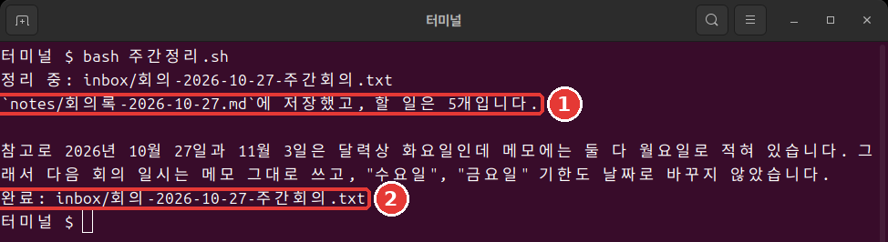

# 第10章 1行実行と自動化

<Badge type="tip" text="必須" /> この段階を進めるなら、必ず読んでください。

> **一言まとめ**: `claude -p` は一度答えたら終わります。書き込みは前もって許可し、成功は終了コードで判断します。この3つを組み合わせると、コマンド1行で動く週ごとの整理になります。

この章の出力は、2026年11月6日にLinuxでClaude Code 2.1.318を実行した結果です。難しく感じても大丈夫です。ひとつずつ見ていけば、前の章で作ったものをつなげるだけの作業です。

## claude -pと対話形式の違い

`-p`（または `--print`）を付けると、対話なしで一度答えて終わります。[^headless] `/exit` で抜けて、ターミナルで練習フォルダに移動してから入力します。

```bash
claude -p "inboxフォルダにファイルがいくつあるか、1行だけで答えて。"
```

「inboxフォルダにはファイルが1個あります。」と答えて、すぐにシェルに戻りました。

対話形式の `claude` は、自分が抜けるまで続き、自動（auto）モードで始まります。`claude -p` は答えを出したら終わり、手動（Manual）モードで始まります。[^headless] 同じ仕事を人なしで動かすときだけ、`-p` が必要です。それ以外は対話形式で十分です。

<Quiz id="ch810-print" />

## なぜ書き込みが止められるのか

今度は、ファイルを作ってほしいと頼んでみます。4章のファイルを上書きしないように、名前を `minutes-one-line.md`（議事録-1行）にします。

```bash
claude -p "inboxの会議メモを読んで、minutes-one-line.md ファイルに整理して保存して。"
```

ファイルはできません。答えは「ファイル書き込みの権限が承認されておらず」と知らせます。故障ではありません。`-p` は手動モードで始まりますが、聞く相手がいません。そのため、承認が必要な呼び出しは拒否されます。[^headless] 必要なツールを前もって許可すればOKです。[^headless]

```bash
claude -p "inboxの会議メモを読んで、minutes-one-line.md ファイルに整理して保存して。答えは1行で。" --allowedTools "Read,Write"
```

`--allowedTools` は、聞かずに使ってよいツールを前もって決めるオプションです。`Read` はファイルの読み込み、`Write` はファイルの書き込みです。カンマでつなげて書き、引用符で囲みます。

今度はファイルができました。`ls` で見つからなければ、`ls notes` も見てください。8章のルールのせいで、そちらに保存されることがあります。

許可は、何が必要かわからないからと広く与えるより、この仕事に必要な `Read,Write` だけを与えるほうがよいです。狭く許可すれば、Claudeが判断を誤っても、できることがそのぶん少なくなります。

<Quiz id="ch810-allow" />

## パイプで内容を渡す

**パイプ**（Pipe、`|`）は、前のコマンドの出力を、後ろのコマンドの入力として渡す記号です。水が管を通って流れる様子を思い浮かべてください。`claude -p` も、パイプで内容を受け取れます。[^headless]

```bash
cat inbox/meeting-2026-10-27-weekly.txt | claude -p "このメモから、ToDoだけを3行で抜き出して。"
```

```text
- ソヨン: トイレの電球を今日（10/27）買う
- ソヨン: セットメニュー表の文言の下書きを水曜日までに作成
- ジュノ: ホットワインの原価を金曜日までに調べてくる
```

**Windowsでは**、パイプで渡したハングル（韓国語の文字）が文字化けすることがあります。答えがおかしければ、パイプの代わりに、ファイル名の前に `@` を付けて渡してください。`ファイル名` は、実際のメモの名前に置き換えます。このコマンドはLinuxで実行して確かめましたが、Windowsでは試していません。

```bash
claude -p "@inbox/ファイル名 から、ToDoだけを3行で抜き出して。"
```

**信頼できない内容は、そのままパイプで渡さないでください。**[^security] Webから取ってきた文章や、知らない人からのメールがそうです。文章の中に、[7章](07-permissions-undo.md)で見たプロンプトインジェクションが隠れていることがあります。[^security] プロンプトインジェクションは、文章の中にAIへの指示をこっそり混ぜて、おかしなことをさせる手口です。

練習用のメモ [meeting-2026-10-29-adhoc.txt](/practice/ja/notes/inbox/meeting-2026-10-29-adhoc.txt)（会議-臨時会議）に、そういう文の例があります。今はリンクをクリックして、ブラウザで読むだけにしてください。まだ `inbox` フォルダには入れません。このあと作るスクリプトが、`inbox` のメモをすべて処理するからです。このメモは、[13章](13-cost-safety-trouble.md)で安全に扱う方法を学ぶときに入れます。

<Quiz id="ch810-pipe" />

## 出力を保存して形を変える

答えをファイルで受け取りたければ、最後に `> todo.txt`（ToDo.txt）を付けます。[^headless] 画面には出ず、ファイルに入ります。同じ名前のファイルがあると上書きされるので、気をつけてください。

この章の実習には、下のJSON出力は必要ありません。こういうものがある、とだけ覚えておいてください。

別のプログラムが答えを読む必要があるなら、[8章](08-memory-settings.md)で見たJSON形式で受け取ります。[^headless] `claude -p "1+1は？ 数字だけ。" --output-format json` のように書きます。長い1行が出てきます。答えは `result` の欄にあります。

`total_cost_usd` の欄には、ドルの金額があります。驚かなくて大丈夫です。プログラムが計算した推定値なので、実際の請求額とは違うことがあります。[^headless] サブスクリプションの利用者にとって、セッションの費用の数字は請求の基準としては意味がありません。[^costs]

<Quiz id="ch810-output" />

## 回数の制限と終了コード

人がいないときに、Claudeが長く動き続けると困ります。`--max-turns` で、ターン（Claudeが仕事を続ける1回分）の回数に上限を設けます。基本は無制限です。[^max-turns] わざと1に減らしてみます。

```bash
claude -p "inboxフォルダのメモをすべて読んで、3行で要約して。" --allowedTools "Read" --max-turns 1
echo $?
```

```text
Error: Reached max turns (1)
1
```

いちばん下の `1` が **終了コード**（Exit code）です。成功すれば0、失敗すれば0以外の値です。[^headless] 人は文字を読み、スクリプトはこの数字を読みます。`echo $?` は、直前のコマンドの終了コードを表示します。PowerShellでは `$LASTEXITCODE` と入力します。

<Quiz id="ch810-exit" />

## weekly-summary.shを作る

いよいよ部品を組み合わせます。**スクリプト**（Script）は、コマンドをファイルに書いて、一度に実行するものです。[8章](08-memory-settings.md)の `CLAUDE.md` と `notes` フォルダ、[9章](09-skills-extensions.md)のスキルが必要です。`/exit` で抜けて、ターミナルで練習フォルダに移動します。MacとLinuxでは、下をまるごと貼り付けます（ファイルで見る: [ch10-weekly-summary.sh.txt](/practice/ja/cli/results/ch10-weekly-summary.sh.txt)）。

```bash
cat > weekly-summary.sh <<'EOF'
#!/bin/bash
# inbox の会議メモをひとつずつ議事録に整理する。
for memo in inbox/meeting-*.txt; do
  echo "整理中: $memo"
  if claude -p "/meeting-notes $memo" --allowedTools "Read,Write" --max-turns 10; then
    echo "完了: $memo"
  else
    echo "失敗: $memo"
  fi
done
EOF
```

貼り付けたあと、まだ実行されていなければ、Enterをもう一度押してください。何も表示されなければ成功です。`ls` で、`weekly-summary.sh`（週ごとの整理）ができたかを見てください。

いちばん上の行 `#!/bin/bash` は、このファイルをbash（シェルの一種）で読むようにという印です。`#` で始まる次の行は、人が読むための説明です。`for` の行は、名前が `meeting-`（会議-）で始まるメモをひとつずつ `memo` に入れます。ここで `memo` は **変数**（Variable）です。値を一時的に入れておく名札だと考えてください。名前の前に `$` を付けて `$memo` と書くと、その中に入っている値を取り出して使います。1回目なら、`$memo` は `inbox/meeting-2026-10-27-weekly.txt` に置き換わります。

`if` の行は9章のスキルを呼び、終了コードが0なら `完了`、そうでなければ `失敗` と表示します。

変数の名前は、`memo` のように英語で書きます。bashは、ハングルの変数名を受け付けません。ファイル名はハングルでもかまいません。

実行は1行です。

```bash
bash weekly-summary.sh
```



```text
整理中: inbox/meeting-2026-10-27-weekly.txt
`notes/minutes-2026-10-27.md`に保存しました。ToDoは5個です。

なお、メモには10/27と11/3が月曜日と書かれていますが、2026年のカレンダーではどちらも火曜日なので、曜日と日付はメモのままにしました。
完了: inbox/meeting-2026-10-27-weekly.txt
```

人が何も押していないのに、議事録ができました（[結果を見る](/practice/ja/cli/results/ch10-minutes-by-script.txt)）。自分の結果と文が違っても、3つの節と表があればOKです。

**Windowsでは**、このスクリプトはPowerShellでそのままでは動きません。bash用だからです。下のPowerShell用を使ってください。MacとLinuxは、この部分を飛ばしてかまいません。

同じことをPowerShellで書くと、下のようになります。実行するたびに、このボックスをウィンドウに貼り付けます。実際には試していない例です。WSLを使うなら、WSLのターミナルの中で上のスクリプトを実行します。[^wsl]

```powershell
foreach ($file in Get-ChildItem inbox/meeting-*.txt) {
  $memo = "inbox/$($file.Name)"
  Write-Output "整理中: $memo"
  claude -p "/meeting-notes $memo" --allowedTools "Read,Write" --max-turns 10
  if ($LASTEXITCODE -eq 0) { Write-Output "完了: $memo" } else { Write-Output "失敗: $memo" }
}
```

<Quiz id="ch810-script" />

## サブスクリプションのアカウントで知っておくこと

サブスクリプションのアカウントなら、2つだけ覚えておいてください。

- スクリプトを実行する前と後に、利用量を一度ずつ見ます。セッションの中で `/usage` と入力すると、利用量のバーが出ます。[^costs]
- ほかの記事で `--bare` というオプションを勧められても、付けないでください。

`-p` の実行が、サブスクリプションの上限からどう差し引かれるかは、このガイドが確認した公式ドキュメントには書かれていません。だから推測せずに、`/usage` で直接見るほうが確実です。

`--bare` を付けてはいけない理由はこうです。公式ドキュメントはスクリプトに `--bare` を勧めていますが、`--bare` はサブスクリプションのログイン情報を読みません。`CLAUDE.md` とスキルも読み込みません。[^bare] 私たちのスクリプトには、3つとも必要です。

逆に、`--bare` なしで `-p` を使うと、そのフォルダの設定を読み込みます。一度も信頼したことのないフォルダのフックやMCPサーバーもそうです。[^bare] だから、中身を知っている自分のフォルダでだけ実行してください。

<Quiz id="ch810-subscription" />

## 席を外す前の点検

任せて席を外す前に、3つを確認してください。[^unattended] 私たちのスクリプトに当てはめると、こうなります。

- 終わりはどんな状態か？ メモごとに議事録ファイルがひとつ `notes` にできれば終わり。
- 自分の仕事を確認できるか？ 終了コードで `完了` と `失敗` を分ける。
- 触るべきものだけを触るか？ `Read,Write` だけを許可したが、フォルダを制限したわけではない。だから練習フォルダでだけ実行する。回数は `--max-turns 10` でしばった。

スクリプトは、`inbox` の会議メモをすべて処理します。だから、新しいメモを入れてから実行します。読んでいないメモは入れないでください。それに、終了コード0は、正常に終わったという意味にすぎません。議事録の内容まで正しいという意味ではありません。最初の数週間は、結果を自分で読んでみてください。

<Quiz id="ch810-unattended" />

## やってみよう

1. ターミナルで、読むだけの質問を `claude -p` で送り、書き込みの依頼を許可なしで送ってみます。`ls` で、ファイルができていないことを確かめます。
2. `--allowedTools "Read,Write"` を付けて、もう一度送ります。
3. パイプでToDoを抜き出して保存します。Windowsで答えがおかしければ、前に出てきた `@` の方法を使います。

   ```bash
   cat inbox/meeting-2026-10-27-weekly.txt | claude -p "このメモから、ToDoだけを3行で抜き出して。" > todo.txt
   ```

4. `--max-turns 1` でわざと失敗させ、終了コードを見ます。
5. `weekly-summary.sh` を作り、`bash weekly-summary.sh` で実行します。Windowsは、上のPowerShellのコードボックスを貼り付けます。

自分に聞いてみてください。人なしで動いたか？ 結果はメモと合っているか？ 来週メモが増えても、同じコマンドで済むか？

## まとめ

- `claude -p` は手動モードで始まり、聞く相手がいない。書き込みは `--allowedTools` で前もって許可する。
- 信頼できない内容はパイプで渡さない。JSONの費用は推定値である。
- `--max-turns` で回数をしばり、終了コードで成功を判断する。
- bashの変数名は英語で書く。bashスクリプトは、PowerShellではそのままでは動かない。
- サブスクリプションのアカウントでは `--bare` を使わず、利用量は `/usage` で直接見る。

## 用語まとめ

| 用語 | 読み方 | 一言でいうと |
|---|---|---|
| Pipe | パイプ | 前のコマンドの出力を後ろに渡す記号 |
| Exit code | イグジットコード | 終わるときに残す数字（0が成功） |
| Script | スクリプト | コマンドを書いて一度に実行するファイル |

<ChapterDone :chapter="810" />

次の章: [第11章 フックと画面のカスタマイズ](11-hooks-statusline.md)

[^headless]: Claude Code公式ドキュメント、「Run Claude Code programmatically」。"Add the `-p` (or `--print`) flag to any `claude` command to run it non-interactively." / "With Claude Code v2.1.302 or later, `claude -p` runs start in Manual mode when nothing sets a permission mode." / "In a Manual mode `claude -p` run, a call that needs approval is denied unless something approves it" / "Use `--allowedTools` to let Claude use certain tools without prompting." / "Non-interactive mode reads stdin, so you can pipe data in and redirect the response out like any other command-line tool." / "`json`: structured JSON with result, session ID, and metadata" / "Both figures are client-side estimates and can differ from your actual bill." / "Claude Code exits with code 0 on success and a non-zero code when the run fails, so your scripts can branch on the exit status." https://code.claude.com/docs/en/headless （確認日 2026-11-06）
[^security]: Claude Code公式ドキュメント、「Security」。"Avoid piping untrusted content directly to Claude" / "Prompt injection is a technique where an attacker attempts to override or manipulate an AI assistant's instructions by inserting malicious text." https://code.claude.com/docs/en/security （確認日 2026-11-06）
[^costs]: Claude Code公式ドキュメント、「Manage costs effectively」。"Claude Pro, Max, and Ultra subscribers have usage included in their subscription, so the session cost figure isn't relevant for billing purposes." / "Subscribers see plan usage bars, activity stats, and a usage breakdown on the same screen." https://code.claude.com/docs/en/costs （確認日 2026-11-06）
[^max-turns]: Claude Code公式ドキュメント、「CLI reference」。"Limit the number of agentic turns (print mode only). No limit by default." https://code.claude.com/docs/en/cli-reference （確認日 2026-11-06）
[^wsl]: Claude Code公式ドキュメント、「Advanced setup」。"You install and launch `claude` inside the WSL terminal, not from PowerShell or CMD." https://code.claude.com/docs/en/setup （確認日 2026-11-06）
[^bare]: Claude Code公式ドキュメント、「Run Claude Code programmatically」。"`--bare` is the recommended mode for scripted and SDK calls, and will become the default for `-p` in a future release." / "In bare mode, Claude Code never reads OAuth credentials or the system keychain." / "Add `--bare` to reduce startup time by skipping auto-discovery of hooks, skills, custom commands, subagents, installed plugins, MCP servers, auto memory, and CLAUDE.md." / "Without `--bare`, a `-p` session runs the hooks in a project's `.claude/settings.json` and connects the servers in its `.mcp.json`, even in a folder you've never trusted." https://code.claude.com/docs/en/headless （確認日 2026-11-06）
[^unattended]: Claude Code公式ドキュメント、「Best practices for Claude Code」。"Before a run goes unattended, make sure it knows what done looks like, can check its own work, and can only touch what it should." https://code.claude.com/docs/en/best-practices （確認日 2026-11-06）
