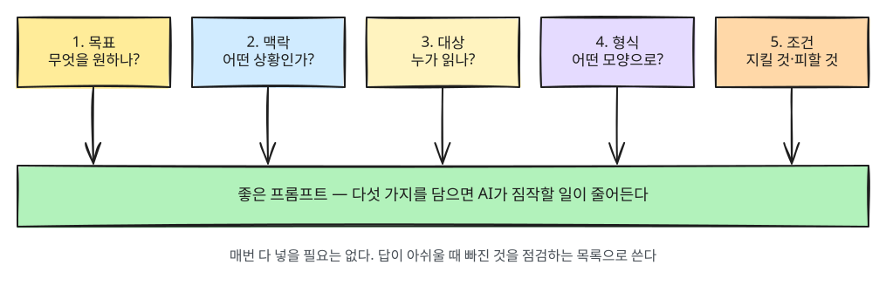

# 第4章 提示词基础

> **一句话总结**：好的提示词，就像你写给一位刚认识的能干同事、请他帮忙做事的那段话。
> 他很聪明，但对你的情况一无所知。

## 什么是提示词

**提示词（prompt）** 是你发给 AI 的请求。你在聊天框里输入的每一段话，都是提示词。

在[第1章](01-what-is-llm.md)里说过，AI“不了解我的情况”。所以提示词的关键，就是
**把 AI 不知道的事告诉它**。

想象一下，你要把一件事交给新来的能干同事。如果你只说“帮我写份报告”，同事一定会反问你：
是什么报告？谁来看？写多长？因为这些他都不知道。
AI 大多不会反问，而是直接猜着写。所以，一开始就告诉它吧。

<Quiz id="ch4-what" />

## 好提示词的5个要素

不用每次都把所有要素写全。当你对回答不满意时，把它当作检查清单就行，看看缺了哪一项。

| 要素 | 问题 | 例子 |
|---|---|---|
| **1. 目标** | 你想要什么？ | “帮我写一封拒绝邮件” |
| **2. 背景** | 现在是什么情况？ | “合作方要求把交货期限推迟2周” |
| **3. 对象** | 谁来读？ | “对方是合作了10年的合作方部长” |
| **4. 格式** | 想要什么样子？ | “五句话以内，礼貌的敬语” |
| **5. 条件** | 必须遵守或避免什么？ | “保留对下次合作的期待。不要过分道歉” |



把五个要素都放进去，就是这样：

```
合作方要求把交货期限推迟2周，但因为我们这边的上市日程，很难答应。
请帮我写一封回信。对方是合作了10年的合作方部长。
请用五句话以内、礼貌的敬语来写，并保留对下次合作的期待。
不要过分道歉。
```

<Quiz id="ch4-five" />

## 通过前后对比来掌握

### 例1. 摘要

**不够好的提示词**

```
帮我总结一下这篇文章。
```

**好的提示词**

```
我想把下面这篇文章分享到公司的群聊里。请总结成核心三句话，
让忙碌的同事30秒内就能读完，再补一句我们团队（线上营销）可以参考的地方。

[粘贴文章]
```

好的提示词多了四样东西：背景（分享到群聊）、对象（忙碌的同事）、格式（三句话加一句话）、目标（我们团队可以参考的地方）。

### 例2. 听讲解

**不够好的提示词**

```
汇率是什么？
```

**好的提示词**

```
我是第一次看经济新闻的高中生。请用一个简单的比喻解释汇率是什么。
再举一个数字的例子，说明汇率上涨时出国旅游为什么会吃亏，
最后告诉我看新闻里的汇率报道时，值得记住的三点。
```

好的提示词多了两样东西：对象（第一次看经济新闻的高中生）和格式（比喻加数字例子加三点）。

得到的回答大致会这样不同。实际的回答会因服务而异，每次也不一样。

| | 不够好的提示词得到的回答 | 好的提示词得到的回答 |
|---|---|---|
| 第一句 | “汇率是一国货币与另一国货币的兑换比率，随外汇市场的供求而…” | “汇率就是把我们的钱换成别国的钱时的‘价目表’。” |
| 例子 | 几乎没有 | “如果1美元从1,300韩元变成1,400韩元，住一晚100美元的酒店，就不是付13万韩元，而是要付14万韩元。” |
| 读完之后 | 术语很多，但没什么实感 | 和自己的生活联系起来，马上就懂 |

### 例3. 点子

**不够好的提示词**

```
帮我推荐店名。
```

**好的提示词**

```
我打算在居民区开一家手工贝果小店，想给它起个名字。
顾客主要是早上上班路上的上班族，以及周末带家人来的客人。
请推荐10个好叫的韩文或英文名字，并在每个后面用一句话说明给人什么感觉。
带有“贝果”这个词的名字不要超过3个。
```

好的提示词多了四样东西：背景（社区和行业）、对象（顾客群）、格式（10个加一句话说明）、条件（词语数量限制）。

<Quiz id="ch4-compare" />

## 马上就能用的三个习惯

1. **试着用“我是○○，我想做○○”开头。** 只这一句，背景和目标就都有了。
2. **想要的样子，试着用数字来说。** 不说“短一点”，而说“三句话”；不说“多一点”，而说“10个”。
3. **不满意时，不要从头重写，而是接着让它修改。** 比如这样说：
   “第二句话太生硬了。请改得再柔和一点。”

<Quiz id="ch4-habits" />

## 亲自试一试

挑一件你最近真正在烦恼的事，填一填下面的空格，做出一个提示词。

```
我是[我是谁]，我想[要做什么]。
[说明情况]。
为了[谁来读／为谁而做]，
请用[想要的格式和篇幅]来[想要的结果]。
[必须遵守或避免的事]。
```

然后，和不填空格、只用一句话问出来的结果比一比。哪一个更符合我的情况？哪一个需要修改得更少？

## 小结

- 提示词的关键，是把 AI 不知道的我的情况告诉它。
- 把目标、背景、对象、格式、条件这五项当作检查清单。
- 不需要一次完美。边聊边改就好。

<ChapterDone :chapter="4" />

下一章：[第5章. 提示词模式](05-prompt-patterns.md)
