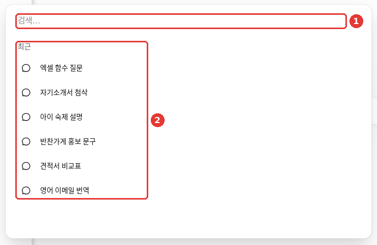
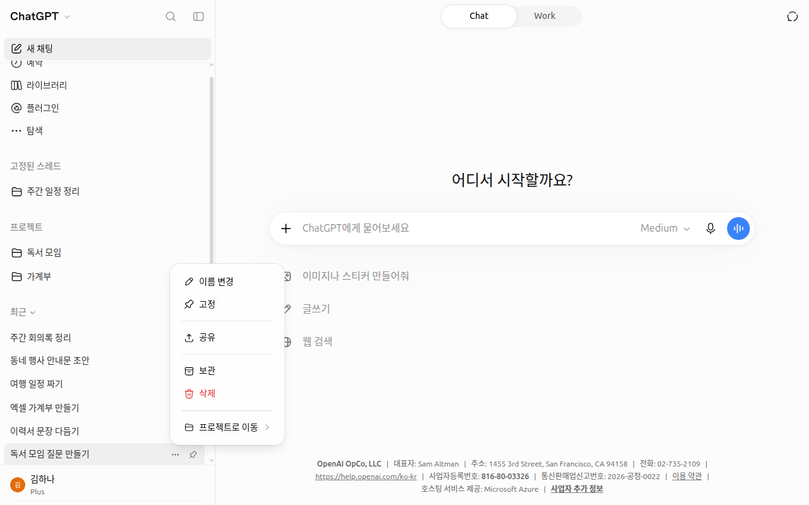
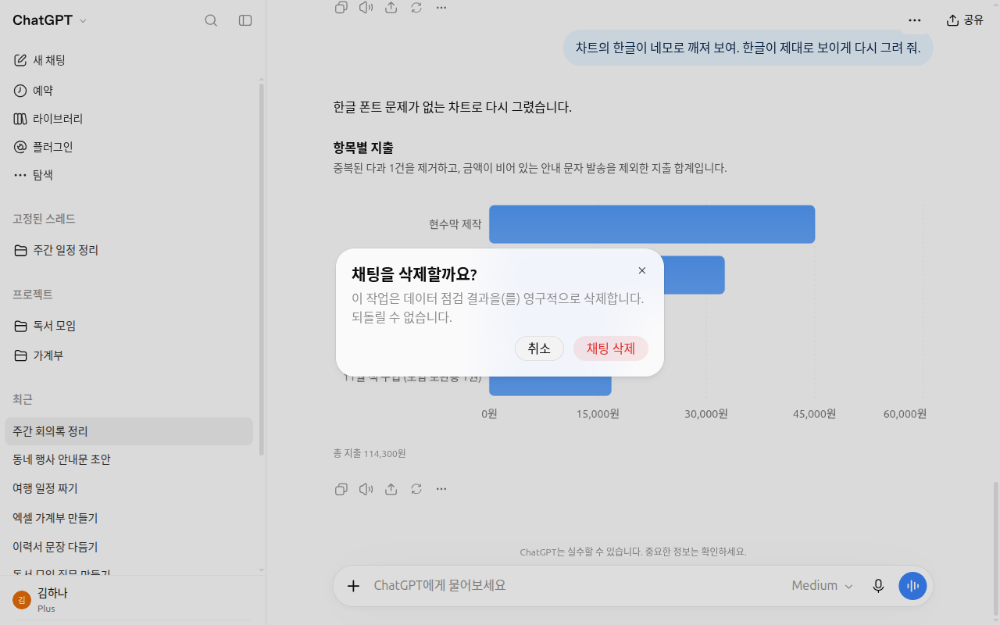

# 第3章 管理对话——查找、整理、分享、隐藏

> **一句话总结**：对话攒多了，就用**搜索**去找；不用的就**归档**或**删除**。
> 给别人看的时候用**分享链接**，不想留下记录的时候用**临时聊天**，怕旁边的人看到的对话用**锁定的对话**。

界面以2026年10月的网页版（Plus 套餐）为准。免费套餐或手机应用里，菜单的位置可能略有不同。

## 开始新聊天

点侧边菜单最上面的「新聊天（새 채팅）」，会打开一个空白对话。发出第一个问题后，这个对话就会出现在侧边菜单的「最近（최근）」列表里。

什么时候最好开一个新聊天，你在第1阶段已经学过了。话题变了、总是忘记最初的指示、对话太长了，就是这些时候（[第1阶段 第6章](../00-common/06-conversation.md)）。
在 ChatGPT 里也同样适用。要搬一段很长的对话时，请这样让它写一份交接备忘，再粘贴到新聊天里。

```
我想在新聊天里接着这段对话。请把到目前为止定下的内容、我的喜好、剩下的事，分条整理出来。
```

::: details 收到的回答大概是这样（示例——点击展开）
这是本指南编的示例。实际的回答会因服务和当时的情况而不同。

如果是讨论家庭旅行的对话，会是这样的样子。

> **到目前为止定下的内容**
> - ○月第○周，○晚○天
> - 和父母一起去的旅行
>
> **我的喜好**
> - 步行的行程要短
> - 住的地方要安静
>
> **剩下的事**
> - 在○个住处候选里选一个
> - 定下第一天晚上吃饭的餐厅

**检查一下有没有收好**：是不是分成了定下的内容、我的喜好、剩下的事三组？对话里定下的事有没有漏掉？还没定的事有没有被写得像已经定了？

:::

<Quiz id="ch103-new" />

## 查找以前的对话——聊天搜索

点侧边菜单最上面的**放大镜**（「搜索（검색）」），会弹出搜索窗口。用键盘的话，Windows 是 Ctrl+K，Mac 是 Cmd+K。[^search]



对话标题和账号名称是改成示例的画面。① 在「搜索…（검색…）」栏里输入词语；什么都不输入的话，② 会显示「最近（최근）」对话列表。

如果想找"上周问 Excel 函数的那次对话"，在 ① 「搜索…」栏里只写 `Excel` 也可以。有几点要知道。[^search]

- **聊天搜索不是互联网搜索。** 它只在我的对话、项目、文件里查找。想在互联网上查，请用 + 菜单里的「网页搜索」（[第6章](06-search.md)）。
- **删除的对话不会出现，归档的对话会出现。** 归档和删除的区别，下一节再看。

<Quiz id="ch103-search" />

## 整理对话——置顶、归档、删除

在侧边菜单里对话旁边的**更多菜单**（•••，三个点的按钮）里整理对话。[^delete]



*对话标题和名称是改成示例的画面。*

菜单里有「重命名」「置顶」「分享」「归档」「删除」「移到项目」。[^screen-menu] 对话的名称用「重命名」来改。经常打开的对话，点「置顶」，它就会固定在侧边菜单上方的「已置顶的对话（고정된 스레드）」里。

### 归档和删除不一样

| | 「归档」 | 「删除」 |
|---|---|---|
| 在侧边菜单里 | 消失 | 消失 |
| 确认窗口 | 没有，直接归档 | — |
| 在聊天搜索里 | **会出现** | 不会出现 |
| 恢复 | 用「取消归档」恢复 | **无法恢复**（客服团队也救不回来） |
| 在公司服务器上 | 仍然保留 | 会被安排在30天内永久删除 |

出处：OpenAI 帮助[^delete]

可以把**归档**想成放进抽屉里收着，**删除**想成扔掉。拿不准的话，先归档。归档可以恢复，删除却无法恢复。
归档的对话，可以在设置 → 「已归档的聊天（보관된 채팅）」里重新取出来。

在侧边菜单里看不到某个对话，并不代表它被删掉了。[^mobile] 先看看是不是用同一个账号登录的（[第1章](01-getting-started.md#注册并登录)），再用聊天搜索找一找。归档的对话也会出现在搜索里。

点「删除」后，会弹出确认窗口："此操作将永久删除（对话标题）。无法恢复。" 要点「删除聊天」才会真正删除。[^screen-menu]



想一次性整理的话，可以用设置 → 「数据管理（데이터 관리）」里的「归档所有聊天」或「删除所有聊天」。**「删除所有聊天」无法恢复。**[^delete]

> **删除了对话，文件还在。** 如果在对话里上传的文件另外保存在「资料库」里，那么删除对话并不会删除文件。文件要到资料库里另外删除（[第4章](04-files-images.md)）。[^delete]

<Quiz id="ch103-archive-delete" />

## 把对话给别人看——分享链接

想把对话给别人看，请点对话界面里的「分享」。点界面上出现的「创建链接」或「复制链接」，再粘贴到聊天软件里就可以了。
链接地址的样子是 `https://chatgpt.com/share/…`。[^share]

<!-- 需要截图：在对话界面点「分享」后出现的创建链接窗口（网页版） -->

请记住，分享链接是**像拍照一样留下那个瞬间**（快照，snapshot）。[^share]

- **创建链接之后继续的对话不会包含在内。** 想把新内容也让别人看到，要点「更新链接」。
- **拿到链接的人，谁都能看。** 无法限制成只有特定的人看，链接也可能传到别处。
- **没有到期日。** 它不会自己消失。不需要了，请自己删除。
- 默认情况下不会显示我的名字（匿名）。

创建过的链接，可以在设置 → 「数据管理」 → 「分享链接——管理」里一个个删除，也可以用「删除所有分享链接」一次性删除。[^share]
分享之前，请先扫一遍对话里有没有姓名、电话号码这样的个人信息（[第1阶段 第9章](../00-common/09-safety.md)）。因为拿到链接的人谁都能看。

<Quiz id="ch103-share" />

## 不留记录——临时聊天

像挑礼物这样不想留下记录的对话，请用**临时聊天**。点右上角的「临时聊天」按钮，画面就会换成临时聊天界面。
第一次打开时，可能会先弹出一个说明窗口。


临时聊天有三个特点。

- **不会留下记录**（图中 ④ 的文字）。不会出现在侧边菜单的对话列表里。不过，**为了安全，可能会保留最多30天的副本**。
- **不会被用来训练。** 这段对话不会被用来训练、让 AI 变得更好。
- **不会生成新的记忆。** 在临时聊天里聊的内容，不会新存进记忆（[第5章](05-memory.md)）。

右上角的**「个性化」**按钮（图中 ①）用来选择，这段对话里要不要使用已经保存的记忆、自定义指令、插件。[^temp][^screen-temp]

| 选项 | 含义 |
|---|---|
| ② 「个性化」（一开始的选择） | 参考保存的记忆、插件、自定义指令来回答 |
| ③ 「不个性化」 | 不使用记忆、插件、自定义指令来回答（可能会用到为了安全而有限的信息） |

**必须在发送第一条消息之前选好。** 对话开始后就不能更改了。[^temp] 以前没有这个选项。如果界面和本指南不同，请以界面为准。

> **临时聊天里也有用不了的功能。** 在2026年10月的网页界面里，临时聊天的 + 菜单中「生成图片」是灰色关闭的，也没有「深度研究」这一项。「添加照片和文件」和「网页搜索」可以使用。

需要知道的事。

- **并不是"哪里都不留"。** 可能会保留最多30天的副本。密码这类信息，在临时聊天里也不要输入。[^temp]
- 在临时聊天里上传的文件，不会保存到「资料库」。[^library]
- 以后也可以把它保存成普通对话。那样的话，就会像普通对话一样，遵循账号的训练设置。[^temp]
- 想在没有我的信息的情况下得到一个干净的回答，请选「不个性化」再开始。

<Quiz id="ch103-temporary" />

## 不让别人打开——锁定的对话

和家人共用电脑，但不想让别人看到健康咨询的对话时，请用**锁定的对话**。这是从2026年10月20日起陆续开放的功能。[^rn-lock]

1. 点要锁定的对话的更多（•••）→ 「锁定对话」。
2. 锁定的对话会集中在「项目」 → 「锁定的对话」里。
3. 打开时要输入**4位账号 PIN**（我自己定的数字密码）。在手机上，也可以用 Face ID 这样的生物识别。

账号 PIN 在设置 → 「安全与登录（보안 및 로그인）」里设定。[^lock] 在手机应用里，过1分钟会重新锁上。也就是离开锁定的对话1分钟，或者应用退到后台（在后台）1分钟的时候。

<!-- 需要截图：侧边菜单「项目」 → 「锁定的对话」里询问 PIN 的界面（网页版） -->

有几个一定要知道的限制。[^lock]

- **它是遮挡板，不是保险柜。** 并没有另外做加密（把内容变成别人读不了的样子）。保留期限和训练设置也都照旧。
- **忘记 PIN 重新设置的话，所有锁定的对话都会被永久删除。** 里面的文件也会一起删掉，客服团队也救不回来。请一定记住 PIN。
- 临时聊天、已归档的聊天、通过分享链接创建的聊天等部分对话，无法锁定。

<Quiz id="ch103-locked" />

## 亲自动手试试

1. 点「新聊天」，问"请推荐下个月家庭旅行的三个目的地"。
2. 按放大镜（Ctrl+K），用 `旅行` 找一下刚才的对话。
3. 把那个对话「归档」之后，再搜索一次，确认它会不会出现；然后在设置 → 「已归档的聊天」里「取消归档」。
4. 打开「临时聊天」，随便问个问题，然后回到新聊天，确认侧边菜单的「最近」里没有那个对话。

**连续任务**（[筹备读书会](../00-common/practice-kit.md)）：在放大镜（Ctrl+K）里输入 `读书`，找一找前一章里聊过的读书会对话。

## 小结

- 聊天搜索只在我的对话里查找。归档的对话会出现，删除的对话不会出现。
- 归档可以恢复，删除无法恢复。拿不准就先归档。
- 分享链接是创建那一刻的快照，拿到链接的人谁都能看，也不会过期。
- 临时聊天不进记录、不用于训练，也不会生成新的记忆，但可能会留下最多30天的副本。要不要使用已保存的记忆和指令，在开始前用「个性化」/「不个性化」来选。
- 锁定的对话是用 PIN 遮起来的功能。重新设置 PIN，锁定的对话就会全部被删掉。

## 术语解释

| 术语 | 中文名称 | 一句话解释 |
|---|---|---|
| Archive | 归档 | 从列表里收起来，但不删除 |
| Shared Link | 分享链接 | 把对话给别人看的网址 |
| Snapshot | 快照 | 把某一瞬间的样子原样留下来 |
| Temporary Chat | 临时聊天 | 不进记录、不用于训练、不生成新记忆的对话 |
| Personalized | 个性化 | 参考保存的记忆和指令，按我的情况来回答的状态 |
| Locked Chat | 锁定的对话 | 要输入 PIN 才能打开的对话 |
| PIN | PIN 码 | 用来确认本人的短数字密码 |
| Encryption | 加密 | 把内容变成只有指定的人才能读的样子 |

<ChapterDone :chapter="103" />

下一章：[第4章. 文件、照片与生成图片](04-files-images.md)

[^search]: OpenAI 帮助，「Finding your chats, projects, and files in ChatGPT」。"press Ctrl+K on Windows or Cmd+K on macOS" / "Sidebar search finds your existing content. It does not search the web." https://help.openai.com/en/articles/10056348 （确认日期 2026-10-23）
[^delete]: OpenAI 帮助，「Deleting and archiving chats in ChatGPT」。"schedules it for permanent deletion from its systems within 30 days" / "You cannot restore a deleted chat" / "No confirmation is required." / "Archived chats remain searchable." / "The Delete all chats action cannot be undone." / "Deleting a chat does not delete files saved separately in Library." https://help.openai.com/en/articles/8809935 （确认日期 2026-10-23）
[^share]: OpenAI 帮助，「Sharing conversations and scheduled tasks in ChatGPT」。"Messages added later are not included automatically." / "Shared links do not have configurable expiration dates." / "Personal-account links are available to anyone who has the link." / "anonymous by default" / "Shared conversation links begin with https://chatgpt.com/share/." https://help.openai.com/en/articles/7925741 （确认日期 2026-10-23）
[^temp]: OpenAI 帮助，「Temporary chat in ChatGPT」。"OpenAI may keep a copy of a temporary chat for up to 30 days for safety purposes." / "Saving converts it into a regular chat" / "Choose Personalized or Unpersonalized before you send your first message." / "Neither option creates or updates memories while the chat remains temporary. You cannot change personalization after the conversation starts." https://help.openai.com/en/articles/8914046 （确认日期 2026-10-24）
[^screen-temp]: 在 ChatGPT 网页界面（Plus 套餐，韩语）上亲自确认。临时聊天界面的「个性化」菜单——"이 채팅은 메모리, 플러그인, 사용자 지정 지침을 참조할 수 있습니다" / "이 채팅에서는 메모리, 플러그인, 사용자 지정 지침을 무시합니다" （确认日期 2026-10-24）
[^library]: OpenAI 帮助，「Using Library to manage files in ChatGPT」。"files uploaded while using Temporary Chat are not saved to your account or Library". https://help.openai.com/en/articles/20001052 （确认日期 2026-10-23）
[^mobile]: OpenAI 帮助，「Troubleshooting the ChatGPT mobile app」。"A chat missing from the sidebar hasn't necessarily been deleted." https://help.openai.com/en/articles/7910461 （确认日期 2026-10-24）
[^rn-lock]: OpenAI 帮助，「ChatGPT release notes」2026-10-20 条目。"Open them with your 4-digit account PIN". https://help.openai.com/en/articles/6825453 （确认日期 2026-10-23）
[^lock]: OpenAI 帮助，「Using locked chats in ChatGPT」。"You can find your locked chats under Projects > Locked chats." / "It does not: create end-to-end encryption or a separate encrypted vault" / "Resetting your account PIN permanently deletes all locked chats" / "Access ends automatically after 1 minute away" / "The Lock chat option is unavailable for some conversation types". https://help.openai.com/en/articles/20001411 （确认日期 2026-10-23）
[^screen-menu]: 亲自确认了侧边菜单里对话的「聊天操作」（•••）菜单和「删除」确认窗口。截图用的对话在拍完之后已删除 （确认日期 2026-10-28，Plus 账号网页界面）
