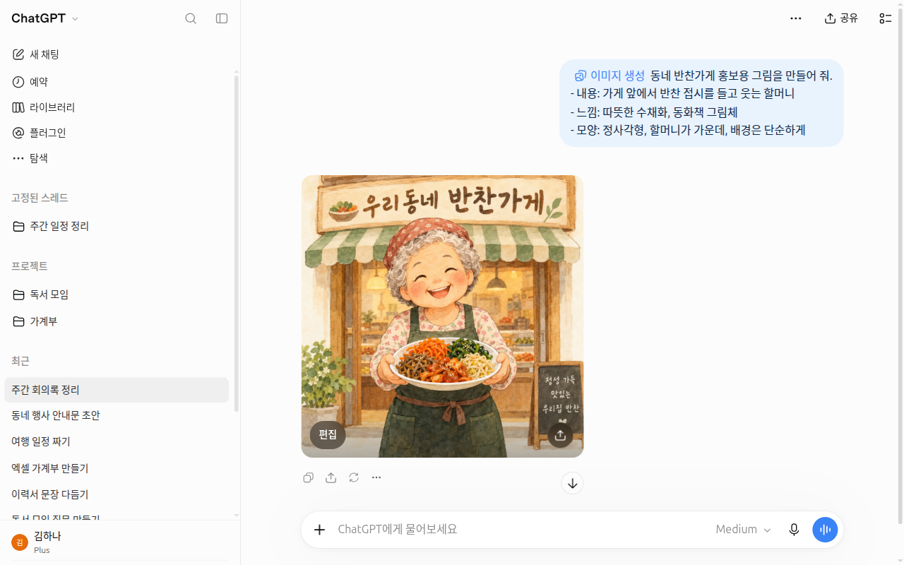
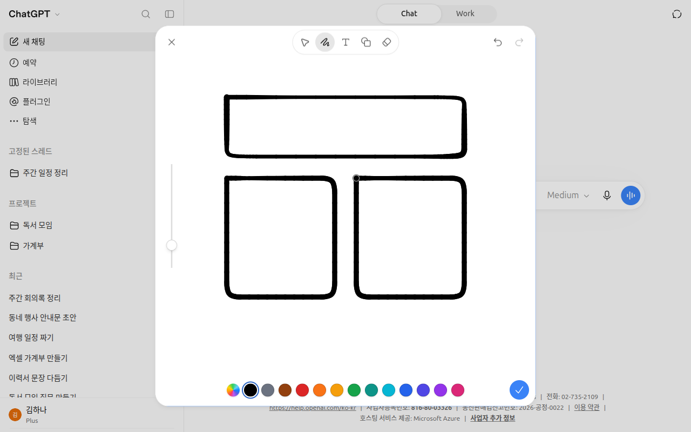

# 第4章 文件、照片与生成图片 — 拿给它看，请它来画

> **一句话总结**：难以用话语说清楚的东西，就**上传照片或文件**给它看；需要的图画，就**请它生成**。
> 上传的文件会汇集在「资料库（라이브러리）」里，可以再次使用。免费套餐每天能上传的文件数量很少。

界面以2026年10月的网页版（Plus 套餐）为准。免费套餐或手机 App 的菜单位置可能略有不同。

## 上传照片和文件

点输入框左边的 + 按钮，选择「添加照片和文件（사진 및 파일 추가）」。然后在你的电脑里选文件就行。[^files]
文件出现在输入框上方后，请把你想用这个文件做什么也一起写成问题，再发送。


对话标题和账号名称已换成示例。这一章用到的是 ① + 按钮、② 「添加照片和文件（사진 및 파일 추가）」、③ 「从资料库导入（라이브러리에서 가져오기）」、④ 「生成图片（이미지 생성）」、⑧ 「草图（스케치）」。

可以上传的东西如下。[^files]

| 种类 | 例子 |
|---|---|
| 照片、图片 | 收据照片、屏幕截图、手写笔记的照片 |
| 文档 | PDF、Word（DOCX）、文本（TXT） |
| 表格 | Excel（XLSX·XLS）、CSV |
| 演示资料 | PowerPoint（PPTX） |
| 声音（仅付费） | WAV、MP3、M4A 录音文件 |

视频也可以作为附件。免费套餐也可以。不过能不能成功，要看设备和上传方式。另外，ChatGPT 也可能无法完全理解整段视频或声音。[^image-faq]

谷歌文档（`.gdoc`）不能直接上传。请先在谷歌文档里下载成 PDF 或 Word，再上传。[^files]
把 PDF 直接上传到对话里，它不只读文字，还会读**里面的图片和图表**。[^files]

比起只上传文件然后说“看看吧”，请把你想要什么也一起写出来。这样得到的回答会好得多。

```
附件的 PDF 是我们公寓的物业费通知单。
请找出比上个月涨得多的三个项目，用表格展示，并用一句话写出你猜测的涨价原因。
不确定的内容请标注“推测”。
```

文件的用处不只是做总结。你可以把以前写得好的文档作为**范本**上传，请它把我的草稿改成同样的结构和语气。把原件和我写的摘要一起上传，还能找出**两者不一致的事实，或原件里没有的内容**。[^academy-content]
```
第一个文件是官方通知（原件），第二个文件是我写的摘要。
请找出我的摘要里和原件不同的事实和数字，以及原件里没有的内容。
```

::: details 得到的回答大致是这样（示例 — 点击展开）
这是本指南制作的示例。实际的回答会因服务和每次情况而不同。

> 和原件对照后，有三处不同。
>
> | 我的摘要 | 原件 | 差异 |
> |---|---|---|
> | “截止 ○月○日” | “截止 ○月△日” | 截止日期不同 |
> | “参加费 ○○韩元” | （原件里没有） | 原件里没有的内容 |
> | “任何人都可申请” | “仅限○○居民申请” | 对象不同 |
>
> 其余内容与原件相同。

**确认一下有没有答好**：和原件不同的事实、数字，有没有一个不漏地找出来？原件里没有的内容，有没有单独标出来？请把回答指出的地方，和真正的原件文件对照一遍。

:::

如果是照片，可以这样写。

```
附件的照片是我家冰箱里面。请只用能看到的食材，推荐两道30分钟内能做好的晚餐。
```

> 身份证、合同、病历这类含有个人信息的文件，上传之前请先遮住或去掉。原则已在[第1阶段第9章](../00-common/09-safety.md)讲过。

上传照片时，也请了解下面这些。[^image-faq]

- **照片里的韩文可能会读错。** 韩文、日文这类非拉丁字母的文字，读得比英文不准确。拍的时候让文字显得大一些，数字请和原件核对。
- **不要用它来判读 CT、X 光这类医学影像。** 这不是合适的用途。
- 如果有想让它重点看的地方，可以用照片编辑 App **画个圈**再上传。这样能让它更关注那一部分。

<Quiz id="ch104-upload" />

## 可以上传的数量 — 各套餐的额度

文件有大小和数量的限制。官方帮助中写明的数值如下。[^files]

| 限制 | 数值 |
|---|---|
| 单个文件的大小（文档、演示资料） | 最多512MB |
| 单个文档的文字量 | 最多200万 token |
| 表格文件（CSV 等） | 约50MB（因内容而异） |
| 单张照片 | 最多20MB |
| 上传数量 | 3小时内最多80个（拥挤时可能更低） |
| **免费（Free）套餐** | **每天最多3个** |
| 我的整个账号的存储空间 | 最多25GB |
| 声音文件 | **仅付费**可上传 |

**token**（词元）是 AI 把文字切成小块来阅读的单位。200万 token 是非常长的篇幅。一般的工作文档很少会碰到这个上限。

在免费套餐里，最先碰到的是**每天3个**。如果需要问好几个文件，请先上传最必要的文件。
如果有好几张照片，把它们拼成一张再上传也是个办法。这样可以省下相应的数量。
额度的数字经常变，所以上面的数值请以确认日期为准。

<Quiz id="ch104-limits" />

## 资料库 — 汇集上传文件的地方

你上传的文件和 ChatGPT 生成的文件，会**自动保存**在侧边菜单的「资料库（라이브러리）」里。资料库在网页上使用。[^library]
想再次使用以前上传的文件，就点 + 按钮 →「从资料库导入（라이브러리에서 가져오기）」。不需要重新上传文件。

<!-- 需要截图：打开侧边菜单「资料库（라이브러리）」的界面（网页，只显示示例文件） -->

资料库能装的容量因套餐而异。[^library]

| 套餐 | 资料库容量 |
|---|---|
| Free | 500MB |
| Go | 4GB |
| Plus · Business | 20GB |
| Pro | 100GB |

需要知道的几点如下。

- **删除对话后，资料库里的文件仍会保留。** 想去掉文件，请在资料库里另外删除。[^delete]
- 删除的文件，有时可以在「最近删除的项目（최근 삭제된 항목）」里恢复。并且会被安排在30天内永久删除。[^library]
- 在**临时聊天**（[第3章](03-chats.md)）里上传的文件不会保存到资料库。[^library]
- **对话里的下载链接很快就会失效。** ChatGPT 生成的文件请马上保存；如果像「Download failed」这样失败了，请让它重新生成。[^errors]

> **资料库正在改成「Space」。** Space 取代资料库，项目则保持不变。[^space] 在 Space 里，除了文件，还可以创建多人一起修改的**页面**（page，文档）。2026年10月24日，在本指南的界面上还显示为「资料库（라이브러리）」。如果侧边菜单里看到「Space」，就当作和这一节的资料库是同一个地方。

<Quiz id="ch104-library" />

## 生成图片

ChatGPT 不只会写字，还会画图。点 + 按钮 →「生成图片（이미지 생성）」，或者点首页推荐的「帮我做图片或贴纸（이미지나 스티커 만들어줘）」。然后描述你想要的图画就行。临时聊天里「生成图片（이미지 생성）」是关闭的，所以请在普通聊天里进行（[第3章](03-chats.md)）。



*这是在下面的示例提示词里，去掉最后的「文字」一行后发送得到的界面。因为没有指定文字，它自己在招牌上写了「우리동네 반찬가게」（我们社区小菜店）。对话和图片在截图后已删除。*[^screen-image]

请它画图时，第1阶段学过的提示词原则也同样适用（[第1阶段第4章](../00-common/04-prompt-basics.md)）。请写进下面四项。这样会更接近你想要的图。

| 要写的内容 | 例子 |
|---|---|
| 画什么 | 站在小菜店门前微笑的奶奶 |
| 什么感觉 | 温暖的水彩，童话绘本的画风 |
| 怎么布局 | 正方形，人物在中间，背景简单 |
| 文字 | 上方写“今日小菜” |

```
请帮我做一幅社区小菜店的宣传图。
- 内容：在店门前端着小菜盘子微笑的奶奶
- 感觉：温暖的水彩，童话绘本的画风
- 形状：正方形，奶奶在中间，背景简单
- 文字：上方用大字写“今日小菜”
```

第一幅图不满意也没关系。就像修改文字时一样，**只指出要改的地方**，再次请求。像“把背景改成夜晚，其余保持不变”这样说就行（[第1阶段第6章](../00-common/06-conversation.md)）。

### 使用参考照片

难以用话语描述的样子，可以一起上传**参考照片**。用「添加照片和文件（사진 및 파일 추가）」附上照片，并说明要模仿什么。

```
附件的照片是我们店的招牌。请保留这块招牌的颜色和字体风格，
做一张秋夕假期休息通知海报。休息日：10月5日~7日。
```

在设置 →「个性化设置（개인 맞춤 설정）」页面里，也有「参考照片（참고 사진）」「全身参考照片（전신 참고 사진）」项目。个性化设置在[第5章](05-memory.md)里讲。

ChatGPT 生成的图片里带有 **C2PA**（记录图片是怎样制作出来的国际标准标签）。[^faq] 它肉眼看不见，是和图片文件一起保存的信息。

关于 AI 生成图片的权利，以及上传别人的照片、作品时的注意事项，请在[第1阶段第9章](../00-common/09-safety.md)里确认。

<Quiz id="ch104-image" />

## 草图 — 亲手画给它看

+ 按钮 →「草图（스케치）」是**在屏幕上亲手画画，再作为图片附上**的功能。界面上的说明是“画一幅画，作为图片附上”。



*画好的图没有附上就关闭了。关闭时会再问一次「要放弃更改吗？（변경 사항을 삭제할까요?）」。*[^screen-sketch]

不需要画得好。把难以用话语说清楚的**布局或形状**大概画出来给它看就行。
比如，用方框和箭头画出传单的布局并附上，然后这样请求。

```
附件的草图是传单的布局。上面的大方框里放店名，中间的圆圈里放招牌菜的照片，
下面的三个小方框里放价格。请按这个布局做一张传单图。
```

<Quiz id="ch104-sketch" />

## 看视频了解更多

这是公司自己制作的介绍视频。界面和功能名称可能与本章的说明不同。

> 下面的视频是**英语**。在 YouTube 视频的设置（齿轮）→ 字幕 → **自动翻译 → 中文**，就可以看到中文字幕。视频可以直接在本页面内播放。

**[Introducing ChatGPT Images 2.5](https://www.youtube.com/watch?v=6l7ble9P74o)** · OpenAI · 想简短了解更快、更清晰的图片生成的人（2026年9月，1分钟）

<YouTube id="6l7ble9P74o" title="Introducing ChatGPT Images 2.5" />

## 亲自试一试

1. 用手机拍下家里的收据或便条，传到电脑上，用「添加照片和文件（사진 및 파일 추가）」上传，并请求“把上面写的内容整理成表格”（请遮住姓名和卡号）。
2. 打开侧边菜单的「资料库（라이브러리）」，确认刚才上传的照片是否已保存。
3. 用「生成图片（이미지 생성）」做出上面的小菜店图画，然后说一次“把背景改成春天的感觉，其余保持不变”来修改它。
4. 用「草图（스케치）」画三个方框附上，并请求“按这个布局做一张生日邀请函”。

**接下来的练习**（[筹备读书会](../00-common/practice-kit.md)）：用「添加照片和文件（사진 및 파일 추가）」上传示例文件 minutes-last-meeting.txt，发送“请把定下来的事、要做的事、还没定的事分成表格。要做的事要写上负责人和期限，没有期限的事写「期限待定」”。把要做的三件事是否全部列出来，和会议纪要对一对。

## 小结

- 通过 + 按钮 →「添加照片和文件（사진 및 파일 추가）」上传照片、文档、表格、演示资料。声音文件只有付费版可以。
- 不要只上传文件，也要写出你想要什么。
- 免费套餐每天最多上传3个。照片最大20MB，文档最大512MB。
- 照片里的韩文、数字可能读错，要和原件核对。
- 上传的文件会自动保存到「资料库（라이브러리）」（正在改成「Space」），删除对话后也会保留。
- 图片在「生成图片（이미지 생성）」里，写进内容、感觉、布局、文字来请求，也可以用参考照片或「草图（스케치）」给它看。

## 术语表

| 术语 | 中文名称 | 一句话解释 |
|---|---|---|
| Upload | 上传 | 把我设备里的文件传到服务上 |
| Token | 词元（token） | AI 把文字切成小块来阅读的单位 |
| MB · GB | 兆字节 · 吉字节 | 文件大小单位。1GB约为1,000MB |
| Library | 资料库 | 汇集上传或生成的文件的地方 |
| Image Generation | 图片生成 | AI 把用文字描述的图画出来的功能 |
| Reference Image | 参考图（参考照片） | 生成图片时用来模仿的范本照片 |
| Sketch | 草图 | 亲手大致画出的图 |
| Space | Space | 取代资料库的文件、页面空间 |
| C2PA | C2PA | 记录照片、图画是怎样制作出来的国际标准标签 |

<ChapterDone :chapter="104" />

下一章：[第5章. 记忆与个性化设置](05-memory.md)

[^files]: OpenAI 帮助中心，「Uploading files and audio to ChatGPT」。"Select + in the prompt area, then Add photos & files." / "You can't upload a .gdoc file directly." / "maximum size of 512 MB per file" / "capped at 2 million tokens per file" / "size limit of approximately 50 MB" / "Images have a limit of 20 MB per image." / "Free users are limited to 3 file uploads per day." / "capped at 25 GB per user" / "Audio uploads are not available on the Free plan at this time." / "ChatGPT can analyze both text and images in PDFs"。https://help.openai.com/en/articles/8555545（确认日期 2026-10-23）
[^library]: OpenAI 帮助中心，「Using Library to manage files in ChatGPT」。"Library is available on web" / "Select Add from library." / "Free users have up to 500 MB of Library storage." / "scheduled for permanent deletion from OpenAI systems within 30 days" / "files uploaded while using Temporary Chat are not saved to your account or Library"。https://help.openai.com/en/articles/20001052（确认日期 2026-10-23）
[^image-faq]: OpenAI 帮助中心，「ChatGPT Image Inputs FAQ」。"The model does not perform as well handling images with text of non-Latin alphabets, such as Japanese or Korean." / "The model is not suitable for interpreting specialized medical images like CT scans" / "consider using a photo edit markup tool on your image before uploading." / "ChatGPT can accept video files as attachments through supported upload methods, including on Free plans." / "It may not analyze the entire video or accurately interpret its audio." https://help.openai.com/en/articles/8400551（确认日期 2026-10-24）
[^errors]: OpenAI 帮助中心，「Troubleshooting ChatGPT Error Messages」。"Ensure that the file is recently generated, files generated by ChatGPT expire quickly"。https://help.openai.com/en/articles/7996703（确认日期 2026-10-24）
[^space]: OpenAI 帮助中心，「ChatGPT Space: sharing, data, and controls」。"It replaces Library, while your Projects stay as they are." / "Pages are editable documents that you can organize inside other pages and work on with other people." https://help.openai.com/en/articles/20001544（确认日期 2026-10-24）
[^faq]: OpenAI 帮助中心，「What is ChatGPT: FAQ」。"ChatGPT images include C2PA provenance metadata." https://help.openai.com/en/articles/12677804（确认日期 2026-10-24）
[^delete]: OpenAI 帮助中心，「Deleting and archiving chats in ChatGPT」。"Deleting a chat does not delete files saved separately in Library." https://help.openai.com/en/articles/8809935（确认日期 2026-10-23）
[^academy-content]: OpenAI Academy 课程正文（需要登录和注册）。AI Foundations: "Use this template as a model. Rewrite my draft so it follows the same structure and tone." Applied AI Foundations: "Verify" "Check whether a draft is supported by the source"（确认日期 2026-10-26）
[^screen-sketch]: 亲自确认了通过 + 菜单 →「草图（스케치）」打开的「草图编辑器（스케치 편집기）」，以及关闭时的确认窗口（「继续编辑（계속 편집하기）」「放弃更改（변경 사항 삭제）」）（确认日期 2026-10-28，Plus 账号网页界面）
[^screen-image]: 通过 + 菜单 →「生成图片（이미지 생성）」发送本节的示例提示词（不含「文字」一行）后亲自确认。图片上方有「编辑（편집）」按钮和分享按钮。删除对话后，图片仍保留在资料库「图片（이미지）」中，因此另行删除了（确认日期 2026-10-28，Plus 账号网页界面）
