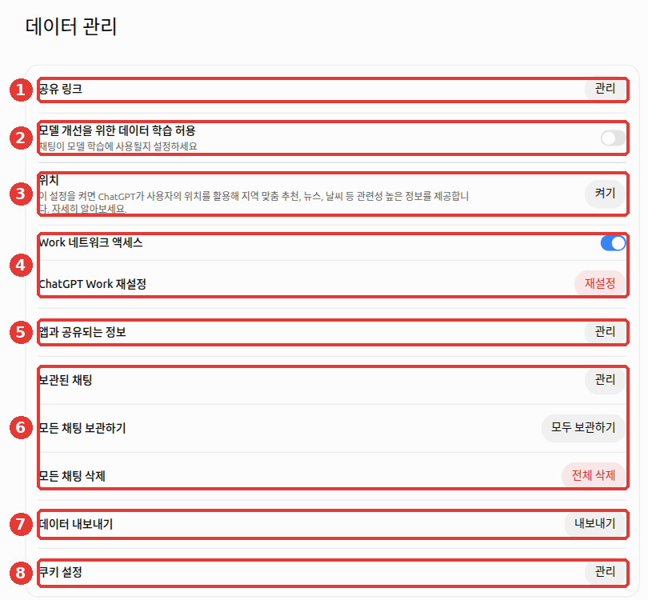
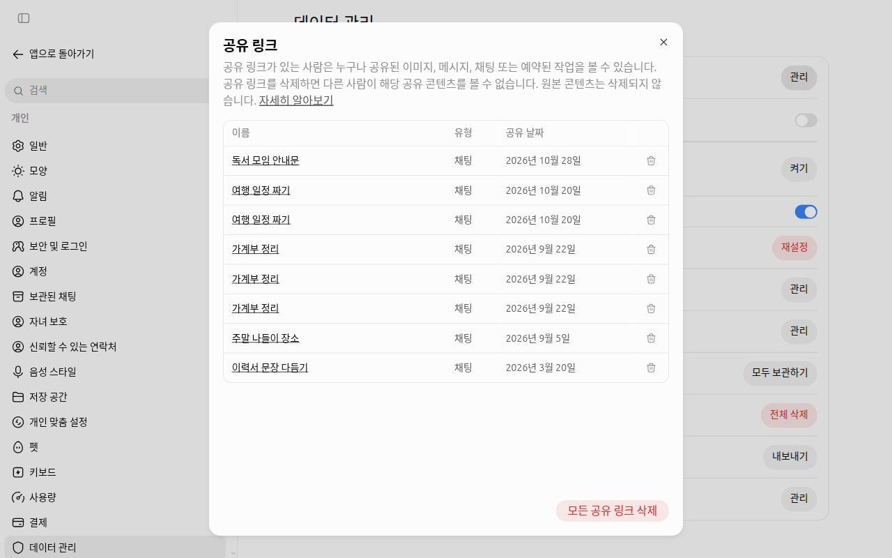
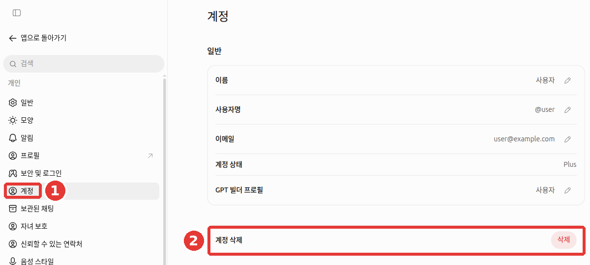
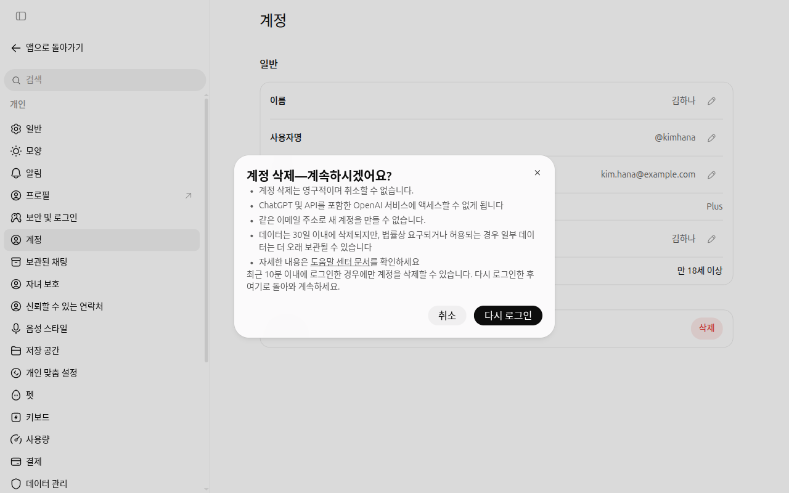

# 第8章 个人信息与数据管理——决定我的对话用在哪里

> **一句话总结**：发给 ChatGPT 的对话会保存在 OpenAI 的计算机（服务器）上，根据设置，还可能被用于让 AI 变得更好的训练。
> 在「设置 > 数据管理」这一个界面里，就可以决定是否允许训练、分享链接、归档·删除、导出。

界面以 2026 年 10 月的网页版（Plus 套餐）为准。免费套餐或手机应用的菜单位置可能略有不同。

**哪些东西不该输入**，对任何 AI 都一样，已经在[第1阶段第9章「不该输入的内容」](../00-common/09-safety.md#不要放进去的东西)里讲过了。这一章只讲**已经输入的对话，在 ChatGPT 里该怎么管理**。

## 逛一逛数据管理界面

点左下角的账号名称，打开「设置（설정）」，然后点设置界面左侧列表最下面的「数据管理（데이터 관리）」。[^data-name]



图中的红色编号就是下面表格里的编号。

| 编号 | 项目 | 作用 | 这一章里 |
|---|---|---|---|
| ① | 「分享链接（공유 링크）」「管理」 | 集中查看并删除我创建的对话分享链接 | 第 3 节 |
| ② | 「允许用数据训练以改进模型（모델 개선을 위한 데이터 학습 허용）」 | 决定是否让我的聊天用于训练的开关 | 第 2 节 |
| ③ | 「位置（위치）」「开启」 | 把设备位置用在本地化推荐·天气之类的回答上 | 见下面的说明 |
| ④ | 「Work 网络访问」·「重置 ChatGPT Work」 | 与 Work 功能有关的设置 | [第7章](07-projects-plugins.md) |
| ⑤ | 「与应用共享的信息」「管理」 | 管理与已连接的应用（插件）共享的信息 | [第7章](07-projects-plugins.md) |
| ⑥ | 「已归档的聊天」·「归档所有聊天」·「删除所有聊天」 | 隐藏对话，或一次性全部删除 | 第 4 节 |
| ⑦ | 「导出数据（데이터 내보내기）」「导出」 | 把我的全部对话记录保存成文件 | 第 5 节 |
| ⑧ | 「Cookie 设置」「管理」 | 设置网站留在我的浏览器里的小记录（Cookie） | — |

**位置**：共享设备位置一开始是关闭的。[^search] 即使不打开，ChatGPT 也能通过上网地址（IP 地址）大致知道所在的地区。只有在确实需要“我们小区的天气”这种小区级别的回答时再打开，就足够了。

<Quiz id="ch108-screen" />

## 不让对话用于训练

**模型训练**（model training）是指 AI 公司收集人们的对话，用来把下一代 AI 教得更聪明。「允许用数据训练以改进模型」就是决定这件事的开关。帮助文档里的英文名称是 Improve the model for everyone（为所有人改进模型）。

### 一开始可能是开着的

这个开关一开始是开着还是关着，**可能因套餐和地区而不同。** OpenAI 的一处帮助文档写着，个人账号的 Free·Plus·Pro 套餐默认是开启的。[^controls] 另一处写着，根据地区和设置而不同。[^home]
所以不要想当然地觉得“我的应该是关着的”，请**亲自打开确认**。上面的图是开关关闭（灰色）的状态。

### 关闭的方法

1. 打开账号名称 → 「设置」 → 「数据管理」。
2. 点「允许用数据训练以改进模型」（这一章第一张图的 ②）右边的开关，把它变成灰色。如果弹出确认窗口，点「完成」。

在登录状态下修改，会应用到**用同一个账号登录的所有设备**（包括手机应用）。在未登录状态下修改，则**只保存在那个浏览器里**。[^controls]

### 关闭之后也不会变的事

我们来看一看围绕这个开关的四个常见误解。

- **关闭后，对话记录会消失吗？** 不会。记录会原样留在侧边菜单里。
- **关闭后，任何对话都不会用于训练吗？** 不是这样。如果你在回答下面点赞·点踩之类的按钮发送反馈（feedback，告诉它回答好不好的评价），那整个对话都可能被用于训练。
- **关闭后，就不会被保存了吗？** 不是。只是不用于训练，对话仍会保存在服务器上。想删除的话，请用第 4 节的删除。
- **开着的时候，连接的 Google 应用里的资料也会被用于训练吗？** 不会。帮助文档说明，直接从已连接的 Google 应用（Gmail·Drive 等）读取的资料，即使开关是开着的，也不会用于训练。不过有例外。发送过反馈（点赞·点踩）的对话、自己复制·粘贴·上传的内容、ChatGPT 回答里包含的内容。[^google]

> 与允许训练无关，写在自定义指令（[第5章](05-memory.md)）里的内容，也遵循这个开关。[^ci] 所以用一个开关就可以一起拦住。

<Quiz id="ch108-training" />

## 管理分享链接

为了给别人看对话而创建的**分享链接**（share link），只要有链接地址，**任何人**都能看。不能按人来限制，也没有会自动失效的到期日。[^share]
创建链接的方法在[第3章](03-chats.md)里看过了。这里讲的是**整理以前创建的链接的方法**。

1. 在「数据管理」里，点「分享链接」右边的「管理」。
2. 在列表里把不需要的链接一个一个删除，或者用「删除所有分享链接」一次性全部删除。



*链接名称是改成示例的界面。用行尾的垃圾桶按钮一个一个删除。*

在群聊里发过一次的链接，我没办法知道传到了哪里。所以删除链接是最可靠的收回办法。

<Quiz id="ch108-share" />

## 归档和全部删除

整理对话的方法有两种，结果完全不同。[^delete]

| | 归档 (Archive) | 删除 (Delete) |
|---|---|---|
| 在侧边菜单里 | 消失 | 消失 |
| 对话内容 | **原样保留。** 聊天搜索也能搜到 | 预定在 30 天内从 OpenAI 系统中永久删除 |
| 恢复 | 在「已归档的聊天」里取消归档 | **无法恢复。** 客户支持团队也无法找回 |

在「数据管理」里可以一次性做这些事。

- 「已归档的聊天」「管理」：查看归档的对话列表并取消归档。
- 「归档所有聊天」「全部归档」：一次清空侧边菜单。内容会保留。
- 「删除所有聊天」「全部删除」：删除所有对话。**无法恢复。** 点之前，请先用第 5 节的导出做好备份。

**删除聊天之后仍然会留下的东西。**

- 对话里上传的文件中，另外保存在**资料库**（[第4章](04-files-images.md)）里的文件会保留。[^delete] 请在资料库里另外删除。
- 从那个对话里产生的**已保存记忆**（[第5章](05-memory.md)）也会保留。[^memory] 请在「个性化设置（개인 맞춤 설정）」里另外删除（[第5章](05-memory.md)）。

如果是一开始就不想留下记录的对话，用**临时聊天**更简单。请点右上角的「临时聊天」按钮开始。这样对话不会留在聊天记录里，也不会用于模型训练。不过出于安全考虑，副本最多可能保存 30 天。[^temp] 详细用法在[第3章](03-chats.md)里。

<Quiz id="ch108-delete" />

## 导出数据

**导出数据**（export）是把到目前为止的对话记录和账号信息，打包成一个压缩文件（ZIP，把多个文件合成一个的文件）的功能。在全部删除或删除账号之前用来备份。[^export]

1. 在「数据管理」里，点「导出数据」右边的「导出」。
2. 在确认窗口里点「确认导出」。
3. 下载链接会发到你注册时用的邮箱（或短信）里。**最多可能需要 7 天**。
4. 链接**收到后过了 24 小时就会失效**。邮件一到就马上下载。错过了的话，重新申请就行。

Free·Go·Plus·Pro 个人账号可以使用。未登录状态下不能使用。[^export]

> 下载的文件里**有我所有的对话。** 不要下载到公用电脑上，也不要上传到和别人共用的云端文件夹里。

**没有把对话转移到其他账号的功能。** 不能合并两个账号，也不能把对话列表整体搬过去。能做的，只是把下载的压缩文件里的 `conversations.json` 文件上传到新账号的对话里，当作**参考资料**来用。侧边菜单里不会出现以前的对话。[^transfer]

<Quiz id="ch108-export" />

## 删除账号

不再使用 ChatGPT 时，可以删除账号。[^account]

1. 打开「设置」 → ① 「账号」。
2. 点 ② 「删除账号」旁边的「删除」。
3. 弹出确认窗口后，阅读说明并继续。如果登录已经超过 10 分钟，要先点「重新登录」。[^screen-account]
4. 按提示输入邮箱地址和 `DELETE`，点「永久删除我的账号」。



*姓名·用户名·邮箱是改成示例的界面。没有点「删除」。*



*点「删除」不会马上删除，会先弹出这个窗口。**只有最近 10 分钟内登录过，才能直接继续。** 如果窗口开了很久，请先点「重新登录」。在这个界面里点的是「取消」。*[^screen-account]

| 删除之后 | 内容 |
|---|---|
| 数据 | 会在 30 天内删除（法律规定必须保存的情况除外） |
| 恢复 | 不可能 |
| 重新注册 | 帮助文档说**30 天后**可以用同一个邮箱重新注册。确认窗口里却写着不能用同一个邮箱创建新账号[^screen-account] |

**订阅要另外取消。** 通过 iPhone 的 App Store（Apple）付费的订阅，即使删除账号也不会取消。[^account] 在手机上删除应用，订阅也会继续。[^pro] 所以删除账号之前，请先到付款的地方取消订阅。

<Quiz id="ch108-account" />

## 保护账号

账号里有我所有的对话。所以只靠一个密码来保护是危险的。请在设置 → 「安全与登录」里确认下面这些项目。[^screen-security]

- 「多重验证（MFA）」：除了密码，再用**验证应用的一次性验证码或短信里的 6 位验证码**确认一次。建议开启（这本指南的建议）。
- 「通行密钥和安全密钥」：不用密码，而是用手机指纹·人脸识别之类的方法登录。这是对钓鱼（用假网站偷密码的手段）很有效的方法。
- 「活跃会话」：查看所有登录过我账号的设备。可以移除设备，也可以在所有设备上退出登录。
- 「登录关联」 → 「用 ChatGPT 登录」：查看用 ChatGPT 账号登录过的其他应用·网站，并切断它们的访问。
- 「锁定模式」：下面会讲。

**如果看到不认识的对话或设备**，请马上更改密码。更改后，**30 分钟内会在所有设备上退出登录**。如果你一直是用 Google·Microsoft 账号登录的，就要更改那家公司账号的密码。[^unrecognized] 账号不要几个人共用。共用的话，很容易被判定为异常活动。[^errors]

在其他应用或网站上点「用 ChatGPT 登录」时，那里**只会收到姓名·邮箱·头像**。[^signin] 对话内容不会传过去。即便如此，也请偶尔在上面的「登录关联」里整理一下登录过的地方。

**锁定模式**（Lockdown Mode）是限制对外连接功能的设置。网页搜索只能使用事先保存的内容，深度研究之类的功能会被禁用。这样可以降低因网页或文件中隐藏的恶意指示（**提示词注入**，prompt injection）导致信息泄露的风险。[^lockdown]

帮助文档说明，这个功能并不是为所有人准备的。它也不能阻止隐藏的指示本身。帮助文档解释说，它是为**处理敏感数据的人和组织**准备的功能。根据套餐和账号，也可能没有这个菜单。这本指南的判断是，如果不是处理敏感数据，通常不用开启。隐藏的指示是什么，请看[第1阶段第9章](../00-common/09-safety.md)。

<Quiz id="ch108-security" />

## 为家人和安全准备的功能

设置里有「家长控制」和「可信联系人」菜单。[^screen-security] 两个都不开，也不影响使用 ChatGPT。不过，了解它们做什么、**不做什么**，可以减少误会。

**家长控制**（parental controls）是把监护人和青少年（未满 18 周岁）的账号连接起来的功能。监护人可以调整部分功能，设定使用时间，在少数情况下收到安全提醒。[^parental]

- **监护人看不到孩子的对话。** 即使连接了账号，也无法访问对话内容、记录和当前的活动。[^parental]
- 如果 ChatGPT 根据使用迹象判断为未满 18 周岁，可能会自动开启青少年保护。如果是成年人却被误判，在我的账号可以使用年龄验证的情况下，可以通过验证来解除（因账号而异）。验证由一家叫 **Persona** 的外部公司负责。**OpenAI 不会收到身份证件或自拍**，也不需要出示身份证号码之类的证件号码。[^age]

**可信联系人**（trusted contact）是成年人预先指定一个人的功能。如果有和自杀相关、让人非常担心安全的对话，可能会向那个人发送提醒，请他来问候确认。自动检测之后，会由受过培训的人进行审核。[^trusted]

- **只能在个人账号里**使用。在 Business·Enterprise·Edu 这类公司·学校空间里不会开启。[^trusted]
- **在韩国，本人和被指定为联系人的人都必须年满 19 周岁**（其他国家是年满 18 周岁）。[^trusted-ko]
- 提醒里**不包含对话内容。** 被指定的人要在**1 周内**接受邀请，才会开启。没有 ChatGPT 账号的人也可以被指定。[^trusted][^trusted-add]
- **它不是急救服务。** 在语音对话中不起作用。如果现在有危险，不要等这个功能，请马上联系急救服务或危机咨询电话。[^trusted]

在倾诉痛苦心情的对话里，ChatGPT 可以介绍所在地区的**危机咨询机构**。各地区的咨询机构，是 OpenAI 和危机咨询对接专业机构（ThroughLine）一起展示的。[^helpline]

<Quiz id="ch108-family" />

## 公司账号有什么不同

公司集体签约的 **Business**（以前叫 Team）·**Enterprise**，以及学校用的 **Edu** 套餐，默认不会把对话内容用于训练。[^controls]
如果你用的是公司账号，比上面的训练开关更优先的是**公司的 AI 使用规定**。能输入什么，请向公司负责部门确认。

反过来，如果用**个人账号**做公司的工作，就得不到这种保护。公司资料请只在公司允许的账号里处理。

关于公司账号，还有几点要知道。

- **管理员可能可以处理我的对话。** 公司管理员根据设置，**可能可以**查看·导出·审计·保留·删除那个账号的数据。也可能同意为了改进模型而与 OpenAI 共享。[^managed] 请把公司账号里的对话看作公司的记录。
- **个人账号和公司账号是分开的。** 即使切换账号进去，对话·文件·设置也不会跟着转移。[^managed]
- 可能会弹出**让你把个人空间合并到公司空间的提示**。合并后无法撤销。离职后，转移的对话也可能看不到了。在公司空间里也不能自己导出。所以合并之前，请先把个人记录导出来。[^migrate]
- 如果公司关闭了记忆功能，我在那个公司空间里已保存的记忆会被删除。[^bizmemory]

<Quiz id="ch108-business" />

## 亲自试一试

**1. 确认我的训练设置**

打开「设置」 → 「数据管理」，看看「允许用数据训练以改进模型」是不是开着的。改成你想要的那一边之后，如果有手机应用，也确认一下应用里是否变成了同样的值。

**2. 分享链接大扫除**

打开「分享链接」「管理」，数一数现在有效的链接有几个。不再需要给别人看的链接，就删掉。

**3. 让 ChatGPT 给我一份设置检查表**

```
我用个人账号使用 ChatGPT。
我想让我的对话不被用于训练，并且整理以前的分享链接。
请把我需要在设置界面里亲自确认的项目，做成检查表（☐）。
你不确定的菜单名称不要编造，请写“在界面上确认”。
```

把拿到的检查表里的菜单名称，和这一章的表格比较一下。如果不一样，以界面上看到的名称为准。

**接下来的作业**（[准备读书会](../00-common/practice-kit.md)）：在「设置」 → 「数据管理」里，确认「允许用数据训练以改进模型」和「分享链接」列表。如果要把真实的聚会资料上传到「读书会」项目里，就决定好这个设置该怎么放。

## 整理

- 在「设置 > 数据管理」这一个界面里，决定允许训练、分享链接、归档·删除、导出。
- 「允许用数据训练以改进模型」可能因套餐·地区而在一开始就是开着的。请亲自打开确认。即使关闭，发送过反馈的对话也可能被用于训练。
- 分享链接任何人都能看，也不会到期。不需要的话，在「管理」里删除。
- 归档是隐藏，删除是 30 天内永久删除，无法恢复。资料库文件和已保存的记忆要另外删除。
- 导出链接要在收到后 24 小时内下载。删除账号之前，先取消订阅。
- 在「安全与登录」里开启多重验证，不认识的设备让它退出登录。更改密码后，30 分钟内会在所有设备上退出登录。
- 连接了家长控制，监护人也看不到对话。可信联系人在韩国要年满 19 周岁，而且不是急救服务。
- 公司账号（Business·Enterprise·Edu）默认不用于训练，但公司规定优先，而且管理员可能可以处理对话。

## 术语整理

| 术语 | 中文名称 | 一句话解释 |
|---|---|---|
| Data controls | 数据管理 | 决定我的对话的训练·保存·删除的设置界面 |
| Model training | 模型训练 | 用收集到的对话来教下一代 AI |
| Share link | 分享链接 | 把对话给别人看的地址。有地址的任何人都能看 |
| Archive | 归档 | 不删除对话，只是在侧边菜单里把它隐藏起来 |
| Export | 导出 | 把我的全部记录保存成文件 |
| ZIP | ZIP 压缩文件 | 把多个文件合成一个并缩小体积的压缩文件 |
| Cookie | Cookie | 网站留在我的浏览器里的小记录 |
| Subscription | 订阅 | 每个月付钱使用的套餐 |
| MFA (Multi-Factor Authentication) | 多重验证 | 除了密码，再用另一种方法确认一次本人身份的登录方式 |
| Passkey | 通行密钥 | 不用密码，而是用设备的指纹·人脸识别登录的方法 |
| Lockdown Mode | 锁定模式 | 限制对外连接功能，降低因隐藏指示而泄露信息风险的设置 |
| Prompt Injection | 提示词注入 | 用藏在网页·文件里的指示，让 AI 做出离谱举动的攻击 |
| Parental Controls | 家长控制 | 连接监护人和青少年账号，设定部分功能和时间的功能 |
| Trusted Contact | 可信联系人 | 为危机时收到问候确认提醒而预先指定的人 |

<ChapterDone :chapter="108" />

下一章：[第9章. 用语音对话](09-voice.md)

---

[^controls]: OpenAI 帮助文档，《Data controls in ChatGPT》。个人工作区的 Free·Plus·Pro 默认开启，登录时应用到所有设备，未登录状态只保存在那个浏览器里，发送反馈时整个对话都可能被用于训练，Business·Enterprise·Edu 默认不用于训练。https://help.openai.com/en/articles/7730893 （确认日期 2026-10-23）
[^home]: OpenAI 帮助文档，《The ChatGPT home page》。是否用于训练 "depends on your location and settings"。https://help.openai.com/en/articles/9125172 （确认日期 2026-10-23）
[^ci]: OpenAI 帮助文档，《ChatGPT Custom Instructions》。自定义指令的使用信息也可能用于模型改进，可以通过训练设置拒绝。https://help.openai.com/en/articles/8096356 （确认日期 2026-10-23）
[^search]: OpenAI 帮助文档，《Searching the web with ChatGPT》。"Device location sharing is optional and off by default." 通过 IP 使用大致位置。https://help.openai.com/en/articles/9237897 （确认日期 2026-10-23）
[^share]: OpenAI 帮助文档，《Sharing conversations and scheduled tasks in ChatGPT》。拥有链接的任何人都能查看，不能设置到期日，在「分享链接 > 管理」里可以单个删除·删除所有分享链接。https://help.openai.com/en/articles/7925741 （确认日期 2026-10-23）
[^delete]: OpenAI 帮助文档，《Deleting and archiving chats in ChatGPT》。删除预定在 30 天内永久删除、无法恢复，归档只是从侧边栏消失、搜索里还能搜到，删除所有聊天无法撤销，删除聊天不会删掉资料库文件。https://help.openai.com/en/articles/8809935 （确认日期 2026-10-23）
[^memory]: OpenAI 帮助文档，《Memory in ChatGPT》。"Deleting the original chat does not automatically delete a separate saved memory." https://help.openai.com/en/articles/8590148 （确认日期 2026-10-23）
[^temp]: OpenAI 帮助文档，《Temporary chat in ChatGPT》。不留在记录里，不用于训练，出于安全目的最多可能保存 30 天。https://help.openai.com/en/articles/8914046 （确认日期 2026-10-23）
[^export]: OpenAI 帮助文档，《Exporting your ChatGPT history and data》。通过邮件·短信发送链接，最多需要 7 天，"The download link expires 24 hours after you receive it."，ZIP 文件，Free·Go·Plus·Pro，未登录状态不可用。https://help.openai.com/en/articles/7260999 （确认日期 2026-10-23）
[^account]: OpenAI 帮助文档，《Deleting your ChatGPT account》。30 天内删除数据（法律例外），无法重新激活，同一个邮箱 30 天后可以重新注册，"Deleting your account does not cancel an Apple subscription." https://help.openai.com/en/articles/6378407 （确认日期 2026-10-23）
[^google]: OpenAI 帮助文档，《Google app data controls FAQ》。"Even if this setting is enabled, we do not train our generalized models on data accessed directly from connected Google apps." https://help.openai.com/en/articles/10408842 （确认日期 2026-10-24）
[^transfer]: OpenAI 帮助文档，《Transfer exported conversations between ChatGPT accounts》。"This is not a full account migration." / "Find conversations.json." https://help.openai.com/en/articles/9106926 （确认日期 2026-10-24）
[^screen-security]: 在 ChatGPT 网页设置界面（Plus 套餐，韩语）上亲自确认。「보안 및 로그인」里的「다중 인증(MFA)」「패스키 및 보안 키」「활성 세션」「로그인 연동 — ChatGPT로 로그인」「락다운 모드」，以及各项目的界面说明（"인증 앱의 일회용 코드 사용", "6자리 인증 코드를 받습니다", "신뢰하는 기기를 제거하거나, 모든 기기에서 로그아웃"），设置列表里的「자녀 보호」「신뢰할 수 있는 연락처」（确认日期 2026-10-24）
[^unrecognized]: OpenAI 帮助文档，《I'm seeing unrecognized activity on my OpenAI account.》。"Once you change your password, all current sessions will be logged out within 30 minutes." / "If you have logged in with Microsoft or Google authentication, you'll need to reset your Microsoft or Google account password." https://help.openai.com/en/articles/8485685 （确认日期 2026-10-24）
[^errors]: OpenAI 帮助文档，《Troubleshooting ChatGPT Error Messages》。"Ensure you are not sharing your ChatGPT account with other people". https://help.openai.com/en/articles/7996703 （确认日期 2026-10-24）
[^signin]: OpenAI 帮助文档，《Sign in with ChatGPT》。"the external application receives only your name, email address, and profile picture, if you have one." https://help.openai.com/en/articles/20001410 （确认日期 2026-10-24）
[^lockdown]: OpenAI 帮助文档，《Lockdown Mode》。"Web browsing is limited to cached content." / "Deep research is disabled." / "It is designed for people and organizations that handle sensitive data" / "Lockdown Mode is not intended for everyone." / "Lockdown Mode does not prevent prompt injections from appearing in the content ChatGPT processes." https://help.openai.com/en/articles/20001061 （确认日期 2026-10-24）
[^parental]: OpenAI 帮助文档，《Managing parental controls in ChatGPT》。"Parental controls let a parent or guardian link their ChatGPT account to a teen’s account, manage selected settings, set schedules, and receive safety notifications in limited situations." / "Linking accounts does not give a parent or guardian access to a teen’s conversations, chat history, or real-time activity." https://help.openai.com/en/articles/12315553 （确认日期 2026-10-24）
[^age]: OpenAI 帮助文档，《Age prediction in ChatGPT》。"OpenAI uses Persona, a third-party service, to verify your age." / "OpenAI does not receive your ID or selfie." / "You do not need to show ID numbers, such as a national ID number or Social Security number." https://help.openai.com/en/articles/12652064 （确认日期 2026-10-24）
[^trusted]: OpenAI 帮助文档，《Trusted contacts in ChatGPT》。"if automated systems and trained reviewers detect you may be talking about suicide in a way that signals a serious safety concern, ChatGPT may notify your trusted contact" / "Your chat details or transcripts are not shared." / "Trusted contact is not an emergency service, a crisis response system, or a substitute for mental health care." / "Trusted contact is not currently available in ChatGPT Voice." / "It is available for personal ChatGPT accounts, and is not enabled in shared workspaces such as ChatGPT Business, Enterprise, or Edu." https://help.openai.com/en/articles/20001105 （确认日期 2026-10-24）
[^trusted-ko]: OpenAI 帮助文档，《Managing parental controls in ChatGPT》。"Trusted Contact is a separate, optional feature for adults 18 or older, or 19 or older in Korea." 韩语设置界面里也写着“사용자 본인과 해당 연락처로 지정된 사람 모두 만 19세 이상이어야 합니다”（确认日期 2026-10-24）。https://help.openai.com/en/articles/12315553 （确认日期 2026-10-24）
[^trusted-add]: OpenAI 帮助文档，《Adding and managing a trusted contact》。"If the person accepts the invitation within 1 week, the feature becomes active." https://help.openai.com/en/articles/20001194 （确认日期 2026-10-24）。没有 ChatGPT 账号也可以，出自《Being someone’s trusted contact》"You do not need a ChatGPT account to be someone’s trusted contact." https://help.openai.com/en/articles/20001195 （确认日期 2026-10-24）
[^helpline]: OpenAI 帮助文档，《Crisis helpline support in ChatGPT》。"As part of our partnership with ThroughLine, we have introduced localized helplines in ChatGPT". https://help.openai.com/en/articles/12677603 （确认日期 2026-10-24）
[^managed]: OpenAI 帮助文档，《Data access for your managed ChatGPT account》。"your administrator may be able to access, export, audit, retain, delete, and opt-in to share data tied to this account with OpenAI to improve OpenAI’s models." / "Switching accounts does not move chats, files, or settings between accounts." https://help.openai.com/en/articles/20001067 （确认日期 2026-10-24）
[^migrate]: OpenAI 帮助文档，《Migrating your personal workspace to ChatGPT Business or Enterprise》。"Migration does not provide an undo option" / "If you leave, are removed, or lose access to the destination workspace, you may also lose access to that content." / "Self-service data export is not available in ChatGPT Business or Enterprise workspaces." https://help.openai.com/en/articles/8801890 （确认日期 2026-10-24）
[^bizmemory]: OpenAI 帮助文档，《Memory FAQ (Business Version)》。"If a workspace owner turns off Memory for the workspace, existing saved memories for members in that workspace are deleted." https://help.openai.com/en/articles/9295112 （确认日期 2026-10-24）
[^pro]: OpenAI 帮助文档，《About ChatGPT Pro tiers》。"Uninstalling the ChatGPT app does not cancel your subscription." https://help.openai.com/en/articles/9793128 （确认日期 2026-10-23）
[^data-name]: 官方帮助文档里这个菜单写作「数据控制」（Data controls）。实际的界面名称是「数据管理（데이터 관리）」。
[^screen-account]: 亲自确认了点击「设置」 → 「账号」 → 「删除」后弹出的确认窗口。"최근 10분 이내에 로그인한 경우에만 계정을 삭제할 수 있습니다." 这个窗口里写着“같은 이메일 주소로 새 계정을 만들 수 없습니다.”，和帮助文档说的 30 天后可以重新注册不同。如果打算重新注册，删除之前请再确认一下帮助文档（确认日期 2026-10-28，Plus 账号网页界面）
