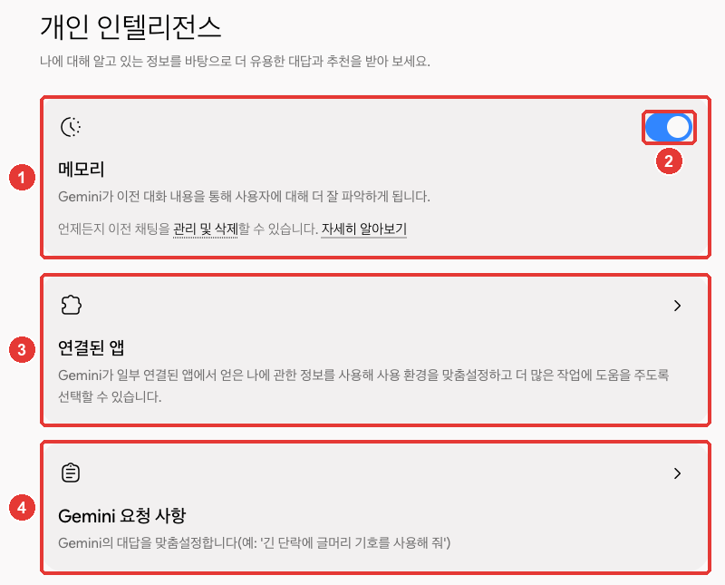
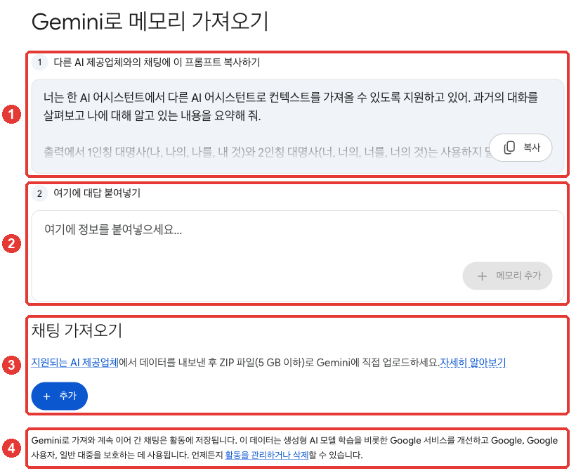

# 第5章 记忆与个性化设置 — 记忆、指令、从其他 AI 迁移过来

> **一句话总结**：Gemini 会根据**过往对话（记忆）**、**已连接的 Google 应用**和**我写下的指令**，来给出适合我的回答。
> 记忆有误时，直接在对话中纠正；想删除时，就删掉包含那些内容的对话。ChatGPT·Claude 里的记忆和对话也可以迁移过来。

界面以 2026年10月的网页版为准，截图是付费套餐（Google AI Pro）的韩语界面。这一章的功能中，有些**只有在美国**才能用，这类功能已经单独标出。

## Gemini 了解我的三条路

Gemini 通过三种方式，给出适合我的回答。[^personal]

| 途径 | 用什么 | 本指南里 |
|---|---|---|
| 记忆 | 过去的 Gemini 对话 | 这一章 |
| 已连接的应用 | Gmail·Google 相册这类 Google 应用里的内容[^apps] | [第7章](07-skills-apps.md) |
| 指令 | 我写下的偏好（语气·格式等） | 这一章 |

出处：Google 帮助文档[^personal]

这些功能**只有个人 Google 账号**才能用。公司·学校账号，或者由监护人管理的账号上不行。[^personal] 它们目前还没有对所有人开放，所以每个功能的条件各不相同。[^personal]

设置集中在一个地方。请点「设置（설정）」→「个人智能（개인 인텔리전스）」。[^screen][^memory]



**红色编号和下面列表里的编号是同一个位置。**[^screen]

- ①「记忆（메모리）」：通过过往对话来了解我的功能。可以用「管理和删除（관리 및 삭제）」去整理过往的对话。
- ② 打开和关闭记忆的开关。
- ③「已连接的应用（연결된 앱）」：Google 应用的连接（[第7章](07-skills-apps.md#已连接的应用-—-在-gemini-里用-gmail·drive·日历)）。
- ④「Gemini 请求事项（Gemini 요청 사항）」：写下指令的地方。说明是“个性化定制 Gemini 的回答（例：‘请对长段落使用项目符号’）”。点它会单独打开一个界面（见下面的“指令”一节）。

<Quiz id="ch305-overview" />

## 记忆 — 记住过往的对话

打开**记忆**后，Gemini 会从过往对话里了解我和我周围的情况，并用在回答里。[^memory]
比如，你上次说过“我正在准备下个月的济州岛旅行”，以后聊到旅行时，它就可以接着用这些内容。它有时还会主动建议正在做的事的下一步，或旅行计划。[^memory]

使用有几个条件。[^memory]

- **年满 18 周岁**，个人 Google 账号
- **「保存活动记录（활동 기록 보관）」必须是开着的**（[第3章](03-chats.md#查找过去的对话)）
- **有些功能里不会用到。** 典型的是 Gem 和语音对话（Live）。不过，在文字对话时，可以请它参考过去的语音对话。

### 询问过去的对话

在新对话里，可以按**主题或时间**询问过去的对话。[^recent]

```
找一下上个月聊读书会地点的那场对话，帮我总结一下。
```

如果 Gemini 参考了过往对话，答案下方的「来源和相关内容（소스 및 관련 콘텐츠）」里会显示「之前的聊天（이전 채팅）」。不过，这个标记偶尔会出错。[^recent]
好奇的话，直接问它。问一句“你用过往对话里的信息了吗？”就行。[^memory]

### 记忆有误时，想删除时

**错误的内容，直接在对话里纠正。** 记忆开着的话，Gemini 会采纳那句话。不过，它也未必每次都能改对。[^memory]

**想删除记忆，必须把包含那些内容的对话全部删掉。** 请在「Gemini 应用活动」里找到那些对话并删除。[^memory] 删除之后，答案里也要过一会儿才会不再出现。[^memory]

即使用指令说“请忘掉那件事”，也**不一定每次都会遵守。** 想让它彻底不再提，请把那个主题的对话删掉。[^instructions]

**直接关闭记忆**的话，Gemini 就不再新学习关于我的内容。把上图里 ② 的开关关掉就行。[^instructions][^screen]

<Quiz id="ch305-memory" />

## 指令 — 不用每次都说

**指令**是我希望 Gemini 始终遵循的、属于我的规则。写下一次，在新对话里也不用再说。[^instructions]
界面上的名称是「Gemini 请求事项」（上图的 ④）。[^screen] **指令，所有用户都可以添加。**[^instructions]

指令的例子如下。[^instructions]

```
所有回答都先用简短的总结开头。
```

```
长段落请用项目符号拆开。
```

比较一下不够好的指令和更好的指令。

| 不够好的指令 | 更好的指令 |
|---|---|
| “讲得好一点” | “出现专业术语时，用括号里的通俗话解释” |
| “简短” | “回答控制在五行以内，最后一行只写一件要做的事” |

更好的指令足够具体，我可以立刻确认 Gemini 有没有遵守（[第1阶段第4章](../00-common/04-prompt-basics.md)）。

添加指令的顺序如下。第 1 步在界面上确认过，第 2~3 步是帮助文档里写的名称（本指南没有打开指令的内部界面）。[^instructions][^screen]

1. 点「设置」→「个人智能」→「Gemini 请求事项」。
2. 点「添加 +（추가 +）」，写下指令后提交（제출）。
3. 要修改或删除，点那条指令的「更多（더보기）」。也可以用最上面的开关，把指令整体打开或关闭。

### 用对话让它记住（仅限美国）

也有一个功能，是在对话中说一句，比如“记住我是素食者”，来让它记住。但这个功能**目前只有在美国**才能用，而且需要 Google AI 套餐并年满 18 周岁。[^instructions]
在韩国，请用上面的**指令**达到同样的效果。像“我吃素。推荐食物时请去掉肉类。”这样写下来就行。

还有一个**记忆摘要**界面，可以汇总、查看并修改 Gemini 对我的理解，但这个也是**只面向美国的付费套餐用户，而且只有英语**。[^summary]

<Quiz id="ch305-instructions" />

## 从其他 AI 迁移过来

如果你原来用 ChatGPT 或 Claude，现在换到 Gemini，可以**把记忆和对话带过来。**[^import] 请在「设置」菜单的「数据和隐私（데이터 및 개인 정보 보호）」组里，点「向 Gemini 导入记忆（Gemini로 메모리 가져오기）」（[第2章](02-screen-tour.md#设置页面-—-账号、偏好设置、隐私)）。[^screen]



**导入记忆**的做法如下。[^import][^screen]

1. 把 ① 的提示词「复制（복사）」，粘贴到 ChatGPT 或 Claude 的聊天窗口里。
2. 复制那个 AI 整理出的关于我的答案。
3. 粘贴到 ② 栏里，点「添加记忆（메모리 추가）」。

**导入对话**在 ③ 里做。请用「添加（추가）」上传从 ChatGPT 或 Claude 导出的 ZIP 文件。[^import][^screen]

- ChatGPT 在「设置 > 数据管理」的「导出数据」里获取，Claude 在「设置」→「隐私」的「导出数据」里获取。详细路径请看 [ChatGPT 第8章](../11-chatgpt/08-privacy.md#导出数据)·[Claude 第9章](../10-claude/09-privacy.md#下载我的数据)。Gemini 帮助文档把这个菜单翻译成「数据控制」，但本指南确认过的 ChatGPT 界面名称是「数据管理（데이터 관리）」。[^import]
- 一个文件最大 5GB，一天最多上传 5 个。[^import]
- 再次上传同一个 ZIP 时，新对话会被添加，之前导入过的对话会被覆盖。[^import]

**导入之前有一点要知道。** 正如 ④ 所写，导入后**继续聊下去**的对话会保存到我的活动里，并**用于包括生成式 AI 模型训练在内的 Google 服务改进。**[^import][^screen] 活动可以随时管理和删除。

导入只有个人 Google 账号、年满 18 周岁才能用。在欧洲经济区（EEA）·瑞士·英国不行。[^import]

<Quiz id="ch305-import" />

## 亲手试一试

1. 打开「设置」→「个人智能」，确认「记忆」是不是开着的。
2. 在「Gemini 请求事项」里添加“所有回答都先用简短的总结开头。”，然后在新对话里随便问一个问题。是以总结开头的吗？
3. 在新对话里问一句“你用过往对话里的信息了吗？”。
4. 确认完毕后，把第 2 步的指令删掉，或者用开关关掉。

**接着做的任务**（[准备读书会](../00-common/practice-kit.md)）：在「Gemini 请求事项」里添加“读书会通知请用敬语，把日期·地点·需要准备的东西写在最上面。”，然后在新对话里再请它写一次通知，看看指令有没有被遵守。

## 小结

- Gemini 通过记忆（过往对话）、已连接的应用、指令来贴合我。设置集中在「设置」→「个人智能」。
- 记忆需要年满 18 周岁·个人账号·「保存活动记录」。Gem 和语音对话里不会用到。
- 错误的记忆，在对话里纠正；想删除，就把包含那些内容的对话全部删掉。“请忘掉”这样的指令不一定每次都被遵守。
- 指令（「Gemini 请求事项」）所有用户都能用。用对话让它记住，以及记忆摘要，仅限美国。
- ChatGPT·Claude 的记忆，复制提示词来迁移；对话则用导出的 ZIP 导入。导入后继续聊的对话，会用于包括 AI 训练在内的服务改进。

## 术语整理

| 术语 | 中文名称 | 一句话解释 |
|---|---|---|
| Memory | 记忆 | 从过往对话中了解我并用在回答里的功能 |
| Personal Intelligence | 个人智能 | 把记忆·已连接的应用·指令合在一起的个性化功能及其设置界面 |
| Instructions for Gemini | Gemini 请求事项（指令） | 我希望 Gemini 始终遵循的、属于我的规则 |
| Memory summary | 记忆摘要 | 查看并修改 Gemini 所理解的我的界面。仅限美国 |
| Import | 导入 | 把其他 AI 的记忆·对话搬到 Gemini |
| ZIP | ZIP | 把多个文件打包成一个的压缩文件 |

<ChapterDone :chapter="305" />

下一章：[第6章. 搜索与 Deep Research](06-search.md)

[^screen]: 在 Gemini 网页界面（Google AI Pro，韩语）里亲自确认。「设置（설정）」→「个人智能（개인 인텔리전스）」（地址 /personalization-settings）界面 "나에 대해 알고 있는 정보를 바탕으로 더 유용한 대답과 추천을 받아 보세요."（根据对我的了解，获得更有用的回答和推荐），卡片「记忆（메모리）」（"Gemini가 이전 대화 내용을 통해 사용자에 대해 더 잘 파악하게 됩니다. 언제든지 이전 채팅을 관리 및 삭제할 수 있습니다."，意思是：Gemini 会通过之前的对话内容更好地了解用户，随时可以管理和删除之前的聊天）和开关，「已连接的应用（연결된 앱）」，「Gemini 请求事项（Gemini 요청 사항）」。「设置」→「向 Gemini 导入记忆（Gemini로 메모리 가져오기）」（地址 /import）界面 "1 다른 AI 제공업체와의 채팅에 이 프롬프트 복사하기" 「复制（복사）」，"2 여기에 대답 붙여넣기" 「여기에 정보를 붙여넣으세요...」 「添加记忆（메모리 추가）」，「导入聊天（채팅 가져오기）」 "지원되는 AI 제공업체에서 데이터를 내보낸 후 ZIP 파일(5 GB 이하)로 Gemini에 직접 업로드하세요." 「添加（추가）」，"Gemini로 가져와 계속 이어 간 채팅은 활동에 저장됩니다. 이 데이터는 생성형 AI 모델 학습을 비롯한 Google 서비스를 개선하고 Google, Google 사용자, 일반 대중을 보호하는 데 사용됩니다."（意思是：导入 Gemini 后继续聊的对话会保存到活动里，这些数据用于改进包括生成式 AI 模型训练在内的 Google 服务，并保护 Google、Google 用户和公众）。「Gemini 请求事项」卡片说明 "Gemini의 대답을 맞춤설정합니다(예: '긴 단락에 글머리 기호를 사용해 줘')"。「向 Gemini 导入记忆」在「设置」菜单的「数据和隐私（데이터 및 개인 정보 보호）」组里。「Gemini 请求事项」里面的界面会显示用户的指令，所以没有打开。只确认了 Google AI Pro 界面，没能确认免费·未成年账号上是否看得到这张卡片。（确认日期 2026-10-31）
[^personal]: Google 帮助文档，《Get personalization in Gemini Apps》（韩语版《Gemini 앱에서 개인화 기능 사용하기》）。"You can get a personalized experience in Gemini Apps based on:" / "These features are not available to everyone at this time. You can find details about each feature in the articles linked below." / "To use these features, you must sign in to Gemini Apps with a personal Google Account. These features are not available while signed in to a work, school, or supervised account." https://support.google.com/gemini/answer/16598623（确认日期 2026-10-31）
[^memory]: Google 帮助文档，《Get personalization with memory of your past Gemini chats》（韩语版《이전 Gemini 채팅의 메모리를 사용해 개인화 기능 사용하기》）。"With this feature, Gemini can learn from your chats to understand more about you and your world." / "Be 18 or over." / "Not available in certain features, like Gems or Live chats. In a text chat, you can ask Gemini to reference a past Gemini Live conversation." / "At the top, tap Menu   Settings & help   Personal Intelligence." / "Tip: When Memory is turned on, Gemini may suggest topics or tools for you based on previous conversations. For instance, Gemini might:" / "Suggest next steps for a project you’re working on" / "Offer to help plan a trip you’ve mentioned" / "To correct what Gemini knows about you and uses in a response:" / "Make sure that Memory is turned on." / "If you delete a chat, there might be a short delay before Gemini stops using it to personalize your responses." / "To check if Gemini used your past chats, just ask Gemini, “Did you use any info from past chats?”" / "To delete something that Gemini remembered about you, delete all chats with this info from Gemini Apps Activity." / "While Gemini continues to improve, it might not always get it right." https://support.google.com/gemini/answer/16598469（确认日期 2026-10-31）
[^recent]: Google 帮助文档，《Find & manage your recent chats in Gemini Apps》。"In a new chat, you can ask Gemini about your past Gemini chats by topic or timeframe, or ask it to reference them before responding." / "Gemini may occasionally make mistakes and display this label incorrectly." 韩语界面名称：「소스 및 관련 콘텐츠」「이전 채팅」。 https://support.google.com/gemini/answer/13666746（确认日期 2026-10-31）
[^instructions]: Google 帮助文档，《Manage what Gemini remembers about you and customize responses》（韩语版《Gemini가 나에 대해 기억하는 정보 관리 및 대답 맞춤설정》）。"Gemini will remember the information or instructions you share with it, even in new chats." / "be over 18." （韩语版 "만 18세 이상이어야 합니다."） / "Have a Google AI plan." / "Only available in the US. All users can add instructions for Gemini Apps." / "Remember that I am vegetarian." / "“Start all responses with a short summary.”" / "Important: Instructions for Gemini to forget or avoid topics in chats doesn’t always work perfectly. To make sure Gemini stops mentioning a topic, delete any chats about it from your Gemini Apps Activity." / "Tap Add +." / "At the top, turn Instructions for Gemini off  or on ." / "To stop Gemini from learning about you" 韩语界面名称：「Gemini 요청 사항」「추가 +」「제출」「더보기」「수정」「삭제」。 https://support.google.com/gemini/answer/16598625（确认日期 2026-10-31）
[^summary]: Google 帮助文档，《View & manage your Memory summary in Gemini Apps》（韩语版《Gemini 앱에서 내 메모리 요약 보기 및 관리하기》）。"You can use memory summary to view, edit, and delete what Gemini Apps understands about you." / "Currently available to US users with an active Google AI plan." / "Available in English." https://support.google.com/gemini/answer/18617127（确认日期 2026-10-31）
[^apps]: Google 帮助文档，《Connect your Google apps to personalize your Gemini experience》（韩语版《Google 앱을 연결하여 Gemini 환경 개인화하기》）。"Get content from Gmail and Google Photos, like photos from your last vacation." https://support.google.com/gemini/answer/16598406（确认日期 2026-10-31）
[^import]: Google 帮助文档，《Import from other AI platforms to Gemini Apps》（韩语版《다른 AI 플랫폼에서 Gemini 앱으로 가져오기》）。"You can bring over your preferences, remembered facts & details, and general contextual information (sometimes called  "memory") from other AI platforms." / "Be signed in with a personal Google Account. This feature isn’t available if you sign in to a work, school, or supervised Google Account." / "Be 18 or older." / "The EEA, Switzerland, or the United Kingdom." / "Click Settings  Data controls." / "Click Settings  Privacy." / "Copy the response from the other AI platform that contains memories about you." / "Tip:  You can upload up to 5 .zip.files per day." / "A download link will be sent to the email associated with your account on the other AI platform." / "If you reupload a  .zip file with your exported chats it will add any new conversations and overwrite previously imported ones." / "Your imported and continued chats are saved in your Activity. This data is used to improve our services (including training generative AI models), and to protect Google, our users and the public." https://support.google.com/gemini/answer/16868299（确认日期 2026-10-31）
