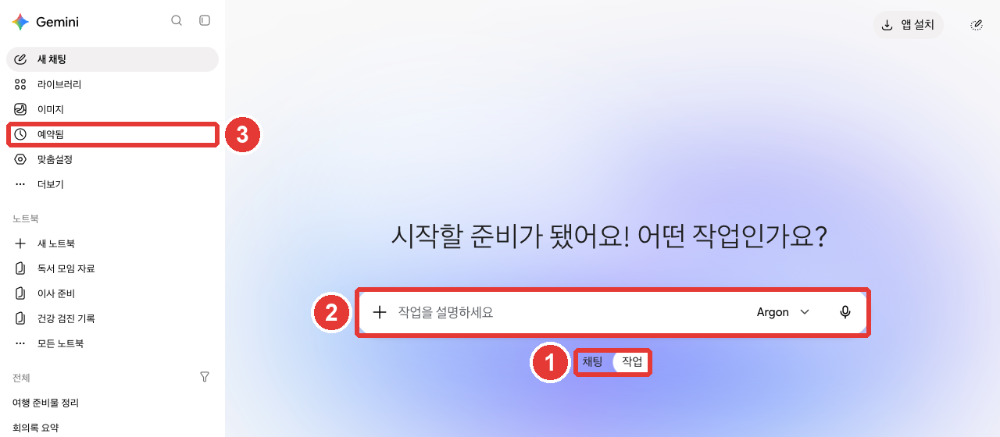

# 第8章 交代工作——任务、日程、Chrome 里的 Gemini、安全守则

> **一句话总结**：需要多个步骤的事，请用输入框下面的**「任务」（작업）**交给它。想让它在定好的时间自动运行，就设置**日程**。
> 交代任务时，**不要把登录·付款信息写进对话里，要认真读那些征求许可的界面。** 亲自盯着，是最好的安全保障。

界面以 2026 年 10 月的网页版为准，图片是付费套餐（Google AI Pro）的韩语界面。

## 任务——不是聊天，而是把整件事交出去

聊天是提问并拿到回答的地方。**任务**（Task）是把多步骤的事**整件交出去**的地方。[^tasks]
Gemini 会用已连接的应用、技能、过去的对话、我登录过的网站等信息来处理工作（[第7章](07-skills-apps.md)）。[^tasks]

帮助文档里的例子是这样的。[^tasks]

- 总结或归档收件箱里的新闻简报，并在休假之后做出紧急待办清单
- 机票·酒店价格降到预算以内时通知我
- 把附有出处的调查结果做成 PDF·文档·表格·演示资料文件

要使用，必须同时满足下面的条件。[^tasks]

- 年满 18 周岁，**个人 Google 账号**（公司·学校账号暂时不行）
- 订阅 **Google AI Pro 或 Ultra**
- 「保留活动记录」开启，使用「个人智能」（[第5章](05-memory.md)）
- 只能在网页、手机应用、Mac 应用上使用。欧洲经济区·尼日利亚·瑞士·英国不能使用。这本指南使用的韩国账号里，「任务」是可以打开的。[^screen]

### 开始任务



**红色编号和下面列表的编号是同一处。**[^screen]

- ① 在输入框下面的**「聊天」·「任务」**中点「任务」。
- ② 提示变成“描述任务”。写下要交出去的事并发送。想一起使用技能，就用 `@` 选择，也可以附上文件。[^tasks]
- ③ 设置了日程的任务，在侧边菜单的**「已预约」**里看（见下一节）。

第一次用，不知道该交什么事的话，可以在任务输入框里写**“采访我”**。韩语版帮助文档说，输入“设置”、“开始”、“采访我”（설정、시작、물어봐 줘），它就会和你一边对话，一边一起做出第一个技能和任务（英语版是 set up, get started, interview me）。[^tasks]

即使事情正在进行中，也可以在输入框里再写指示来改变方向。已经做完的事会照旧继续。[^tasks]

```
把过去一周收到的邮件里只挑出新闻简报，把标题和一行核心内容整理成表格。
不要删除或归档邮件，只给我看整理好的表格。
```

像最后一行那样，**把不该做的事写下来**，有助于防止出现不想要的行为。

有几点要知道。[^tasks][^threads]

- **最多同时运行 15 个。** 超过了就要等有任务结束。
- 任务也会用掉用量。用多少，因套餐和事情的复杂程度而异。
- 任务和侧边菜单的对话列表显示在一起，并用图标告诉你进行状态。必须开着「保留活动记录」，才会出现在列表里。
- 删除任务对话时，与该任务相连的日程也会一起删除。用任务做出的文件会保留。

<Quiz id="ch308-task" />

## 在定好的时间自动运行——日程

**日程**（Schedule）是让 Gemini 在定好的时间自动做事的功能。[^schedule] 有两个名字相近的，请区分开。

| | 聊天里的日程 | 任务里的日程 |
|---|---|---|
| 作用 | 在固定时间收到摘要·消息 | 在固定时间运行任务 |
| 可以开着的数量 | 10 个 | 50 个 |
| 需要的套餐 | 条件里没有（正在逐步开放） | Google AI Pro·Ultra |

出处：Google 帮助文档[^chatschedule][^schedule]

### 在聊天里设置日程

通常在聊天里把**什么时候、多久收一次**一起写上发送就行。Gemini 会以日程摘要的形式回答。[^chatschedule]

```
每天早上 7 点，帮我总结一下今天的天气和上班路上值得了解的三条新闻。
```

- 内容会在**约定收到的时间之前一小时以内**提前准备好。所以像股价这种变化很快的信息，可能不是最新的。适合每日摘要或总结。[^chatschedule]
- 必须开着「保留活动记录」。[^chatschedule]

### 给任务设置日程

在任务里，用三种方式决定时间。[^schedule]

- **时间**：一次、每小时、每天、每周、每月、每年
- **盯着 Gmail**：来了符合条件的邮件时
- **盯着主题**：新闻·金融·体育等主题出现新消息时

“盯着”**不适合非常紧急的事。** 帮助文档举的例子是“一放票就马上告诉我”这类事。运行时间也不精确，只是大概的。[^schedule]

### 在「已预约」里管理

日程集中在侧边菜单的**「已预约」**里。这本指南的界面上有「测试版」标示、按状态筛选的菜单、「创建预约任务」按钮。[^screen]

- 用「创建预约任务」亲手创建的，只有**时间日程**。盯着邮件·主题的，要在任务对话里用语言来创建。[^schedule]
- 新的日程可以用「更多」 → 「立即运行」马上试一下。[^schedule]
- 长期没有确认的日程，可能会自动暂停。界面上也出现了“部分未活动的预约任务已暂停”的提示。随时可以重新打开。[^chatschedule][^screen]

<Quiz id="ch308-schedule" />

## 使用浏览器的任务和许可

购物、预订旅行、预订餐厅这类**必须亲自点击网站的事**，也可以交出去。[^tasks] 这时 Gemini 会使用两种浏览器中的一种。[^tasks]

| | 我电脑里的 Chrome | 云端的远程浏览器 |
|---|---|---|
| 能进入的网站 | 包括我登录过的网站 | 在 Gemini 专用浏览器里 |
| 使用的地方 | 只在电脑上 | 手机上只用这个 |
| 关掉设备后 | 要开着。关掉的话可能转到远程浏览器 | 继续进行 |
| 需要登录时 | — | 暂停，由我来接手 |

出处：Google 帮助文档[^tasks]

使用网络的任务**默认每次都会先征求确认。**[^tasks] 在设置里改成「始终允许」，就会不问直接使用网络。[^permission]

### 征求许可的界面

Gemini 在使用浏览器、修改应用里的内容，或发送可能敏感的信息之前，会在任务对话里征求许可。[^permission] 可以选的回答是这样的（帮助文档韩语版的名称）。[^permission]

- **「不允许」**：停下来。我拒绝的事，它不会换别的办法再试。[^tasks]
- **「允许一次」**：只允许这一步。
- **「在此聊天中允许」**：在这个任务对话结束之前一直允许。只出现在已连接的 Google 应用的操作上。
- **「始终允许」**：在今后所有任务对话里允许**那个操作**。**点一次，设置就会改变**，一直适用。

刚开始请只用**「允许一次」**。等习惯了它问的是什么事，再放宽也不晚。

即使设成了「始终允许」，发送消息·购买·付款·提交网页表单这类**重要行为，仍会再次确认。** 在发送健康·金融·证件号码之类的敏感信息之前，也会停下来问你。[^permission][^tasks]
想按应用分别改变许可方式，请进入「个性化设置」 → 「连接器」，点应用，在「应用操作」旁边选择「始终允许」或「始终确认」。[^permission]

### 停下来并接手

如果 Gemini 做了你不喜欢的事，请马上让它停下来。在聊天里点**「停止回答」**，在浏览器里点**「亲自控制」**。[^tasks] 在需要输入密码或付款信息的步骤，Gemini 会暂停，并请求你亲自控制。[^tasks]

### 任务设置

设置菜单「任务设置」（[第2章](02-screen-tour.md#设置页面-—-账号、偏好设置、隐私)）里有三项。[^screen][^tasks]

| 项目 | 作用 |
|---|---|
| 「使用任务模式交付任务」 → 「停用」 | 关闭任务功能。上网记录和远程代码执行文件会被删除，日程会暂停（不会被删除） |
| 「删除远程浏览器数据」 → 「删除」 | 删除远程浏览器的 Cookie，并从网站退出登录 |
| 「删除远程代码执行数据」 → 「删除」 | 删除远程电脑上留下的文件等 |

出处：Gemini 网页界面[^screen]

即使关闭任务功能，已经创建的任务、对话、文件也不会被删除。[^tasks]

<Quiz id="ch308-permission" />

## 交出去之前——安全守则

任务是**处于实验阶段的功能**。帮助文档说，**用户亲自盯着是最重要的安全保障。**[^tasks] 交出去之前，请遵守这五条。

1. **不要把登录信息、付款信息、敏感信息写进任务对话里。** 需要的话，亲自控制浏览器，直接输入到网页上。[^tasks]
2. **敏感的事不要设日程。** 如果日程在我离线时运行，可能无法阻止它完成不想要的操作。[^tasks]
3. **认真读征求许可的界面和反过来问你的问题。** 只交代可以放心交出去的事。[^tasks]
4. **小心第一次见到的网站·邮件里的隐藏指示。** 网页或邮件里可能藏着欺骗 AI 的句子。这叫作**提示词注入**（Prompt injection，用隐藏的指示操纵 AI）。正在执行任务的 AI 如果读到这样的句子，可能会做出离谱的事，即使有安全保障，也无法拦住所有风险。[^tasks][^inject]
5. **把文件夹连接到 Mac 应用时，不要放入丢不起的文件。** Gemini 工作时删除的文件，可能无法找回。Gemini 只会看到我放进「已连接的文件夹」的文件夹·文件。[^mac]

提示词注入在第1阶段也讲过（[第1阶段第9章](../00-common/09-safety.md#_4-隐藏指令——提示词注入)）。Google 也提醒，要小心不认识的人分享的 Gemini 对话或 Canvas 应用。[^inject]

<Quiz id="ch308-safety" />

## Chrome 里的 Gemini

在电脑的 **Chrome 浏览器**里也可以唤出 Gemini。可以让它总结你正在看的页面、解释难懂的概念，或者在页面里找答案。[^chrome]

- 在电脑（Chromebook Plus·Mac·Windows）的**最新版 Chrome** 里使用。[^chrome] 只要**年满 18 周岁**，支持地区列表里有韩国，支持的语言里也有韩语。[^chromeavail]
- 必须登录 Chrome，**在隐身模式下不能用。**[^chrome]
- 点 Chrome 上方的**「向 Gemini 提问」**，第一次要按照屏幕提示同意使用。[^chrome]
- 默认会把**当前标签页的内容**发给 Gemini。在提问栏里输入 `@` 还可以选择其他标签页，最多可以一起发送**10 个**打开的标签页。[^chrome]
- 还没有对所有人开放。正在分阶段推送。[^chrome]

让 Chrome 代替你浏览网页、加入购物车、预订的**自动浏览**（auto browse），只有**在美国的年满 18 周岁的人**才能用。在韩国还不能用。[^autobrowse]

这一节这本指南没能在界面上确认，只是以帮助文档为依据写的。

<Quiz id="ch308-chrome" />

## 亲自试一试

1. 点输入框下面的「任务」，发送“采访我”，看看 Gemini 会建议什么任务（付费套餐）。
2. 在聊天里设置日程“每周一早上 8 点总结本周天气”，在侧边菜单的「已预约」里确认后，用「更多」试着让它暂停或删除。
3. 打开设置 → 「任务设置」，读一读三个项目的名称和说明（不用点击）。
4. 在电脑的 Chrome 里点「向 Gemini 提问」，让它把你正在读的一篇文章总结成三行。

**连续任务**（[准备读书会](../00-common/practice-kit.md)）：设置一个日程“聚会前一天晚上 8 点，再告诉我一遍要准备的东西清单”。确认收到的清单和会议记录里要准备的东西是否一致，聚会结束后就把日程删掉。

## 整理

- 「任务」是把多步骤的事整件交出去的地方。需要年满 18 周岁·个人账号·Google AI Pro 或 Ultra·「保留活动记录」·「个人智能」。最多同时运行 15 个。
- 日程有两种。聊天日程最多开 10 个，任务日程最多开 50 个。在侧边菜单的「已预约」里管理。
- 使用网络的任务默认会征求许可。刚开始只用「允许一次」，有异常就用「停止回答」或「亲自控制」让它停下来。
- 登录·付款信息不要写进对话，敏感的事不要设日程。小心隐藏的指示（提示词注入），并盯着它运行的样子。
- Chrome 里的 Gemini 在电脑的最新版 Chrome 中，年满 18 周岁的人在韩国也能用。正在分阶段开放，所以可能还看不到。自动浏览目前只限美国。

## 术语整理

| 术语 | 中文名称 | 一句话解释 |
|---|---|---|
| Task | 任务 | 把多步骤的事整件交出去的功能 |
| Schedule | 日程 | 让 Gemini 在定好的时间自动做事的设置 |
| Remote browser | 远程浏览器 | 在云端运行的 Gemini 专用浏览器 |
| Take control | 亲自控制 | 我来接手 Gemini 正在使用的浏览器 |
| Prompt injection | 提示词注入 | 在网页·邮件里藏下欺骗 AI 的指示的攻击 |
| Auto browse | 自动浏览 | Chrome 里的 Gemini 代替你浏览网页的功能 |

<ChapterDone :chapter="308" />

下一章：[第9章. 个人信息与安全](09-privacy.md)

[^screen]: 在 Gemini 网页界面（Google AI Pro，韩语）上亲自确认。输入框下面的「채팅」「작업」切换按钮，点「작업」后标题 "시작할 준비가 됐어요! 어떤 작업인가요?" 和输入框提示 "작업을 설명하세요"（帮助文档韩语版把按钮叫作「할 일」）。侧边菜单「예약됨」界面的「베타」标示、按状态筛选的菜单、「예약 작업 만들기」按钮（帮助文档韩语版「예약된 작업 만들기」），提示 "비활성 상태의 일부 예약된 작업이 일시중지되었습니다"。设置 → 「작업 설정」界面的「작업 모드를 사용하여 작업 전달」（说明 "이 기능을 사용 중지하면 인터넷 사용 기록과 원격 코드 실행 파일이 삭제되고 예약된 작업이 중지됩니다"，按钮「사용 중지」）、「원격 브라우저 데이터 삭제」（说明 "쿠키가 삭제되고 웹사이트에서 로그아웃됩니다"，按钮「삭제」）、「원격 코드 실행 데이터 삭제」（按钮「삭제」）。帮助文档写的是在「设置 > 浏览器」里删除远程浏览器数据，但这个界面的设置菜单里没有「브라우저」。（确认日期 2026-10-31）
[^tasks]: Google 帮助文档，《Manage your tasks & workflows in Gemini Apps》（韩语版《Gemini 앱에서 작업 및 워크플로 관리하기》）. "Assign Gemini tasks to automate complex workflows and manage schedules for ongoing tasks." / "Save you money: Gemini can monitor and alert you when the prices of flights and hotels drop within your budget." / "Be 18 or over." / "Have a Google AI Pro or Ultra subscription. Learn how to upgrade." / "Have Keep Activity on." / "Opt in to Personal Intelligence." / "Available wherever Gemini Apps are supported, except in the European Economic Area, Nigeria, Switzerland, and the United Kingdom." / "Only available in the Gemini mobile app, the Gemini app on Mac, and the Gemini web app at gemini.google.com." / "Just enter “set up,” “get started,” or “interview me” in a task." 韩语版 "작업에 '설정', '시작' 또는 '물어봐 줘'를 입력하기만 하면 됩니다." / "If you close or turn off your device before the task is finished, or the device isn’t available, Gemini might use a remote browser to complete the task." / "Your schedules and tasks are paused and not deleted." / "직접 제어 모드: Gemini는 작업을 일시적으로 중지하고 사용자에게 브라우저를 '직접 제어'해 특정 유형의 정보(예: 비밀번호 또는 결제 세부정보) 입력 등 일부 작업을 직접 수행해 달라고 요청할 수 있습니다." / "Gemini updates its work without losing progress." / "You can have up to 15 tasks running at a given time." / "To interact with websites, Gemini can connect to the local Chrome browser on your desktop or use a separate remote browser in the cloud." / "If you use your local browser: Gemini has access to all the same sites that you do, including sites you’re signed into." / "If you use the remote browser: Gemini continues to work on your task even if you close your device, and only uses the remote browser on mobile devices. For certain steps, like signing in to a website, the task pauses until you take over and complete that step." / "After that, for every task that involves web browsing, Gemini will ask for confirmation first." / "Do not enter sign-in info, payment details, or info you may find sensitive directly into the task thread. If needed, take control of Gemini’s browser or the local browser. Then, enter relevant details directly on the webpage." / "If a schedule runs when you are offline, you may not be able to stop Gemini from completing an unintended action." / "Sending communications, modifying or deleting your data, making purchases, completing financial transactions, and filling out and submitting web forms." / "Gemini pauses and asks for your permission before it shares info you may find sensitive, such as your health information, financial details, or government ID numbers, with a website or connected app." / "If an AI agent reads these instructions while doing a task, it may be misled into doing unintended things." / "Deny or don’t allow an action: If you deny an action in a task thread, Gemini stops and doesn’t try another way to complete it." / "Gemini’s ability to handle tasks is experimental." / "Your active supervision is the most important way to protect against risk when you assign tasks to Gemini. Review confirmation requests and clarifying questions closely. Assign tasks to Gemini carefully and safely, and only give it tasks you're comfortable with." / "If Gemini is doing something you don't like, you can stop it by selecting Stop response  in the chat or Take control  over Gemini’s browser." / "Your tasks, threads, schedules, or any related files that Gemini updated or created will not be deleted." 韩语界面名称 「대답 중지」「직접 제어」. https://support.google.com/gemini/answer/17094507 （确认日期 2026-10-31）
[^threads]: Google 帮助文档，《Find & manage your tasks in Gemini Apps》（韩语版《Gemini 앱에서 할 일 확인 및 관리하기》）. "Next to your task threads, check the icon for the progress of your tasks." / "Tasks are only listed in the side bar if you have Keep Activity on." / "If you delete a task thread, it also deletes the following:" https://support.google.com/gemini/answer/17094196 （确认日期 2026-10-31）
[^schedule]: Google 帮助文档，《Create & manage schedules for tasks in Gemini》（韩语版《Gemini에서 작업 일정 만들기 및 관리하기》）. "A schedule acts as the automated trigger for a task, telling Gemini exactly when to step in and execute your instructions." / "Time-based: schedule tasks to run once, hourly, daily, weekly, monthly, or yearly." / "While Gemini has improved at monitoring and responding to events more quickly, monitors are still not ideal for tracking fast-moving data or performing time-critical tasks like “Let me know when tickets go on sale immediately so I can buy it.”" / "The option to create a schedule manually is only available for time-based schedules." / "Tip: To test your new schedule, hover over the schedule, then click More   Run now ." / "Active schedules limit reached: The current limit for how many active schedules you can have for tasks is 50." / "Schedule run times vary: Scheduled tasks run times are approximate and may not run at the exact moment a time or event condition is met." https://support.google.com/gemini/answer/17094710 （确认日期 2026-10-31）
[^chatschedule]: Google 帮助文档，《Schedules in Gemini Apps》（韩语版《Gemini 앱의 일정》）. "You can set a delivery time that works for your schedule. Gemini will prepare your content in the background so it’s ready by the scheduled time." / "Important: We’re gradually making this feature available to all personal Google Accounts, so it might not be available to you just yet." / "Have Keep Activity on. This feature isn't available when this setting is off." / "Important: You can have up to 10 active schedules at a time." / "If you aren’t receiving responses for a schedule, it may have been automatically turned off due to inactivity. You can turn the schedule on again at any time." / "Tip: In your prompt, provide details about when and how often you want to schedule the action." / "Responses for schedules are prepared in advance to guarantee timely delivery. As a result, rapidly changing data, like stock prices, won’t be the latest when you receive them. Schedules work best for daily summaries and wrap-ups." https://support.google.com/gemini/answer/16316416 （确认日期 2026-10-31）
[^permission]: Google 帮助文档，《Manage browser & app permissions for tasks in Gemini》（韩语版《Gemini에서 작업에 대한 브라우저 및 앱 권한 관리하기》）. "Gemini is designed to ask for your permission in the task thread before it uses a browser, makes a change in an app, or performs an action or shares info that you may find sensitive." / "Allow for this chat: Approves the action automatically for the rest of the current thread without changing your Connected Apps settings." / "This option is only available for connected Google products." / "Always allow: Gemini uses the web without asking." / "Always allow: Approves the action for the current thread and all future task threads. Selecting this automatically updates your preference to “Always allow” in your settings." / "Under “App actions,” next to the action, click the dropdown and select your permission preference:" / "To help prevent unintended actions and protect your data, Gemini is designed to apply built-in safeguards that confirm some actions with you even if you set a permission to “Always allow.”" 韩语版 선택지 이름 「허용 안함」「한 번 허용」「이 채팅에 허용」「항상 허용」「항상 확인」. https://support.google.com/gemini/answer/18766567 （确认日期 2026-10-31）
[^mac]: Google 帮助文档，《Assign tasks in the Gemini app on Mac》（韩语版《Mac의 Gemini 앱에서 작업 할당하기》）. "Gemini can only view files or directories that you specifically add to the Connected folders toolbar." / "Don’t include any files that you don’t want Gemini to work with or which are too sensitive to lose. You may not be able to recover files once Gemini completes a task for them or is instructed to delete them." https://support.google.com/gemini/answer/17208717 （确认日期 2026-10-31）
[^inject]: Google 帮助文档，《How Gemini Apps help protect users from malicious content & prompt injection》（韩语版《Gemini 앱이 악성 콘텐츠 및 프롬프트 인젝션으로부터 사용자를 보호하는 방법》）. "Prompt injection is an attempt to elicit an unintended or harmful response from generative AI tools." / "Use caution when interacting with shared content, like public Gemini Apps chats or Gemini Canvas web apps, from unknown providers" https://support.google.com/gemini/answer/16188217 （确认日期 2026-10-31）
[^chrome]: Google 帮助文档，《Use Gemini in Chrome》（韩语版《Chrome의 Gemini 사용하기》）. "With Gemini in Chrome, you can get AI assistance in your browser to easily get key takeaways, clarify concepts, find answers and more." / "Important: Gemini in Chrome is not available to all users at this time." / "On a computer, you can also share up to 10 open tabs with Gemini." / "Use a Chromebook Plus, Mac, or Windows computer." / "Use the latest version of Chrome." / "Sign in to Chrome. This feature isn’t available in Incognito mode." / "You’ll need to opt in the first time you use Gemini in Chrome. To opt in, follow the onscreen instructions." / "To add an open tab directly in your prompt, enter @ and select the tab. You can also share up to 10 of your open tabs." 韩语版 버튼 이름 「Gemini에게 물어보기」. https://support.google.com/gemini/answer/16283624 （确认日期 2026-10-31）
[^chromeavail]: Google 帮助文档，《Gemini in Chrome availability》（韩语版《Chrome의 Gemini 사용 가능 여부》）. "For users 18 or older, Gemini in Chrome is available in the following locales:" （列表中包含 "South Korea"，支持语言列表中包含 "Korean"）https://support.google.com/gemini/answer/17140089 （确认日期 2026-10-31）
[^autobrowse]: Google 帮助文档，《Ask Gemini in Chrome to complete tasks for you with auto browse》（韩语版《Chrome의 Gemini에게 자동 탐색을 사용하여 작업을 완료하도록 요청하기》）. "Be 18 or over and in the US." https://support.google.com/gemini/answer/16821166 （确认日期 2026-10-31）
