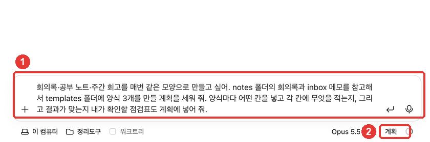
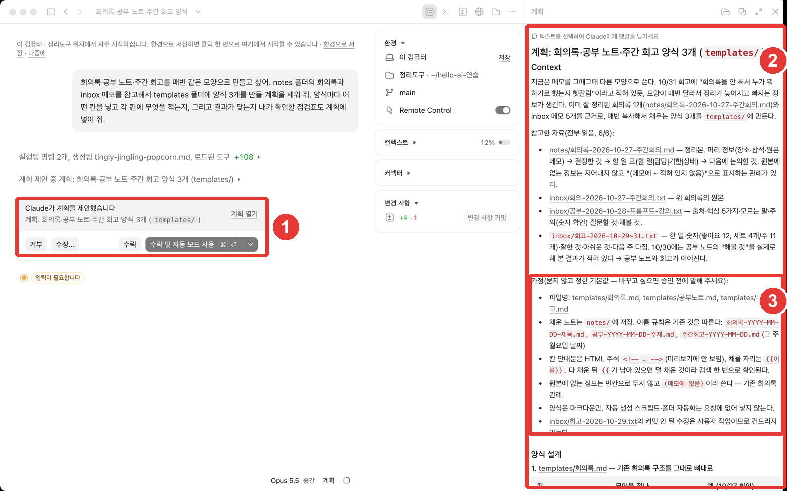
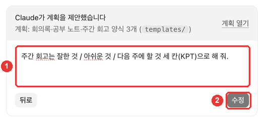
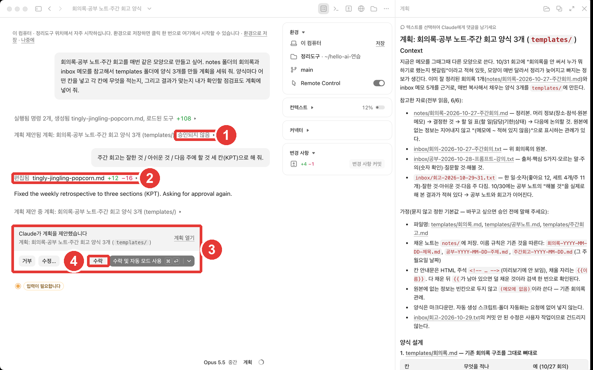
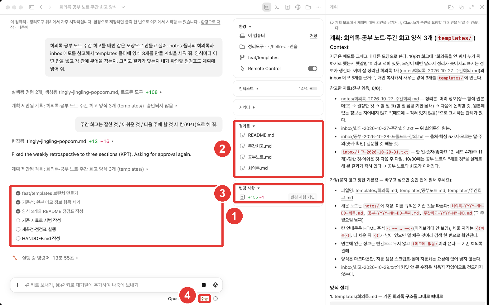

# 第5章 怎样把事情交代好——说具体、先做计划、给出检查标准

> **一句话总结**：在请求里写明**看什么、做成什么样、放在哪里、怎样才算完成**。事情比较大时，先用**「计划」模式拿到方法**，修改之后再交给它。
> 不要只相信"做完了"这句话，要它同时给出**检查标准和依据**。

本章依据 2026 年 10 月 31 日确认过的 Claude Code 官方文档，以及 macOS 桌面应用（韩语界面，付费账号）写成。这一章要做出「整理工具」的骨架——**3 种模板**（会议纪要、学习笔记、每周回顾）。

## 说具体

官方文档指出，请求没有达到预期，最常见的原因是这样的。**因为缺少了 Claude 只读文件夹是无法知道的信息。**[^cant-see] 比如会议上决定了什么、我喜欢的格式、"做完了"的标准，都属于这一类。

所以请求里要写这四样。

| 要写的 | 例子 |
|---|---|
| 看什么 | inbox 里的会议笔记 |
| 做成什么样 | 决定的事 / 要做的事（负责人·期限）/ 下次讨论 |
| 放在哪里 | 在 notes 文件夹里存成新文件 |
| 怎样才算完成 | 每件要做的事都有负责人和期限 |

官方文档也说，一开始就说明"看什么、是什么症状、怎样才算修好"，可以少费一轮修改的功夫。[^specific]

```
整理一下会议笔记。
```

```
读一下 inbox 里的会议笔记，整理成会议纪要。分成"决定的事 / 要做的事（负责人·期限）/ 下次要讨论的事"三部分，保存成 notes 文件夹里的新文件。不要修改原始笔记。
```

第二个请求就是第2章用过的那个。它比第一个长，但可以减少把结果改两三遍的麻烦。

**想要多一点的时候，就这样说。** Claude 读请求很谨慎，倾向于做出满足请求的**最小的结果**。[^ambitious] 请像"连空白的时候怎么处理也写上""每个再给一个例子"这样，亲自把范围放宽。

<Quiz id="ch405-specific" />

## 不清楚的时候，让它来提问

即使还没想好要什么也没关系。可以**让 Claude 向你提问**。[^interview]

```
我想做一份每周五用的每周回顾模板，但还什么都没定。请你一个一个地问我问题，我来回答，全部定下来之后，把内容整理成 회고-양식-초안.md。
```

Claude 会用带选项的问题，来问还没定下来的部分。它会一直问下去，直到回答汇集成规格说明（Spec，写明要做什么的文档）。[^interview] 整理出来的草稿文件，会成为下次真正动手做时的标准。

<Quiz id="ch405-interview" />

## 先做计划——「计划」模式

事情比较大时，不要马上交给它，先**拿到方法**看看。在「计划」模式下，Claude 会读取并查看文件，然后写出计划，但**不会修改文件。**[^plan] 官方文档也建议，复杂的事从「计划」开始。[^plan-tip]

我们来练习一下。在新会话里，把输入框下面一行的模式换成**「计划」**（第4章的权限模式菜单），然后这样发送。



```
我想让会议纪要、学习笔记、每周回顾每次都做成同样的样子。请参考 notes 文件夹里的会议纪要和 inbox 里的笔记，制定一个在 templates 文件夹里做 3 个模板的计划。每个模板要放哪些栏、每个栏里写什么，还有让我检查结果对不对的检查清单，也请放进计划里。
```

过一会儿，计划就出来了。



在 **① 卡片**里选择怎么处理计划。

| 界面名称 | 作用 |
|---|---|
| 拒绝 | 不接受这个计划 |
| 修改… | 写下要改的地方，让它重新做计划 |
| 接受 | 批准，修改逐项确认 |
| 接受并使用自动模式 | 批准，并用自动模式进行 |

来源：界面名称来自本指南的界面确认（2026-10-31），动作来自官方文档[^approve]

在 **② 计划栏**里读计划全文。栏的上方有「选中文字即可给 Claude 留言」的提示，所以可以直接给让你在意的句子写意见。

请一定要读一读 **③ 假设**一节。在这个练习里，Claude 说"这是没问我就定下的默认值——想改的话请在批准之前告诉我"，并把文件名、保存位置、空白的标注方法等单独集中在这里。**批准之前，是修改成本最低的时候。**

### 修改计划

每周回顾，我想写成做得好的、可惜的、下次要做的三栏。点「修改…」，就会打开「需要更改什么？（可选）」栏。



**KPT** 是分成做得好的（Keep）、可惜的（Problem）、下次要试的（Try）的回顾方式。点「修改」，Claude 会修改计划，并再次请求批准。



这次我点的是**「接受」**。批准之后，Claude 会退出计划模式，切换成与所选方式相符的权限模式，并开始修改文件。[^approve] 界面下面一行的模式也从「计划」变成了「手动」。



① 待办清单里能看到的"创建分支""写 HANDOFF.md"，是因为截图电脑上的个人指令（第6章的折叠框）才出现的步骤。你的界面里可能不会出现。

做出的模板是这样的（本指南的实操结果）。

- [5장-양식-회의록.txt](/practice/notes/results/5장-양식-회의록.txt) · [5장-양식-공부노트.txt](/practice/notes/results/5장-양식-공부노트.txt) · [5장-양식-주간회고.txt](/practice/notes/results/5장-양식-주간회고.txt)
- [5장-양식-README.txt](/practice/notes/results/5장-양식-README.txt)——模板的使用方法和检查清单

每周回顾模板按照修改要求，变成了「做得好的 (Keep) / 可惜的 (Problem) / 下周要做的 (Try)」三栏。每个栏都附有写什么的说明和示例。

<Quiz id="ch405-plan" />

## 给出检查标准——用依据代替"做完了"

Claude 在事情**看起来做完了**的时候就会停下。如果没有办法自己确认对不对，那么"看起来做完了"就是全部。这样一来，我就成了一项一项检查的人。[^check]

所以要同时给出**能得出对或错答案的标准**。[^check] 如果是代码，就是测试；如果是整理文档，检查清单就起这个作用。

```
用模板写这周的回顾。写完后，把下面的检查清单逐项确认，每一项都给出"通过/未通过"，以及作为依据的笔记那一行。
- 每个栏里放了 1~3 条吗？
- 数字（销量、点赞数）和笔记一样吗？
- 有没有编造笔记里没有的内容？
```

官方文档说，不管用什么方法，都要**要求它给出依据**。比起"全部通过"这一行字，读它实际确认的内容更快也更准确。[^evidence] 这个练习的模板 README 里，Claude 也放进了检查清单。

<Quiz id="ch405-check" />

## 中途改变方向

请看着最初的 1 分钟。如果它往奇怪的方向走了，就马上让它停下并纠正。[^steer]

- **停下来**：停止按钮或 **Esc**。到那时为止做过的事都会保留。[^steer]
- **倒回去**：第4章的 `/rewind`。可以先试大胆的方法，不行再倒回去，所以尝试起来没有负担。[^steer]
- **从头再来**：**同一件事改了两次还是不对**，就不要改第三次，重新开始。因为失败的两次尝试留在对话里，Claude 会一直重读它们。一个带上所学教训的新请求，几乎总是更好。[^steer] 在桌面应用里，打开一个新会话就行。

<Quiz id="ch405-steer" />

## 亲手试一试

1. 在新会话里把模式换成「计划」，发送上面制作 3 个模板的计划请求。
2. 读计划的「假设」一节，用「修改…」改掉其中至少一个（例如：把每周回顾改成 KPT 三栏）。
3. 用「接受」批准，看看会话信息栏的成果里有没有生成模板文件。
4. 让它用模板写这周的回顾，同时要它给出检查清单和依据。

**连续任务**：再看一遍第4章里记下的"想在两份文档里通用的规则"三行。在第6章里，把这些规则保存到 CLAUDE.md，这样不用每次都说，它也会遵守。

## 小结

- 请求里要写明看什么、做成什么样、放在哪里、怎样才算完成。
- 没想好的话，让 Claude 来提问。
- 事情大时，用「计划」模式先拿到方法。读「假设」一节，用「修改…」改好之后再「接受」。
- 给出能得出对错答案的标准（检查清单），并要求它连同结果一起给出依据。
- 看最初的 1 分钟，改了两次还不对就重新开始。

## 术语整理

| 术语 | 中文名称 | 一句话解释 |
|---|---|---|
| Plan mode | 计划模式 | 不修改文件，只查看后给出计划的模式 |
| Spec | 规格说明 | 写明要做什么的文档 |
| Template | 模板 | 每次都按同样样子填写的框架 |
| KPT | KPT 回顾法 | 分成做得好的（Keep）、可惜的（Problem）、要试的（Try）的回顾方式 |
| Evidence | 依据 | 实际确认过的内容。用来代替"做完了"这句话 |

<ChapterDone :chapter="405" />

下一章：[第6章. 项目记忆](06-claude-md.md)

[^cant-see]: Claude Code 官方文档，「Best practices for Claude Code」. "Claude built something different from what you had in mind, or it has to rediscover the same fact at the start of every session. It's missing information it can't get from reading the repo." https://code.claude.com/docs/en/best-practices (确认日期 2026-10-31)
[^specific]: Claude Code 官方文档，「Best practices for Claude Code」. "If you name the file, describe the symptom, and say what "fixed" looks like up front, you usually save yourself a round of corrections later." https://code.claude.com/docs/en/best-practices (确认日期 2026-10-31)
[^ambitious]: Claude Code 官方文档，「Best practices for Claude Code」. "Claude tends to read a request conservatively and build the smallest thing that satisfies it, since it can't see how much you were hoping for." https://code.claude.com/docs/en/best-practices (确认日期 2026-10-31)
[^interview]: Claude Code 官方文档，「Best practices for Claude Code」. "When you don't know exactly what you want yet, you don't have to work it all out before you prompt. Ask Claude to interview you instead" / "Claude comes back with multiple-choice questions about the parts you haven't pinned down" / "It keeps asking until the answers add up to a spec." https://code.claude.com/docs/en/best-practices (确认日期 2026-10-31)
[^plan]: Claude Code 官方文档，「Choose a permission mode」. "Plan mode tells Claude to research and propose changes without making them. Claude reads files, runs shell commands to explore, and writes a plan, but does not edit your source." https://code.claude.com/docs/en/permission-modes (确认日期 2026-10-31)
[^plan-tip]: Claude Code 官方文档，「Desktop application」. "Start complex tasks in Plan so Claude maps out an approach before making changes." https://code.claude.com/docs/en/desktop (确认日期 2026-10-31)
[^approve]: Claude Code 官方文档，「Choose a permission mode」. "When the plan is ready, Claude presents it and asks how to proceed." / "Approving a plan exits plan mode and switches the session to the permission mode each approve option describes, so Claude starts editing." https://code.claude.com/docs/en/permission-modes (确认日期 2026-10-31)
[^check]: Claude Code 官方文档，「Best practices for Claude Code」. "Claude stops when the work looks done." / "Give Claude something it can run that comes back pass or fail." https://code.claude.com/docs/en/best-practices (确认日期 2026-10-31)
[^evidence]: Claude Code 官方文档，「Best practices for Claude Code」. "\"All tests pass\" on its own tells you very little" / "reading the output is faster than rerunning the check yourself" https://code.claude.com/docs/en/best-practices (确认日期 2026-10-31)
[^steer]: Claude Code 官方文档，「Best practices for Claude Code」. "Watch the first minute, press Esc the moment Claude drifts, and after two failed corrections run /clear and write a better prompt instead of a third." / "Esc stops Claude mid-action and keeps everything up to that point" / "That makes it low-risk to try the bolder approach first and rewind if it doesn't work out." / "a third correction mostly adds to a conversation that already contains two failed attempts for Claude to keep re-reading. /clear plus one new prompt that folds in what you learned works better almost every time." https://code.claude.com/docs/en/best-practices (确认日期 2026-10-31)
