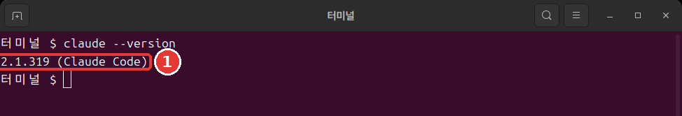

# 第3章 安装与登录

<Badge type="tip" text="必读" /> 想跟着这一阶段学下去，一定要读这一章。

> **一句话总结**：粘贴官方文档里的安装命令，然后在**新的终端窗口**里用 `claude --version` 确认。接着在练习文件夹里运行 `claude`，在浏览器里登录，准备就完成了。

安装只需要做一次。命令也只有一行。

## 粘贴之前——先确认来源

安装命令就在下一节。粘贴之前，先确认一件事。

安装命令会在你的电脑上直接运行从互联网下载的程序。这很方便，但如果粘贴了来路不对的网站上的命令，坏程序就可能以你的权限运行。

所以，**不要把陌生网站上的安装命令直接粘贴进去。** 本课程里的命令也一样。打开官方文档「[Quickstart](https://code.claude.com/docs/en/quickstart)」，用眼睛核对一下是不是同一条命令。

- **不太好的例子**：把博客上找到的安装命令直接粘贴到终端里。
- **更好的例子**：打开官方文档，确认是同一条命令后再粘贴。

不管粘贴到终端里的是什么命令，都要先看来源。安装别的程序时，这个习惯也能保护你。

<Quiz id="ch803-safe" />

## 各操作系统的安装命令

打开终端，**只**粘贴适合你电脑的**一条**命令，然后按 Enter。这是官方文档里的命令。[^install]

Mac·Linux·WSL（在 Windows 里使用 Linux 的功能）这样输入。

```bash
curl -fsSL https://claude.ai/install.sh | bash
```

Windows PowerShell 这样输入。

```powershell
irm https://claude.ai/install.ps1 | iex
```

这两条命令做的是同一件事。前半部分下载安装文件，`|`（竖线）后面运行下载下来的内容。不完全懂每个片段的意思，也能安装。

::: details 详细说明（点击展开）
- `|` 是把前一条命令的结果交给后一条命令的符号。
- Mac·Linux 由 `curl` 下载，由 `bash` 运行。
- PowerShell 由 `irm` 下载，由 `iex` 运行。[^irm]
- `-fsSL` 是把决定下载方式的四个选项合在一起写。意思写在[命令词典](command-reference.md)里。
:::

下载过程中没有进度显示。即使看起来什么都没发生，也不要关窗口，耐心等待。完成后会看到 `Claude Code successfully installed!` 这句话。[^progress]

如果把命令输入到了不对的窗口，就会出错。这不是坏了，而是选错了窗口。[^wrong-shell]

- 出现 `'irm' is not recognized`：你在 CMD 里，而不是 PowerShell 里。打开 PowerShell 再来一次。
- 因为 `-fsSL` 而出错：你把 Mac·Linux 用的命令输入到了 PowerShell 里。请使用 PowerShell 用的命令。

根据界面语言，错误也可能用中文显示。意思是一样的。

在 Windows 上，不需要以管理员身份运行。[^no-admin] 大多数情况下，上面一行就够了。

::: details 详细说明（点击展开）
- **Windows 和 Git**：即使没有 Git（记录文件变更的工具），也可以照样跟着学。没有的话，Claude Code 会改用 PowerShell。[^git-win] Git 在第12章安装。
- **其他安装方法**：也可以用 Mac 的 Homebrew 或 Windows 的 WinGet 这样的程序管理工具来安装。[^brew] 如果你没有在用这类工具，就用上面那一行。
:::

<Quiz id="ch803-install" />

## 确认安装

安装完成后，**打开一个新的终端窗口**，输入这条命令。[^check]

```bash
claude --version
```

像这样显示出版本号就成功了。版本号不同也没关系。看看后面有没有带着 `(Claude Code)`。



```text
2.1.318 (Claude Code)
```

为什么要新窗口呢？已经打开的窗口还在用旧的设置。[^old-path] 所以会出现在完成安装的那个窗口里不行、在新窗口里却可以的情况。

<Quiz id="ch803-check" />

## 出现 command not found 的时候

即使在新窗口里，也可能出现这样的话。在 Windows 上会出现 `not recognized`。根据界面语言，也可能用中文显示。意思是一样的。

```text
zsh: command not found: claude
bash: claude: command not found
```

意思是已经安装好了，但终端找不到这个程序。[^path-cause]

终端会在一个叫 **PATH**（路径变量）的文件夹列表里找程序。把它想成电话簿就好懂了。程序就算存在，如果没写进列表，也找不到。安装程序只会告诉你怎么修复，不会直接修改 PATH。[^path-what]

程序在 Mac·Linux 上位于 `~/.local/bin/claude`，在 Windows 上位于 `%USERPROFILE%\.local\bin\claude.exe`。[^path-where] 把这个文件夹加到列表里就行。下面是官方文档里的命令。**只用适合你电脑的那一条**。

Mac 的默认 shell（在终端里接收命令的程序）Zsh 这样写。

```bash
echo 'export PATH="$HOME/.local/bin:$PATH"' >> ~/.zshrc
source ~/.zshrc
```

大多数 Linux（Bash）这样写。

```bash
echo 'export PATH="$HOME/.local/bin:$PATH"' >> ~/.bashrc
source ~/.bashrc
```

Windows PowerShell 这样写。

```powershell
$currentPath = [Environment]::GetEnvironmentVariable('PATH', 'User')
[Environment]::SetEnvironmentVariable('PATH', "$currentPath;$env:USERPROFILE\.local\bin", 'User')
```

命令的各个片段是这个意思。

- **`echo` 那一行**：把设置保存到文件里。`>>` 是追加到文件末尾的符号。所以设置文件里原有的内容不会被删掉。
- **`source` 那一行**：把保存的设置应用到当前窗口。
- **只输入一次**：输入两次的话，同样的一行会被加进去两次。
- **Windows**：输入这两行之后，需要重新启动终端。[^path-apply]

然后再输入一次 `claude --version`。显示出版本号，就解决了。

如果还是不行，请看官方文档「[Troubleshoot installation and login](https://code.claude.com/docs/en/troubleshoot-install)」。如果 `claude` 能运行，可以用 `claude doctor` 查看安装状态。它不打开会话，只显示诊断结果。[^doctor]

<Quiz id="ch803-path" />

## 登录

在新窗口里移动到第2章的练习文件夹，然后输入 `claude`。Mac·Linux 这样输入。

```bash
cd ~/hello-ai-연습/터미널
claude
```

Windows PowerShell 这样输入。

```powershell
cd $HOME\hello-ai-연습\터미널
claude
```

第一次运行时，会提示你登录。个人订阅用户用 claude.ai 账号登录。[^login] 步骤是这样的。[^login-steps]

1. 浏览器打开后，登录。
2. 如果浏览器没有打开，在终端里按 `c`。登录地址会被复制下来，把它粘贴到浏览器里。
3. 如果浏览器显示了一段代码，把它粘贴到终端里 `Paste code here if prompted` 的位置。
4. 出现 `Login successful` 后，按 Enter。

登录一次就够了。信息会被保存下来，不会再问。想换账号的话，在运行中输入 `/login`。[^login-once]

登录前后可能还会出现初始设置界面。也可能出现一个询问你是否信任这个文件夹的窗口。这个窗口我们在第4章一起看。现在可以按 `Esc` 退出。

<Quiz id="ch803-login" />

## 更新和卸载

**更新。** 如果你是用上面那一行安装的，就不用另外做什么。它会在后台自动下载，下次打开 Claude Code 时生效。[^auto-update] 想马上更新的话，在终端里输入 `claude update`。如果已经是最新版，它会告诉你 `Claude Code is up to date`。[^update]

如果是用 Homebrew 或 WinGet 安装的，就不会自动更新。需要隔一段时间用那个工具自己更新一下。[^manual-update]

**卸载。** 卸载的方法现在用不上，所以先折叠起来了。以后需要时再展开看。

::: details 详细说明（点击展开）
在 Mac·Linux 上，如果是用上面那一行安装的，就用这两行卸载。[^uninstall]

```bash
rm -f ~/.local/bin/claude
rm -rf ~/.local/share/claude
```

`rm` 是不经过回收站、直接删除的命令。`-r` 是连文件夹里面全部删除，`-f` 是不询问直接删除的选项。输入前一定要核对每一个字。Windows 和其他安装方法，请按照官方文档「[Advanced setup](https://code.claude.com/docs/en/setup)」里的 Uninstall 一节操作。
:::

<Quiz id="ch803-update" />

## 动手试试

1. 打开官方文档，确认安装命令和本章里的一样。
2. 粘贴适合你操作系统的命令，等它完成。
3. 打开新窗口，输入 `claude --version`。如果出现 `command not found`，就按照上面那一节来做。
4. 在练习文件夹里运行 `claude` 并登录。如果弹出信任窗口，按 `Esc` 退出。如果已经进入了输入框，就输入 `/exit`。

问问自己。`claude --version` 显示版本号了吗？如果是，下一章就可以让它做第一件事了。

## 小结

- 安装命令要确认和官方文档一样再粘贴。
- Mac·Linux 用 `curl` 那一行，Windows 用 PowerShell 的 `irm` 那一行。没有进度显示也要耐心等。
- 在新窗口里用 `claude --version` 确认。
- 出现 `command not found` 时，先打开新窗口试试，还不行就加上 PATH 那一行。
- 登录是在练习文件夹里运行 `claude`，在浏览器里登录一次就行。
- 默认安装会自动更新。

## 术语整理

| 术语 | 中文名称 | 一句话解释 |
|---|---|---|
| PATH | 路径变量 | 终端用来找程序的文件夹列表 |
| WSL | 适用于 Linux 的 Windows 子系统 | 在 Windows 里使用 Linux 的功能 |
| `curl` | 下载命令 | 从互联网获取内容的命令 |
| `irm` | PowerShell 下载命令 | 在 PowerShell 里从互联网获取内容的命令 |
| `rm` | 删除命令 | 删除文件的命令 |

<ChapterDone :chapter="803" />

下一章：[第4章 第一次会话](04-first-session.md)

[^install]: 本指南是在已经安装、登录好的电脑上运行的，所以没有亲自走过安装和登录的过程。本章的安装·登录步骤来自官方文档的说明。Claude Code 官方文档，「Quickstart」. "curl -fsSL https://claude.ai/install.sh | bash" / "irm https://claude.ai/install.ps1 | iex" https://code.claude.com/docs/en/quickstart （确认日期 2026-11-06）
[^progress]: Claude Code 官方文档，「Quickstart」. "The install command shows no progress while it downloads Claude Code." https://code.claude.com/docs/en/quickstart · 「Terminal guide for new users」. "When the installer finishes, you'll see "Claude Code successfully installed!"" https://code.claude.com/docs/en/terminal-guide （确认日期 2026-11-06）
[^wrong-shell]: Claude Code 官方文档，「Quickstart」. "If you see `'irm' is not recognized as an internal or external command`, you're in CMD, not PowerShell." https://code.claude.com/docs/en/quickstart · 「Troubleshoot installation and login」. "you ran the macOS/Linux `curl -fsSL ... | bash` installer in Windows PowerShell, where `curl` is an alias for `Invoke-WebRequest` and rejects the `-fsSL` flags" https://code.claude.com/docs/en/troubleshoot-install （确认日期 2026-11-06）
[^no-admin]: Claude Code 官方文档，「Advanced setup」. "You do not need to run as Administrator." https://code.claude.com/docs/en/setup （确认日期 2026-11-06）
[^git-win]: Claude Code 官方文档，「Quickstart」. "Git for Windows is recommended on native Windows so Claude Code can use the Bash tool." / "If Git for Windows is not installed, Claude Code uses PowerShell as the shell tool instead." https://code.claude.com/docs/en/quickstart （确认日期 2026-11-06）
[^brew]: Claude Code 官方文档，「Quickstart」. "brew install --cask claude-code" / "winget install Anthropic.ClaudeCode" https://code.claude.com/docs/en/quickstart （确认日期 2026-11-06）
[^check]: Claude Code 官方文档，「Quickstart」. "When the installer finishes, open a new terminal window and run `claude --version`." / "The command prints a version number followed by `(Claude Code)`." https://code.claude.com/docs/en/quickstart （确认日期 2026-11-06）
[^old-path]: Claude Code 官方文档，「Troubleshoot installation and login」. "a window that was already open keeps its old PATH, and a terminal inside an editor takes its PATH from the editor." https://code.claude.com/docs/en/troubleshoot-install （确认日期 2026-11-06）
[^path-cause]: Claude Code 官方文档，「Troubleshoot installation and login」. "If installation succeeded but you get a `command not found` or `not recognized` error when running `claude`, the install directory isn't in your PATH." https://code.claude.com/docs/en/troubleshoot-install （确认日期 2026-11-06）
[^path-what]: Claude Code 官方文档，「Troubleshoot installation and login」. "Your shell searches for programs in directories listed in PATH" / "It prints the fix with that note but doesn't change PATH itself." https://code.claude.com/docs/en/troubleshoot-install （确认日期 2026-11-06）
[^path-where]: Claude Code 官方文档，「Troubleshoot installation and login」. "the installer places `claude` at `~/.local/bin/claude` on macOS/Linux or `%USERPROFILE%\.local\bin\claude.exe` on Windows" https://code.claude.com/docs/en/troubleshoot-install （确认日期 2026-11-06）
[^path-apply]: Claude Code 官方文档，「Troubleshoot installation and login」. "The `echo` command saves the setting for every new terminal, and `source` applies it to the window you're in." / "Restart your terminal for the change to take effect." https://code.claude.com/docs/en/troubleshoot-install （确认日期 2026-11-06）
[^doctor]: Claude Code 官方文档，「Advanced setup」. "prints read-only installation and settings diagnostics without starting a session" https://code.claude.com/docs/en/setup （确认日期 2026-11-06）
[^login]: Claude Code 官方文档，「Quickstart」. "Claude Code prompts you to log in on first use." https://code.claude.com/docs/en/quickstart · 「Authentication」. "Claude Pro, Max, or Ultra subscription: log in with your claude.ai account." https://code.claude.com/docs/en/authentication （确认日期 2026-11-06）
[^login-steps]: Claude Code 官方文档，「Authentication」. "If the browser doesn't open automatically, press `c` to copy the login URL to your clipboard, then paste it into your browser." / "If your browser shows a login code instead of redirecting back after you sign in, paste it into the terminal at the `Paste code here if prompted` prompt." / "When login completes, the terminal shows `Login successful` and prompts you to press `Enter` to continue." https://code.claude.com/docs/en/authentication （确认日期 2026-11-06）
[^login-once]: Claude Code 官方文档，「Quickstart」. "Once logged in, your credentials are stored and you won't need to log in again." / "To switch accounts later or re-authenticate, type `/login` inside the running session." https://code.claude.com/docs/en/quickstart （确认日期 2026-11-06）
[^auto-update]: Claude Code 官方文档，「Quickstart」. "Native installations automatically update in the background to keep you on the latest version." https://code.claude.com/docs/en/quickstart · 「Advanced setup」. "Updates download and install in the background, then take effect the next time you start Claude Code." https://code.claude.com/docs/en/setup （确认日期 2026-11-06）
[^update]: Claude Code 官方文档，「CLI reference」. "Update to latest version" https://code.claude.com/docs/en/cli-reference · 「Advanced setup」. "If you're already on the newest version, it reports `Claude Code is up to date (<version>)`." https://code.claude.com/docs/en/setup （确认日期 2026-11-06）
[^manual-update]: Claude Code 官方文档，「Quickstart」. "Homebrew installations do not auto-update." / "Run `winget upgrade Anthropic.ClaudeCode` periodically to get the latest features and security fixes." https://code.claude.com/docs/en/quickstart （确认日期 2026-11-06）
[^uninstall]: Claude Code 官方文档，「Advanced setup」. "rm -f ~/.local/bin/claude" https://code.claude.com/docs/en/setup （确认日期 2026-11-06）
[^irm]: Claude Code 官方文档，「Terminal guide for new users」. "`irm` fetches the file and `iex` runs it." https://code.claude.com/docs/en/terminal-guide （确认日期 2026-11-06）
