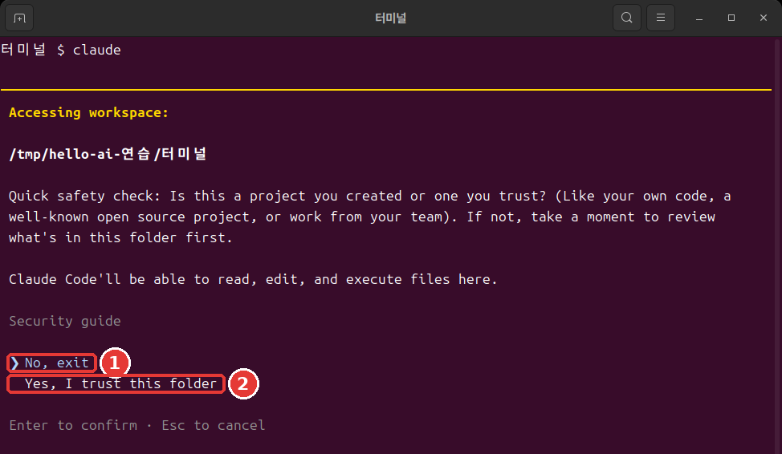
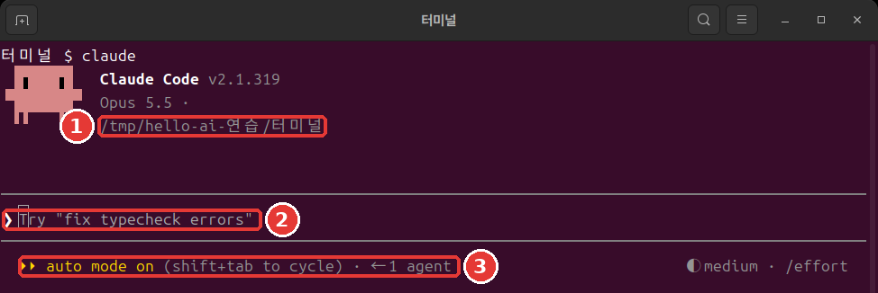
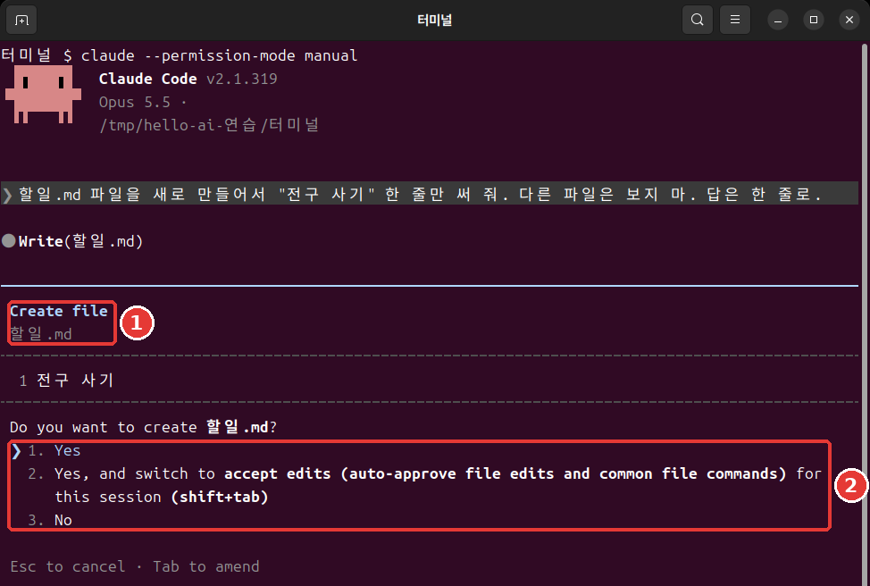

# 第4章 第一次会话

<Badge type="tip" text="必读" /> 想跟着这一阶段学下去，一定要读这一章。

> **一句话总结**：进入要工作的文件夹，输入 `claude`。在信任确认窗口里选 `Yes`，然后用说话的方式交代任务。要停下按 `Esc`，要结束输入 `/exit`。

**会话**（Session）是从打开 Claude Code 到结束为止的一整段对话。我们在第2章建好的文件夹里，打开第一次会话。

## 从文件夹开始

先移动到要工作的文件夹。然后输入 `claude`。[^start]

Mac·Linux 这样输入。

```bash
cd ~/hello-ai-연습/터미널
claude
```

Windows PowerShell 这样输入。

```powershell
cd $HOME\hello-ai-연습\터미널
claude
```

**顺序很重要。** `claude` 会把当前所在的文件夹当作工作文件夹来启动。启动界面上也会显示这个文件夹。[^header] 如果在和工作无关的文件夹里打开，它就会对着那个文件夹里的文件干活。

- **不太好的例子**：一打开终端就输入 `claude`。
- **更好的例子**：用 `cd` 进入文件夹，用 `pwd` 确认后，再输入 `claude`。

<Quiz id="ch804-start" />

## 信任确认窗口

在第一次打开的文件夹里，会先弹出这样一个窗口。



这是实际终端窗口的截图。颜色和字体取决于你的终端设置。下面的文字框是把同一个界面用文字写出来的。[^screens]

```text
 Accessing workspace:

 ~/hello-ai-연습/터미널

 Quick safety check: Is this a project you created or one you trust? (Like your own code, a
 well-known open source project, or work from your team). If not, take a moment to review what's in
 this folder first.

 Claude Code'll be able to read, edit, and execute files here.

 Security guide

 ❯ No, exit
   Yes, I trust this folder

 Enter to confirm · Esc to cancel
```

意思是这样的。"这是你自己创建的、或者你信任的文件夹吗？如果不是，请先看看里面有什么。Claude Code 可以读取、修改和运行这里的文件。"

**如果在这里直接按 Enter，程序就会退出。** 因为 `❯` 标记停在 `No, exit` 上。按一次向下方向键，移到 `Yes, I trust this folder`，再按 Enter。在终端里不能点菜单来选择。[^arrows]

这个文件夹是你刚刚自己建的，可以信任。如果是从别人那里拿到的文件夹，请先看看里面的内容。

<Quiz id="ch804-trust" />

## 看懂启动界面

选了 `Yes` 之后，会出现这样的界面。



```text
 ▐▛███▛█   Claude Code v2.1.318
▝▜██████▀  Opus 5.5 · Claude 套餐名称
 ▝▝   ▝▝   ~/hello-ai-연습/터미널

▎ Auto mode is now Claude Code's default permission mode.
▎ Auto mode lets Claude handle permission prompts automatically. Claude checks each tool call for
▎ risky actions and prompt injection before executing, runs the ones it assesses as lower-risk, and
▎ blocks the rest.
▎ https://code.claude.com/docs/en/permission-modes

────────────────────────────────────────────────────────────
❯ Try "create a util logging.py that..."
────────────────────────────────────────────────────────────
  ⏵⏵ auto mode on (shift+tab to cycle)                ◐ medium · /effort
```

从上往下读一读。

- **最上面三行**：版本、当前模型、工作文件夹。[^header] 一定要看看文件夹是不是你以为的那个。
- **Auto mode 说明**：第一次运行时会看到的英文通知。现在不读直接跳过也可以。重要的内容下面马上用中文讲。
- **`❯` 那一行**：输入框。以 `Try` 开头的文字是示例。你一输入自己的文字，它就会消失。
- **最下面一行**：左边是当前的**权限模式**。权限模式是 Claude 不用问你就可以做的事情的范围。[^mode] 右边的 `medium` 在第13章讲。

终端里的 `claude` 以**自动模式**（auto）启动。另有一个 AI 会提前检查它的行动，拦下看起来危险的操作。不过，自动模式只是减少许可窗口，并不保证安全。[^auto]

一开始，最好亲眼看着 Claude 要做什么。按一次 `Shift + Tab`，切换到手动模式。[^shift-tab] 最下面一行会变成这样。

```text
  ⏸ manual mode on · ? for shortcuts                  ◐ medium · /effort
```

手动模式下，在修改文件或运行命令之前，大多会先问你。[^manual] 模式在第7章详细讲。

::: details 详细说明（点击展开）
- 不能使用自动模式的会话，会以手动模式启动。[^auto] 当前是什么模式，请以最下面一行为准。
- 也可以一开始就用 `claude --permission-mode manual` 启动。[^manual]
:::

<Quiz id="ch804-screen" />

## 第一个请求——做会议记录

现在让它干活。像跟同事说话一样写就行。[^colleague] 把这句话输入到输入框里，按 Enter。

```text
读一下 inbox 里的会议笔记，保存成 회의록.md。回答只要一行。
```

`.md` 是 Markdown 文件。是用记事本也能打开的文本文件。

请求越具体越好。

- **不太好的例子**：`帮我做会议记录`——读什么、放在哪里，都得让 Claude 去猜。
- **更好的例子**：上面那句话——要读的东西、保存的位置、回答的长度都有了。

如果是手动模式，Claude 会读取笔记，显示文件内容，然后这样问你。



```text
 Do you want to create 회의록.md?
 ❯ 1. Yes
   2. Yes, and switch to accept edits (auto-approve file edits and common file commands) for this
      session (shift+tab)
   3. No

 Esc to cancel · Tab to amend
```

浏览一下内容，在 `1. Yes` 上按 Enter。[^yes] 2 号是让这次会话里修改文件不再询问的选项，3 号是拒绝。如果保持自动模式，可能不会出现这个窗口就直接保存了。本指南的界面记录是手动模式下的。

完成后，它会这样回答。

```text
● 已整理成 회의록.md。笔记里的 10/27（周一）和 11/3（周一）在 2026 年的日历上是星期二，所以在文件里标注了
  需要确认。
```

就算它提到星期几的事，也不要惊讶。练习笔记里的星期是编出来的，和日历对不上。Claude 发现了这一点。回答的句子每次运行都可能不同。输入框里也可能浅浅地显示出下一个请求的建议。不用也没关系。

用同一份笔记做出的成果物在 [4장-회의록.txt](/practice/cli/results/4장-회의록.txt) 里。可以和你自己的结果比一比。不需要一模一样。

<Quiz id="ch804-first" />

## 交代任务与停下

会话就是对话。可以接着前面的事继续交代。这次来修改文件。

```text
在 회의록.md 的最上面一行加上"草稿"这一行。回答只要一行。
```

这次它会显示要改动的行，然后问你。带 `+` 的行是要新加入的行。

```text
 1 +草稿
 2  # 街角咖啡馆 每周例会 会议记录
 3
 4  - **日期时间：** 10/27（周一）
```

在它下面会问 `Do you want to make this edit to 회의록.md?`。要改动的行的样子，取决于你的会议记录。

许可窗口要读完再选。这是你能核对它做的是不是你交代的事的时刻。

如果 Claude 跑偏了，就按 **`Esc`**。正在执行的操作会被取消，Claude 会等你的下一个指示。你随时可以插话，改变方向。[^esc]

有一点要记住。即使停下了，**到目前为止做过的事还在。**[^esc-keep] 已经保存的文件不会自动恢复原样。怎么撤销，在第7章学。

<Quiz id="ch804-stop" />

## 结束

在输入框里这样输入，按 Enter。[^exit]

```text
/exit
```

会回到终端的提示符。现在你已经在 Claude Code 外面了。确认一下文件有没有生成。

```bash
ls
cat 회의록.md
```

如果在 PowerShell 里文字显示成乱码，就用 `Get-Content -Encoding UTF8 회의록.md` 来看。

在空的输入框里按两次 `Ctrl + D` 也能结束。[^ctrl-d] 一开始，用文字输入的 `/exit` 最不容易搞混。怎么继续已经结束的对话，在第6章讲。

现在来区分两个地方。以后命令该输入到哪里，就靠这个来判断。

- **终端**：光标前面的符号是 `%`、`$`、`>`。`cd`、`ls`、`claude` 输入在这里。
- **Claude 输入框**：最前面是 `❯`，上下各有一条线。用说话方式提的请求和以 `/` 开头的命令输入在这里。

把 `/exit` 输入到终端里会出错。反过来，把 `ls` 或 `cd` 这样的终端命令输入到输入框里，它不会作为命令运行，而是变成发给 Claude 的话。后面章节里说要"在终端里"输入的命令，如果你看到的是输入框，就先用 `/exit` 出来再输入。

<Quiz id="ch804-exit" />

## 动手试试

1. 用 `cd` 进入练习文件夹，用 `pwd` 确认。
2. 打开 `claude`，在信任确认窗口里选 `Yes, I trust this folder`。
3. 在启动界面上看文件夹和权限模式。用 `Shift + Tab` 切换到手动模式。
4. 发送做会议记录的请求，读完许可窗口后选 `1. Yes`。
5. 让它加上"草稿"那一行。
6. 用 `/exit` 出来，用 `cat` 查看文件。

问问自己。文件生成了吗？笔记里的决定和待办事项都一个不落地写进去了吗？有没有混进笔记里没有的内容？把 AI 的结果和笔记对照的习惯，就从这里开始。

## 小结

- 用 `cd` 进入文件夹后再打开 `claude`。
- 信任确认窗口的默认选项是 `No, exit`。用向下方向键选 `Yes`。
- 在启动界面上看文件夹和权限模式。终端以自动模式启动，用 `Shift + Tab` 切换。
- 请求里要写明读什么、存在哪里。许可窗口读完再选。
- `Esc` 是停下。到目前为止做过的事会留下。
- 用 `/exit` 结束，把结果和笔记对照。
- 符号是 `%`、`$`、`>` 就是终端，是 `❯` 就是 Claude 输入框。

## 术语整理

| 术语 | 中文名称 | 一句话解释 |
|---|---|---|
| Session | 会话 | 从打开 Claude Code 到结束为止的一整段对话 |
| Permission mode | 权限模式 | 不用询问就可以做的事情的范围 |
| Auto mode | 自动模式 | 另有一个 AI 提前检查、减少许可窗口的模式 |
| Manual mode | 手动模式 | 大多会先询问的模式 |
| Markdown | Markdown | 用符号写标题和列表的文本文件格式 |

<ChapterDone :chapter="804" />

下一章：[第5章 输入技巧与命令](05-input-commands.md)

[^screens]: 本章和后面的图，是在 Linux 终端里用 Claude Code 2.1.319 截的。文件夹路径是练习用的临时文件夹，所以和你的界面不同；套餐名称已经遮住。界面上的文件夹路径和套餐名称，按本课程改写过。文字框是为了方便复制另外誊写的。有些地方是从别的运行里搬过来的，所以路径或文件名可能和图不一样。
[^start]: Claude Code 官方文档，「Quickstart」. "Open your terminal in any project directory and start Claude Code:" https://code.claude.com/docs/en/quickstart （确认日期 2026-11-06）
[^header]: Claude Code 官方文档，「Quickstart」. "The Claude Code prompt appears with the version, current model, and working directory shown above it." https://code.claude.com/docs/en/quickstart （确认日期 2026-11-06）
[^arrows]: Claude Code 官方文档，「Terminal guide for new users」. "You can't click on things in the terminal. Use the arrow keys to move around." https://code.claude.com/docs/en/terminal-guide （确认日期 2026-11-06）
[^mode]: Claude Code 官方文档，「Choose a permission mode」. "A permission mode sets which actions Claude can take in a session without asking you first." https://code.claude.com/docs/en/permission-modes （确认日期 2026-11-06）
[^auto]: Claude Code 官方文档，「Choose a permission mode」. "With Claude Code v2.1.283 or later, auto mode is the built-in starting permission mode for interactive terminal and VS Code sessions." / "A separate classifier model reviews actions before they run, blocking anything that escalates beyond your request, targets unrecognized infrastructure, or appears driven by hostile content Claude read." / "Auto mode reduces permission prompts but does not guarantee safety." / "When the flag, a settings file, or the built-in default selects `auto` but auto mode isn't available to the session, Claude Code starts the session in Manual instead." https://code.claude.com/docs/en/permission-modes （确认日期 2026-11-06）
[^shift-tab]: Claude Code 官方文档，「Choose a permission mode」. "From `auto`, the first press switches to `default`, and the cycle then runs `default` → `acceptEdits` → `plan`." https://code.claude.com/docs/en/permission-modes （确认日期 2026-11-06）
[^manual]: Claude Code 官方文档，「Choose a permission mode」. "In Manual mode, Claude Code stops and asks you before most actions that edit files, run shell commands, or reach the network." https://code.claude.com/docs/en/permission-modes · 「Best practices for Claude Code」. "`Shift+Tab` in the session cycles through the permission modes, Manual included, or start with `claude --permission-mode manual` from your shell." https://code.claude.com/docs/en/best-practices （确认日期 2026-11-06）
[^colleague]: Claude Code 官方文档，「Quickstart」. "Talk to Claude like you would a helpful colleague." https://code.claude.com/docs/en/quickstart （确认日期 2026-11-06）
[^yes]: Claude Code 官方文档，「Quickstart」. "If it asks before making the change, select Yes to approve." https://code.claude.com/docs/en/quickstart （确认日期 2026-11-06）
[^esc]: Claude Code 官方文档，「How Claude Code works」. "The running tool call is canceled and Claude waits for your next instruction." / "You can interrupt at any point to steer Claude in a different direction, provide additional context, or ask it to try a different approach." https://code.claude.com/docs/en/how-claude-code-works （确认日期 2026-11-06）
[^esc-keep]: Claude Code 官方文档，「Interactive mode」. "Stop the current response or tool call mid-turn so you can redirect. Claude keeps the work done so far." https://code.claude.com/docs/en/interactive-mode （确认日期 2026-11-06）
[^exit]: Claude Code 官方文档，「Commands」. "Exit the CLI." https://code.claude.com/docs/en/commands （确认日期 2026-11-06）
[^ctrl-d]: Claude Code 官方文档，「Terminal guide for new users」. "Type `exit` or press `Ctrl + D` twice on an empty prompt to leave Claude Code." https://code.claude.com/docs/en/terminal-guide （确认日期 2026-11-06）
