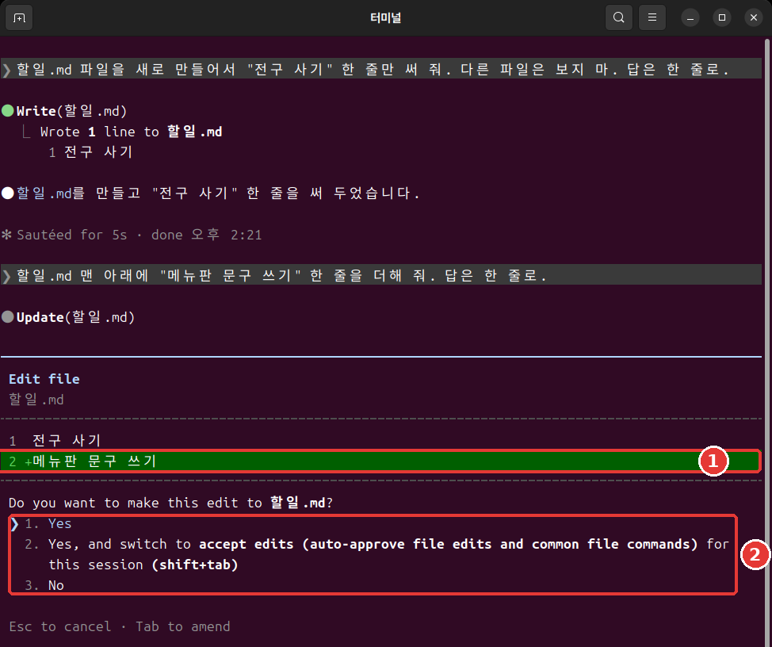
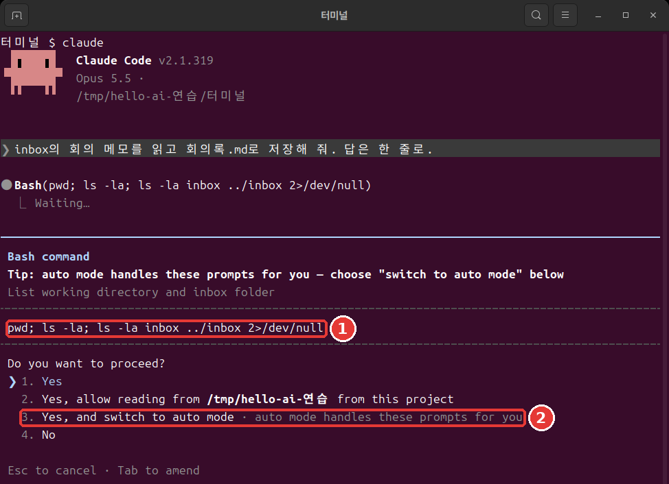
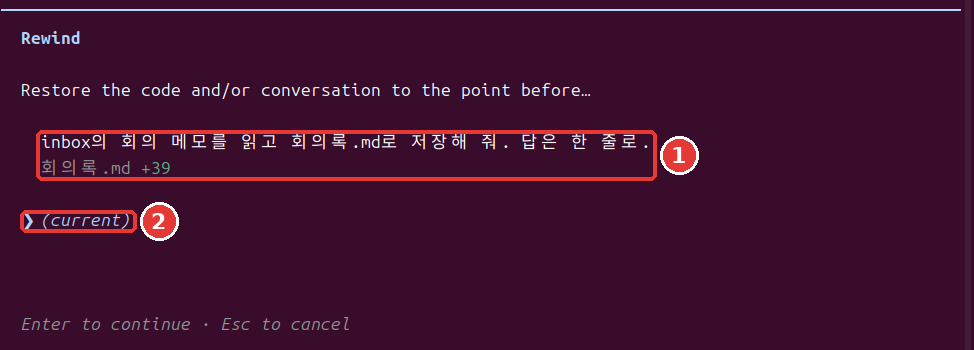
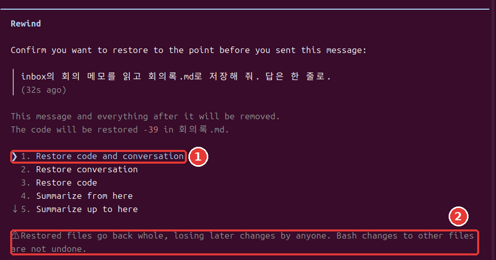

# 第7章 许可与撤回

<Badge type="tip" text="必读" /> 想跟着这个阶段走下去，一定要读这一章。

> **一句话总结**：Claude 不问你就能做哪些事，由权限模式和规则决定。出了错可以按两次 Esc 回退，但也有回不来的事。

不用全部记住。[^run] 先学会怎么读许可窗口就行。

## 四种权限模式

**权限模式**（Permission mode）是 Claude 不问你也可以做的事情的范围。[^modes] 当前模式显示在画面最下面一行。每按一次 Shift+Tab，就按表格的顺序切换，最下面一个之后会回到最上面。

| 简单的名字 | 最下面一行的文字 | 作用 |
|---|---|---|
| 自动 | `⏵⏵ auto mode on` | 由另一个 AI 检查后进行 |
| 手动 | `⏸ manual mode on` | 大多数事先问你 |
| 允许编辑 | `⏵⏵ accept edits on` | 文件操作不问你 |
| 计划 | `⏸ plan mode on` | 只调查和提建议 |

- **自动（auto）**：在终端里打开 `claude`，就从这个模式开始。一个事先检查行动的另一个 AI，会拦下看起来危险的操作。[^auto] 这不是有人替你把关。自动模式只是减少许可窗口，并不保证安全。[^auto]
- **手动（manual）**：修改文件、运行 Shell 命令、访问网络，大多都会先问你。[^modes] 很安全，但大约十次之后，就容易不看内容直接批准。[^practice]
- **允许编辑（accept edits）**：在工作文件夹里新建和修改文件，都不会问你。[^modes] 常见的文件命令也会不问就批准。
- **计划（plan）**：只调查并提出建议，不做修改。[^modes] 交给它大任务之前，想先看看它打算怎么做时很好用。

::: details 详细（点击展开）
在自动模式下连续被拦下三次，它就会停下来，重新来问你。[^practice]
:::

刚开始练习时，试试从手动模式开始。你会慢慢看熟 Claude 在做什么。在终端里这样输入。[^practice]

```bash
claude --permission-mode manual
```

<Quiz id="ch807-modes" />

## 读懂许可窗口

在手动模式下，如果你请它"读一下 inbox 里的会议记录，保存成 회의록2.md。回答只用一行。"，就会弹出这样的窗口。许可窗口会先展示 Claude 打算做的事，再给你选项。[^prompt]

```text
 Do you want to create 회의록2.md?
 ❯ 1. Yes
   2. Yes, and switch to accept edits (auto-approve file edits and common file commands) for this
      session (shift+tab)
   3. No

 Esc to cancel · Tab to amend
```

用上下方向键选择，然后按 Enter。选 1 只允许这一次。选 2 会把这个会话切换成允许编辑模式。选 3 就是不做。Esc 是取消。

修改已有文件时，它会问 `Do you want to make this edit to 회의록2.md?`，并显示要改的行。前面带 `+` 的行是新加进去的行。



运行 Shell 命令时，会弹出样子稍有不同的窗口。它会原样显示要运行的命令，所以先读一读。如果可以用自动模式，还会附上切换到自动模式的选项。[^switch-auto]



以 `Yes, allow reading from` 开头的选项，是在问能不能读某个文件夹。看清是哪个文件夹的名字再选。[^symbols]

窗口弹出时，这样问问自己。

- 是我说的那个文件吗？
- 要改的内容是我请它做的吗？
- 有没有夹杂我没请它做的事？

欠佳的习惯是窗口一弹出就按 Enter。更好的习惯是看清文件名和要改的行再选。这几秒钟能提前抓住错误的修改。

Shell 命令的许可窗口里可能会出现 `Yes, and don't ask again`。选它的话，规则会保存到设置文件里，下一个会话也继续有效。[^local-file] 文件修改的批准只持续到会话结束。[^prompt] 会被保存的那种会留很久，所以只在明白意思时再选。

<Quiz id="ch807-prompt" />

## 不要用跳过检查的选项

你可能会在网上的文章里看到 `--dangerously-skip-permissions`。这是跳过权限检查的选项。[^skip] 不要用它。

这个选项既挡不住失误，也挡不住提示词注入（第5章看过的、用藏在文字里的指令操控 AI 的攻击）。[^bypass] 所以它只用在和你的电脑隔开的练习环境里。官方文档举的例子是断网的容器或虚拟机（在你电脑里另外建的一台隔离的电脑）。[^bypass]

如果嫌许可窗口麻烦，还有别的办法。只把常做的事用下一节的允许规则放开就行。

<Quiz id="ch807-skip" />

## 许可规则 allow·ask·deny

如果说模式是大框架，规则就是细项。规则按**工具**来定。工具是 Claude 使用的功能。比如 `Read` 是读文件，`Bash` 是 Shell 命令。

规则有三种。[^rules]

- **allow**：不问就允许。
- **ask**：每次使用都确认。
- **deny**：禁止使用。

规则写在设置文件里。下一节会亲手做一条。

规则按 deny、ask、allow 的顺序判断，先匹配上的那条胜出。所以不能用 allow 在大范围的 deny 上开个口子。[^rules] 拒绝规则在任何模式下都会拦住。[^bypass]

样子是这样的：在工具名后面的括号里写上对象。`Bash(ls *)` 只匹配 `ls` 命令。写成 `Bash(*)` 就匹配所有 Shell 命令。[^rules] 星号匹配的范围很广，只在需要的范围内使用。

在会话里输入 `/permissions`，就能查看和管理规则。[^rules] 用左右方向键在上方的标签之间移动。

```text
  Permissions  Recently blocked   Allow   Ask   Deny   Auto mode   Workspace
```

<Quiz id="ch807-rules" />

## 试用拒绝规则

我们来试试不让 Claude 读秘密文件。含有密码、认证密钥这类登录信息的文件，最好用权限规则挡住。[^creds] **不要用真正的密码**，用假文件来练习。

要做三件事：创建一个假的秘密文件，创建一个挡住它的设置文件，然后请 Claude 读一下试试。

用 `/exit` 退出，在终端里进入练习文件夹。Mac 和 Linux 把下面的内容整段粘贴进去。Windows PowerShell 请按照紧接着下面的「如果是 Windows PowerShell」的方法来做。

```bash
mkdir 비밀
echo '假密码: cafe-1234' > 비밀/암호.txt
mkdir -p .claude
cat > .claude/settings.json <<'EOF'
{
  "permissions": {
    "deny": ["Read(./비밀/**)"]
  }
}
EOF
```

我们一行一行读一下这个框。

- `mkdir 비밀`：创建 `비밀`（秘密）文件夹。
- `echo '…' > 비밀/암호.txt`：把引号里的文字保存到文件里。`>` 是把输出保存到文件的符号。
- `mkdir -p .claude`：创建 `.claude` 文件夹。就算已经存在也不会报错。
- `cat > .claude/settings.json <<'EOF'`：把从下一行开始到 `EOF` 为止的内容保存到这个文件里。后面的章节创建文件时也会用这种写法。
- 从 `{` 到 `}`：要放进设置文件的内容。在 `"deny"` 一栏写上了要挡住的对象。

粘贴后如果还没运行，就再按一次 Enter。什么都没显示就是成功了。用 `ls` 看看 `비밀` 文件夹有没有建好。

**如果是 Windows PowerShell**：用 `mkdir 비밀`、`mkdir .claude` 创建文件夹。用 `notepad 비밀\암호.txt` 打开记事本，填入 `假密码: cafe-1234`。在 `notepad .claude\settings.json` 里，去掉上面框中以 `cat` 开头的那一行和 `EOF` 那一行，只填入两者之间的内容。问你是否新建文件时点「是（예）」，用 `Ctrl + S` 保存后关闭。这个方法我们没有实际运行过。

`Read(./비밀/**)` 的意思是不要读秘密文件夹里的任何东西。在终端里打开 `claude`，请它"读一下 비밀/암호.txt 文件，告诉我内容。"试试。

我们把同样的请求用一次就结束的方式（在[第10章](10-headless-automation.md)里学的方式）发出去，Claude 回答说读不了这个文件，也没有显示内容。每次运行的措辞可能不一样。要确认的只有一件事：回答里出现 `cafe-1234` 了吗？

这个练习说明的只有一件事：Claude 的读取请求被挡住了。不要把它扩大理解成用任何方法都绝对读不到。不指明文件名就读取文件的命令，这条规则管不到。[^deny-limit] 最安全的做法是，真正的密码不要放在工作文件夹里。

<Quiz id="ch807-deny" />

## 回退

Claude 修改的文件会被自动追踪。每发一次请求，就多一个可以回去的点。[^checkpoint] 这个点叫作**检查点**（Checkpoint）。

在输入框为空时按两次 Esc，就会打开 `Rewind` 菜单。输入 `/rewind` 也可以。**输入框必须是空的。** 如果有文字，就不会打开菜单，而是把文字清掉。[^checkpoint] 被清掉的文字可以用上方向键找回来。[^esc-up]

菜单里会显示你发过的消息和改过的文件。用上方向键选一条消息，按 Enter，就会出现选项。[^checkpoint]





| 选项 | 意思 |
|---|---|
| Restore code and conversation | 文件和对话都回退 |
| Restore conversation | 只回退对话 |
| Restore code | 只回退文件 |
| Summarize from here | 把从这里开始的对话做成摘要 |
| Summarize up to here | 把这里之前的对话做成摘要 |

第一次的话，选最上面那个。想放弃就按 Esc。菜单下方会出现这样的警告。

```text
  ⚠ Restored files go back whole, losing later changes by anyone. Bash changes to other files are
  not undone.
```

意思是文件会整个回退，所以之后不管是谁做的修改，也都会消失。

练习时，我们让它在文件里多加一行，然后用最上面的选项回退了。文件回到了之前的内容，我发过的那条消息又回到了输入框里。改一改再发，或者删掉就行。

想让 Claude 停下手头的事时，只按**一次** Esc。到那时为止做的事会保留下来。[^practice]

<Quiz id="ch807-rewind" />

## 撤回不了的事

如果以为"按两次 Esc 就全都能回去"，那就麻烦了。回退只处理**被 Claude 的编辑工具修改过的文件**。下面这些回不来。[^limits]

- 只被 Shell 命令改过的文件
- 子代理（Claude 把一部分工作分出去交给的辅助帮手，[第9章](09-skills-extensions.md)）改过的其他文件
- 你自己改过的文件，或其他会话的编辑（大多数情况下）
- 发邮件、修改外部数据库这类在电脑外面做的事[^remote]

要撤回这些修改，就要用 **Git** 这类版本管理工具。[^limits] Git 是把文件状态记录下来的工具。和游戏的存档文件差不多。在[第12章](12-parallel-remote.md)里会第一次留下记录。回退是方便的安全网，但不要把它当成唯一的安全网。

<Quiz id="ch807-limits" />

## 动手试试

1. 在练习文件夹里用 `claude --permission-mode manual` 开始，按四次 Shift+Tab，看模式转一圈。
2. 请它创建 회의록2.md。接着说："在 회의록2.md 的第一行加一行"草稿"。回答只用一行。"读一读许可窗口，选 1。
3. 在输入框为空时按两次 Esc。选最后一条请求，再选 `Restore code and conversation`。"草稿"那一行消失了吗？
4. 用两次 Esc 清掉回到输入框里的文字，再用 `/exit` 退出。在终端里创建拒绝规则，打开 `claude`，请它读一下 `비밀/암호.txt` 试试。

问问自己：我能说出我的 Claude 不经许可能做哪些事吗？我能举出三件用回退回不来的事吗？

## 小结

- 权限模式有四种，用 Shift+Tab 切换。对话模式从自动开始，自动并不保证安全。
- 许可窗口要看清文件名和要改的行再选。不用 `--dangerously-skip-permissions`。
- 规则按 deny、ask、allow 的顺序判断。拒绝规则在所有模式下都会拦住。
- 在输入框为空时按两次 Esc，就会打开回退菜单。
- 回退只能撤回被 Claude 的编辑工具改过的文件。其余的需要 Git。

## 术语整理

| 术语 | 中文名称 | 一句话解释 |
|---|---|---|
| Permission mode | 权限模式 | 不问也可以做的事情的范围 |
| allow / ask / deny | 允许 / 询问 / 拒绝 | 允许 / 确认 / 拒绝规则 |
| Checkpoint | 检查点 | 可以回去的点 |
| Git | Git | 把文件状态记录下来的工具 |

<ChapterDone :chapter="807" />

下一章：[第8章 项目记忆与设置](08-memory-settings.md)

[^run]: 本章的画面是 2026 年 11 月 6 日在 Linux 上用 Claude Code 2.1.318 运行的结果。
[^symbols]: 图中命令里的 `;` 和 `2>/dev/null` 是什么意思，可以在[命令词典](command-reference.md)里查到。
[^local-file]: 保存到的文件是 `.claude/settings.local.json`。设置文件在[第8章](08-memory-settings.md)里讲。
[^modes]: Claude Code 官方文档，「Choose a permission mode」。"A permission mode sets which actions Claude can take in a session without asking you first." / "In Manual mode, Claude Code stops and asks you before most actions that edit files, run shell commands, or reach the network." / "lets Claude create and edit files in your working directory without prompting" / "Plan mode tells Claude to research and propose changes without making them." https://code.claude.com/docs/en/permission-modes （确认日期 2026-11-06）
[^auto]: Claude Code 官方文档，「Choose a permission mode」。"With Claude Code v2.1.283 or later, auto mode is the built-in starting permission mode for interactive terminal and VS Code sessions." / "A separate classifier model reviews actions before they run, blocking anything that escalates beyond your request, targets unrecognized infrastructure, or appears driven by hostile content Claude read." / "Auto mode reduces permission prompts but does not guarantee safety." https://code.claude.com/docs/en/permission-modes （确认日期 2026-11-06）
[^practice]: Claude Code 官方文档，「Best practices for Claude Code」。"After three blocks in a row (or twenty in total), auto mode pauses and goes back to asking you." / "Safe, but after the tenth prompt you start approving without reading, and nothing moves while you're away from the keyboard." / "`Shift+Tab` in the session cycles through the permission modes, Manual included, or start with `claude --permission-mode manual` from your shell." / "`Esc` stops Claude mid-action and keeps everything up to that point, so you can redirect without losing work." https://code.claude.com/docs/en/best-practices （确认日期 2026-11-06）
[^prompt]: Claude Code 官方文档，「Configure permissions」。"A permission prompt shows what Claude is about to do, followed by your options." / "Claude Code saves the rule to `.claude/settings.local.json` at the root of the git repository" / "A file-modification approval isn't saved to the file: as the table shows, it lasts until the session ends." https://code.claude.com/docs/en/permissions （确认日期 2026-11-06）
[^skip]: Claude Code 官方文档，「CLI reference」。"Skip permission prompts." https://code.claude.com/docs/en/cli-reference （确认日期 2026-11-06）
[^bypass]: Claude Code 官方文档，「Choose a permission mode」。"Only use this mode in isolated environments like containers, VMs, or dev containers without internet access, where Claude Code cannot damage your host system." / "`bypassPermissions` offers no protection against prompt injection or unintended actions." / "Deny rules block in every mode, including `bypassPermissions`." https://code.claude.com/docs/en/permission-modes （确认日期 2026-11-06）
[^rules]: Claude Code 官方文档，「Configure permissions」。"Allow rules let Claude Code use the specified tool without manual approval." / "Ask rules prompt for confirmation whenever Claude Code tries to use the specified tool." / "Deny rules prevent Claude Code from using the specified tool." / "Rules are evaluated in order: deny, then ask, then allow." / "An allow rule can't carve an exception out of a deny rule." / "`Bash(ls *)` matches `ls`" / "`Bash(*)` is equivalent to `Bash` and matches all Bash commands." / "You can view and manage Claude Code's tool permissions with `/permissions`." https://code.claude.com/docs/en/permissions （确认日期 2026-11-06）
[^creds]: Claude Code 官方文档，「Explore the .claude directory」。"Use permission rules to deny reads of credential files" https://code.claude.com/docs/en/claude-directory （确认日期 2026-11-06）
[^checkpoint]: Claude Code 官方文档，「Checkpointing」。"Claude Code automatically tracks Claude's file edits as you work, allowing you to quickly undo changes and rewind to previous states if anything gets off track." / "Every prompt you send that starts a turn creates a new checkpoint" / "Run `/rewind`, or press `Esc` twice when the prompt input is empty, to open the rewind menu." / "If the prompt input contains text, double `Esc` clears it instead of opening the menu." / "Restore code and conversation: revert both code and conversation to that point" / "Restore conversation: rewind to that message while keeping current code" / "Restore code: revert file changes while keeping the conversation" / "Summarize from here: compress the conversation from this point forward into a summary, freeing context window space" / "Summarize up to here: compress the conversation before this point into a summary, keeping later messages intact" https://code.claude.com/docs/en/checkpointing （确认日期 2026-11-06）
[^esc-up]: Claude Code 官方文档，「Interactive mode」。"When the prompt input contains text, double `Esc` clears it and saves the draft to history so `Up` recalls it." https://code.claude.com/docs/en/interactive-mode （确认日期 2026-11-06）
[^limits]: Claude Code 官方文档，「Checkpointing」。"A file that only Bash commands changed isn't tracked and stays as it is." / "To revert it, use version control, such as Git." / "The subagent's edits to other files stay, so use version control, such as Git, to revert them." / "Manual changes you make to files outside of Claude Code and edits from other concurrent sessions are normally not captured, unless they happen to modify the same files as the current session." https://code.claude.com/docs/en/checkpointing （确认日期 2026-11-06）
[^remote]: Claude Code 官方文档，「How Claude Code works」。"Actions that affect remote systems (databases, APIs, deployments) can't be checkpointed." https://code.claude.com/docs/en/how-claude-code-works （确认日期 2026-11-06）
[^deny-limit]: Claude Code 官方文档，「Configure permissions」。"They don't apply to a command that reads files without naming them" https://code.claude.com/docs/en/permissions （确认日期 2026-11-06）
[^switch-auto]: Claude Code 官方文档，「Choose a permission mode」。"Claude Code adds **Yes, and switch to auto mode** to a Bash command's permission prompt." https://code.claude.com/docs/en/permission-modes （确认日期 2026-11-06）
