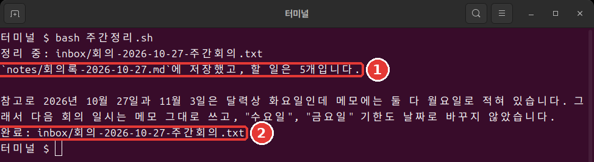

# 第10章 一行运行与自动化

<Badge type="tip" text="必读" /> 想跟着这个阶段学下去，一定要读这一章。

> **一句话总结**：`claude -p` 回答一次就结束。写入要事先许可，成功与否看退出码。把这三样组合起来，就成了一行命令就能运行的每周整理。

本章的输出是 2026年11月6日在 Linux 上用 Claude Code 2.1.318 运行的结果。觉得难也没关系。一块一块地看，其实就是把前面几章做好的东西接起来。

## claude -p 与对话式的区别

加上 `-p`（或 `--print`），就不进入对话，回答一次就结束。[^headless] 用 `/exit` 退出，在终端里进入练习文件夹后输入。

```bash
claude -p "inbox 文件夹里有几个文件？只用一行回答。"
```

它回答了 `inbox 文件夹里有 1 个文件。`，然后马上回到了 Shell。

对话式的 `claude` 会一直持续到你退出，并以自动（auto）模式启动。`claude -p` 给出回答就结束，并以手动（Manual）模式启动。[^headless] 只有在没人值守、要运行同样的工作时才需要 `-p`。其余情况用对话式就够了。

<Quiz id="ch810-print" />

## 为什么写入会被挡住

这次请它创建一个文件。为了不覆盖第4章的文件，把文件名定为 `minutes-one-line.md`（会议记录-一行）。

```bash
claude -p "读取 inbox 里的会议笔记，整理成 minutes-one-line.md 文件并保存。"
```

文件没有生成。回答里告诉你 `文件写入权限没有被批准`。这不是故障。`-p` 以手动模式启动，却没有可以询问的人。所以需要批准的调用会被拒绝。[^headless] 只要事先许可需要的工具就行。[^headless]

```bash
claude -p "读取 inbox 里的会议笔记，整理成 minutes-one-line.md 文件并保存。回答只用一行。" --allowedTools "Read,Write"
```

`--allowedTools` 是事先指定哪些工具不用询问就能使用的选项。`Read` 是读取文件，`Write` 是写入文件。用逗号连起来，再用引号括住。

这次文件生成了。如果 `ls` 里没有，也看看 `ls notes`。因为第8章的规则，它可能被保存到了那里。

与其因为不知道需要什么而给得很宽，不如只给这项工作需要的 `Read,Write`。许可给得窄，就算 Claude 判断错了，它能做的事也相应更少。

<Quiz id="ch810-allow" />

## 用管道传递内容

**管道**（Pipe，`|`）是把前一条命令的输出交给后一条命令作为输入的符号。想象水顺着管子流过去就行。`claude -p` 也能通过管道接收内容。[^headless]

```bash
cat inbox/meeting-2026-10-27-weekly.txt | claude -p "从这份笔记里只挑出待办事项，写成三行。"
```

```text
- 瑞妍：今天（10/27）买卫生间灯泡
- 瑞妍：周三前写好套餐菜单文案初稿
- 俊浩：周五前查好热红酒成本
```

**在 Windows 上**，通过管道传过去的韩文可能会变成乱码。如果回答不对劲，就不用管道，改成在文件名前加 `@` 传过去。把 `文件名` 换成实际的笔记文件名。这条命令我们在 Linux 上运行确认过，在 Windows 上没有试过。

```bash
claude -p "从 @inbox/文件名 里只挑出待办事项，写成三行。"
```

**不能信任的内容，不要直接用管道传过去。**[^security] 比如从网上下载的文字，或者陌生人发来的邮件。文字里可能藏着[第7章](07-permissions-undo.md)里看到的提示词注入。[^security] 提示词注入是在文字里偷偷混入给 AI 的指示，让它去做奇怪事情的手法。

练习笔记 [meeting-2026-10-29-adhoc.txt](/practice/zh-hans/notes/inbox/meeting-2026-10-29-adhoc.txt)（会议-2026-10-29-临时会议）里就有这种句子的例子。现在只点开链接，在浏览器里读一读。先不要放进 `inbox` 文件夹。因为后面要做的脚本会处理 `inbox` 里的所有笔记。这份笔记要等到[第13章](13-cost-safety-trouble.md)学习如何安全处理时再放进去。

<Quiz id="ch810-pipe" />

## 保存输出、改变格式

想把回答存成文件，就在最后加上 `> todo.txt`（待办.txt）。[^headless] 回答不会显示在屏幕上，而是写进文件。如果已经有同名文件，会被覆盖，要小心。

本章的练习不需要下面的 JSON 输出。知道有这么个东西就行。

如果需要别的程序来读取回答，就用[第8章](08-memory-settings.md)里看到的 JSON 格式接收。[^headless] 写法是 `claude -p "1+1等于几？只要数字。" --output-format json`。会输出很长的一行。回答在 `result` 这一项里。

`total_cost_usd` 这一项里是美元金额。不用吃惊。这是程序算出的估算值，可能和实际账单不同。[^headless] 对订阅用户来说，会话费用的数字在计费上没有意义。[^costs]

<Quiz id="ch810-output" />

## 次数限制与退出码

没人看着的时候，Claude 运行太久就麻烦了。用 `--max-turns` 给轮次（Claude 接着做一次工作的单位）的次数设上限。默认没有限制。[^max-turns] 我们故意把它降到 1 试试。

```bash
claude -p "读取 inbox 文件夹里的所有笔记，总结成三行。" --allowedTools "Read" --max-turns 1
echo $?
```

```text
Error: Reached max turns (1)
1
```

最下面的 `1` 就是**退出码**（Exit code）。成功是 0，失败是不为 0 的值。[^headless] 人读文字，脚本读这个数字。`echo $?` 显示刚刚那条命令的退出码。在 PowerShell 里输入 `$LASTEXITCODE`。

<Quiz id="ch810-exit" />

## 制作 weekly-summary.sh

现在把这些零件拼起来。**脚本**（Script）就是把命令写进文件，一次性运行。需要有[第8章](08-memory-settings.md)的 `CLAUDE.md` 和 `notes` 文件夹，以及[第9章](09-skills-extensions.md)的技能。用 `/exit` 退出，在终端里进入练习文件夹。Mac 和 Linux 把下面整段粘贴进去（以文件查看：[ch10-weekly-summary.sh.txt](/practice/zh-hans/cli/results/ch10-weekly-summary.sh.txt)）。

```bash
cat > weekly-summary.sh <<'EOF'
#!/bin/bash
# 把 inbox 里的会议笔记逐个整理成会议记录。
for memo in inbox/meeting-*.txt; do
  echo "正在整理：$memo"
  if claude -p "/meeting-notes $memo" --allowedTools "Read,Write" --max-turns 10; then
    echo "完成：$memo"
  else
    echo "失败：$memo"
  fi
done
EOF
```

粘贴后如果还没运行，就再按一次 Enter。什么都没显示就是成功了。用 `ls` 看看 `weekly-summary.sh`（每周整理.sh）有没有生成。

第一行 `#!/bin/bash` 表示用 bash（Shell 的一种）来读这个文件。下一行以 `#` 开头，是给人看的说明。`for` 那一行把名字以 `meeting-` 开头的笔记逐个放进 `memo`。这里的 `memo` 是**变量**（Variable）。可以看成暂时存放值的名牌。在名字前面加 `$`，写成 `$memo`，就能取出里面的值来用。第一轮时，`$memo` 会变成 `inbox/meeting-2026-10-27-weekly.txt`。

`if` 那一行调用第9章的技能，退出码是 0 就打印 `完成`，否则打印 `失败`。

变量名要像 `memo` 这样用英文写。bash 不接受韩文变量名。文件名用韩文也没关系。

运行只要一行。

```bash
bash weekly-summary.sh
```



```text
正在整理：inbox/meeting-2026-10-27-weekly.txt
已保存到 `notes/minutes-2026-10-27.md`，待办事项有 5 个。

顺便说一下，笔记里把 10/27 和 11/3 写成了星期一，但按 2026 年的日历两天都是星期二，所以星期和日期保持了笔记原样。
完成：inbox/meeting-2026-10-27-weekly.txt
```

没人按任何键，会议记录就生成了（[查看结果](/practice/zh-hans/cli/results/ch10-minutes-by-script.txt)）。你的结果措辞不同也没关系，只要有三个部分和表格就行。

**在 Windows 上**，这个脚本不能在 PowerShell 里直接运行。因为它是给 bash 用的。请用下面的 PowerShell 版。Mac 和 Linux 跳过这部分就行。

同样的工作用 PowerShell 写是下面这样。每次运行时，把这个框里的内容粘贴到窗口里。这是没有实际运行过的示例。如果你用 WSL，就在 WSL 终端里运行上面的脚本。[^wsl]

```powershell
foreach ($file in Get-ChildItem inbox/meeting-*.txt) {
  $memo = "inbox/$($file.Name)"
  Write-Output "正在整理：$memo"
  claude -p "/meeting-notes $memo" --allowedTools "Read,Write" --max-turns 10
  if ($LASTEXITCODE -eq 0) { Write-Output "完成：$memo" } else { Write-Output "失败：$memo" }
}
```

<Quiz id="ch810-script" />

## 订阅账号要知道的事

如果是订阅账号，只要记住两点。

- 运行脚本前后各看一次用量。在会话里输入 `/usage`，会显示用量条。[^costs]
- 就算别的文章推荐 `--bare` 这个选项，也不要加。

`-p` 运行会怎样从订阅限额里扣除，本指南确认过的官方文档里没有写。所以不要猜，用 `/usage` 亲眼看最可靠。

不能加 `--bare` 的原因是这样的。官方文档推荐在脚本里用 `--bare`，但 `--bare` 不会读取订阅登录信息。`CLAUDE.md` 和技能也不会加载。[^bare] 我们的脚本这三样都需要。

反过来，不加 `--bare` 使用 `-p`，就会加载那个文件夹的设置。连从没信任过的文件夹里的钩子和 MCP 服务器也一样。[^bare] 所以只在你清楚内容的自己的文件夹里运行。

<Quiz id="ch810-subscription" />

## 离开座位前的检查

交给它运行、自己离开座位之前，确认三件事。[^unattended] 对照我们的脚本是这样的。

- 结束时是什么样子？每份笔记在 `notes` 里生成一个会议记录文件，就算结束。
- 它能检查自己的工作吗？用退出码区分 `完成` 和 `失败`。
- 它只碰该碰的东西吗？只许可了 `Read,Write`，但并没有限制文件夹。所以只在练习文件夹里运行。次数用 `--max-turns 10` 限住了。

脚本会处理 `inbox` 里的全部会议笔记。所以放进新笔记再运行。没读过的笔记不要放进去。另外，退出码 0 只表示正常结束了。并不表示会议记录的内容也是对的。头几周请亲自读一读结果。

<Quiz id="ch810-unattended" />

## 动手试一试

1. 在终端里用 `claude -p` 发一个读取类的问题，再不加许可发一个写入请求。用 `ls` 确认文件没有生成。
2. 加上 `--allowedTools "Read,Write"` 再发一次。
3. 用管道挑出待办事项并保存。在 Windows 上如果回答不对劲，就用前面的 `@` 方法。

   ```bash
   cat inbox/meeting-2026-10-27-weekly.txt | claude -p "从这份笔记里只挑出待办事项，写成三行。" > todo.txt
   ```

4. 用 `--max-turns 1` 让它失败，看看退出码。
5. 做好 `weekly-summary.sh`，用 `bash weekly-summary.sh` 运行。Windows 粘贴上面的 PowerShell 代码框。

问问自己：没人值守也跑完了吗？结果和笔记一致吗？下周笔记多了，用同一条命令也行吗？

## 小结

- `claude -p` 以手动模式启动，没有可以询问的人。写入要用 `--allowedTools` 事先许可。
- 不能信任的内容不要用管道传过去。JSON 里的费用是估算值。
- 用 `--max-turns` 限制次数，用退出码判断是否成功。
- bash 变量名用英文写。bash 脚本不能在 PowerShell 里直接运行。
- 订阅账号不要用 `--bare`，用量用 `/usage` 亲自查看。

## 术语整理

| 术语 | 中文名称 | 一句话解释 |
|---|---|---|
| Pipe | 管道 | 把前一条命令的输出交给后面的符号 |
| Exit code | 退出码 | 结束时留下的数字（0 表示成功） |
| Script | 脚本 | 写好命令、一次性运行的文件 |

<ChapterDone :chapter="810" />

下一章：[第11章 钩子与界面定制](11-hooks-statusline.md)

[^headless]: Claude Code 官方文档，「Run Claude Code programmatically」。"Add the `-p` (or `--print`) flag to any `claude` command to run it non-interactively." / "With Claude Code v2.1.302 or later, `claude -p` runs start in Manual mode when nothing sets a permission mode." / "In a Manual mode `claude -p` run, a call that needs approval is denied unless something approves it" / "Use `--allowedTools` to let Claude use certain tools without prompting." / "Non-interactive mode reads stdin, so you can pipe data in and redirect the response out like any other command-line tool." / "`json`: structured JSON with result, session ID, and metadata" / "Both figures are client-side estimates and can differ from your actual bill." / "Claude Code exits with code 0 on success and a non-zero code when the run fails, so your scripts can branch on the exit status." https://code.claude.com/docs/en/headless (确认日期 2026-11-06)
[^security]: Claude Code 官方文档，「Security」。"Avoid piping untrusted content directly to Claude" / "Prompt injection is a technique where an attacker attempts to override or manipulate an AI assistant's instructions by inserting malicious text." https://code.claude.com/docs/en/security (确认日期 2026-11-06)
[^costs]: Claude Code 官方文档，「Manage costs effectively」。"Claude Pro, Max, and Ultra subscribers have usage included in their subscription, so the session cost figure isn't relevant for billing purposes." / "Subscribers see plan usage bars, activity stats, and a usage breakdown on the same screen." https://code.claude.com/docs/en/costs (确认日期 2026-11-06)
[^max-turns]: Claude Code 官方文档，「CLI reference」。"Limit the number of agentic turns (print mode only). No limit by default." https://code.claude.com/docs/en/cli-reference (确认日期 2026-11-06)
[^wsl]: Claude Code 官方文档，「Advanced setup」。"You install and launch `claude` inside the WSL terminal, not from PowerShell or CMD." https://code.claude.com/docs/en/setup (确认日期 2026-11-06)
[^bare]: Claude Code 官方文档，「Run Claude Code programmatically」。"`--bare` is the recommended mode for scripted and SDK calls, and will become the default for `-p` in a future release." / "In bare mode, Claude Code never reads OAuth credentials or the system keychain." / "Add `--bare` to reduce startup time by skipping auto-discovery of hooks, skills, custom commands, subagents, installed plugins, MCP servers, auto memory, and CLAUDE.md." / "Without `--bare`, a `-p` session runs the hooks in a project's `.claude/settings.json` and connects the servers in its `.mcp.json`, even in a folder you've never trusted." https://code.claude.com/docs/en/headless (确认日期 2026-11-06)
[^unattended]: Claude Code 官方文档，「Best practices for Claude Code」。"Before a run goes unattended, make sure it knows what done looks like, can check its own work, and can only touch what it should." https://code.claude.com/docs/en/best-practices (确认日期 2026-11-06)
