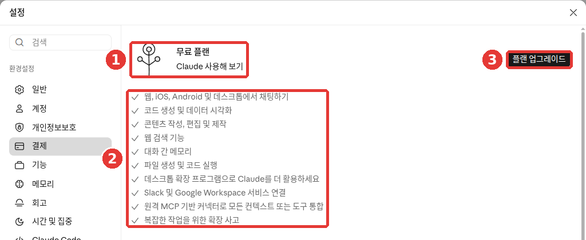

# 第1章 開始使用——在哪裡用、註冊、套餐和使用額度

> **一句話總結**：Claude 可以在網頁、電腦應用和手機應用上用同一個賬號使用。註冊需要郵箱（或 Google、Apple 賬號）和手機簡訊驗證。先免費用起來，只有在額度經常不夠用時，再考慮付費套餐。

介面以 2026 年 10 月的網頁版為準，圖片是免費套餐的介面。手機應用和電腦應用的選單位置可能略有不同。

## Claude 是什麼，在哪裡用

Claude（讀作"克勞德"）是一家叫 Anthropic（讀作"安索普"）的公司做的 **LLM**（大語言模型，見[第1階段第1章](../00-common/01-what-is-llm.md)）。[^start]
第1階段學過的提問方法，在 Claude 上同樣適用。這一章只講怎麼進入 Claude 這項服務。

用的地方有三種。不管在哪裡用，賬號都是同一個。

| 使用的地方 | 開啟方式 | 需要什麼 |
|---|---|---|
| 網頁 | 在瀏覽器裡開啟 claude.ai | 一個瀏覽器 |
| 電腦應用 | 在下載頁面下載 | macOS 13 以上，Windows 10 以上 |
| 手機應用 | 在應用商店下載 | iOS 18 以上，Android 8.0 以上 |

來源：Anthropic 幫助文件[^start][^desktop][^ios][^android]

電腦應用在 Linux（一種電腦作業系統）上也能用，不過是**測試版**（Beta，正式釋出前還在試用的階段）。[^desktop]
如果你是第一次用，建議從網頁開始。不用安裝任何東西，最簡單。

使用有兩個條件。[^start]

- 你必須在**支援地區**（官方提供服務的國家）之內。韓國在支援地區名單裡。[^where]
- 你必須**年滿 18 週歲**。

下載手機應用時，請在應用商店搜尋「Claude by Anthropic」。[^ios][^android]
iPhone 的 App Store 裡還有一個面向公司的「Claude for Intune」。如果公司沒有要求你用它，下載「Claude by Anthropic」就可以了。[^ios]
如果搜不到這個應用，可能是你所在的地區、裝置或系統版本不被支援。[^android]
如果新功能只在你的應用裡看不到，請在應用商店裡手動更新一下應用。[^update]

第一次進去，可以這樣問。

```
你能幫我做哪些事？請舉五個上班族馬上就能用上的例子。
```

<Quiz id="ch201-where" />

## 註冊和登入

開啟 claude.ai，輸入你的郵箱地址，然後點「用郵箱繼續（이메일로 계속하기）」。如果你有 Google 或 Apple 賬號，也可以點「用 Google 繼續（Google로 계속하기）」或「用 Apple 繼續（Apple로 계속하기）」。[^signup][^screen-login]


**Claude 沒有密碼。** 你不能為 Claude 賬號單獨設定密碼。[^login]
用郵箱登入時，你會收到一封標題為「登入 Claude.ai 的安全連結」（Secure link to log in to Claude.ai）的郵件。點郵件裡的連結就能登入。[^login]
不用記密碼，很方便。不過前提是，你**要能登入那個郵箱賬號**。

有三點需要知道。[^login]

1. **在另一臺裝置上點連結，會出現一個驗證碼。** 比如你在電腦上請求登入，卻在手機上打開了郵件。這時手機上會顯示一個驗證碼。請把這個驗證碼輸入到最初請求登入的那臺電腦上。
2. **收不到郵件，就看看垃圾郵件箱。** 找一下來自 @mail.anthropic.com 的郵件。
3. **每臺裝置都用同一個郵箱登入。** 用平時用的那個郵箱登入，開啟的才是同一個賬號。

<Quiz id="ch201-login" />

## 手機簡訊驗證

第一次註冊時，需要進行**手機號驗證**。輸入支援地區的手機號後，會有一條 **6 位數字**的驗證碼透過簡訊發給你。[^phone]
這一步**不能跳過**。所有新使用者都要經過這一步。[^phone]

<!-- 需要截圖：手機號輸入介面和「確認驗證碼」介面（網頁） -->

輸入之前，請先確認下面幾點。[^phone]

- **只能用普通手機號。** 網路電話（VoIP）號碼、Google Voice、用應用生成的號碼、家裡的座機（固定電話）都不行。
- **超過 5 分鐘還沒收到簡訊，** 就點「重試」。
- **一個號碼最多可以驗證 3 個賬號。**
- **驗證過的號碼，之後不能更換。** 所以請用你會長期使用的自己的號碼來驗證。如果用的是臨時借來的號碼，之後就沒有辦法更換了。

<Quiz id="ch201-phone" />

## 一眼看懂套餐

Claude 也有從免費到公司專用的多種**套餐**（Plan，根據付費多少，可用的功能和用量不同的使用方式）。[^pricing]

| 套餐 | 適合誰 | 價格（每月，美元） |
|---|---|---|
| Free（免費） | 第一次試用的人 | $0 |
| Pro | 每天都用的人 | $20（按年付費時約每月 $17） |
| Max | 用得非常多的人 | 5x $100 · 20x $200 |
| Team · Enterprise | 以公司為單位使用的地方 | 另行報價 |

來源：Anthropic 價格頁面、幫助文件[^pricing][^pro][^max]

這些價格**以美元計**，而且**不含稅**。[^pricing] 在你所在的國家，價格可能會用當地貨幣顯示，稅率也因國家而異。[^pro]
在手機應用裡付款，價格可能和網頁不同。[^max] 在韓國看到的韓元價格，本指南沒能確認。付款前，請直接到[價格頁面](https://claude.com/pricing)確認。

### 各套餐有什麼不同

比起數字，弄清楚**"到底哪裡不一樣"**，選起來會更容易。

| 不同之處 | 免費（Free） | 付費（Pro·Max） |
|---|---|---|
| **用量** | 基礎 | Pro 是免費的 5 倍以上[^pricing] |
| **聯網搜尋、生成檔案** | 可以[^pricing] | 可以 |
| **研究**（長篇調研報告） | 不可以 | 可以（[第6章](06-search.md)）[^pricing] |
| **大模型**（Opus） | 不能選 | 可以選（[第2章](02-screen-tour.md)）[^pricing] |
| **Cowork**（把整件事交給它做） | 不可以 | 可以（[第8章](08-cowork.md)）[^desktop] |

免費套餐裡包含什麼，可以在「設定（설정）」→「結算（결제）」裡直接看到。



這是免費套餐的網頁介面。**紅色編號對應下面列表裡的同號內容。**

- ① 當前套餐：「免費方案」
- ② 免費方案包含的內容：在網頁、iOS、Android、桌面端聊天，生成程式碼和資料視覺化，寫作和修改文章，網頁搜尋功能，跨對話記憶，生成檔案和執行程式碼，桌面擴充套件程式，連線 Slack、Google Workspace，聯結器（與其他服務相連的功能，[第7章](07-projects-tools.md)），處理複雜任務的擴充套件思考[^screen]
- ③ 「升級方案」：改成付費套餐的按鈕（見下面的「改成付費前要知道的事」）

當你需要列表裡沒有的功能時，再考慮付費。這樣就不會為用不上的功能花錢。

Max 的用量是 Pro 的 5 倍（5x）或 20 倍（20x）。它可以得到更長的回答，也可以搶先試用新功能。[^pricing]

付款週期也不同。Pro 可以在按月和按年裡選一種。**Max 只能按月付費。**[^max]
除了按年付費的折扣，Pro 和 Max 沒有長期適用的折扣價。只是偶爾會有限定時間的活動。[^pro]

<Quiz id="ch201-plans" />

## 使用額度——5 小時、每週、長度

Claude **沒有"每天幾次"這樣固定的訊息條數。** 能用多少，取決於對話的長度和複雜程度、你選的模型，以及用到的功能。[^pricing]
取而代之的是三種額度。

| 額度 | 含義 | 適用於誰 |
|---|---|---|
| **會話額度** | 每 5 小時重新補滿的用量 | 所有套餐 |
| **每週額度** | 每一週重新補滿的用量 | 付費套餐 |
| **長度額度** | 一個對話裡能裝下的量 | 所有套餐 |

來源：Anthropic 幫助文件[^start][^limits]

**會話額度和每週額度**像是衡量用量的"水桶"。每週額度會在每個賬號固定的星期和時刻重新補滿。[^pro]
在網頁、電腦應用、手機應用上用掉的量，是**算在同一個桶裡**的。換到手機上用，也不會多出新的額度。[^limits][^pricing]

額度快用完時，會出現「接近會話限制」或「接近每週限制」的警告。[^errors] 用到上限時，會告訴你什麼時候可以再用。[^errors]
這時，等到那個時刻，或者升級套餐就可以了。[^limits] 付費套餐可以在設定的「用量」（Usage）介面，用進度條看到自己用了多少。[^best][^usage-name]

**長度額度**是 Claude 在一個對話裡能處理的量。它和第1階段學過的[上下文視窗](../00-common/01-what-is-llm.md#_3-一次能看的量有限——-上下文視窗)是同一回事。[^limits]
如果出現以「訊息超出了此聊天的長度限制」開頭的提示，請減少檔案，或者開始一個新對話。[^errors]
對話變得非常長時，Claude 有時會自動總結前面的部分，再接著聊。這時你會看到「正在整理思路」的提示。[^limits]
這樣的長對話會多消耗用量。話題變了的時候，開一個[新對話](../00-common/06-conversation.md#什麼時候開始新對話)會更好。[^limits]

還有一些節省額度的小竅門。[^best]

- **把相關的問題合在一條訊息裡。** 分三次問，不如一次問完，用得更少。
- **傳送前再讀一遍。** 這樣重新追問的次數會變少。
- **把常用的資料放進專案裡**（[第7章](07-projects-tools.md)）。專案裡的資料在重複使用時，消耗的額度更少。

比如，不要把問題分成三次單獨傳送，可以像這樣合在一起。

```
請一次回答下面三件事。
1. 把這份會議記錄總結成五行。
2. 用表格整理已經確定的事項和負責人。
3. 寫一份發給參會人員的簡短通知郵件草稿。
（貼上會議記錄）
```

::: details 收到的回答大概是這樣（示例——點選展開）
這是本指南編寫的示例。實際的回答會因服務和每次情況而不同。

> **1. 五行總結**
> - 下個月活動的日期定在○月○日。
> - 活動地點定為（會議記錄裡的地點）。
> - 預算與上次相同。
> - 確定了場地預訂和通知撰寫的負責人。
> - 下次會議定在○月○日召開。
>
> **2. 已確定事項和負責人**
>
> | 要做的事 | 負責人 |
> |---|---|
> | 預訂場地 | （會議記錄裡的名字） |
> | 製作通知 | （會議記錄裡的名字） |
>
> **3. 通知郵件草稿**
> 標題：○月○日會議結果通知
> 您好。現將今天會議上確定的活動內容和分工整理後發給您。請在下次會議前完成各自負責的事項。

**檢查一下有沒有收到想要的結果**：三個回答都按編號給齊了嗎？總結真的是五行嗎？表格裡的事項和負責人與會議記錄一致嗎？有沒有編造會議記錄裡沒有的內容？有沒有給出可以直接發給參會人員的簡短郵件草稿？

:::

<Quiz id="ch201-limits" />

## 改成付費前要知道的事

沒必要一開始就付費。**先免費用，經常碰到額度上限時再升級**，是最穩妥的做法。

**在網頁上訂閱的方法**如下。[^signup]

1. 點左下角你的名字（或名字的首字母），選擇「設定（설정）」。
2. 進入「結算（결제）」，點「升級方案」（上面結算圖裡的 ③）。[^screen][^billing-name]
3. 選擇按月或按年的付款週期，填寫付款資訊後，點「訂閱」。


名字和郵箱是改成示例的畫面（免費套餐）。賬號選單裡，除了 ① 「設定」，還能直接看到 ④ 「升級方案」。[^screen] 不管從哪邊進入，付款前都請再讀一遍價格和條件。

在手機應用裡，點右上角的名字首字母，選擇「升級到 Pro」。這會透過應用商店付款（應用內購買）來進行。[^ios-pro][^android-pro]

付款前，下面這些一定要知道。

- **訂閱會自動續訂。** 預設情況下，每個付款週期結束時都會自動續費。[^signup]
- **在哪裡訂閱，就在哪裡取消。** 如果是在網頁或電腦應用上訂閱的，就點設定 →「結算」裡的「取消」按鈕。[^billing-name] 如果是在手機應用上訂閱的，就進入應用裡的名字首字母 →「賬單」→「管理訂閱」。這時的付款是由 Apple 或 Google 處理的。[^cancel]
- **請在扣款日的 24 小時前取消。** 這樣才不會扣下一期的錢。取消會在當前付款週期結束時生效。[^cancel]
- **刪除應用，訂閱也不會停止。** 在手機上刪掉應用，訂閱不會自動取消。[^ios]
- **取消後，對話仍然保留。** 聊天、專案、檔案都還在，週期結束後會變成免費套餐。[^pricing]
- **原則上不能退款。** 只有條款或當地法律規定的情況除外。[^pricing]
- **在網頁上付款，只接受信用卡和簽帳金融卡。**[^billing]
- **扣款日不能自己修改。** 如果想改，需要先取消，再在想要的日子重新訂閱。[^billing]
- **已經付款卻顯示免費時，不要再付一次。** 先看看是不是用了另一個郵箱登入。也要確認付款是不是失敗了。[^billing]

收據可以在設定 →「結算」裡看到，也會發到郵箱。在郵箱裡搜尋 "Your receipt from Anthropic" 就能找到。[^billing]

如果不確定哪個套餐適合自己，可以把自己的使用習慣告訴 Claude，問問它。不過，價格和條件請到價格頁面確認，不要只聽 AI 的回答（[第1階段第9章](../00-common/09-safety.md)）。

```
我每天用 3~4 次 Claude，主要用來潤色工作郵件和總結會議記錄。
偶爾也會上傳 PDF 檔案讓它總結。我想先免費用著，
請告訴我三個標準，讓我能自己判斷什麼時候需要改成付費。
```

<Quiz id="ch201-billing" />

## 用不了的時候先試試這些

可能會出現沒有回答、彈出錯誤提示，或者登入不了的情況。這時請按下面的順序試試看。

1. **「由於意外的容量限制……」這樣的提示不是故障。** 它的意思是人太多，比較擁擠。幾分鐘後再試一次。這種擁擠不會顯示在服務狀態頁面上。[^errors]
2. **是不是真的出故障了，可以到 status.claude.com**（Anthropic 的服務狀態頁面）確認。[^errors]
3. **如果出現登入錯誤，** 請關掉 VPN（更改上網地址的程式）和瀏覽器擴充套件程式。清除瀏覽器的快取和 Cookie（訪問過的網站留下的臨時記錄）也是一個辦法。[^errors]
4. **如果收不到登入郵件，** 請到垃圾郵件箱裡找 @mail.anthropic.com。[^login]

如果還是不行，就去問客服。**沒有電話支援，只能用文字**溝通。[^support]

- **如果已經登入：** 點左下角你的名字（或名字首字母）→「獲取幫助」（上面賬號選單圖裡的 ③）。[^screen] 這會開始和 **Fin**（Anthropic 的 AI 客服機器人）對話。和 Fin 聊天不會減少使用額度。[^support]
- **如果根本登入不了：** 點幫助中心（support.claude.com）右下角的訊息圖示，選擇「我無法登入」。[^support]
- **如果是付費（Pro·Max）：** Fin 解決不了的問題，會由人工支援團隊接著處理。免費使用者大多隻能用到幫助文件和 Fin。[^support]
- **同一個問題不要再開新的諮詢。** 在原來的對話裡回覆就行。回覆會同時發到聊天視窗和賬號郵箱，所以關掉視窗也沒關係。[^support]

傳送截圖時，請注意不要露出其他個人資訊。

<Quiz id="ch201-trouble" />

## 親手試一試

1. 開啟 claude.ai，用郵箱註冊，再點登入郵件裡的連結進入。收不到郵件，就看看垃圾郵件箱。
2. 完成手機簡訊驗證。再確認一次這是不是你會長期使用的號碼。
3. 問一句"你能幫我做哪些事？"
4. 在手機上安裝「Claude by Anthropic」應用，用同一個郵箱登入，看看在電腦上聊過的對話是否出現了。

**連續任務**（[籌備讀書會](../00-common/practice-kit.md)）：問它"我是社群讀書會的總務。請幫我列一份籌備下個月聚會時要做的事的清單。"拿到的清單，等任務做完後，和自己實際做的事比較一下。

## 小結

- Claude 可以在網頁（claude.ai）、電腦應用、手機應用上用同一個賬號使用。年滿 18 週歲，在支援地區（包括韓國）可以使用。
- 註冊和登入用郵箱，或 Google、Apple 賬號。沒有密碼，而是收到一封帶登入連結的郵件。
- 第一次註冊要經過手機簡訊驗證。驗證過的號碼不能更換。
- 個人用的套餐是 Free、Pro、Max。價格以美元計、不含稅，請到價格頁面確認。
- 額度有三種：5 小時的會話額度、（付費的）每週額度、一個對話的長度額度。沒有固定的訊息條數。
- 訂閱會自動續訂。請在訂閱的地方，於扣款日 24 小時前取消。刪除應用，訂閱也不會停止。
- 「容量限制」的提示是擁擠造成的。真正的故障請到 status.claude.com 檢視。求助從賬號選單「獲取幫助」裡的 Fin 開始。

## 術語整理

| 術語 | 中文名稱 | 一句話解釋 |
|---|---|---|
| Supported Location | 支援地區 | 官方提供服務的國家和地區 |
| Beta | 測試版 | 正式釋出前還在試用的階段 |
| Plan | 套餐 | 根據付費多少，功能和用量不同的使用方式 |
| Subscription | 訂閱 | 每月或每年自動扣款的使用合約 |
| Session Limit | 會話額度 | 每 5 小時重新補滿的用量 |
| Weekly Limit | 每週額度 | 付費套餐裡每一週重新補滿的用量 |
| Length Limit | 長度額度 | 一個對話裡能裝下的量，與上下文視窗有關 |
| VoIP | 網路電話 | 透過網際網路撥打的電話，不能用來做簡訊驗證 |
| Fin | Fin（客服機器人） | Anthropic 客戶支援的 AI 機器人 |

<ChapterDone :chapter="201" />

下一章：[第2章. 熟悉介面](02-screen-tour.md)

[^usage-name]: 韓語幫助文件裡，有的地方寫的是「사용」。
[^billing-name]: 介面上的名稱是「結算（결제）」，但幫助文件裡寫的是「Billing」（賬單）。
[^screen]: 在 Claude 網頁介面（免費套餐，韓語）中直接確認。設定 →「結算（결제）」裡的「免費方案 · 試用 Claude」列表和「升級方案」，賬號選單裡的「設定」「語言」「獲取幫助」「升級方案」。（確認日期 2026-10-26）
[^start]: Anthropic 幫助文件，「Get started with Claude」. "Claude is a large language model (LLM) built by Anthropic." / "Web: Visit claude.ai to chat with Claude in a web browser." / "You must be in one of our supported locations to access Claude." / "You must be at least 18 years old to use our services." / "there is a session-based usage limit that will reset every five hours." https://support.claude.com/en/articles/8114491 (確認日期 2026-10-26)
[^where]: Anthropic 幫助文件，「Where can I access Claude?」. 支援地區名單中包含 "South Korea"。 https://support.claude.com/en/articles/8461763 (確認日期 2026-10-26)
[^desktop]: Anthropic 幫助文件，「Install Claude Desktop」. "Claude Desktop is available on macOS, Windows, and Linux (beta)." / "macOS: macOS 13 (Ventura) or higher" / "Claude Cowork is available for all paid plans (Pro, Max, Team, Enterprise)" https://support.claude.com/en/articles/10065433 (確認日期 2026-10-26)
[^ios]: Anthropic 幫助文件，「Install Claude for iOS」. "You can install the Claude app onto your iOS device by navigating to the App Store and searching for “Claude by Anthropic”" / "If your organization hasn't asked you to use Claude for Intune, install Claude by Anthropic." / "We currently support iOS version 18.0 and above, and iPadOS 18.0 and above." / "your subscription will not be automatically canceled." https://support.claude.com/en/articles/9266462 (確認日期 2026-10-26)
[^android]: Anthropic 幫助文件，「Install Claude for Android」. "We currently support Android 8.0 Oreo and above." / "you may be located in an unsupported region, using an unsupported device, or using an unsupported version of Android." https://support.claude.com/en/articles/9612887 (確認日期 2026-10-26)
[^update]: Anthropic 幫助文件，「How to update Claude for iOS」. "you may need to update your mobile app manually" https://support.claude.com/en/articles/11825384 (確認日期 2026-10-26)
[^signup]: Anthropic 幫助文件，「How do I sign up for the Pro plan?」. "Enter your email address and click “Continue with email” or click “Continue with Google” if applicable." / "Navigate to Settings > Billing and click the “Upgrade plan” button." / "Choose between monthly and annual billing periods." / "your subscription will be set to automatically renew at the end of each billing period (monthly or annual) by default." https://support.claude.com/en/articles/8325609 (確認日期 2026-10-26)
[^login]: Anthropic 幫助文件，「Log in to your Claude account」. "you will see two different options for logging in to your Claude account." / "This will send you an email with the subject line “Secure link to log in to Claude.ai” and a login link." / "You should enter this code on the original device where you requested the login email to authenticate." / "It’s not possible to create a dedicated password for your Claude account at this time." / "enter the same email address you use to log in on your usual device." / "Check your spam and junk folders for emails from @mail.anthropic.com." https://support.claude.com/en/articles/13189465 (確認日期 2026-10-26)
[^phone]: Anthropic 幫助文件，「Verify your phone number」. "you’ll be asked to enter your phone number from a supported location to receive a verification code via text message." / "We’ll send a six-digit verification code to your phone number via text message." / "you cannot use VoIP numbers, Google Voice, phone numbers created using apps, landlines" / "We require phone verification for all new users, and there isn’t a way to skip this step." / "if it has been more than five minutes, click "Try again" to reset the modal" / "We only allow a maximum of three Claude accounts to be verified with the same phone number." / "There isn’t a way to change your phone number associated with your Claude account once it has been verified." https://support.claude.com/en/articles/8287232 (確認日期 2026-10-26)
[^pricing]: Anthropic 價格頁面。 "Per month with annual subscription discount ( $200 billed up front). $20 if billed monthly." / "Prices shown don’t include applicable tax." / "Search the web, create files, and run code" / "Pro gives you at least 5x more usage per 5-hour session than Free." / "Higher output limits for all tasks" / "How much you can do depends on the length and complexity of your conversations, the model you choose, and the features you use, so there's no fixed message count." / "Your activity across Claude on web, desktop, mobile, and Claude Code all draws from the same pool." / "Canceling doesn't delete your data. Your chats, projects, and files stay with your account" / "For Pro and Max, your account moves to the Free plan once the period ends." / "Payments are generally non-refundable, except where our Consumer Terms of Service say otherwise or where local law requires it." 對比表中的 Research 行和 Opus 行：Free 沒有，從 Pro 開始有。 https://claude.com/pricing (確認日期 2026-10-26)
[^pro]: Anthropic 幫助文件，「What is the Pro plan?」. "The Pro plan is available for $20 per month (US), with pricing in your local currency where supported." / "Annual subscriptions are billed once yearly at a discounted rate." / "We don’t offer standard discounted pricing for individual plans (Pro and Max)." / "Weekly limits reset at a fixed time each week that is assigned to your account." https://support.claude.com/en/articles/8325606 (確認日期 2026-10-26)
[^max]: Anthropic 幫助文件，「What is the Max plan?」. "Max 5x: $100 per month" / "These prices are for web subscriptions only. Mobile pricing may vary depending on your app platform." / "The Max plan is currently available as a monthly subscription only." https://support.claude.com/en/articles/11049741 (確認日期 2026-10-26)
[^limits]: Anthropic 幫助文件，「How do usage and length limits work?」. "Paid plans have two types of usage limits: a session limit that resets every five hours, and weekly limits that reset once every week." / "your usage of all different Claude product surfaces (claude.ai, Claude Code, Claude Desktop) counts towards the same usage limit." / "If you hit your session limit or weekly limit, you can wait for it to reset or upgrade your plan." / "Length limits relate to Claude's context window—the amount of information Claude can work with in a single chat." / "Claude summarizes earlier messages to continue the conversation seamlessly." / "Longer conversations that trigger automatic context management consume more of your usage limit." https://support.claude.com/en/articles/11647753 (確認日期 2026-10-26)
[^best]: Anthropic 幫助文件，「Usage limit best practices」. "you can navigate to Settings > Usage to view progress bars showing how much of your five-hour session and weekly usage limits you’ve consumed." / "If you have multiple related tasks or questions, group them in a single message." / "Content in projects is cached and counts less against your limits when reused." https://support.claude.com/en/articles/9797557 (確認日期 2026-10-26)
[^errors]: Anthropic 幫助文件，「Troubleshoot Claude error messages」. "“Approaching session limit” or "Approaching weekly limit."" / "you’ll see an error message letting you know when you can use Claude again" / "Try attaching fewer or smaller files or starting a new conversation." / "Ensure you’re not using a VPN when accessing Claude." / "The system is functioning normally but managing high demand across all users." / "Capacity issues will not appear on our status page" / "To check for confirmed incidents, visit status.claude.com" https://support.claude.com/en/articles/12466728 (確認日期 2026-10-26)
[^ios-pro]: Anthropic 幫助文件，「How do I sign up for Claude Pro on the Claude app for iOS?」. "click on your initials in the upper right corner" / "From your settings page, click on “Upgrade to Pro” and follow the payment instructions to complete your in-app purchase." https://support.claude.com/en/articles/9266495 (確認日期 2026-10-26)
[^android-pro]: Anthropic 幫助文件，「How do I sign up for Claude Pro on Claude for Android?」. "To sign up for Claude Pro using the Claude app for Android, open the app on your device and click on your initials in the upper right corner." https://support.claude.com/en/articles/9612892 (確認日期 2026-10-26)
[^cancel]: Anthropic 幫助文件，「Cancel your Pro or Max subscription」. "Your cancellation will take effect at the end of your current billing period" / "cancel your subscription at least 24 hours before your next billing date." / "Navigate to Settings > Billing and click the “Cancel” button." / "Select “Manage subscription” and follow the prompts for cancellation." https://support.claude.com/en/articles/8325617 (確認日期 2026-10-26)
[^billing]: Anthropic 幫助文件，「Paid plan billing FAQs」. "For subscriptions purchased on the web, we only accept credit or debit cards." / "search by the subject line "Your receipt from Anthropic."" / "there isn't a direct way to change your subscription billing date." / "You've logged in with a different email." https://support.claude.com/en/articles/8325618 (確認日期 2026-10-26)
[^support]: Anthropic 幫助文件，「How to get support」. "Support is provided in writing through the support messenger and email. We don't offer phone support." / "Click your initials or name in the lower left corner and select “Get help” from the menu." / "Chatting with Fin will not impact Claude usage or spend limits." / "Further assistance from our Product Support team" / "Select "I can't login."" / "Opening a second request for the same problem creates a duplicate that has to be re-triaged" / "Replies are delivered to the messenger and to your account email, so you won't miss one." https://support.claude.com/en/articles/9015913 (確認日期 2026-10-26)
[^screen-login]: 在未登入的新瀏覽器視窗中直接開啟 claude.ai/login 確認。按鈕有「用 Google 繼續」「用 Apple 繼續」「用郵箱繼續」。幫助文件裡有一句話說登入方式只有郵箱和 Google 兩種，但這個介面上還有 Apple 按鈕（確認日期 2026-10-28，網頁登入前介面）
