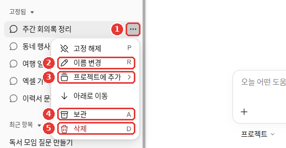
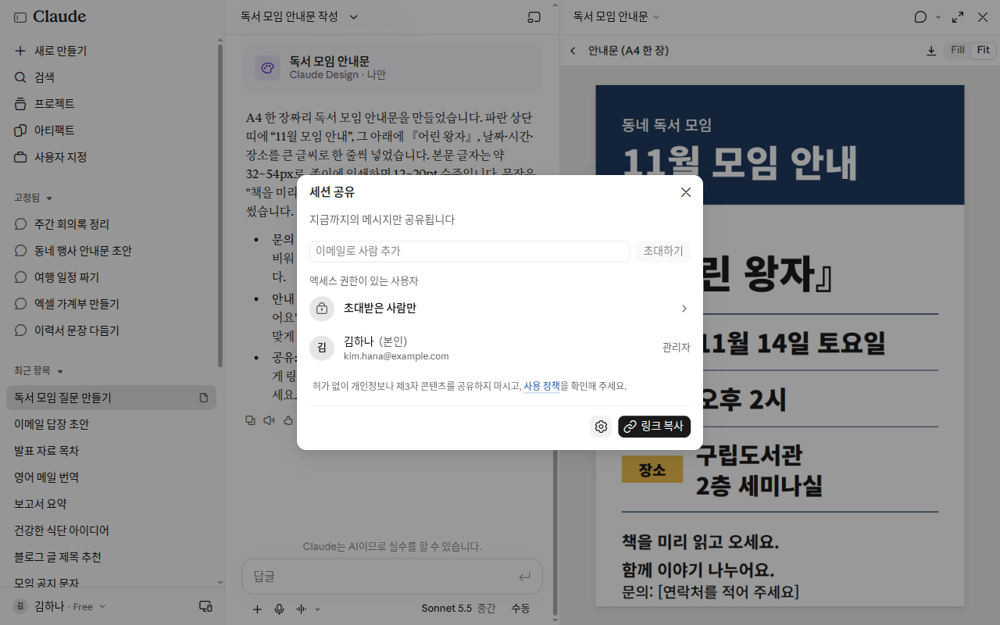
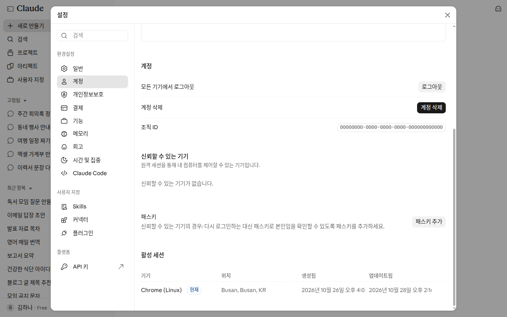

# 第3章 管理對話——查詢、整理、分享、隱藏

> **一句話總結**：用完的對話可以**重新命名或刪除**；過去的對話可以在列表裡找，也可以讓 Claude **幫你找**。
> 給別人看的時候，用**邀請指定的人**或**公開連結**；不想留下記錄的時候，用**隱身聊天**。

介面以 2026 年 10 月的網頁版為準。把聊天和 Cowork 合併起來的新 Claude 介面正在陸續推送，所以你看到的介面可能不一樣。手機應用的選單位置略有不同。

什麼時候適合開一個新對話，第1階段已經學過了。就是話題變了、總是忘記最初的指示，或者對話變得太長的時候（[第1階段第6章](../00-common/06-conversation.md#什麼時候開始新對話)）。在 Claude 裡也一樣適用。這一章來看看怎麼處理這些積累下來的對話。

## 重新命名和刪除對話

為了以後好找，請把對話的名字改成你自己的話。
在網頁上這樣操作。

1. 在側邊選單的「已固定」或「最近專案」列表裡找到這個對話。[^screen]
2. 把滑鼠放在對話上，點右邊的「⋯」（三個點）按鈕。[^screen]
3. 選擇「重新命名」或「刪除」。[^screen] 刪除時，要在確認窗口裡再點一次。[^delete]



對話標題是改成示例的畫面（免費套餐）。**紅色編號對應下面列表裡的同號內容。**[^screen]

- ① 「⋯」：把滑鼠放在對話上才會出現的按鈕。
- ② 「重新命名」：把對話標題改成你自己的話。
- ③ 「新增到專案」：把對話放進專案。專案在[第7章](07-projects-tools.md)裡講。
- ④ 「歸檔」：把對話從列表裡收起來。它和刪除是不同的選單。
- ⑤ 「刪除」：刪掉對話。

同一個選單裡還有「取消固定」（或固定）和「下移」。[^screen] 固定的對話會集中在側邊選單的「已固定」列表裡。

::: details 想一次刪除多個對話（點選展開）
幫助文件裡也有一次刪除多個對話的方法。在完整的對話列表（「聊天和任務」，Chats and tasks）裡點「⋮」→「選擇」，然後勾選要刪除的對話，或點最上面的「全選」。[^delete] 選單名稱可能因介面而異。
:::

在手機上，方法略有不同。[^delete]

- **iPhone**：在聊天列表里長按對話。
- **Android**：點開啟的對話右上角的「⋮」。要刪除多個時，點列表右上角的清單圖示，再用垃圾桶圖示刪除。

刪除前要知道的事。

- **刪除的對話會立刻從列表裡消失。** 在公司的伺服器上，也會在 30 天內被刪除。[^delete] 幫助文件裡沒有恢復的方法。請想好刪了沒問題再點。
- **刪除對話後，從這個對話裡產生的記憶還會保留。** 記憶（Claude 記住的關於你的內容）要另外刪除。[^memory-delete] 刪除的方法在[第5章](05-memory.md)裡講。

<Quiz id="ch203-delete" />

## 查詢過去的對話

查詢過去的對話有兩條路。

**第一，在列表裡找。** 瀏覽一下側邊選單的「最近專案」列表。側邊選單上方還有一個「搜尋」按鈕。[^screen] 簡短的提問和長時間的任務，都集中在「最近專案」（Recents）這一個列表裡。[^new] 如果把標題改成你自己的話，這時就會快很多。

**第二，讓 Claude 幫你找。** 如果是付費套餐（Pro·Max·Team·Enterprise），在新對話裡直接問就可以了。網頁、桌面端、手機應用都可以。[^search]

```
幫我找一下上週問過 Excel 函式的那個對話。把當時告訴我的函式再整理一遍。
```

當 Claude 翻查過去的對話時，在對話中會顯示為**工具呼叫**（Claude 取出一個功能來使用）。回答裡用到的過去對話，會以指向原對話的連結（引用）的形式附上。[^search] 點連結開啟原對話，馬上就能確認 Claude 有沒有找錯對話。

也要知道搜尋的範圍。[^search]

- 在專案之外提問，會在**專案之外的全部對話**裡查詢。
- 在專案裡提問，只會在**該專案裡的對話**中查詢。專案在[第7章](07-projects-tools.md)裡講。
- 這個搜尋不會查詢以前的 Cowork 任務。那樣的任務請在「最近專案」裡按名稱查詢。[^new]

如果不想讓 Claude 翻查過去的對話，請在「設定 > 記憶」（或「設定 > Your Claude」）裡關掉「搜尋和引用聊天」（Search and reference chats）。[^search]

::: details 如果看不到這個開關（點選展開）
幫助文件寫著，這個開關在「設定 > Your Claude」或「設定 > 記憶」（Memory）裡。[^search] 拍攝本章圖片用的免費賬號裡，看不到這個開關。因為查詢過去的對話是付費套餐的功能。[^screen] 介面可能有所不同。
:::

<Quiz id="ch203-search" />

## 展示對話——給指定的人

把對話給別人看的方法有兩種。一種是隻讓你指定的人看的**邀請指定的人**，另一種是讓拿到連結的任何人都能看的**公開連結**。邀請指定的人是預設方式。[^share-people] 先來看這一種。

1. 點上方對話標題旁邊的 ▾ 選單，選擇「分享會話」。如果右邊沒有開啟工件（Artifact）欄，也可以點右上角的「分享」按鈕開啟。
2. 在「透過郵箱新增人員」欄裡，寫上收件人的郵箱。
3. 點「邀請」。[^screen-share]



*名字和郵箱是改成示例的畫面。沒有邀請任何人就關閉了。在新介面裡，對話被稱為「會話」。*

收件人會收到一封郵件，裡面有你的名字、對話標題和開啟連結。包括免費套餐在內，所有套餐都可以使用。[^share-people]

這種方式有以下特點。[^share-people]

- **只有被邀請的郵箱才能開啟。** 即使收件人轉發了郵件，別人也打不開。
- **只能檢視。** 收件人不能繼續這個對話，不能複製到自己的賬號，也不能下載檔案。
- **沒有 Claude 賬號的人也可以邀請。** 建立一個免費賬號就能看。沒有開啟的邀請，30 天後會失效。
- **每天能邀請的人數有上限。** 具體數字幫助文件裡沒有寫。
- **目前還不能在手機應用裡傳送。** 請在網頁上傳送。收到的對話在任何裝置上都能開啟。

分享是**像拍照一樣留下那一刻的樣子**（快照，snapshot）。[^share-old] 分享之後再聊的內容，收件人看不到。如果想讓對方看到新內容，請在分享窗口裡點「更新已分享的聊天」（Update shared chat）。[^share-people]

附加的檔案也不會放進分享的內容裡。檔案始終只有你自己能看到。[^share-old]

如果不想再給別人看，請在分享窗口裡點「關閉」（Turn off）。這樣連結會立刻對所有人失效。刪除對話，連結也會失效。[^share-people]
到目前為止分享過的對話，可以在一個地方集中檢視，並逐個關閉。[^share-people] 請點「設定 > 隱私」裡「已分享的聊天」旁邊的「管理」。[^screen]

<Quiz id="ch203-share" />

## 公開連結——讓任何人都能看

公開連結是隻要有連結，**任何人**都能開啟。沒有 Claude 賬號也可以。只能檢視這一點，和邀請相同。[^public]
只有個人套餐（Free·Pro·Max）可以使用。公司套餐（Team·Enterprise）只能在組織內部分享。[^public]

公開連結也是在對話介面的「分享」裡建立。請按分享窗口裡顯示的專案操作。

::: details 不同的幫助文件對建立步驟的寫法不一樣（點選展開）
建立公開連結的步驟，不同的文件寫法不同。舊的幫助文件說，點「分享」之後，在彈出的窗口裡再點一次「分享」就會生成連結。[^share-old] 介面可能有所不同。
:::

使用公開連結之前，只需記住一條原則。用幫助文件裡的原話說就是**"把公開連結當作公開的東西"**。[^public] 如果是不會發到網際網路上的內容，也不要做成公開連結。

- **即使只發給一個人，也是公開的。** 收件人可以轉發，也可以釋出到別處。沒有辦法限制成只有特定的人能看。
- **會請求搜尋引擎不要收錄。** 但這並不能阻止連結被傳播，也不能阻止別人製作副本。
- **關閉後，連結會立刻失效。** 但別人已經做好的副本或螢幕截圖，是刪不掉的。

包含 Claude 生成的檔案（第4章）的對話，在個人套餐裡不能公開分享。[^file-share]

比較一下不太好的例子和更好的例子。

- **不太好的例子**：把家人健康諮詢的對話做成公開連結，發給兄弟姐妹。
- **更好的例子**：用兄弟姐妹的郵箱，邀請他們檢視同一個對話。

區別只有一點。公開連結只要兄弟姐妹轉發，任何人都能開啟；而邀請只能用兄弟姐妹的郵箱開啟。分享之前，請先瀏覽一遍對話裡有沒有姓名、電話號碼之類的個人資訊（[第1階段第9章](../00-common/09-safety.md#_2-個人資訊和機密——放進去之前先想一想)）。

<Quiz id="ch203-public-link" />

## 不留下記錄——隱身聊天

像挑選禮物這樣不想留在記錄裡的對話，請用**「隱身聊天」**（Incognito chat）。包括免費套餐在內，所有套餐都可以使用。[^incognito]

1. 在專案之外開啟一個新對話。[^incognito]
2. 點螢幕右上角的**幽靈圖示**（「使用隱身模式」）。[^screen]
3. 螢幕四周變黑，左上角出現「隱身」標記，就開始了。[^screen][^incognito-name]


這是免費套餐的介面。**紅色編號對應下面表格裡的同號內容。**[^screen]

| 編號 | 位置 | 名稱 | 作用 |
|---|---|---|---|
| ① | 左上角 | 「隱身」 | 表示正在隱身對話 |
| ② | 中間 | 輸入框 | 被虛線圍起來，和普通對話區分開 |
| ③ | 輸入框下面 | 提示文字 | 說明不會留下記錄 |
| ④ | 右上角 | ✕ | 退出隱身對話 |

③ 的提示文字是這樣的。"隱身會話不會留在歷史記錄、記憶和搜尋中，也不會用於 Claude 的訓練。"[^screen]

隱身聊天的特點。[^incognito]

- **不會儲存到對話記錄和記憶裡。** 不會留在側邊選單的對話列表裡。
- **不會用於訓練。** 這個對話不會用來讓 AI 變得更好。
- **也不會使用已有的記憶。** 不過，你設定過的個人偏好之類的資料資訊還是會用到。
- **不能變成普通對話。** 關閉之後也不能再開啟。需要留下的回答，請在關閉前複製下來。

這並不意味著"哪裡都不會留下"。**它不會留在記錄裡，但預設會儲存 30 天。**[^incognito] 密碼之類的資訊，在隱身聊天裡也不要輸入。

在新介面裡，在隱身聊天中 **Claude 不能生成檔案，也不能執行程式碼。**[^incognito] 生成檔案在第4章裡講。

::: details 為什麼隱身聊天裡不能生成檔案？（點選展開）
因為即使你在用新的 Claude 介面，隱身聊天也是以舊介面的方式開啟的。[^incognito] 舊介面的內容在[第2章](02-screen-tour.md#新的-claude-介面和舊介面)裡。
:::

### 保留對話，只關閉記憶

有時你希望保留對話記錄，但不讓 Claude 使用關於你的記憶。這時請在新對話裡，**傳送第一條訊息之前**，關掉「+」選單裡的「記憶」（Memory）。對話開始之後就不能再改了。[^memory-off]
在專案裡不能使用隱身聊天，也看不到幽靈圖示。在專案裡請用這個方法。[^incognito]

| | 「隱身聊天」 | 只關閉記憶的對話 |
|---|---|---|
| 在對話列表裡 | 不保留 | 保留 |
| 使用或新增記憶嗎 | 不會 | 不會 |
| 以後搜尋過去的對話時 | 搜不到 | 搜得到 |
| 在專案裡 | 不能用 | 可以用 |
| 在哪裡開啟 | 右上角的幽靈圖示 | 「+」→ 關閉「記憶」 |

來源：Anthropic 幫助文件[^incognito][^memory-off]

如果你想在沒有關於你的任何記憶的情況下，得到一個乾淨的回答，可以在隱身聊天裡這樣問。

```
假設你對我一無所知，請推薦三種適合 50 多歲的人入門的運動，並說明各自的優缺點。
```

::: details 收到的回答大概是這樣（示例——點選展開）
這是本指南編寫的示例。實際的回答會因服務和每次情況而不同。

> 下面是適合 50 多歲的人入門的三種運動。
>
> | 運動 | 優點 | 缺點 |
> |---|---|---|
> | 步行 | 幾乎不花錢，馬上就能開始 | 要很久才能感覺到效果 |
> | 游泳 | 對關節負擔小 | 要去游泳池，需要付費 |
> | 拉伸·瑜伽 | 讓身體變柔軟，對平衡感有好處 | 一開始不容易掌握動作 |
>
> 如果有慢性病，開始之前請先和醫生商量。

**檢查一下有沒有收到想要的結果**：正好是三種嗎？優點和缺點都有嗎？明明是隱身聊天，裡面有沒有摻進你的職業、居住地之類關於你的內容？

:::

<Quiz id="ch203-incognito" />

## 管理已登入的裝置

你有沒有在網咖的電腦或別人的手機上登入過 Claude？如果有，請確認一下自己登入在哪些地方。

在網頁上登入後，登入狀態會保持 28 天。在這期間只要使用 Claude，就會從那時起重新延長到 28 天。[^logout] 這意味著，忘了退出登入的電腦，可能會長時間保持登入狀態。

**檢視在哪些地方登入了**[^sessions]

1. 點左下角你的名字，選擇「設定」。[^screen]
2. 進入「賬號」（Account）。
3. 向下找到「活躍會話」（Active sessions）。在新的設定介面裡，它叫「你的登入位置」（Where you're logged in）。

你會看到裝置、瀏覽器、大致位置和最後使用的時間。如果有不認識的裝置，請點它旁邊的「⋮」→「終止」（Terminate）。這樣那臺裝置會立刻退出登入。如果看到陌生的位置或裝置，請馬上斷開，並檢查賬號安全。[^sessions]



*位置和組織 ID 是改成示例的畫面。當前正在使用的裝置會有「當前」標記。這個介面裡只有一臺裝置，所以看不到「⋮」→「終止」選單。*

**一次退出所有裝置的登入**[^logout]

在同一個「設定 > 賬號」裡，點「退出所有裝置的登入」並確認。[^screen][^logout-name] 網頁、手機、桌面應用等所有登入過的地方，會立刻退出登入。
這個功能只能在網頁上使用。手機應用裡目前還沒有。

<Quiz id="ch203-sessions" />

## 親手試一試

1. 問"推薦三個下個月全家旅行的目的地"，然後把這個對話的名字改成「家庭旅行候選」。
2. 如果是付費套餐，在新對話裡問"幫我找一下聊家庭旅行的那個對話"。確認回答裡附的連結能開啟原來的對話。如果是免費套餐，就在側邊選單的「搜尋」或「最近專案」列表裡找。
3. 用幽靈圖示開啟「隱身聊天」，隨便問一個問題，然後關閉。確認側邊選單列表裡沒有這個對話。
4. 在「設定 > 賬號」裡開啟已登入的裝置列表，看看有沒有不認識的裝置。

**連續任務**（[籌備讀書會](../00-common/practice-kit.md)）：把第1章裡聊讀書會的那個對話，改名為「籌備讀書會」。

## 小結

- 對話的重新命名和刪除，在對話旁邊的「⋯」裡進行。刪除的對話會立刻消失，在伺服器上也會在 30 天內被刪除。
- 刪除對話後，從中產生的記憶還會保留。記憶要另外刪除。
- 過去的對話，可以在「最近專案」列表或「搜尋」裡找，付費套餐也可以讓 Claude 幫你找。
- 邀請指定的人，只有那個郵箱才能開啟。公開連結任何人都能開啟，所以要當作公開的東西對待。
- 分享是那一刻的快照。想讓對方看到新內容，請點「更新已分享的聊天」。
- 隱身聊天不會進入記錄、記憶和訓練，但會儲存 30 天。想保留對話、只排除記憶，就在第一條訊息之前關掉「+」→「記憶」。
- 在「設定 > 賬號」裡檢視已登入的裝置，不認識的裝置就「終止」。

## 術語整理

| 術語 | 中文名稱 | 一句話解釋 |
|---|---|---|
| Snapshot | 快照 | 把某一瞬間的樣子原樣留下來的東西 |
| Public link | 公開連結 | 拿到連結的任何人都能開啟的分享地址 |
| Incognito chat | 隱身聊天 | 不會儲存到記錄和記憶裡的臨時對話 |
| Memory | 記憶 | Claude 記住的關於我的內容 |
| Tool call | 工具呼叫 | Claude 取出搜尋之類的功能來使用 |
| Session | 會話 | 在一臺裝置上保持登入的狀態 |
| Recents | 最近專案 | 新介面裡彙集對話和任務的列表 |

<ChapterDone :chapter="203" />

下一章：[第4章. 檔案與工件](04-files-artifacts.md)

[^screen]: 在 Claude 網頁介面（免費套餐，韓語）中直接確認。 "이름 변경" / "프로젝트에 추가" / "보관" / "삭제" / "시크릿 모드입니다" / "시크릿 세션은 기록, 메모리, 검색에 남지 않으며 Claude 학습에 사용되지 않습니다." / "모든 기기에서 로그아웃" (確認日期 2026-10-26)
[^delete]: Anthropic 幫助文件，「Delete or rename a conversation」. "Find the conversation in the left sidebar, or click "Chats and tasks" to see your full chat history." / "Click the checkbox on the left side of additional conversations you want to delete, or click "Select all" at the top." / "Touch and hold the conversation." / "Open your chat list and tap the checklist icon in the top right corner." / "When you delete a conversation, it's removed from your conversation history immediately and deleted from our back-end systems within 30 days." https://support.claude.com/en/articles/8230524 (確認日期 2026-10-26)
[^memory-delete]: Anthropic 幫助文件，「Use Claude’s chat search and memory to build on previous context」. "When a conversation is deleted, including under a retention period, memory entries generated from it aren’t removed, but you can delete individual memories while memory is on." https://support.claude.com/en/articles/11817273 (確認日期 2026-10-26)
[^new]: Anthropic 幫助文件，「Claude Cowork and chat are one Claude」. "One conversation list: Your quick questions and longer tasks live together in Recents." / "Search doesn't include older Cowork tasks." https://support.claude.com/en/articles/16761823 (確認日期 2026-10-26)
[^search]: Anthropic 幫助文件，「Use Claude’s chat search and memory to build on previous context」. "Searching past chats is available to users on paid plans (Pro, Max, Team, and Enterprise plans) on the web, Claude Desktop, and Claude Mobile apps." / "When Claude searches your previous chats, you will see this reflected in your current chat as a tool call." / "Individual project conversations (searches are limited to within each specific project)." / "When Claude references previous conversations through search, you'll see citations linking back to the original chats, along with the option to delete specific conversations." / "Yes, navigate to Settings > Your Claude (or Settings > Memory in the older Settings layout) and switch the toggle next to Search and reference chats off." https://support.claude.com/en/articles/11817273 (確認日期 2026-10-26)
[^share-people]: Anthropic 幫助文件，「Share a chat with specific people」. "This is the default way to share a chat and keeps it private to the people you choose." / "Sharing with specific people is available on all plans (Free, Pro, Max, Team, and Enterprise) on claude.ai." / "If someone forwards the email, the link won't open for anyone else." / "Recipients can't continue the chat, copy it to their account, or download files from it." / "Pending invites expire after 30 days if they aren't opened." / "There's a limit on how many people you can invite in a day." / "open the share dialog and click "Update shared chat."" / "To stop sharing the chat entirely, click "Turn off" in the share dialog." / "You can also review everything you've shared from Settings > Privacy under Shared chats." / "Sharing with specific people is available on claude.ai on the web." https://support.claude.com/en/articles/16762496 (確認日期 2026-10-26)
[^share-old]: Anthropic 幫助文件，「Share and unshare chats」. "While chats are always private by default, you can easily create snapshots of your conversations to share via direct link." / "Click the "Share" button in the pop out to create a shareable link." / "If you share a chat that contains an attached file, the file itself is not included in the shared snapshot and remains private." https://support.claude.com/en/articles/10593882 (確認日期 2026-10-26)
[^public]: Anthropic 幫助文件，「Public links for shared chats」. "Public links are available on Free, Pro, and Max plans." / "Anyone with the link can open it. No Claude account is required." / "The simple rule: treat a public link as public." / "there's no way to limit a public link to specific people." / "It can't remove copies, screenshots, or archives someone else already made." https://support.claude.com/en/articles/16762437 (確認日期 2026-10-26)
[^file-share]: Anthropic 幫助文件，「Create and edit files with Claude」. "Disabled public sharing of conversations that include any file artifacts from the code execution and file creation feature for free, Pro, and Max users." https://support.claude.com/en/articles/12111783 (確認日期 2026-10-26)
[^incognito]: Anthropic 幫助文件，「Use incognito chats」. "Incognito chats are temporary conversations that aren't saved to your chat history or to Claude’s memory." / "Incognito chats are not used for training." / "While incognito chats aren't saved to your chat history, they are retained for either 30 days (default), or longer in accordance with your organization's custom data retention setting (available for Enterprise plans)." / "The interface will indicate you're in an incognito chat with a black border and “Incognito chat” label in the upper left corner." / "Yes, Claude can access this information within an incognito chat." / "Once closed, incognito chats cannot be reopened." / "Incognito mode is currently only available for chats outside of projects, so you won't see the ghost icon when starting a chat within a project." / "If you have the new Claude experience, incognito chats open in the previous chat experience, so Claude can't create files or run code in them." https://support.claude.com/en/articles/12260368 (確認日期 2026-10-26)
[^memory-off]: Anthropic 幫助文件，「Use Claude’s chat search and memory to build on previous context」. "Unlike an incognito chat, the chat stays in your chat history and Claude can still find it when searching past chats from your other conversations." / "You need to turn memory off before you send the first message." https://support.claude.com/en/articles/11817273 (確認日期 2026-10-26)
[^sessions]: Anthropic 幫助文件，「Managing your active sessions」. "Scroll to the Active sessions section (called Where you're logged in in the updated Settings layout)." / "Click the three-dot menu (⋮) next to that session." / "terminate it right away and consider changing your password." https://support.claude.com/en/articles/13124001 (確認日期 2026-10-26)
[^logout]: Anthropic 幫助文件，「How do I log out of all active sessions?」. "When you log in via claude.ai, this creates a session with a duration of 28 days." / "This option is not currently available in the Claude mobile apps for iOS or Android." / "This action will immediately sign you out of your account across all devices where you were previously logged in, including:" https://support.claude.com/en/articles/10310342 (確認日期 2026-10-26)
[^incognito-name]: 幫助文件寫的是黑色邊框和「Incognito chat」標記。標記的名稱可能因介面而異。
[^logout-name]: 幫助文件裡寫的是「退出登入」（Log Out）按鈕。
[^screen-share]: 直接確認了透過對話標題旁的 ▾ →「分享會話（세션 공유）」開啟的視窗。"지금까지의 메시지만 공유됩니다"、「透過郵箱新增人員（이메일로 사람 추가）」「邀請（초대하기）」、「有訪問許可權的使用者（액세스 권한이 있는 사용자）」、「僅受邀者（초대받은 사람만）」、「複製連結（링크 복사）」。幫助文件把同一位置稱為「有訪問許可權的人」（People with access）和「傳送」。截圖用的對話在拍完後已刪除（確認日期 2026-10-28，網頁，免費（Free）套餐）
