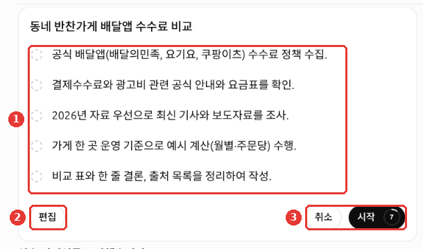
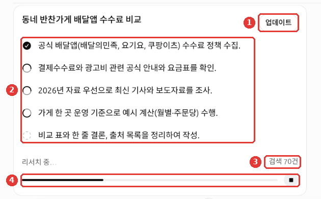
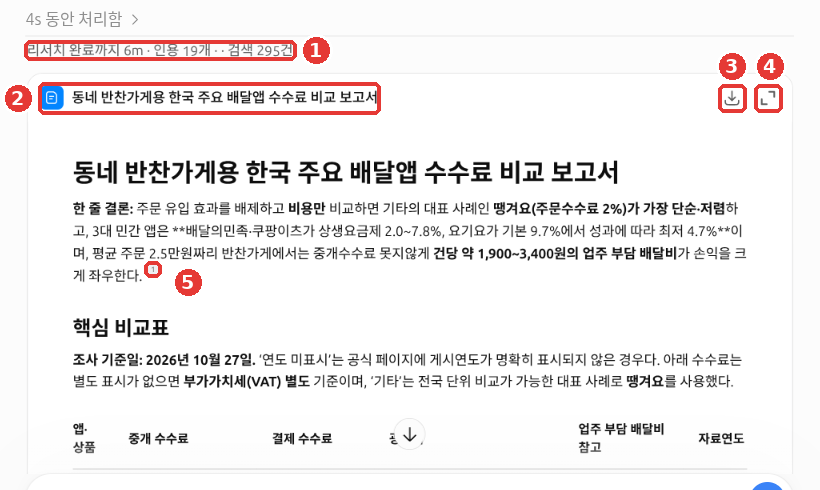
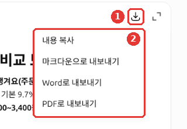

# 第6章 搜尋與深度調研——連同出處一起拿到最新資訊

> **一句話總結**：今天發生的事，或者經常變化的資訊，用**聯網搜尋**來問；需要比較多份資料的大問題，
> 用**深度調研**來問。不管哪種，把附帶的出處親自開啟看一看，才算一套完整的做法。

畫面以 2026年10月網頁版（Plus 套餐）為準。免費套餐或手機應用，選單的位置可能略有不同。

## 聯網搜尋——讓 ChatGPT 去網上查

AI 只知道它學習截止時間之前的內容。所以像"這周的天氣""昨天公佈的政策"這樣的近期的事，直接問很容易答錯。
**聯網搜尋**（web search）是這樣的功能：讓 ChatGPT 到網上找最新的資料，讀過之後再回答。

聯網搜尋在包括 Free 在內的所有套餐裡都能用。沒登入的狀態下也能用。
ChatGPT 判斷有必要時，也會**自己**去搜索。[^search]
想讓它一定去搜索，請點輸入框左側的 **+ 按鈕 →「聯網搜尋（웹 검색）」**，然後再提問。[^screen]


這是把對話標題和賬號名稱換成示例後的畫面。這一章用到的是 ① + 按鈕、⑤「聯網搜尋」、⑦「深度調研」。

```
告訴我這個週末首爾的天氣。分成周六和週日，
並把參考的網站也一起給我看。
```

### 和側邊選單的「搜尋」不一樣

側邊選單最上面放大鏡圖示的「搜尋（검색）」，只查詢**我的聊天、專案、檔案**。不會查詢網際網路。[^find]
像"上個月寫簡歷的那個對話跑哪兒去了？"這樣的事，用側邊選單的「搜尋」找。像"今年最低工資是多少？"這樣的事，用聯網搜尋來問就行。側邊選單搜尋在[第3章](03-chats.md)講。

<Quiz id="ch106-web-search" />

## 核對出處的習慣

透過聯網搜尋拿到的回答，句子末尾會像小標籤一樣附上**引用**（citation，標明是從哪裡取來的）。比如「國立中央博物館 +1（국립중앙박물관 +1）」，意思是參考了那個網站和另外 1 個出處。參考過的網站列表，可以在「出處（출처）」裡看到。[^search]


*這是把對話標題和賬號名稱換成示例後的畫面。* ① 句子末尾的小標籤就是出處標註。③ 回答下方有複製、朗讀、重新生成、更多按鈕。在 2026年10月23日的網頁畫面裡，點這個出處標註，**原來的網頁會在新標籤頁裡開啟。** ② 第二段裡像 `**금요일(10월 23일)**` 這樣，粗體符號原樣顯示出來，是[第1階段第7章](../00-common/07-structured-prompts.md)裡看過的 Markdown 符號露了出來。

不過，OpenAI 也說明，搜尋結果和引用**可能不完整、過時或有錯**。[^search]
光是附了連結，並不等於已經確認過。就像[第1階段第9章](../00-common/09-safety.md)裡學的，數字、日期、名字，要親自開啟連結，和原文對一對。
開啟連結之後，請自己問下面四個問題。

| 要確認的 | 這樣看 |
|---|---|
| 連結能開啟嗎？ | 點出處，看真實頁面是否出現 |
| 原文裡有這句話嗎？ | 找找回答裡的數字、句子在頁面裡是不是原樣存在 |
| 是什麼時候寫的？ | 看頁面的寫作日期，確認是不是過時的資訊 |
| 是誰寫的？ | 看是官方機構、公司的頁面，還是個人部落格 |

對出處不滿意，可以這樣重新拜託它。

```
剛才的回答裡，去掉個人部落格的出處，只參考政府或公共機構的網站，再告訴我一遍。
每項內容都標明是從哪個頁面取來的。
```

<Quiz id="ch106-citations" />

## 搜尋時 ChatGPT 會知道什麼

問餐廳、醫院這類"我附近"很重要的問題時，會用到位置。
ChatGPT 會根據網路地址（IP 地址，連上網際網路的每臺裝置都有的編號）推測**大致的位置**。
告訴它裝置精確位置的功能，需要另外開啟。一開始是關著的（「設定（설정）」→「資料管理（데이터 관리）」→「位置（위치）」）。[^search][^screen]

另外，ChatGPT 會把我的問題改寫成搜尋詞，發給外部的搜尋公司。這時不會同時傳送我的 IP 地址或賬號資訊。[^search]
不過，如果記憶是開著的，搜尋詞可能會根據我的情況而改變。「個性化設定（개인 맞춤 설정）」畫面裡就是這麼寫的（[第5章](05-memory.md)）。[^screen]

<Quiz id="ch106-location" />

## 購物時——比較交給它，價格自己確認

為了買東西而提問時，回答裡可能會出現**商品卡片**（product card，附有照片、價格、賣家的商品列表）。選一個以上的商品，點「Research」，就會開始**購物調研**（shopping research）。
ChatGPT 會反過來問你喜歡的品牌、尺寸、更看重什麼。幾分鐘後，它會給你一份**購買指南**（buyer’s guide），裡面有挑選時要看的點、推薦商品、對比表。[^shop-research]
這個功能在韓國的畫面裡是否會出現，幫助文件裡沒有寫。編寫本指南時也沒能確認。

```
我在找上下班用的雙肩包。預算10萬韓元，要能放進15英寸筆記型電腦，下雨天也要用。
只挑三個，用對比表給我看，每個賣家的價格請附上鍊接，讓我自己去確認。
```

::: details 拿到的回答大致是這樣（示例——點選展開）
這是本指南做的示例。實際的回答會因服務和每次的情況而不同。

> 我按條件（10萬韓元以下、15英寸筆記型電腦、下雨天）挑了三個。
>
> | 產品 | 價格 | 筆記本隔層 | 防雨能力 | 賣家 |
> |---|---|---|---|---|
> | (產品 A) | ○○韓元 | 放得進15英寸 | 防水面料 | (賣家連結) |
> | (產品 B) | ○○韓元 | 放得進15英寸 | 生活防水 | (賣家連結) |
> | (產品 C) | ○○韓元 | 放得進15英寸 | 生活防水 | (賣家連結) |
>
> 價格可能因賣家而不同，請透過連結親自確認。

**請確認有沒有拿對**：正好是三個嗎？我的三個條件在表格裡都看得到嗎？點了連結，出來的是同一個產品嗎？價格是在連結裡親自看過的嗎？

:::

需要知道的幾點。

- **是廣告嗎？** 不是。商品結果是 ChatGPT 另外挑選的。廣告會另外標註。[^shop]
- **我的對話會傳給商家嗎？** 在購物調研中聊的內容，不會分享給賣家。[^shop-research]
- **最先看到的價格**——是最先出現的那個賣家的價格。不一定是最低價。[^shop]
- **像「價效比」這樣的標註、評論摘要**——是 ChatGPT 生成的，不是保證。評論也沒有經過 OpenAI 核實。[^shop]
- **「Try on」（試穿）**——把衣服、配飾穿到我的照片上看效果的功能。它不保證實際的尺寸或合身程度。上傳的照片會為了下次使用而儲存，想刪的話請到設定裡刪除。[^shop]

**付款之前，請親自在賣家網站上確認最終價格、稅費、運費、庫存和尺寸，以及退貨規定。**[^shop-research] 價格和庫存經常變化，可能和 ChatGPT 給你看的不一樣。

<Quiz id="ch106-shopping" />

## 深度調研——把報告交給它

**深度調研**（deep research）是這樣的功能：ChatGPT 花很長時間查詢、閱讀許多資料，整理成附有引用的**報告**。
快速的事實，請用搜索來問。需要深度和細緻的時候，用深度調研就行。[^dr]

| 適合什麼時候 | 選什麼 | 例子 |
|---|---|---|
| 一兩行就能答完 | 聯網搜尋 | "告訴我今天的匯率" |
| 需要比較、整理許多資料 | 深度調研 | "適合一人小店的 3 種刷卡機比較報告" |

### 開始的方法

用下面任意一種方式開始。[^dr][^screen]

- 輸入框 **+ 按鈕 →「深度調研」**
- 在輸入框裡輸入 `/Deepresearch`

### 進行的流程

1. **發出問題**——想要什麼、為誰、以什麼形式拿到，寫得越詳細越好。
2. **先看調研計劃**——ChatGPT 會給你看"打算按這樣的順序調查"的計劃。這個計劃我可以修改。
3. **調研過程中可以插話**——進行中可以改變方向，或說出要補充的內容。
4. **拿到附有引用的報告**——可以下載成 Markdown、Word、PDF 格式。[^dr]

> **臨時聊天裡不能使用深度調研。** 在 2026年10月的網頁畫面裡，臨時聊天的 + 選單裡沒有「深度調研」。「圖片生成（이미지 생성）」也是灰色關著的。深度調研請在普通聊天裡開始。

下面是把這一節後面出現的外賣應用佣金示例真正傳送出去時的畫面。**紅色編號和圖下面列表的編號指的是同一個地方。**



- ① 這是顯示要按什麼順序調查什麼的計劃。
- ② 想改計劃，就點「編輯」。
- ③「開始」旁邊的數字，是到自動開始為止不斷減少的數字。在 2026年10月27日的畫面裡，什麼都不點，數字減完之後調研就開始了。想放棄，請點「取消」。[^screen-dr]

如果對計劃不滿意，請在開始之前點「編輯」。這樣就能在調研跑偏之前糾正過來。



- ① 調研過程中想改變方向或補充內容，就點「更新」。
- ② 完成的步驟會有勾選標記。
- ③ 這是到目前為止搜尋的次數。
- ④ 這是進度條。可以用右邊的 ■ 按鈕停下來。[^screen-dr]

調研可以放著不管，去做別的事。這個示例用了大約 6 分鐘才結束。[^screen-dr]



- ① 會顯示所用的時間、引用的出處數量、搜尋次數。
- ② 這是報告標題。報告以對話裡的文件卡片形式送來。
- ③ 是下載，④ 是放大檢視按鈕。
- ⑤ 句子末尾的小數字就是引用。順著數字，把出處開啟看看。[^screen-dr]

報告第一段裡，像 `**배달의민족·쿠팡이츠가…**` 這樣，有的地方星號原樣顯示了出來。這是粗體符號露了出來（[第1階段第7章](../00-common/07-structured-prompts.md)）。

點下面這張圖裡的 ① 下載按鈕（上圖的 ③），② 選單裡會出現「複製內容（내용 복사）」「匯出為 Markdown（마크다운으로 내보내기）」「匯出為 Word（Word로 내보내기）」「匯出為 PDF（PDF로 내보내기）」。[^screen-dr]



這是在普通聊天裡做的調研，所以這個對話會留在聊天列表裡。不想留下的話，看完之後請用[第3章](03-chats.md)的方法刪掉。

也可以讓它只調查特定的網站，或者先看這些網站。在輸入框的 Sites → Manage sites 裡設定。不過這個名稱是幫助文件裡寫的，韓文畫面裡的名稱還沒有確認。[^dr]

```
寫一份報告，比較街坊小菜店能用的外賣應用佣金。
- 物件：經營 1 家店的老闆
- 要比較的：中介佣金、支付手續費、廣告費
- 格式：最前面一行結論，然後是對比表，最後是出處清單
- 優先使用 2026年的資料，不知道日期的資料，請另外標出來
```

報告和搜尋結果一樣，也要打開出處來確認。報告越長、越像回事，就越容易跳過核對。尤其請先核對結論裡用到的數字。

<Quiz id="ch106-deep-research" />

## 額度要在畫面上確認

深度調研能用的次數，因套餐而異。剩餘次數請透過**應用裡的顯示**來確認。
每月額度從第一次使用那天起，每 30 天重新補滿。[^dr]
具體的次數在幫助文件裡沒有寫，而且經常變。所以本指南沒有寫。使用之前，請在畫面上確認。

<Quiz id="ch106-limits" />

## 動手試試

1. 在普通聊天裡點 + 按鈕 →「聯網搜尋」，問"告訴我我們小區這個月的文化活動"。
2. 親自打開回答裡附帶的兩個出處，確認活動日期和原文是否一致。
3. 把上面的外賣應用佣金示例改成適合我自己的事，用深度調研發送。出現調研計劃後，試著請它改一處。
4. 在拿到的報告裡，挑出結論裡用到的一個數字，到出處裡去找。

**連續任務**（[準備讀書會](../00-common/practice-kit.md)）：用聯網搜尋查"我們小區區立圖書館研討室的租借方法"。小區的名字自己填進去。營業時間和申請方法，要打開出處親自確認。

## 總結

- 最新資訊用聯網搜尋來問。ChatGPT 有時會自己去搜索，也可以透過 + 按鈕 →「聯網搜尋」手動開啟。
- 側邊選單的「搜尋」是查詢我的對話，不是網際網路搜尋。
- 引用和出處也可能出錯。要開啟連結，和原文對一對。
- 購物結果不是廣告，但最先出現的價格不一定是最低價。付款前，在賣家那裡確認價格、運費、退貨規定。
- 大問題交給深度調研。可以先看計劃並修改，報告可以下載成 Markdown、Word、PDF。
- 深度調研的次數因套餐而異，請在畫面上確認。

## 術語整理

| 術語 | 中文名稱 | 一句話解釋 |
|---|---|---|
| Web Search | 聯網搜尋 | ChatGPT 到網上找最新資料來回答的功能 |
| Citation | 引用 | 標明回答內容是從哪裡取來的標註 |
| Source | 出處 | 回答參考過的網頁 |
| IP Address | IP 地址 | 連上網際網路的每臺裝置都有的編號。可以大致知道位置 |
| Deep Research | 深度調研 | 長時間調查許多資料，整理成附有引用的報告的功能 |
| Buyer’s Guide | 購買指南 | 把挑選時要看的點、推薦商品、對比表彙總在一起的整理文章 |
| Shopping Research | 購物調研 | 反過來詢問所選商品、進行比較，整理成購買指南的功能 |

<ChapterDone :chapter="106" />

下一章：[第7章. 專案、外掛、Work](07-projects-plugins.md)

[^search]: OpenAI 幫助文件，「Searching the web with ChatGPT」。 https://help.openai.com/en/articles/9237897 （確認日期 2026-10-23）
[^find]: OpenAI 幫助文件，「Finding your chats, projects, and files in ChatGPT」。 https://help.openai.com/en/articles/10056348 （確認日期 2026-10-23）
[^dr]: OpenAI 幫助文件，「Deep research in ChatGPT」。 https://help.openai.com/en/articles/10500283 （確認日期 2026-10-23）
[^shop]: OpenAI 幫助文件，「Shopping with ChatGPT Search」。 "Product results are selected independently by ChatGPT and are not ads" / "may not be the lowest available price" / "They’re not guarantees or verified statements" / "Reviews and ratings are not verified by OpenAI." / "Your reference photos are saved for future try-ons" / "do not guarantee fit or size". https://help.openai.com/en/articles/11128490 （確認日期 2026-10-24）
[^shop-research]: OpenAI 幫助文件，「Using shopping research in ChatGPT」。 "Select one or more products and choose “Research”" / "After a few minutes, shopping research returns a buyer’s guide." / "Your chats are never shared with retailers." / "Confirm the final price, taxes, fees, and shipping costs on the retailer’s website." https://help.openai.com/en/articles/12911370 （確認日期 2026-10-24）
[^screen]: 在 ChatGPT 網頁畫面（Plus 套餐，韓文介面）上親自確認。輸入框 + 選單、「資料管理（데이터 관리）」「個性化設定（개인 맞춤 설정）」畫面 （確認日期 2026-10-23）
[^screen-dr]: 在 ChatGPT 網頁畫面（Plus 套餐，韓文介面）上親自確認。在普通聊天裡透過 + 選單的「深度調研」傳送這一章的外賣應用佣金示例時的調研計劃卡片（「編輯」「取消」「開始」）、進度卡片（「更新」「搜尋 70 次」、暫停）、完成的報告（「調研完成用時 6m · 引用 19 個 · 搜尋 295 次」）和下載選單。看完之後把對話刪掉了。 （確認日期 2026-10-27）

