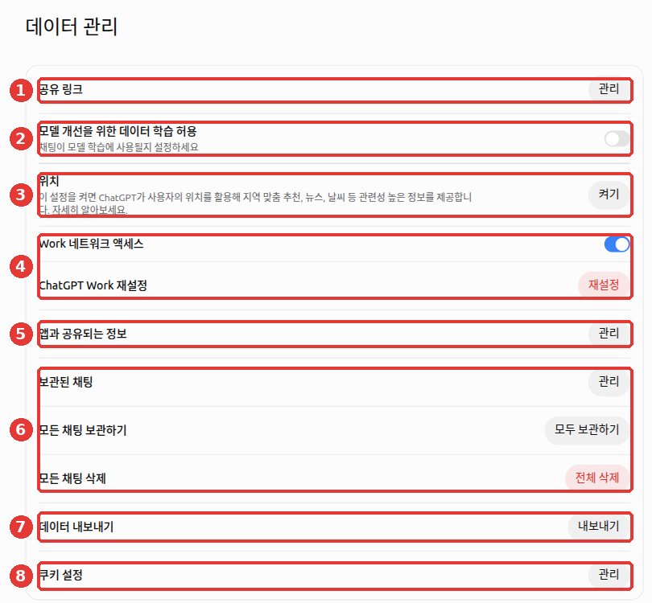
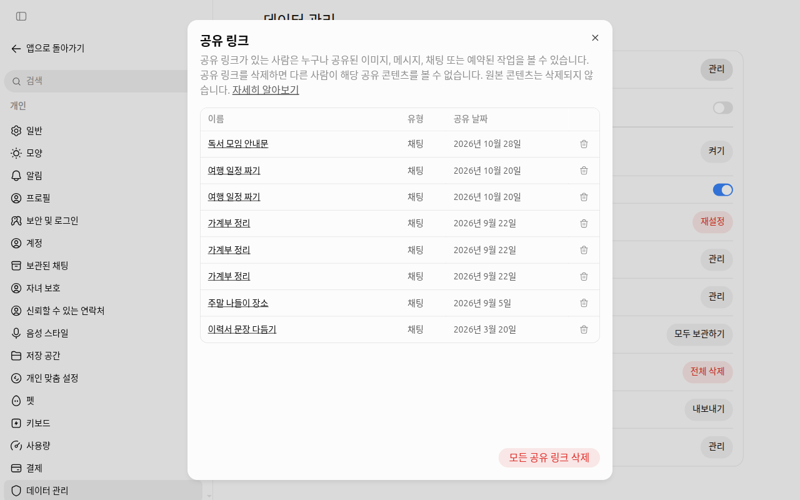
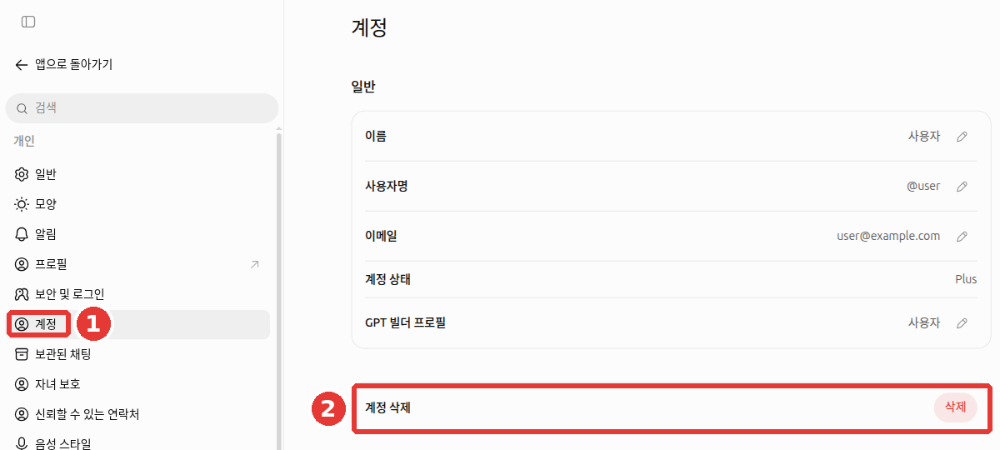
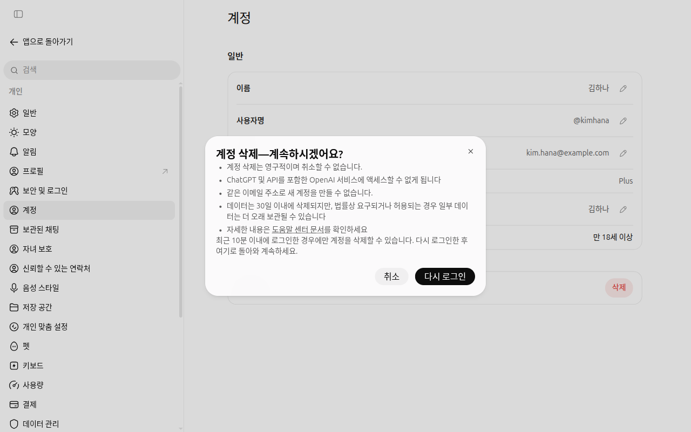

# 第8章 個人資訊與資料管理——決定我的對話用在哪裡

<Badge type="tip" text="必讀" /> 想跟著這個階段學下去，一定要讀這一章。

> **一句話總結**：發給 ChatGPT 的對話會儲存在 OpenAI 的計算機（伺服器）上，根據設定，還可能被用於讓 AI 變得更好的訓練。
> 在「設定 > 資料管理」這一個介面裡，就可以決定是否允許訓練、分享連結、歸檔·刪除、匯出。

介面以 2026 年 10 月的網頁版（Plus 方案）為準。免費方案或手機應用的選單位置可能略有不同。

**哪些東西不該輸入**，對任何 AI 都一樣，已經在[第1階段第9章「不該輸入的內容」](../00-common/09-safety.md#不要放進去的東西)裡講過了。這一章只講**已經輸入的對話，在 ChatGPT 裡該怎麼管理**。

## 逛一逛資料管理介面

點左下角的帳號名稱，開啟「設定（설정）」，然後點設定介面左側列表最下面的「資料管理（데이터 관리）」。[^data-name]



圖中的紅色編號就是下面表格裡的編號。

| 編號 | 專案 | 作用 | 這一章裡 |
|---|---|---|---|
| ① | 「分享連結（공유 링크）」「管理」 | 集中檢視並刪除我建立的對話分享連結 | [分享連結](#管理分享連結) |
| ② | 「允許用資料訓練以改進模型（모델 개선을 위한 데이터 학습 허용）」 | 決定是否讓我的聊天用於訓練的開關 | [關閉訓練](#不讓對話用於訓練) |
| ③ | 「位置（위치）」「開啟」 | 把裝置位置用在本地化推薦·天氣之類的回答上 | 見下面的說明 |
| ④ | 「Work 網路訪問」·「重置 ChatGPT Work」 | 與 Work 功能有關的設定 | 見下面的說明 |
| ⑤ | 「與應用共享的資訊」「管理」 | 管理與已連線的應用（外掛）共享的資訊 | [第7章](07-projects-plugins.md) |
| ⑥ | 「已歸檔的聊天」·「歸檔所有聊天」·「刪除所有聊天」 | 隱藏對話，或一次性全部刪除 | [歸檔和刪除](#歸檔和全部刪除) |
| ⑦ | 「匯出資料（데이터 내보내기）」「匯出」 | 把我的全部對話記錄儲存成檔案 | [匯出](#匯出資料) |
| ⑧ | 「Cookie 設定」「管理」 | 設定網站留在我的瀏覽器裡的小記錄（Cookie） | — |

**Work 設定**：Work 是把較長的任務交給它、拿回完成成果的功能（[第7章](07-projects-plugins.md#chat-和-work-的區別)）。④ 的兩個設定，這本指南不單獨講。如果你不用 Work，保持原樣就行。

**位置**：共享裝置位置一開始是關閉的。[^search] 即使不開啟，ChatGPT 也能透過上網地址（IP 地址）大致知道所在的地區。只有在確實需要「我們小區的天氣」這種小區級別的回答時再開啟，就足夠了。

<Quiz id="ch108-screen" />

## 不讓對話用於訓練

**模型訓練**（model training）是指 AI 公司收集人們的對話，用來把下一代 AI 教得更聰明。「允許用資料訓練以改進模型」就是決定這件事的開關。幫助文件裡的英文名稱是 Improve the model for everyone（為所有人改進模型）。

### 一開始可能是開著的

這個開關一開始是開著還是關著，**可能因方案和地區而不同。**[^default-on][^controls][^home]
所以不要想當然地覺得「我的應該是關著的」，請**親自開啟確認**。上面的圖是開關關閉（灰色）的狀態。

### 關閉的方法

1. 開啟帳號名稱 → 「設定」 → 「資料管理」。
2. 點「允許用資料訓練以改進模型」（這一章第一張圖的 ②）右邊的開關，把它變成灰色。如果彈出確認視窗，點「完成」。

在登入狀態下修改，會應用到**用同一個帳號登入的所有裝置**（包括手機應用）。在未登入狀態下修改，則**只儲存在那個瀏覽器裡**。[^controls]

### 關閉之後也不會變的事

我們來看一看圍繞這個開關的四個常見誤解。

- **關閉後，對話記錄會消失嗎？** 不會。記錄會原樣留在側邊選單裡。
- **關閉後，任何對話都不會用於訓練嗎？** 不是這樣。如果你在回答下面點贊·點踩之類的按鈕傳送反饋（feedback，告訴它回答好不好的評價），那整個對話都可能被用於訓練。
- **關閉後，就不會被儲存了嗎？** 不是。只是不用於訓練，對話仍會儲存在伺服器上。想刪除的話，請看下面的[歸檔和全部刪除](#歸檔和全部刪除)。
- **開著的時候，連線的 Google 應用裡的資料也會被用於訓練嗎？** 不會。幫助文件說明，直接從已連線的 Google 應用（Gmail·Drive 等）讀取的資料，即使開關是開著的，也不會用於訓練。不過有例外。傳送過反饋（點贊·點踩）的對話、自己複製·貼上·上傳的內容、ChatGPT 回答裡包含的內容。[^google]

> 與允許訓練無關，寫在自定義指令（[第5章](05-memory.md)）裡的內容，也遵循這個開關。[^ci] 所以用一個開關就可以一起攔住。

<Quiz id="ch108-training" />

## 管理分享連結

為了給別人看對話而建立的**分享連結**（share link），只要有連結地址，**任何人**都能看。不能按人來限制，也沒有會自動失效的到期日。[^share]
建立連結的方法在[第3章](03-chats.md)裡看過了。這裡講的是**整理以前建立的連結的方法**。

1. 在「資料管理」裡，點「分享連結」右邊的「管理」。
2. 在列表裡把不需要的連結一個一個刪除，或者用「刪除所有分享連結」一次性全部刪除。



*連結名稱是改成示例的介面。用行尾的垃圾桶按鈕一個一個刪除。*

在群聊裡發過一次的連結，我沒辦法知道傳到了哪裡。所以刪除連結是最可靠的收回辦法。

<Quiz id="ch108-share" />

## 歸檔和全部刪除

整理對話的方法有兩種，結果完全不同。[^delete]

| | 歸檔 (Archive) | 刪除 (Delete) |
|---|---|---|
| 在側邊選單裡 | 消失 | 消失 |
| 對話內容 | **原樣保留。** 聊天搜尋也能搜到 | 預定在 30 天內從 OpenAI 系統中永久刪除 |
| 恢復 | 在「已歸檔的聊天」裡取消歸檔 | **無法恢復。** 客戶支援團隊也無法找回 |

在「資料管理」裡可以一次性做這些事。

- 「已歸檔的聊天」「管理」：檢視歸檔的對話列表並取消歸檔。
- 「歸檔所有聊天」「全部歸檔」：一次清空側邊選單。內容會保留。
- 「刪除所有聊天」「全部刪除」：刪除所有對話。**無法恢復。** 點之前，請先用下面的[匯出資料](#匯出資料)做好備份。

**刪除聊天之後仍然會留下的東西。**

- 對話裡上傳的檔案中，另外儲存在**資料庫**（[第4章](04-files-images.md)）裡的檔案會保留。[^delete] 請在資料庫裡另外刪除。
- 從那個對話裡產生的**已儲存記憶**（[第5章](05-memory.md)）也會保留。[^memory] 請在「個性化設定（개인 맞춤 설정）」裡另外刪除（[第5章](05-memory.md)）。

如果是一開始就不想留下記錄的對話，用**臨時聊天**更簡單。請點右上角的「臨時聊天」按鈕開始。這樣對話不會留在聊天記錄裡，也不會用於模型訓練。不過出於安全考慮，副本最多可能儲存 30 天。[^temp] 詳細用法在[第3章](03-chats.md)裡。

<Quiz id="ch108-delete" />

## 匯出資料

**匯出資料**（export）是把到目前為止的對話記錄和帳號資訊，打包成一個壓縮檔案（ZIP，把多個檔案合成一個的檔案）的功能。在全部刪除或刪除帳號之前用來備份。[^export]

1. 在「資料管理」裡，點「匯出資料」右邊的「匯出」。
2. 在確認視窗裡點「確認匯出」。
3. 下載連結會發到你註冊時用的電子郵件（或簡訊）裡。**最多可能需要 7 天**。
4. 連結**收到後過了 24 小時就會失效**。郵件一到就馬上下載。錯過了的話，重新申請就行。

Free·Go·Plus·Pro 個人帳號可以使用。未登入狀態下不能使用。[^export]

> 下載的檔案裡**有我所有的對話。** 不要下載到公用電腦上，也不要上傳到和別人共用的雲端資料夾裡。

**沒有把對話轉移到其他帳號的功能。** 不能合併兩個帳號，也不能把對話列表整體搬過去。能做的，只是把下載的記錄上傳到新帳號的對話裡，當作**參考資料**來用。側邊選單裡不會出現以前的對話。[^transfer]

1. 解壓下載的壓縮檔案。一般雙擊檔案，或者用滑鼠右鍵選單裡的「解壓」就能解開。
2. 在解開的資料夾裡找到 `conversations.json` 檔案。這是用文字儲存對話記錄的檔案。結尾的 `.json` 是檔案格式的名稱，不用在意。
3. 把這個檔案上傳到新帳號的對話裡，然後像「請從這份記錄裡找出上個月聊旅行計劃的內容」這樣提問。

<Quiz id="ch108-export" />

## 刪除帳號

不再使用 ChatGPT 時，可以刪除帳號。[^account]

1. 開啟「設定」 → ① 「帳號」。
2. 點 ② 「刪除帳號」旁邊的「刪除」。
3. 彈出確認視窗後，閱讀說明並繼續。如果登入已經超過 10 分鐘，要先點「重新登入」。[^screen-account]
4. 按提示輸入電子郵件地址和 `DELETE`，點「永久刪除我的帳號」。



*姓名·使用者名稱·電子郵件是改成示例的介面。沒有點「刪除」。*



*點「刪除」不會馬上刪除，會先彈出這個視窗。**只有最近 10 分鐘內登入過，才能直接繼續。** 如果視窗開了很久，請先點「重新登入」。在這個介面裡點的是「取消」。*[^screen-account]

| 刪除之後 | 內容 |
|---|---|
| 資料 | 會在 30 天內刪除（法律規定必須儲存的情況除外） |
| 恢復 | 不可能 |
| 重新註冊 | 用同一個電子郵件可能比較難[^rejoin][^account][^screen-account] |

**訂閱要另外取消。** 透過 iPhone 的 App Store（Apple）付費的訂閱，即使刪除帳號也不會取消。[^account] 在手機上刪除應用，訂閱也會繼續。[^pro] 所以刪除帳號之前，請先到付款的地方取消訂閱。

<Quiz id="ch108-account" />

## 保護帳號

帳號裡有我所有的對話。所以只靠一個密碼來保護是危險的。請在設定 → 「安全與登入」裡確認下面這些專案。[^screen-security]

- 「多重驗證（MFA）」：除了密碼，再用**驗證應用的一次性驗證碼或簡訊裡的 6 位驗證碼**確認一次。建議開啟（這本指南的建議）。
- 「通行金鑰和安全金鑰」：不用密碼，而是用手機指紋·人臉識別之類的方法登入。這是對釣魚（用假網站偷密碼的手段）很有效的方法。
- 「活躍會話」：檢視所有登入過我帳號的裝置。可以移除裝置，也可以在所有裝置上退出登入。
- 「登入關聯」 → 「用 ChatGPT 登入」：檢視用 ChatGPT 帳號登入過的其他應用·網站，並切斷它們的訪問。
- 「鎖定模式」：下面會講。

**如果看到不認識的對話或裝置**，請馬上更改密碼。更改後，**30 分鐘內會在所有裝置上退出登入**。如果你一直是用 Google·Microsoft 帳號登入的，就要更改那家公司帳號的密碼。[^unrecognized] 帳號不要幾個人共用。共用的話，很容易被判定為異常活動。[^errors]

在其他應用或網站上點「用 ChatGPT 登入」時，那裡**只會收到姓名·電子郵件·頭像**。[^signin] 對話內容不會傳過去。即便如此，也請偶爾在上面的「登入關聯」裡整理一下登入過的地方。

**鎖定模式**（Lockdown Mode）是限制對外連線功能的設定。它可以降低因網頁或檔案中隱藏的惡意指示（**提示詞注入**，prompt injection）導致資訊洩露的風險。[^lockdown] 它是為**處理敏感資料的人和組織**準備的功能，所以通常不用開啟（這本指南的判斷）。

::: details 鎖定模式詳細說明（點選展開）

- 網頁搜尋只能使用事先儲存的內容，深度研究之類的功能會被停用。[^lockdown]
- 幫助文件說明，這個功能並不是為所有人準備的。它也不能阻止隱藏的指示本身。[^lockdown]
- 根據方案和帳號，也可能沒有這個選單。
- 隱藏的指示是什麼，請看[第1階段第9章](../00-common/09-safety.md)。

:::

<Quiz id="ch108-security" />

## 為家人和安全準備的功能

設定裡有「家長控制」和「可信聯絡人」選單。[^screen-security] 兩個都不開，也不影響使用 ChatGPT。不過，瞭解它們做什麼、**不做什麼**，可以減少誤會。

**家長控制**（parental controls）是把監護人和青少年（未滿 18 週歲）的帳號連線起來的功能。監護人可以調整部分功能，設定使用時間，在少數情況下收到安全提醒。[^parental]

- **監護人看不到孩子的對話。** 即使連線了帳號，也無法訪問對話內容、記錄和當前的活動。[^parental]
- 如果 ChatGPT 根據使用跡象判斷為未滿 18 週歲，可能會自動開啟青少年保護。如果是成年人卻被誤判，有時可以透過年齡驗證來解除（見下面的「詳細說明」）。[^age]

**可信聯絡人**（trusted contact）是成年人預先指定一個人的功能。如果有和自殺相關、讓人非常擔心安全的對話，可能會向那個人傳送提醒，請他來問候確認。自動檢測之後，會由受過培訓的人進行稽核。[^trusted]

- 提醒裡**不包含對話內容。**[^trusted]
- **它不是急救服務。** 在語音對話中不起作用。如果現在有危險，不要等這個功能，請馬上聯絡急救服務或危機諮詢電話。[^trusted]

在傾訴痛苦心情的對話裡，ChatGPT 可以介紹所在地區的**危機諮詢機構**。[^helpline]

::: details 詳細說明——年齡驗證和可信聯絡人的條件（點選展開）

**年齡驗證**：只有在我的帳號可以使用年齡驗證時才行（因帳號而異）。驗證由一家叫 **Persona** 的外部公司負責。**OpenAI 不會收到身份證件或自拍**，也不需要出示身份證號碼之類的證件號碼。[^age]

**可信聯絡人**的條件如下。

- **只能在個人帳號裡**使用。在 Business·Enterprise·Edu 這類公司·學校空間裡不會開啟。[^trusted]
- **在韓國，本人和被指定為聯絡人的人都必須年滿 19 週歲**（其他國家是年滿 18 週歲）。[^trusted-ko]
- 被指定的人要在**1 周內**接受邀請，才會開啟。沒有 ChatGPT 帳號的人也可以被指定。[^trusted][^trusted-add]

**危機諮詢介紹**：各地區的諮詢機構，是 OpenAI 和危機諮詢對接專業機構（ThroughLine）一起展示的。[^helpline]

:::

<Quiz id="ch108-family" />

## 公司帳號有什麼不同

公司集體簽約的 **Business**（以前叫 Team）·**Enterprise**，以及學校用的 **Edu** 方案，預設不會把對話內容用於訓練。[^controls]
如果你用的是公司帳號，比上面的訓練開關更優先的是**公司的 AI 使用規定**。能輸入什麼，請向公司負責部門確認。

反過來，如果用**個人帳號**做公司的工作，就得不到這種保護。公司資料請只在公司允許的帳號裡處理。

關於公司帳號，還有幾點要知道。

- **管理員可能可以處理我的對話。** 公司管理員根據設定，**可能可以**檢視·匯出·審計·保留·刪除那個帳號的資料。也可能同意為了改進模型而與 OpenAI 共享。[^managed] 請把公司帳號裡的對話看作公司的記錄。
- **個人帳號和公司帳號是分開的。** 即使切換帳號進去，對話·檔案·設定也不會跟著轉移。[^managed]
- 可能會彈出**讓你把個人空間合併到公司空間的提示**。合併後無法撤銷。離職後，轉移的對話也可能看不到了。在公司空間裡也不能自己匯出。所以合併之前，請先把個人記錄匯出來。[^migrate]
- 如果公司關閉了記憶功能，我在那個公司空間裡已儲存的記憶會被刪除。[^bizmemory]

<Quiz id="ch108-business" />

## 親自試一試

**1. 確認我的訓練設定**

開啟「設定」 → 「資料管理」，看看「允許用資料訓練以改進模型」是不是開著的。改成你想要的那一邊之後，如果有手機應用，也確認一下應用裡是否變成了同樣的值。

**2. 分享連結大掃除**

開啟「分享連結」「管理」，數一數現在有效的連結有幾個。不再需要給別人看的連結，就刪掉。

**3. 讓 ChatGPT 給我一份設定檢查表**

```
我用個人帳號使用 ChatGPT。
我想讓我的對話不被用於訓練，並且整理以前的分享連結。
請把我需要在設定介面裡親自確認的項目，做成檢查表（☐）。
你不確定的選單名稱不要編造，請寫「在介面上確認」。
```

把拿到的檢查表裡的選單名稱，和這一章的表格比較一下。如果不一樣，以介面上看到的名稱為準。

**連續任務**（[準備讀書會](../00-common/practice-kit.md)）：在「設定」 → 「資料管理」裡，確認「允許用資料訓練以改進模型」和「分享連結」列表。如果要把真實的聚會資料上傳到「讀書會」專案裡，就決定好這個設定該怎麼放。

## 整理

- 在「設定 > 資料管理」這一個介面裡，決定允許訓練、分享連結、歸檔·刪除、匯出。
- 「允許用資料訓練以改進模型」可能因方案·地區而在一開始就是開著的。請親自開啟確認。即使關閉，傳送過反饋的對話也可能被用於訓練。
- 分享連結任何人都能看，也不會到期。不需要的話，在「管理」裡刪除。
- 歸檔是隱藏，刪除是 30 天內永久刪除，無法恢復。資料庫檔案和已儲存的記憶要另外刪除。
- 匯出連結要在收到後 24 小時內下載。刪除帳號之前，先取消訂閱。
- 在「安全與登入」裡開啟多重驗證，不認識的裝置讓它退出登入。更改密碼後，30 分鐘內會在所有裝置上退出登入。
- 連線了家長控制，監護人也看不到對話。可信聯絡人在韓國要年滿 19 週歲，而且不是急救服務。
- 公司帳號（Business·Enterprise·Edu）預設不用於訓練，但公司規定優先，而且管理員可能可以處理對話。

## 術語整理

| 術語 | 中文名稱 | 一句話解釋 |
|---|---|---|
| Data controls | 資料管理 | 決定我的對話的訓練·儲存·刪除的設定介面 |
| Model training | 模型訓練 | 用收集到的對話來教下一代 AI |
| Share link | 分享連結 | 把對話給別人看的地址。有地址的任何人都能看 |
| Archive | 歸檔 | 不刪除對話，只是在側邊選單裡把它隱藏起來 |
| Export | 匯出 | 把我的全部記錄儲存成檔案 |
| ZIP | ZIP 壓縮檔案 | 把多個檔案合成一個並縮小體積的壓縮檔案 |
| Cookie | Cookie | 網站留在我的瀏覽器裡的小記錄 |
| Subscription | 訂閱 | 每個月付錢使用的方案 |
| MFA (Multi-Factor Authentication) | 多重驗證 | 除了密碼，再用另一種方法確認一次本人身份的登入方式 |
| Passkey | 通行金鑰 | 不用密碼，而是用裝置的指紋·人臉識別登入的方法 |
| Lockdown Mode | 鎖定模式 | 限制對外連線功能，降低因隱藏指示而洩露資訊風險的設定 |
| Prompt Injection | 提示詞注入 | 用藏在網頁·檔案裡的指示，讓 AI 做出離譜舉動的攻擊 |
| Parental Controls | 家長控制 | 連線監護人和青少年帳號，設定部分功能和時間的功能 |
| Trusted Contact | 可信聯絡人 | 為危機時收到問候確認提醒而預先指定的人 |

<ChapterDone :chapter="108" />

下一章：[第9章. 用語音對話](09-voice.md)

---

[^default-on]: OpenAI 的一處幫助文件（《Data controls in ChatGPT》）寫著，個人帳號的 Free·Plus·Pro 方案預設是開啟的。另一處（《The ChatGPT home page》）寫著，根據地區和設定而不同。
[^rejoin]: 幫助文件（《Deleting your ChatGPT account》）說**30 天後**可以用同一個電子郵件重新註冊。但刪除確認視窗裡卻寫著不能用同一個電子郵件建立新帳號。如果打算重新註冊，刪除之前請再確認一次幫助文件。
[^controls]: OpenAI 幫助文件，《Data controls in ChatGPT》。個人工作區的 Free·Plus·Pro 預設開啟，登入時應用到所有裝置，未登入狀態只儲存在那個瀏覽器裡，傳送反饋時整個對話都可能被用於訓練，Business·Enterprise·Edu 預設不用於訓練。https://help.openai.com/en/articles/7730893 （確認日期 2026-10-23）
[^home]: OpenAI 幫助文件，《The ChatGPT home page》。是否用於訓練 "depends on your location and settings"。https://help.openai.com/en/articles/9125172 （確認日期 2026-10-23）
[^ci]: OpenAI 幫助文件，《ChatGPT Custom Instructions》。自定義指令的使用資訊也可能用於模型改進，可以透過訓練設定拒絕。https://help.openai.com/en/articles/8096356 （確認日期 2026-10-23）
[^search]: OpenAI 幫助文件，《Searching the web with ChatGPT》。"Device location sharing is optional and off by default." 透過 IP 使用大致位置。https://help.openai.com/en/articles/9237897 （確認日期 2026-10-23）
[^share]: OpenAI 幫助文件，《Sharing conversations and scheduled tasks in ChatGPT》。擁有連結的任何人都能檢視，不能設定到期日，在「分享連結 > 管理」裡可以單個刪除·刪除所有分享連結。https://help.openai.com/en/articles/7925741 （確認日期 2026-10-23）
[^delete]: OpenAI 幫助文件，《Deleting and archiving chats in ChatGPT》。刪除預定在 30 天內永久刪除、無法恢復，歸檔只是從側邊欄消失、搜尋裡還能搜到，刪除所有聊天無法撤銷，刪除聊天不會刪掉資料庫檔案。https://help.openai.com/en/articles/8809935 （確認日期 2026-10-23）
[^memory]: OpenAI 幫助文件，《Memory in ChatGPT》。"Deleting the original chat does not automatically delete a separate saved memory." https://help.openai.com/en/articles/8590148 （確認日期 2026-10-23）
[^temp]: OpenAI 幫助文件，《Temporary chat in ChatGPT》。不留在記錄裡，不用於訓練，出於安全目的最多可能儲存 30 天。https://help.openai.com/en/articles/8914046 （確認日期 2026-10-23）
[^export]: OpenAI 幫助文件，《Exporting your ChatGPT history and data》。透過郵件·簡訊傳送連結，最多需要 7 天，"The download link expires 24 hours after you receive it."，ZIP 檔案，Free·Go·Plus·Pro，未登入狀態不可用。https://help.openai.com/en/articles/7260999 （確認日期 2026-10-23）
[^account]: OpenAI 幫助文件，《Deleting your ChatGPT account》。30 天內刪除資料（法律例外），無法重新啟用，同一個電子郵件 30 天後可以重新註冊，"Deleting your account does not cancel an Apple subscription." https://help.openai.com/en/articles/6378407 （確認日期 2026-10-23）
[^google]: OpenAI 幫助文件，《Google app data controls FAQ》。"Even if this setting is enabled, we do not train our generalized models on data accessed directly from connected Google apps." https://help.openai.com/en/articles/10408842 （確認日期 2026-10-24）
[^transfer]: OpenAI 幫助文件，《Transfer exported conversations between ChatGPT accounts》。"This is not a full account migration." / "Find conversations.json." https://help.openai.com/en/articles/9106926 （確認日期 2026-10-24）
[^screen-security]: 在 ChatGPT 網頁設定介面（Plus 方案，韓語）上親自確認。「보안 및 로그인」裡的「다중 인증(MFA)」「패스키 및 보안 키」「활성 세션」「로그인 연동 — ChatGPT로 로그인」「락다운 모드」，以及各專案的介面說明（"인증 앱의 일회용 코드 사용", "6자리 인증 코드를 받습니다", "신뢰하는 기기를 제거하거나, 모든 기기에서 로그아웃"），設定列表裡的「자녀 보호」「신뢰할 수 있는 연락처」（確認日期 2026-10-24）
[^unrecognized]: OpenAI 幫助文件，《I'm seeing unrecognized activity on my OpenAI account.》。"Once you change your password, all current sessions will be logged out within 30 minutes." / "If you have logged in with Microsoft or Google authentication, you'll need to reset your Microsoft or Google account password." https://help.openai.com/en/articles/8485685 （確認日期 2026-10-24）
[^errors]: OpenAI 幫助文件，《Troubleshooting ChatGPT Error Messages》。"Ensure you are not sharing your ChatGPT account with other people". https://help.openai.com/en/articles/7996703 （確認日期 2026-10-24）
[^signin]: OpenAI 幫助文件，《Sign in with ChatGPT》。"the external application receives only your name, email address, and profile picture, if you have one." https://help.openai.com/en/articles/20001410 （確認日期 2026-10-24）
[^lockdown]: OpenAI 幫助文件，《Lockdown Mode》。"Web browsing is limited to cached content." / "Deep research is disabled." / "It is designed for people and organizations that handle sensitive data" / "Lockdown Mode is not intended for everyone." / "Lockdown Mode does not prevent prompt injections from appearing in the content ChatGPT processes." https://help.openai.com/en/articles/20001061 （確認日期 2026-10-24）
[^parental]: OpenAI 幫助文件，《Managing parental controls in ChatGPT》。"Parental controls let a parent or guardian link their ChatGPT account to a teen’s account, manage selected settings, set schedules, and receive safety notifications in limited situations." / "Linking accounts does not give a parent or guardian access to a teen’s conversations, chat history, or real-time activity." https://help.openai.com/en/articles/12315553 （確認日期 2026-10-24）
[^age]: OpenAI 幫助文件，《Age prediction in ChatGPT》。"OpenAI uses Persona, a third-party service, to verify your age." / "OpenAI does not receive your ID or selfie." / "You do not need to show ID numbers, such as a national ID number or Social Security number." https://help.openai.com/en/articles/12652064 （確認日期 2026-10-24）
[^trusted]: OpenAI 幫助文件，《Trusted contacts in ChatGPT》。"if automated systems and trained reviewers detect you may be talking about suicide in a way that signals a serious safety concern, ChatGPT may notify your trusted contact" / "Your chat details or transcripts are not shared." / "Trusted contact is not an emergency service, a crisis response system, or a substitute for mental health care." / "Trusted contact is not currently available in ChatGPT Voice." / "It is available for personal ChatGPT accounts, and is not enabled in shared workspaces such as ChatGPT Business, Enterprise, or Edu." https://help.openai.com/en/articles/20001105 （確認日期 2026-10-24）
[^trusted-ko]: OpenAI 幫助文件，《Managing parental controls in ChatGPT》。"Trusted Contact is a separate, optional feature for adults 18 or older, or 19 or older in Korea." 韓語設定介面裡也寫著“사용자 본인과 해당 연락처로 지정된 사람 모두 만 19세 이상이어야 합니다”（確認日期 2026-10-24）。https://help.openai.com/en/articles/12315553 （確認日期 2026-10-24）
[^trusted-add]: OpenAI 幫助文件，《Adding and managing a trusted contact》。"If the person accepts the invitation within 1 week, the feature becomes active." https://help.openai.com/en/articles/20001194 （確認日期 2026-10-24）。沒有 ChatGPT 帳號也可以，出自《Being someone’s trusted contact》"You do not need a ChatGPT account to be someone’s trusted contact." https://help.openai.com/en/articles/20001195 （確認日期 2026-10-24）
[^helpline]: OpenAI 幫助文件，《Crisis helpline support in ChatGPT》。"As part of our partnership with ThroughLine, we have introduced localized helplines in ChatGPT". https://help.openai.com/en/articles/12677603 （確認日期 2026-10-24）
[^managed]: OpenAI 幫助文件，《Data access for your managed ChatGPT account》。"your administrator may be able to access, export, audit, retain, delete, and opt-in to share data tied to this account with OpenAI to improve OpenAI’s models." / "Switching accounts does not move chats, files, or settings between accounts." https://help.openai.com/en/articles/20001067 （確認日期 2026-10-24）
[^migrate]: OpenAI 幫助文件，《Migrating your personal workspace to ChatGPT Business or Enterprise》。"Migration does not provide an undo option" / "If you leave, are removed, or lose access to the destination workspace, you may also lose access to that content." / "Self-service data export is not available in ChatGPT Business or Enterprise workspaces." https://help.openai.com/en/articles/8801890 （確認日期 2026-10-24）
[^bizmemory]: OpenAI 幫助文件，《Memory FAQ (Business Version)》。"If a workspace owner turns off Memory for the workspace, existing saved memories for members in that workspace are deleted." https://help.openai.com/en/articles/9295112 （確認日期 2026-10-24）
[^pro]: OpenAI 幫助文件，《About ChatGPT Pro tiers》。"Uninstalling the ChatGPT app does not cancel your subscription." https://help.openai.com/en/articles/9793128 （確認日期 2026-10-23）
[^data-name]: 官方幫助文件裡這個選單寫作「資料控制」（Data controls）。實際的介面名稱是「資料管理（데이터 관리）」。
[^screen-account]: 親自確認了點選「設定」 → 「帳號」 → 「刪除」後彈出的確認視窗。"최근 10분 이내에 로그인한 경우에만 계정을 삭제할 수 있습니다." 這個視窗裡寫著“같은 이메일 주소로 새 계정을 만들 수 없습니다.”，和幫助文件說的 30 天後可以重新註冊不同。如果打算重新註冊，刪除之前請再確認一下幫助文件（確認日期 2026-10-28，Plus 帳號網頁介面）
