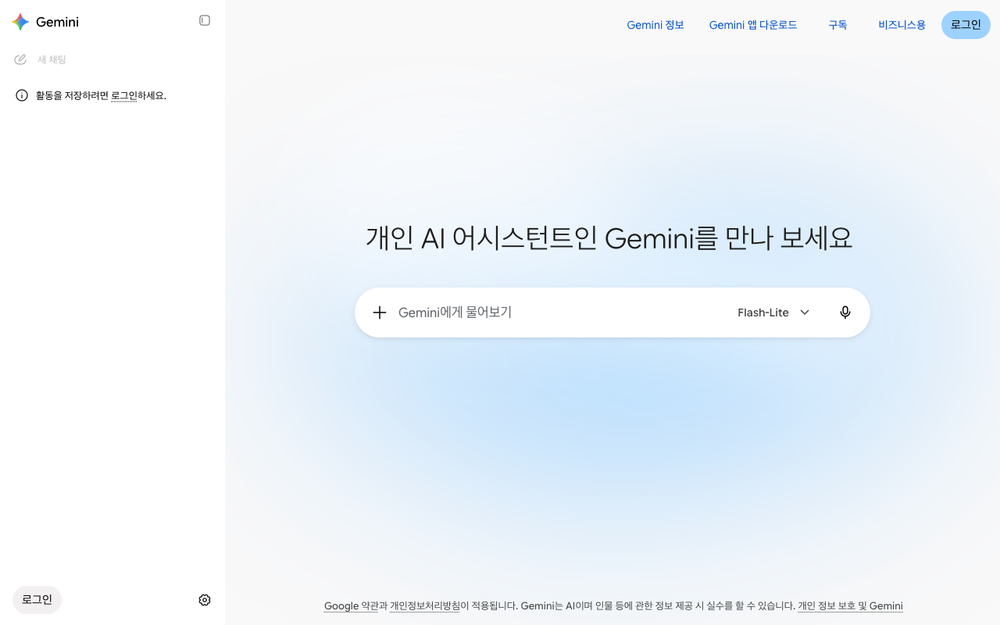
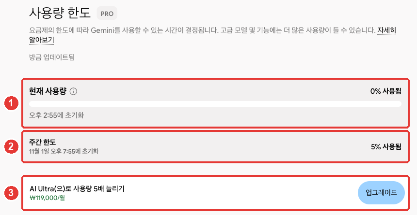
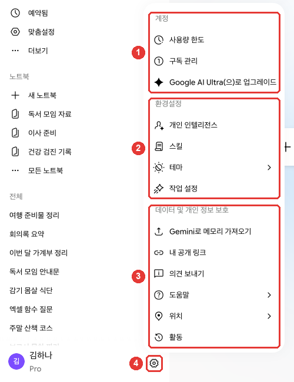

# 第1章 開始使用——在哪裡用、登入、套餐和使用額度

> **一句話總結**：Gemini 用一個 Google 賬號，就可以在網頁、手機應用和電腦應用上使用。不需要另外註冊，
> 用你已經在用的 Google 賬號登入就行。先免費用起來，只有額度經常不夠時，再考慮付費套餐。

介面以 2026 年 10 月的網頁版為準，圖片是付費套餐（Google AI Pro）的韓語介面。免費賬號或手機應用的選單可能略有不同。

## Gemini 是什麼，在哪裡用

Gemini 是 Google 做的 AI 服務。它靠第1階段學過的 **LLM**（大語言模型，[第1階段第1章](../00-common/01-what-is-llm.md)）運轉。
第1階段學到的提問方法，用在 Gemini 上也完全適用。這一章只講怎麼進入 Gemini 這個服務。

可以使用的地方有網頁、手機應用和電腦應用。無論在哪裡用，都用同一個 Google 賬號進入。

| 使用的地方 | 開啟方式 | 需要什麼 |
|---|---|---|
| 網頁 | 在瀏覽器裡開啟 gemini.google.com | Chrome·Safari·Firefox·Opera·Edge |
| 安卓應用 | 從 Google Play 下載 | Android 9 以上，RAM 2GB 以上 |
| Mac 應用 | 在 gemini.google/mac 下載 | macOS 15 以上，Apple 晶片 |
| Windows 應用 | 在 gemini.google/desktop 下載 | Windows 10 以上 |

出處：Google 幫助文件[^start][^mobile][^mac][^windows]

iPhone 和 iPad 從 App Store 下載 Gemini 應用就行。[^mobile]
如果是第一次，建議從網頁開始。不需要安裝任何東西，最簡單。

使用有兩個條件。

- 必須在**支援的國家**。韓國在網頁版和手機應用的支援國家名單裡，也支援韓語。[^where][^mobile]
- 必須**年滿 13 週歲**（個人賬號標準，各國的標準年齡可能不同）。公司賬號要年滿 18 週歲。[^signin]

不過，付費套餐和部分功能（個性化設定、從其他 AI 匯入等）只有**年滿 18 週歲**的人才能使用。[^plans][^customize]
像孩子的賬號這樣，由 Family Link（家庭管理功能）管理的賬號，不能在網頁上使用 Gemini。手機應用則可以由家長在 Family Link 設定裡關閉孩子的使用。[^signin]

第一次進去時，可以這樣問問看。

```
你能幫我做哪些事？請只舉五個上班族可以馬上用上的例子。
```

<Quiz id="ch301-where" />

## 用 Google 賬號登入

Gemini 沒有單獨的註冊過程。用**你在 Gmail 或 YouTube 上使用的 Google 賬號**登入就行。[^start]
開啟 gemini.google.com，點右上角的「登入（로그인）」。[^signin]



這是登入之前的介面。側邊選單裡能看到「登入以儲存你的活動記錄。」的提示，模型固定為「Flash-Lite」。[^screen-out]

即使不登入，在網頁上也能問一些簡單的問題。但是不能做的事很多。[^start]

| 未登入 | 已登入 |
|---|---|
| 用文字提問和回答 | 用文字提問和回答 |
| 重新檢視過去的對話 ✗ | 重新檢視過去的對話 |
| 上傳檔案·生成圖片 ✗ | 上傳檔案·生成圖片 |
| 連線 Gmail·Drive 這類 Google 應用 ✗ | 連線 Google 應用 |

出處：Google 幫助文件[^start]

想保留對話並以後再看，請登入。安卓手機應用從一開始就必須登入才能使用。[^start]

要退出登入，在左側選單裡點頭像（或名字的首字母），選擇「退出登入」。[^signin]
如果是好幾個人共用的電腦，用完後一定要退出登入。如果一直保持登入，下一個人可以在側邊選單裡開啟我的對話。

<Quiz id="ch301-login" />

## 一眼看懂套餐

Gemini 也有從免費開始的多種**套餐**（根據付費程度，能使用的功能和用量不同的使用方式）。
付費套餐叫作 Google AI 套餐，透過 **Google One**（Google 的付費訂閱服務）訂閱。[^upgrade]

| 套餐 | 月費（韓國） | 用量 | 儲存空間 |
|---|---|---|---|
| 免費 | ₩0 | 基礎 | — |
| Google AI Plus | ₩7,500 | 基礎的 2 倍 | 400GB |
| Google AI Pro | ₩29,000 | 基礎的 4 倍 | 5TB |
| Google AI Ultra | ₩119,000 起 | Pro 的 5 倍或 20 倍 | 20TB 起 |

出處：Google 套餐頁面（韓國）和幫助文件[^plans-screen][^limits]

有一點值得注意。Google AI 套餐裡**包含了 Google 儲存空間**。這個空間由 Drive·Gmail·Google 相簿共用。[^upgrade]
所以，如果你已經為照片或郵件購買並在使用儲存空間，選套餐時請一起考慮。

Ultra 有兩種。「Ultra 5 倍」（月 ₩119,000，20TB）和「Ultra 20 倍」（月 ₩300,000，30TB）。[^plans-screen]
價格可能會變，也經常有限時折扣。付款之前，請到[套餐頁面](https://one.google.com/about/google-ai-plans/)親自確認。

### 各套餐有什麼不同

比起數字，瞭解**“有什麼不一樣”**，選起來更容易。

| 不同的地方 | 免費 | 付費 |
|---|---|---|
| **用量** | 基礎 | Plus 2 倍，Pro 4 倍[^limits] |
| **一次能讀的量** | 約 3 萬 2 千 token | Plus 12 萬 8 千，Pro·Ultra 100 萬 token[^limits] |
| **自己選擇模型** | 不能選 | 可以選（[第2章](02-screen-tour.md)）[^models] |
| **最大的模型**（Argon） | 不能用 | Pro·Ultra[^plans] |

**一次能讀的量**就是第1階段學過的[上下文視窗](../00-common/01-what-is-llm.md#_3-一次能看的量有限——-上下文視窗)。token 是 AI 數文字的單位。
100 萬 token 的話，一次能讀大約 1,500 頁的文字。[^limits] 想把一份很長的報告或一整本書一起上傳來提問時，差別就出來了。

如果把 Pro 套餐作為家庭套餐使用，家庭成員也不用額外付費就能使用 AI 功能。[^plans]

<Quiz id="ch301-plans" />

## 使用額度——5 小時·每週·閱讀量

Gemini 的額度**不是“一天幾次”這樣按次數計算，而是按用掉的量計算。** 提問有多複雜、用了什麼模型和功能、對話有多長，都會一起計算。[^limits]
用掉的量**每 5 小時**重新補滿，另外還有**每週額度**。[^limits]

瞭解哪些事情會用掉很多用量，就能省著用。[^limits]

| 做的事 | 用量 |
|---|---|
| 一個簡短的提問 | 很少 |
| 持續很長的對話 | 一般 |
| Deep Research（長篇調查報告） | 多 |
| 生成圖片·音樂·影片 | 多（影片最多） |

出處：Google 幫助文件[^limits]

持續很長的對話用得更多，是有原因的。Gemini 每次回答時，都會把前面的對話重新讀一遍。[^limits]
所以**話題變了，就新開一個聊天。** 不用重新讀很長的對話，用量就會減少（[第1階段第6章](../00-common/06-conversation.md#什麼時候開始新對話)）。[^limits]

接近額度時會彈出提示，達到額度時會告訴你什麼時候重新補滿。[^limits]
如果是付費套餐，即使達到額度，也可以用較輕的模型（Flash-Lite）繼續對話。如果是免費賬號，等到重新補滿就行。[^limits]
免費賬號在人多的時段，Deep Research 之類的功能也可能暫時不能用。[^limits]

用了多少，可以在左下角的「設定（설정）」 → 「使用額度（사용량 한도）」裡檢視。[^limits][^screen]



這是付費套餐（Pro）的介面。**紅色編號和下面列表的編號是同一處。**[^screen]

- ① 「當前用量」：每 5 小時重新補滿的用量。會顯示用了多少，以及什麼時候重新補滿。
- ② 「每週額度」：以一週為單位的用量。重新補滿的日期和時間另外顯示。
- ③ 升級到更高套餐的提示。

比如，不要把問題分成三次單獨傳送，而是像這樣合在一起。一次傳送，可以減少重新讀取前面對話的次數，從而節省用量。

```
請一次回答下面三件事。
1. 把這份會議記錄總結成五行。
2. 把確定的事項和負責人整理成表格。
3. 寫一份發給參會者的簡短通知郵件草稿。
（貼上會議記錄）
```

<Quiz id="ch301-limits" />

## 換成付費之前要知道的事

不需要一開始就付費。**先免費用，經常碰到額度上限時再升級**，是最穩妥的做法。

換成付費的路徑是這樣的。[^upgrade]

1. 點 gemini.google.com 左下角的「設定」。
2. 點「檢視訂閱」（沒有套餐的賬號上顯示的名稱），選擇想要的 Google AI 套餐。
3. 選擇或新添付款方式，然後訂閱。

付款由 Google One 處理。所以更換或取消套餐的地方也是 Google One。[^upgrade]



姓名和對話標題是改成示例的介面。點 ④ 齒輪，選單就會開啟，最上面 ① 「賬號」組裡有「使用額度」和「管理訂閱（구독 관리）」。[^screen] 其餘的組在[第2章](02-screen-tour.md)裡講。

付款之前，下面這些內容一定要知道。

- **隨時可以取消。**[^plans] 進入「設定」 → 「管理訂閱」，在 Google One 設定裡點「取消會員資格」。[^upgrade][^screen]
- **更換套餐也在 Google One 裡進行。** 在「管理會員資格」 → 「更改會員套餐」裡升級或降級。[^upgrade]
- **套餐結束後，儲存空間也會一起減少。** 幫助文件以 Pro 為例說明，增加的 Drive·Gmail·相簿儲存空間，以及 Gmail·Docs 裡的 Gemini 之類的權益，就不能再使用了。[^upgrade] 如果你用了很多儲存空間，取消之前請先確認。
- **付費結束後，不能用 Pro 開始新對話，也不能繼續用 Pro 建立的對話。**[^upgrade]
- **公司·學校賬號不能訂閱這個套餐。** 只有個人 Google 賬號可以訂閱。[^plans]

不知道哪個套餐適合的話，可以把我的使用習慣告訴 Gemini，問問它。不過，費用和條件不要看 AI 的回答，而要到套餐頁面確認（[第1階段第9章](../00-common/09-safety.md)）。

```
我一天用 3~4 次 Gemini，主要用來潤色公司郵件和總結會議記錄。
偶爾也會上傳 PDF 檔案來做總結。我想先免費用一用，請告訴我，
在什麼時刻會需要付費，給我三條我自己可以判斷的標準。
```

<Quiz id="ch301-billing" />

## 用不了的時候先試試這些

可能收不到回答、彈出錯誤提示，或者登入不上。這時請按下面的順序試試。[^errors]

1. **把同樣的問題再發一次。** 還是不行的話，在新聊天裡試試。
2. **如果上傳了檔案，就拿掉**，只用文字提問。
3. **確認網路連線，等 5 分鐘左右。** 人多的時候，可能會暫時用不了。
4. **重新整理頁面，或者重新啟動應用。**

經常看到的提示，瞭解它的意思就不會那麼慌了。

| 提示 | 意思 | 可以試試 |
|---|---|---|
| 「出了點問題」（登入時） | 這個賬號現在不能使用[^signin] | 確認年齡·賬號型別 |
| Too many requests… | 人多或暫時達到額度[^errors] | 幾分鐘後再試 |
| 錯誤 1060 | 可能在這個國家不能使用[^errors] | 確認支援的國家 |
| I cannot fulfill this request | 所需的應用連線被關閉了[^errors] | 確認已連線的應用 |

登入時如果彈出「出了點問題」，可能是賬號方面的問題。居住地、年齡、賬號型別（公司·學校賬號等）都可能是原因。[^signin]

還是不行的話，請傳送反饋。在「設定」 → 「傳送反饋（의견 보내기）」裡填寫，還可以附上截圖。[^feedback][^screen]
**傳送反饋時，那個對話和上傳的檔案會一起發到 Google。**[^feedback] 如果是包含個人資訊的對話，請讓那部分不要被看到。

<Quiz id="ch301-trouble" />

## 親自試一試

1. 開啟 gemini.google.com，用平時使用的 Google 賬號登入。
2. 問一句“你能幫我做哪些事？”。
3. 開啟「設定」 → 「使用額度」，確認現在的套餐和用掉的量。
4. 在手機上安裝 Gemini 應用，用同一個 Google 賬號登入，確認在電腦上進行的對話能不能看到。

**連續任務**（[準備讀書會](../00-common/practice-kit.md)）：問一句“我是附近讀書會的總務。請做一份籌備下個月聚會時需要準備的事情清單。”。把拿到的清單，在作業結束後和我實際做過的事比較一下。

## 整理

- Gemini 在網頁（gemini.google.com）、手機應用、Mac·Windows 應用上用同一個 Google 賬號使用。支援韓國和韓語。
- 不用另外註冊，用 Google 賬號登入。不登入就不能用過去的對話、上傳檔案、生成圖片。
- 個人賬號要年滿 13 週歲，但付費套餐和部分功能要年滿 18 週歲。
- 付費套餐是 Google AI Plus·Pro·Ultra，透過 Google One 訂閱。裡面包含 Google 儲存空間。
- 用量每 5 小時重新補滿，另外有每週額度。話題變了就新開聊天來節省。
- 取消要透過「設定」 → 「管理訂閱」進入 Google One。取消後增加的儲存空間也會消失。
- 出了錯誤，按重新發送 → 新聊天 → 拿掉檔案 → 等 5 分鐘的順序試試。

## 術語整理

| 術語 | 中文名稱 | 一句話解釋 |
|---|---|---|
| Google Account | Google 賬號 | Gmail·YouTube 等共用的 Google 登入賬號 |
| Google One | Google One | Google 的付費訂閱服務。出售儲存空間和 AI 套餐 |
| Google AI Plan | Google AI 套餐 | Plus·Pro·Ultra 三種 Gemini 付費套餐 |
| Usage Limit | 使用額度 | 每 5 小時、每一週重新補滿的可用量 |
| Context Window | 上下文視窗 | 一次能一起讀取的量。用 token 計算 |
| Token | token（詞元） | AI 把文字拆分計數的小單位 |
| Family Link | Family Link（家庭管理） | 家長管理孩子 Google 賬號的功能 |

<ChapterDone :chapter="301" />

下一章：[第2章. 逛一逛介面](02-screen-tour.md)

[^screen-out]: 在未登入的瀏覽器裡親自確認 gemini.google.com。側邊選單「활동을 저장하려면 로그인하세요.」，輸入框的模型標示「Flash-Lite」，右上角「Gemini 정보」「Gemini 앱 다운로드」「구독」「비즈니스용」「로그인」。（確認日期 2026-10-31）
[^screen]: 在 Gemini 網頁介面（Google AI Pro，韓語）上親自確認。左下角「設定」選單的「賬號」組裡有「사용량 한도」「구독 관리」，「사용량 한도」介面（gemini.google.com/usage）的「현재 사용량」·「주간 한도」和各自的重置時間，「데이터 및 개인 정보 보호」組裡有「의견 보내기」。（確認日期 2026-10-30，圖片是 2026-10-31）
[^plans-screen]: 在已登入的瀏覽器裡親自確認 Google One 套餐頁面（地區「대한민국」）。Google AI Plus ₩7,500/月·400GB·"2배 더 많은 Gemini 액세스"，Google AI Pro ₩29,000/月·5TB·"4배 더 많은 Gemini 액세스"，對比表裡的 Ultra 5 倍 月 ₩119,000·20TB 和 Ultra 20 倍 月 ₩300,000·30TB。https://one.google.com/about/google-ai-plans/ （確認日期 2026-10-30）
[^start]: Google 幫助文件，《Use Gemini Apps》。"You can use some features in Gemini Apps without signing in." / "The Gemini mobile app on an Android device." / "Accessing past chats: Your chat history with Gemini Apps won’t be available." / "Other features that require account authentication: Features like image generation, Gems, and file upload won’t be available." / "Integration with other Google services: Features that rely on Connected Apps (like Google Workspace, Google Photos, or other Google services) won’t be available." / "To use gemini.google.com, you need access to a supported browser: Chrome, Safari, Firefox, Opera, or Edgium." https://support.google.com/gemini/answer/13275745 （確認日期 2026-10-30）
[^signin]: Google 幫助文件，《What you need to sign in to Gemini Apps》。"At the top right, select Sign in." / "Select Sign out." / "You must be 13 (or the applicable age in your country) or over to use Gemini with a personal or school Google Account and 18 or over to use Gemini with a work account." / "You still can’t access the Gemini web app with a Google Account managed by Family Link." / "If you get a “Something went wrong” message while trying to access or sign in to the Gemini web app, your account can't access the app at the moment." https://support.google.com/gemini/answer/13278668 （確認日期 2026-10-30）
[^where]: Google 幫助文件，《Where you can use the Gemini web app》。"The Gemini web app is currently available in more than 70 languages and over 230 countries and territories." 語言列表裡包含 "Korean"，國家列表裡包含 "South Korea"。https://support.google.com/gemini/answer/13575153 （確認日期 2026-10-30）
[^mobile]: Google 幫助文件，《Gemini mobile app availability》。"Gemini mobile apps are currently available in multiple languages and more than 150 countries." 「Where you can download the Gemini app from the Google Play Store」列表裡包含 "South Korea"。"On iOS: The Gemini app." / "Tip: Android Go doesn't support the Gemini mobile app." https://support.google.com/gemini/answer/14579026 （確認日期 2026-10-30）
[^mac]: Google 幫助文件，《Use the Gemini app on Mac》。"A Mac running macOS Sequoia (15.0) or later with Apple Silicon, 8 GB of RAM or more, and at least 200 MB of available disk space for installation." / "Open your web browser and go to gemini.google/mac." https://support.google.com/gemini/answer/17011627 （確認日期 2026-10-30）
[^windows]: Google 幫助文件，《Use the Gemini app for Windows》。"A PC running Windows 10 or later." / "Go to gemini.google/desktop on your PC." https://support.google.com/gemini/answer/18263854 （確認日期 2026-10-30）
[^customize]: Google 幫助文件，《Customize your Gemini chats experience》。"Customize is available for signed-in users 18 and older using Gemini Apps in an available language and region." 從其他 AI 匯入也只有年滿 18 週歲的個人賬號才可以：《Import from other AI platforms to Gemini Apps》 https://support.google.com/gemini/answer/16868299 https://support.google.com/gemini/answer/18736938 （確認日期 2026-10-30）
[^plans]: Google One 套餐頁面（韓語）。"Google AI 요금제에 포함된 Gemini 앱과 Gmail, Docs 등의 Gemini는 만 18세 이상만 이용할 수 있습니다." / "개인 Google 계정만 Google AI 요금제에 가입할 수 있습니다." / "복잡한 워크플로에서 최첨단 성능을 발휘하는 Gemini 4 Argon에 대한 액세스" / "Google AI Pro 요금제를 사용하는 가족 요금제 구성원은 추가 비용 없이 AI 혜택과 기능을 이용할 수 있습니다." / "언제든지 취소할 수 있습니다." 幫助文件（16275805）寫的套餐年齡在大多數國家是 13 週歲，兩者不同——這本指南寫的是更嚴格的一方（18 週歲）。https://one.google.com/about/google-ai-plans/ （確認日期 2026-10-30）
[^limits]: Google 幫助文件，《Gemini Apps limits & feature availability》。"These limits factor in the complexity of your prompt, the models and features you use, and the length of your chat." / "Your limit refreshes every 5 hours until you reach your weekly limit." / "4x higher than standard limits" / "5x or 20x higher than AI Pro limits depending on your subscription" / "32k tokens" / "128k tokens" / "1 million tokens" / "For example, with a 1M token context window, Gemini can understand up to 1,500 pages of text or 30,000 lines of code." / "These require Gemini to re-read the previous conversation history to maintain context. As the chat gets longer, this requires more thinking power." / "Video generally requires the most usage." / "Start a new chat when you move to a new topic. This will help save usage because Gemini won’t have to re-read a long conversation history before creating a response." / "If you have a Google AI subscription and reach your limit, you can continue your conversation with Flash-Lite." / "For users without a Google AI plan, some features that require more compute resources, like Deep Research, may be unavailable during periods of high demand." / "Gemini Apps will notify you when you're close to your limit based on your plan's level." / "To view your usage limits:" https://support.google.com/gemini/answer/16275805 （確認日期 2026-10-30）
[^models]: Google 幫助文件，《About Gemini models》。"If you have a Google AI plan you can manually switch models in both Chat Mode and Task Mode." https://support.google.com/gemini/answer/18648722 （確認日期 2026-10-30）
[^upgrade]: Google 幫助文件，《Manage your Google AI plan from Gemini Apps》。"You can subscribe to a Google AI plan through Google One." / "Select the Google AI plan you want." / "When you subscribe to the plan, you’ll need to select or provide a form of payment." / "To upgrade: Select a plan under "Upgrade options."" / "You can cancel your plan in Google One settings." / 韓語版步驟 "하단에서 설정 및 도움말 구독 보기를 클릭합니다."（當前未訂閱套餐）/ "When your AI Pro plan ends, you’ll no longer have access to:" / 韓語版「Pro로 새 채팅 시작하기」「Pro로 생성된 채팅 이어서 하기」/ "Expanded storage across Drive, Gmail, and Photos" https://support.google.com/gemini/answer/14517446 （確認日期 2026-10-30）
[^errors]: Google 幫助文件，《Troubleshoot error codes in Gemini Apps》。"Gemini Apps may not be available in your country or region." / "Wait a few minutes: If Gemini Apps are experiencing high traffic, wait 5 minutes and try your prompt again." / "High demand or usage limits: If you get "Too many requests in a short time period," Gemini Apps may be experiencing high traffic, or you may have reached a temporary usage limit." / "Connected Apps aren't turned on: If you get "I cannot fulfill this request" or "This feature only works with content that Gemini can access," the required connected app (such as Google Workspace) might not be connected." https://support.google.com/gemini/answer/18647528 （確認日期 2026-10-30）
[^feedback]: Google 幫助文件，《Send feedback or report a problem with Gemini Apps》。"Enter your feedback. You can choose to add a screenshot to help us better understand the issue." / "When you submit feedback, the associated conversation, like your prompts and the Gemini app’s responses, is added as part of your feedback." https://support.google.com/gemini/answer/13275746 （確認日期 2026-10-30）
