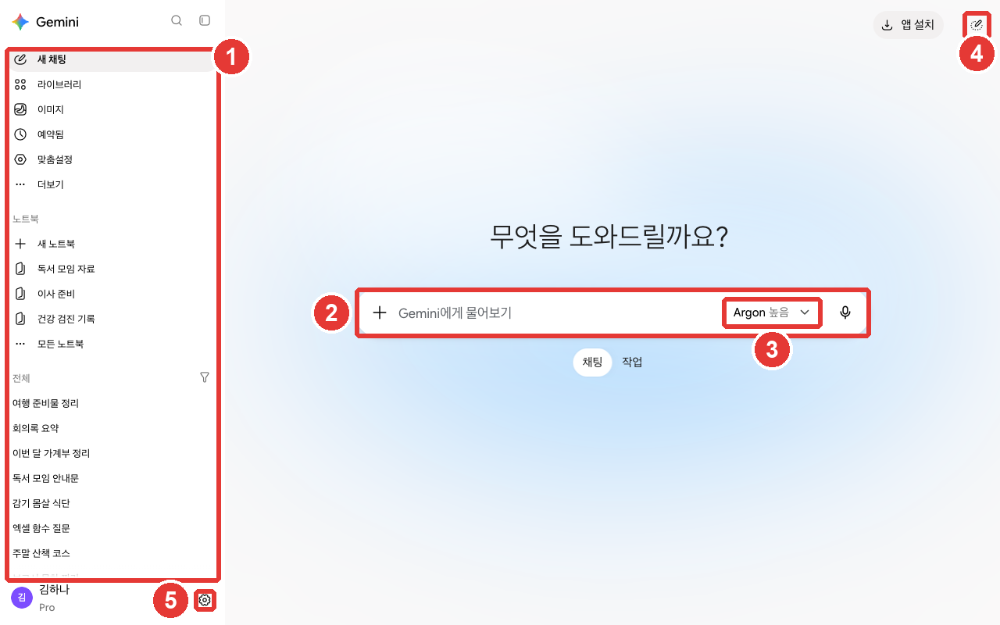
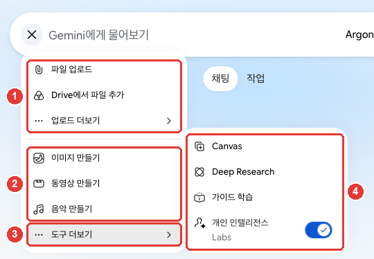

# 第2章 熟悉介面 — 什麼在哪裡

> **一句話總結**：Gemini 的介面，你只要認得四個地方：**左邊的側邊選單**（以前的對話）、**中間的輸入框**（提問的地方和「+」）、
> **輸入框右邊的模型按鈕**（模型和思考級別）、**左下角的「設定（설정）」**。剛開始時，只用輸入框就足夠了。

介面以2026年10月的網頁版為準，圖片是付費套餐（Google AI Pro）的韓語介面。免費賬號裡，有些選單可能看不到，或者帶著一把鎖。如果名稱和你的介面不同，請找名稱相近的按鈕。

## 一眼看懂首頁

登入後，中間會看到「有什麼可以幫您？（무엇을 도와드릴까요?）」的問候語和輸入框。[^screen]



姓名、對話標題、筆記本標題已換成示例（Google AI Pro）。**紅色編號和下表的編號對應同一個地方。**

把介面分成五個地方來看會比較容易。

| 編號 | 地方 | 位置 | 作用 |
|---|---|---|---|
| ① | 側邊選單 | 左邊 | 新聊天、以前的對話、筆記本 |
| ② | 輸入框 | 中間 | 寫問題，用「+」新增檔案和工具 |
| ③ | 模型按鈕 | 輸入框右邊 | 選擇模型和思考級別 |
| ④ | 「臨時聊天（임시 채팅）」 | 右上角 | 不留記錄的對話 |
| ⑤ | 「設定（설정）」 | 左下角 | 用量、訂閱、主題、隱私 |

出處：在 Gemini 網頁介面上親自確認[^screen]

輸入框下面的「聊天（채팅）」·「任務（작업）」切換，是用來選擇普通對話，還是**把整件事交出去的任務**。任務在[第8章](08-tasks.md)裡講，現在放在「聊天（채팅）」就行。[^screen][^models]

不需要一開始就全部瞭解。在輸入框裡寫下問題併發送就可以了。其餘的，需要時再回來翻這一章。

<Quiz id="ch302-home" />

## 側邊選單 — 新聊天和以前的對話

左邊的側邊選單，從上到下有這些。[^screen]

- **「搜尋聊天（채팅 검색）」**（放大鏡）：用詞語查詢以前的對話。
- **「新聊天（새 채팅）」**：開啟新的對話。話題變了就點這裡（[第1章](01-getting-started.md)）。[^start]
- **「資料庫（라이브러리）」·「圖片（이미지）」**：集中檢視上傳或生成的檔案和圖畫（[第4章](04-files-create.md)）。
- **「已安排（예약됨）」**：集中檢視到約定的時間自動去做的事。
- **「個性化設定（맞춤설정）」**：新增技能和已連線的應用。
- **「筆記本（노트북）」**：把資料和對話按主題歸在一起。有「新建筆記本（새 노트북）」·「所有筆記本（모든 노트북）」。
- **「全部（전체）」**：到目前為止聊過的對話列表。最上面是最近的對話。

最下面是我的賬號名稱和套餐（例：「Pro」），以及齒輪「設定（설정）」。[^screen]

側邊選單可以透過左上角的「關閉側邊欄（사이드바 닫기）」（方框圖示）收起和展開。[^screen]

給別人看你的介面時，請把側邊選單收起來。光是對話列表裡的標題，也可能暴露出我問過什麼。

<Quiz id="ch302-sidebar" />

## 輸入框和 + 選單

在輸入框「向 Gemini 提問（Gemini에게 물어보기）」裡寫下問題併發送就行。[^screen][^start]
點輸入框左邊的「+」（「上傳和工具（업로드 및 도구）」），會出現檔案和工具。[^screen]



**紅色編號和下表的編號對應同一個地方。** ④ 是把滑鼠移到 ③ 「更多工具（도구 더보기）」上就會展開的。[^screen]

| 編號 | 選單 | 作用 |
|---|---|---|
| ① | 「上傳檔案（파일 업로드）」·「從 Drive 新增檔案（Drive에서 파일 추가）」 | 把我的檔案一起傳送 |
| ② | 「生成圖片（이미지 만들기）」·「生成影片（동영상 만들기）」·「生成音樂（음악 만들기）」 | 生成圖畫、影片、音樂 |
| ③ | 「更多工具（도구 더보기）」 | 展開其餘的工具 |
| ④ | 「Canvas」 | 在旁邊的畫面裡一起修改文件、應用 |
| ④ | 「Deep Research」 | 查詢多份資料，拿到長篇報告 |
| ④ | 「引導式學習（가이드 학습）」 | 像學習那樣分步驟地學 |

出處：在 Gemini 網頁介面上親自確認[^screen]

選單看起來很多，但剛開始時，只要認得「上傳檔案（파일 업로드）」這一個就行。其餘的從第4章起一個個講。

檔案一次最多可以上傳**10個**。影片每個最大2GB，其他檔案每個最大100MB。[^files]

點輸入框右邊的麥克風（「語音輸入（음성기록）」），就可以用說話來輸入。[^screen]

### 修改已傳送的問題

想修改已傳送的問題，就點我的問題旁邊的「編輯文字（텍스트 수정）」（鉛筆）。改完後點「更新（업데이트）」，Gemini 就會重新生成回答。[^start]
事後才發現問題裡漏了條件時，用這個很好。不用把同一個問題從頭再寫一遍。

比如像下面這樣傳送之後，發現漏掉了“發給公司同事”這個條件，就把問題改一改，重新拿一次回答。

```
請幫我寫一條簡短的訊息，提議把下週二的會議改到週四。
```

<Quiz id="ch302-plus" />

## 模型按鈕 — 模型和思考級別

點輸入框右邊的模型按鈕（例：「Argon 高（Argon 높음）」），就可以選擇**模型**和**思考級別**。[^screen]
模型是生成回答的 AI 的種類，思考級別是回答之前要想多久。


這是 Google AI Pro 的介面。① 點模型按鈕後會開啟 ② 模型列表，把滑鼠移到 ③ 「思考級別（사고 수준）」上，會展開 ④ 三個檔位。打勾的就是當前選中的。[^screen]

### 選擇模型

| 模型 | 介面上的說明 | 適合什麼時候 |
|---|---|---|
| Flash-Lite | 提供最快的回答 | 簡短、簡單的問題 |
| Flash | 什麼都可以請它幫忙 | 平時的大部分工作 |
| Pro | 高階推理 | 複雜的問題、困難的程式設計 |
| Argon | 複雜任務 | 非常困難、複雜的工作 |

出處：Gemini 網頁介面和 Google 幫助中心[^screen][^models]

模型名稱前面的數字（例：3.8 Flash）是版本號。它經常變，所以比起數字，請按**作用**來記。[^models]

**免費賬號不能自己選擇模型。** Gemini 會自動選擇適合問題的模型，或者用 Flash-Lite 來回答。[^models]
有付費套餐（Google AI 套餐）才能自己切換。帶著鎖的模型，意思是需要升級套餐才能使用。[^models]

### 思考級別 — 想多深

「思考級別 ▸（사고 수준 ▸）」有三個檔位。[^screen][^models]

| 思考級別 | 介面上的說明 | 適合什麼時候 |
|---|---|---|
| 低 | 快速高效 | 簡單的問題 |
| 中 | 深度均衡 | 需要稍微想一想的事 |
| 高 | 非常徹底 | 需要多個步驟的困難工作 |

出處：Gemini 網頁介面和 Google 幫助中心[^screen][^models]

不選的話，預設是「低（낮음）」。[^models] 幫助中心的韓語版裡有的地方寫作「中間（중간）」，但介面上的名稱是「中（보통）」。[^screen]

### 什麼時候調高

**模型越好、思考級別越高，用量消耗得越多。**[^models] 所以不必總是調到最高。
平時用預設值（「低（낮음）」）或較輕的設定，只有在回答太淺或有錯時，再調高一檔。圖中的「Argon 高（Argon 높음）」，是本指南為了展示介面而選的設定。Argon 只在 Pro·Ultra 套餐裡才會出現（[第1章](01-getting-started.md)）。讓它想得久一點，也不一定總會更好（[第1階段第5章](../00-common/05-prompt-patterns.md)）。

有兩點需要注意。[^models]

- **選過一次的模型會一直保留在那個對話裡。** 以後回到那個對話，用的還是同樣的模型和思考級別。
- **想看是哪個模型回答的**，請點回答下方的「更多（더보기）」（三個點），選「查看回答詳情（응답 세부정보 보기）」。

在付費套餐裡碰到額度上限，對話就會用 Flash-Lite 接著進行。[^models] 如果回答突然變短了，請用「查看回答詳情（응답 세부정보 보기）」確認一下。

在交辦困難的工作之前這樣問一問，就能掂量出這件事值不值得調高思考級別。

```
接下來要交給你的工作，是在我們團隊3個月的預算表裡找出可以削減的專案。
請先告訴我，這項工作是需要分多個步驟來推敲的，還是可以簡單回答的。
如果需要多個步驟，請只寫出按什麼順序推敲的步驟。
```

<Quiz id="ch302-model" />

## 臨時聊天 — 不留記錄的對話

點右上角的「臨時聊天（임시 채팅）」，就會開始一個**不留記錄的對話**。[^screen][^start]
臨時聊天不會留在側邊選單的對話列表和「Gemini 應用活動（Gemini 앱 활동）」（我的對話記錄）裡。[^start]


開啟臨時聊天後，② 會彈出說明文字，右上角的圖示會變成 ① 關閉（×）。點 × 就回到普通對話。[^screen]

臨時聊天適合這些時候使用。

- 提一個不想留在對話列表裡的問題時
- 想不受以前對話和我的個性化設定的影響，從頭拿到回答時

作為代價，有些事做不到。[^start]

- **離開臨時聊天後，就再也看不到那個對話了。** 需要的回答，請在離開之前複製下來。
- 不能使用 Gmail、Drive 這類**已連線的應用**。
- 不能得到貼合我個人資訊的**個性化回答**，也不能給回答留下**反饋**（贊、踩）。
- 只有**個人 Google 賬號**可以用。公司、學校賬號不行。

**臨時聊天也會在賬號裡儲存72小時。** 介面上的說明解釋為“為了安全”。不過，它不會用於 Google 的 AI 模型訓練。[^screen][^privacy]
所以即使是臨時聊天，也不要輸入密碼或身份證號碼這類資訊（[第1階段第9章](../00-common/09-safety.md)）。詳細的隱私設定在[第9章](09-privacy.md)裡講。

<Quiz id="ch302-temp" />

## 設定頁面 — 賬號、偏好設定、隱私

點左下角的齒輪「設定（설정）」，選單會分成三組開啟。[^screen]


姓名、對話標題已換成示例。表中的 ①②③ 是和圖中編號相同的分組。[^screen]

| 分組 | 選單 | 作用 |
|---|---|---|
| ① 賬號 | 「用量上限（사용량 한도）」·「管理訂閱（구독 관리）」 | 檢視用了多少、管理套餐（[第1章](01-getting-started.md)） |
| ② 偏好設定 | 「個人智慧（개인 인텔리전스）」·「技能（스킬）」 | 貼合我個人資訊的回答、管理技能 |
| ② 偏好設定 | 「主題（테마）」·「任務設定（작업 설정）」 | 淺色、深色介面，交辦工作的設定 |
| ③ 資料與隱私 | 「用 Gemini 匯入記憶（Gemini로 메모리 가져오기）」 | 把其他 AI 的記憶搬過來 |
| ③ 資料與隱私 | 「我的公開連結（내 공개 링크）」·「活動（활동）」 | 管理已分享的連結、設定對話記錄 |
| ③ 資料與隱私 | 「傳送反饋（의견 보내기）」·「幫助（도움말）」·「位置（위치）」 | 反映問題、幫助、確認位置 |

出處：在 Gemini 網頁介面上親自確認[^screen]

剛開始值得看一次的有兩個。

- **「主題（테마）」**：預設跟隨我裝置的明暗設定。在這裡可以改成深色介面，並儲存在同一個瀏覽器裡。[^theme]
- **「活動（활동）」**：點了之後，會在新標籤頁裡開啟「Gemini 應用活動（Gemini 앱 활동）」。這是決定對話記錄怎樣儲存的地方。在[第9章](09-privacy.md#開啟和關閉「保留活動記錄」)裡詳細講。[^screen]

**介面語言沒有單獨選擇的選單。** 在網頁上，它跟隨瀏覽器或裝置的語言。[^language]
不管介面語言是什麼，用韓語問，它就用韓語回答。[^language]

<Quiz id="ch302-settings" />

## 親自試一試

1. 在首頁找到並點一點側邊選單、輸入框、模型按鈕、「臨時聊天（임시 채팅）」、「設定（설정）」這五個地方。
2. 傳送一個簡短的問題，然後用「編輯文字（텍스트 수정）」再加一個條件，重新拿一次回答。
3. 用回答下方的「更多（더보기）」→「查看回答詳情（응답 세부정보 보기）」，確認是哪個模型回答的。
4. 開啟「臨時聊天（임시 채팅）」提問，然後退出，確認它有沒有留在對話列表裡。
5. 在「設定（설정）」→「主題（테마）」裡改成深色介面試試，再改回來。

**連續任務**（[籌備讀書會](../00-common/practice-kit.md)）：接著第1章拿到的籌備清單，問“請把這份清單按日期順序重新整理一下”。如果對回答不滿意，就用「編輯文字（텍스트 수정）」修改問題，重新拿一次回答。

## 小結

- 介面分為側邊選單、輸入框、模型按鈕、「臨時聊天（임시 채팅）」、「設定（설정）」這五個地方。
- 在側邊選單裡開啟新聊天，用「搜尋聊天（채팅 검색）」和「全部（전체）」列表查詢以前的對話。
- 輸入框的「+」裡集中了上傳檔案和生成的工具。檔案一次最多10個。
- 模型有 Flash-Lite、Flash、Pro、Argon，思考級別有低、中、高。越高越消耗用量。免費賬號不能自己選擇。
- 臨時聊天不會留在對話列表裡，但會在賬號裡儲存72小時。離開後就再也看不到了。
- 「設定（설정）」分為賬號、偏好設定、資料與隱私三組。介面語言跟隨瀏覽器語言。

## 術語表

| 術語 | 中文名稱 | 一句話解釋 |
|---|---|---|
| Sidebar | 側邊欄（側邊選單） | 介面左邊集中了對話列表和選單的地方 |
| Model | 模型 | 生成回答的 AI 的種類。Flash、Pro 等 |
| Thinking Level | 思考級別 | 回答之前要想多久 |
| Temporary Chat | 臨時聊天 | 不會留在對話列表和活動記錄裡的對話 |
| Gemini Apps Activity | Gemini 應用活動 | 彙集並管理我的 Gemini 對話記錄的地方 |

<ChapterDone :chapter="302" />

下一章：[第3章. 對話管理](03-chats.md)

[^screen]: 在 Gemini 網頁介面（Google AI Pro，韓語）上親自確認。首頁「무엇을 도와드릴까요?」（有什麼可以幫您？），輸入框「Gemini에게 물어보기」（向 Gemini 提問），「업로드 및 도구」(+)（上傳和工具），模型按鈕和「음성기록」（語音輸入），右上角的「앱 설치」（安裝應用）和「임시 채팅」（臨時聊天）圖示，輸入框下方「채팅」（聊天）「작업」（任務）切換。臨時聊天說明 "임시 채팅은 최근 채팅에 표시되지 않으며, Google AI를 개선하는 데 사용되지 않습니다. 안전을 위해 72시간 동안 저장됩니다." 側邊選單「채팅 검색」「사이드바 닫기」「새 채팅」「라이브러리」「이미지」「예약됨」「맞춤설정」「노트북」「전체」，最下面的賬號名稱、套餐標示和「설정」。+ 選單「파일 업로드」「Drive에서 파일 추가」「업로드 더보기」「이미지 만들기」「동영상 만들기」「음악 만들기」「도구 더보기」，「도구 더보기」下的「Canvas」「Deep Research」「가이드 학습」「개인 인텔리전스(Labs)」（2026-10-30 時這些工具在 + 選單的第一層）。模型選單「3.5 Flash-Lite — 가장 빠른 답변 제공」「3.8 Flash — 무엇이든 도움을 받으세요」「3.1 Pro — 고급 추론」「4 Argon — 복잡한 작업」，思考級別「낮음 — 빠르고 효율적」「보통 — 균형 잡힌 깊이」「높음 — 매우 철저함」。設定選單「계정」(「사용량 한도」「구독 관리」)，「환경설정」(「개인 인텔리전스」「스킬」「테마」「작업 설정」)，「데이터 및 개인 정보 보호」(「Gemini로 메모리 가져오기」「내 공개 링크」「의견 보내기」「도움말」「위치」「활동」)。「활동」會在新標籤頁「Gemini 앱 활동」中開啟。幫助中心韓語版裡的介面名稱：「텍스트 수정」「업데이트」(13275745)，「응답 세부정보 보기」(18648722)。（確認日期 2026-10-30，圖片、+ 選單、臨時聊天為 2026-10-31）
[^start]: Google 幫助中心，「Use Gemini Apps」。"In the text box at the bottom, enter your question or prompt." / "To start a new chat, at the top left, click New chat" / "You can start a temporary chat that won’t appear in your Gemini Apps Activity or your recent chats." / "A personal Google Account. This feature is not available for users signed in to a work or school Google Account." / "When you leave the temporary chat, you’ll no longer have access to that chat, and it won’t appear in your recent chats." / "Use Connected Apps and other integrated services that require the Keep Activity setting to be turned on." / "Get personalized responses." / "If you want to revise your prompt, you can edit it, and Gemini will regenerate the response." https://support.google.com/gemini/answer/13275745（確認日期 2026-10-30）
[^files]: Google 幫助中心，「Upload & analyze files in Gemini Apps」。"Up to 10 files (subject to availability) can be uploaded in the same prompt. When uploading a folder, each file inside will count towards this limit." / "Each video can be up to 2 GB. All other supported file types can be up to 100 MB." https://support.google.com/gemini/answer/14903178（確認日期 2026-10-30）
[^models]: Google 幫助中心，「About Gemini models」。"Gemini Flash-Lite: A fast, cost-efficient model built for quick answers to everyday questions and lightweight tasks." / "Gemini Pro: An advanced reasoning model designed for complex prompts, sophisticated coding, and in-depth problem-solving." / "Gemini Argon: Top-tier intelligence, dynamic deep reasoning, and the highest performance for complex workflows." / "Auto or Flash-Lite*" / "If you have a Google AI plan you can manually switch models in both Chat Mode and Task Mode." / "Higher-tier models marked with a lock icon require an eligible plan upgrade" / "Low: Provides fast, concise answers for straightforward queries." / "High: Allows the model to carefully process and reason through complex, multistep prompts." / "If you don’t select a thinking level, it will default to Low." / "More advanced models and higher thinking levels require more of your usage." / "If you have a Google AI plan and reach your usage limit, your chat will continue with Flash-Lite." / "Gemini will continue to use that model and thinking level during the current conversation including if you later return to that same conversation." / "From the menu, select See response details ." / "Access to specific Gemini models, thinking levels, and task features varies depending on your plan and your remaining available usage." 幫助中心寫的是預設自動選擇模型，但本指南確認的 Pro 賬號的模型選單裡沒有「自動（자동）」專案。https://support.google.com/gemini/answer/18648722（確認日期 2026-10-30）
[^privacy]: Google 幫助中心，「Gemini Apps Privacy Hub」。"Temporary chats and chats you have when Keep Activity is off are retained with your account for 72 hours and used to:" / "Temporary chats are not used to train Google’s AI models." https://support.google.com/gemini/answer/13594961（確認日期 2026-10-30）
[^theme]: Google 幫助中心，「Use Dark theme in Gemini Apps」。"By default, the color scheme for the Gemini app matches the color scheme of the device you’re on." https://support.google.com/gemini/answer/13542227（確認日期 2026-10-30）
[^language]: Google 幫助中心，「Change Gemini's language」。"The Gemini web app uses the language set in your browser or device language settings." / "Regardless of this setting, Gemini Apps can understand and reply in any supported language when you type your prompt or speak in Gemini Live." https://support.google.com/gemini/answer/15984485（確認日期 2026-10-30）
