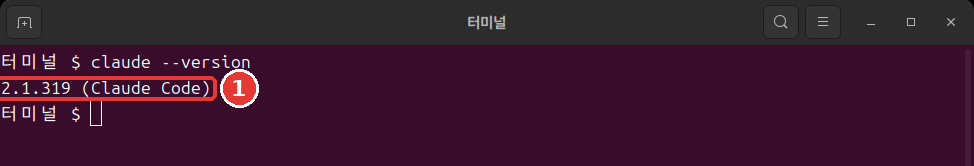

# 第3章 安裝與登入

<Badge type="tip" text="必讀" /> 想跟著這一階段學下去，一定要讀這一章。

> **一句話總結**：貼上官方文件裡的安裝命令，然後在**新的終端視窗**裡用 `claude --version` 確認。接著在練習資料夾裡執行 `claude`，在瀏覽器裡登入，準備就完成了。

安裝只需要做一次。命令也只有一行。

## 貼上之前——先確認來源

安裝命令就在下一節。貼上之前，先確認一件事。

安裝命令會在你的電腦上直接執行從網際網路下載的程式。這很方便，但如果貼上了來路不對的網站上的命令，壞程式就可能以你的許可權執行。

所以，**不要把陌生網站上的安裝命令直接貼上進去。** 本課程裡的命令也一樣。開啟官方文件「[Quickstart](https://code.claude.com/docs/en/quickstart)」，用眼睛核對一下是不是同一條命令。

- **不太好的例子**：把部落格上找到的安裝命令直接貼上到終端裡。
- **更好的例子**：開啟官方文件，確認是同一條命令後再貼上。

不管貼上到終端裡的是什麼命令，都要先看來源。安裝別的程式時，這個習慣也能保護你。

<Quiz id="ch803-safe" />

## 各作業系統的安裝命令

開啟終端，**只**貼上適合你電腦的**一條**命令，然後按 Enter。這是官方文件裡的命令。[^install]

Mac·Linux·WSL（在 Windows 裡使用 Linux 的功能）這樣輸入。

```bash
curl -fsSL https://claude.ai/install.sh | bash
```

Windows PowerShell 這樣輸入。

```powershell
irm https://claude.ai/install.ps1 | iex
```

這兩條命令做的是同一件事。前半部分下載安裝檔案，`|`（豎線）後面執行下載下來的內容。不完全懂每個片段的意思，也能安裝。

::: details 詳細說明（點選展開）
- `|` 是把前一條命令的結果交給後一條命令的符號。
- Mac·Linux 由 `curl` 下載，由 `bash` 執行。
- PowerShell 由 `irm` 下載，由 `iex` 執行。[^irm]
- `-fsSL` 是把決定下載方式的四個選項合在一起寫。意思寫在[命令詞典](command-reference.md)裡。
:::

下載過程中沒有進度顯示。即使看起來什麼都沒發生，也不要關視窗，耐心等待。完成後會看到 `Claude Code successfully installed!` 這句話。[^progress]

如果把命令輸入到了不對的視窗，就會出錯。這不是壞了，而是選錯了視窗。[^wrong-shell]

- 出現 `'irm' is not recognized`：你在 CMD 裡，而不是 PowerShell 裡。開啟 PowerShell 再來一次。
- 因為 `-fsSL` 而出錯：你把 Mac·Linux 用的命令輸入到了 PowerShell 裡。請使用 PowerShell 用的命令。

根據介面語言，錯誤也可能用中文顯示。意思是一樣的。

在 Windows 上，不需要以管理員身份執行。[^no-admin] 大多數情況下，上面一行就夠了。

::: details 詳細說明（點選展開）
- **Windows 和 Git**：即使沒有 Git（記錄檔案變更的工具），也可以照樣跟著學。沒有的話，Claude Code 會改用 PowerShell。[^git-win] Git 在第12章安裝。
- **其他安裝方法**：也可以用 Mac 的 Homebrew 或 Windows 的 WinGet 這樣的程式管理工具來安裝。[^brew] 如果你沒有在用這類工具，就用上面那一行。
:::

<Quiz id="ch803-install" />

## 確認安裝

安裝完成後，**開啟一個新的終端視窗**，輸入這條命令。[^check]

```bash
claude --version
```

像這樣顯示出版本號就成功了。版本號不同也沒關係。看看後面有沒有帶著 `(Claude Code)`。



```text
2.1.318 (Claude Code)
```

為什麼要新視窗呢？已經開啟的視窗還在用舊的設定。[^old-path] 所以會出現在完成安裝的那個視窗裡不行、在新視窗裡卻可以的情況。

<Quiz id="ch803-check" />

## 出現 command not found 的時候

即使在新視窗裡，也可能出現這樣的話。在 Windows 上會出現 `not recognized`。根據介面語言，也可能用中文顯示。意思是一樣的。

```text
zsh: command not found: claude
bash: claude: command not found
```

意思是已經安裝好了，但終端找不到這個程式。[^path-cause]

終端會在一個叫 **PATH**（路徑變數）的資料夾列表裡找程式。把它想成電話簿就好懂了。程式就算存在，如果沒寫進列表，也找不到。安裝程式只會告訴你怎麼修復，不會直接修改 PATH。[^path-what]

程式在 Mac·Linux 上位於 `~/.local/bin/claude`，在 Windows 上位於 `%USERPROFILE%\.local\bin\claude.exe`。[^path-where] 把這個資料夾加到列表裡就行。下面是官方文件裡的命令。**只用適合你電腦的那一條**。

Mac 的預設 shell（在終端裡接收命令的程式）Zsh 這樣寫。

```bash
echo 'export PATH="$HOME/.local/bin:$PATH"' >> ~/.zshrc
source ~/.zshrc
```

大多數 Linux（Bash）這樣寫。

```bash
echo 'export PATH="$HOME/.local/bin:$PATH"' >> ~/.bashrc
source ~/.bashrc
```

Windows PowerShell 這樣寫。

```powershell
$currentPath = [Environment]::GetEnvironmentVariable('PATH', 'User')
[Environment]::SetEnvironmentVariable('PATH', "$currentPath;$env:USERPROFILE\.local\bin", 'User')
```

命令的各個片段是這個意思。

- **`echo` 那一行**：把設定儲存到檔案裡。`>>` 是追加到檔案末尾的符號。所以設定檔案裡原有的內容不會被刪掉。
- **`source` 那一行**：把儲存的設定應用到當前視窗。
- **只輸入一次**：輸入兩次的話，同樣的一行會被加進去兩次。
- **Windows**：輸入這兩行之後，需要重新啟動終端。[^path-apply]

然後再輸入一次 `claude --version`。顯示出版本號，就解決了。

如果還是不行，請看官方文件「[Troubleshoot installation and login](https://code.claude.com/docs/en/troubleshoot-install)」。如果 `claude` 能執行，可以用 `claude doctor` 檢視安裝狀態。它不開啟會話，只顯示診斷結果。[^doctor]

<Quiz id="ch803-path" />

## 登入

在新視窗裡移動到第2章的練習資料夾，然後輸入 `claude`。Mac·Linux 這樣輸入。

```bash
cd ~/hello-ai-연습/터미널
claude
```

Windows PowerShell 這樣輸入。

```powershell
cd $HOME\hello-ai-연습\터미널
claude
```

第一次執行時，會提示你登入。個人訂閱使用者用 claude.ai 帳號登入。[^login] 步驟是這樣的。[^login-steps]

1. 瀏覽器開啟後，登入。
2. 如果瀏覽器沒有開啟，在終端裡按 `c`。登入地址會被複制下來，把它貼上到瀏覽器裡。
3. 如果瀏覽器顯示了一段程式碼，把它貼上到終端裡 `Paste code here if prompted` 的位置。
4. 出現 `Login successful` 後，按 Enter。

登入一次就夠了。資訊會被儲存下來，不會再問。想換帳號的話，在執行中輸入 `/login`。[^login-once]

登入前後可能還會出現初始設定介面。也可能出現一個詢問你是否信任這個資料夾的視窗。這個視窗我們在第4章一起看。現在可以按 `Esc` 退出。

<Quiz id="ch803-login" />

## 更新和解除安裝

**更新。** 如果你是用上面那一行安裝的，就不用另外做什麼。它會在後臺自動下載，下次開啟 Claude Code 時生效。[^auto-update] 想馬上更新的話，在終端裡輸入 `claude update`。如果已經是最新版，它會告訴你 `Claude Code is up to date`。[^update]

如果是用 Homebrew 或 WinGet 安裝的，就不會自動更新。需要隔一段時間用那個工具自己更新一下。[^manual-update]

**解除安裝。** 解除安裝的方法現在用不上，所以先摺疊起來了。以後需要時再展開看。

::: details 詳細說明（點選展開）
在 Mac·Linux 上，如果是用上面那一行安裝的，就用這兩行解除安裝。[^uninstall]

```bash
rm -f ~/.local/bin/claude
rm -rf ~/.local/share/claude
```

`rm` 是不經過回收站、直接刪除的命令。`-r` 是連資料夾裡面全部刪除，`-f` 是不詢問直接刪除的選項。輸入前一定要核對每一個字。Windows 和其他安裝方法，請按照官方文件「[Advanced setup](https://code.claude.com/docs/en/setup)」裡的 Uninstall 一節操作。
:::

<Quiz id="ch803-update" />

## 動手試試

1. 開啟官方文件，確認安裝命令和本章裡的一樣。
2. 貼上適合你作業系統的命令，等它完成。
3. 開啟新視窗，輸入 `claude --version`。如果出現 `command not found`，就按照上面那一節來做。
4. 在練習資料夾裡執行 `claude` 並登入。如果彈出信任視窗，按 `Esc` 退出。如果已經進入了輸入框，就輸入 `/exit`。

問問自己。`claude --version` 顯示版本號了嗎？如果是，下一章就可以讓它做第一件事了。

## 小結

- 安裝命令要確認和官方文件一樣再貼上。
- Mac·Linux 用 `curl` 那一行，Windows 用 PowerShell 的 `irm` 那一行。沒有進度顯示也要耐心等。
- 在新視窗裡用 `claude --version` 確認。
- 出現 `command not found` 時，先開啟新視窗試試，還不行就加上 PATH 那一行。
- 登入是在練習資料夾裡執行 `claude`，在瀏覽器裡登入一次就行。
- 預設安裝會自動更新。

## 術語整理

| 術語 | 中文名稱 | 一句話解釋 |
|---|---|---|
| PATH | 路徑變數 | 終端用來找程式的資料夾列表 |
| WSL | 適用於 Linux 的 Windows 子系統 | 在 Windows 裡使用 Linux 的功能 |
| `curl` | 下載命令 | 從網際網路獲取內容的命令 |
| `irm` | PowerShell 下載命令 | 在 PowerShell 裡從網際網路獲取內容的命令 |
| `rm` | 刪除命令 | 刪除檔案的命令 |

<ChapterDone :chapter="803" />

下一章：[第4章 第一次會話](04-first-session.md)

[^install]: 本指南是在已經安裝、登入好的電腦上執行的，所以沒有親自走過安裝和登入的過程。本章的安裝·登入步驟來自官方文件的說明。Claude Code 官方文件，「Quickstart」. "curl -fsSL https://claude.ai/install.sh | bash" / "irm https://claude.ai/install.ps1 | iex" https://code.claude.com/docs/en/quickstart （確認日期 2026-11-06）
[^progress]: Claude Code 官方文件，「Quickstart」. "The install command shows no progress while it downloads Claude Code." https://code.claude.com/docs/en/quickstart · 「Terminal guide for new users」. "When the installer finishes, you'll see "Claude Code successfully installed!"" https://code.claude.com/docs/en/terminal-guide （確認日期 2026-11-06）
[^wrong-shell]: Claude Code 官方文件，「Quickstart」. "If you see `'irm' is not recognized as an internal or external command`, you're in CMD, not PowerShell." https://code.claude.com/docs/en/quickstart · 「Troubleshoot installation and login」. "you ran the macOS/Linux `curl -fsSL ... | bash` installer in Windows PowerShell, where `curl` is an alias for `Invoke-WebRequest` and rejects the `-fsSL` flags" https://code.claude.com/docs/en/troubleshoot-install （確認日期 2026-11-06）
[^no-admin]: Claude Code 官方文件，「Advanced setup」. "You do not need to run as Administrator." https://code.claude.com/docs/en/setup （確認日期 2026-11-06）
[^git-win]: Claude Code 官方文件，「Quickstart」. "Git for Windows is recommended on native Windows so Claude Code can use the Bash tool." / "If Git for Windows is not installed, Claude Code uses PowerShell as the shell tool instead." https://code.claude.com/docs/en/quickstart （確認日期 2026-11-06）
[^brew]: Claude Code 官方文件，「Quickstart」. "brew install --cask claude-code" / "winget install Anthropic.ClaudeCode" https://code.claude.com/docs/en/quickstart （確認日期 2026-11-06）
[^check]: Claude Code 官方文件，「Quickstart」. "When the installer finishes, open a new terminal window and run `claude --version`." / "The command prints a version number followed by `(Claude Code)`." https://code.claude.com/docs/en/quickstart （確認日期 2026-11-06）
[^old-path]: Claude Code 官方文件，「Troubleshoot installation and login」. "a window that was already open keeps its old PATH, and a terminal inside an editor takes its PATH from the editor." https://code.claude.com/docs/en/troubleshoot-install （確認日期 2026-11-06）
[^path-cause]: Claude Code 官方文件，「Troubleshoot installation and login」. "If installation succeeded but you get a `command not found` or `not recognized` error when running `claude`, the install directory isn't in your PATH." https://code.claude.com/docs/en/troubleshoot-install （確認日期 2026-11-06）
[^path-what]: Claude Code 官方文件，「Troubleshoot installation and login」. "Your shell searches for programs in directories listed in PATH" / "It prints the fix with that note but doesn't change PATH itself." https://code.claude.com/docs/en/troubleshoot-install （確認日期 2026-11-06）
[^path-where]: Claude Code 官方文件，「Troubleshoot installation and login」. "the installer places `claude` at `~/.local/bin/claude` on macOS/Linux or `%USERPROFILE%\.local\bin\claude.exe` on Windows" https://code.claude.com/docs/en/troubleshoot-install （確認日期 2026-11-06）
[^path-apply]: Claude Code 官方文件，「Troubleshoot installation and login」. "The `echo` command saves the setting for every new terminal, and `source` applies it to the window you're in." / "Restart your terminal for the change to take effect." https://code.claude.com/docs/en/troubleshoot-install （確認日期 2026-11-06）
[^doctor]: Claude Code 官方文件，「Advanced setup」. "prints read-only installation and settings diagnostics without starting a session" https://code.claude.com/docs/en/setup （確認日期 2026-11-06）
[^login]: Claude Code 官方文件，「Quickstart」. "Claude Code prompts you to log in on first use." https://code.claude.com/docs/en/quickstart · 「Authentication」. "Claude Pro, Max, or Ultra subscription: log in with your claude.ai account." https://code.claude.com/docs/en/authentication （確認日期 2026-11-06）
[^login-steps]: Claude Code 官方文件，「Authentication」. "If the browser doesn't open automatically, press `c` to copy the login URL to your clipboard, then paste it into your browser." / "If your browser shows a login code instead of redirecting back after you sign in, paste it into the terminal at the `Paste code here if prompted` prompt." / "When login completes, the terminal shows `Login successful` and prompts you to press `Enter` to continue." https://code.claude.com/docs/en/authentication （確認日期 2026-11-06）
[^login-once]: Claude Code 官方文件，「Quickstart」. "Once logged in, your credentials are stored and you won't need to log in again." / "To switch accounts later or re-authenticate, type `/login` inside the running session." https://code.claude.com/docs/en/quickstart （確認日期 2026-11-06）
[^auto-update]: Claude Code 官方文件，「Quickstart」. "Native installations automatically update in the background to keep you on the latest version." https://code.claude.com/docs/en/quickstart · 「Advanced setup」. "Updates download and install in the background, then take effect the next time you start Claude Code." https://code.claude.com/docs/en/setup （確認日期 2026-11-06）
[^update]: Claude Code 官方文件，「CLI reference」. "Update to latest version" https://code.claude.com/docs/en/cli-reference · 「Advanced setup」. "If you're already on the newest version, it reports `Claude Code is up to date (<version>)`." https://code.claude.com/docs/en/setup （確認日期 2026-11-06）
[^manual-update]: Claude Code 官方文件，「Quickstart」. "Homebrew installations do not auto-update." / "Run `winget upgrade Anthropic.ClaudeCode` periodically to get the latest features and security fixes." https://code.claude.com/docs/en/quickstart （確認日期 2026-11-06）
[^uninstall]: Claude Code 官方文件，「Advanced setup」. "rm -f ~/.local/bin/claude" https://code.claude.com/docs/en/setup （確認日期 2026-11-06）
[^irm]: Claude Code 官方文件，「Terminal guide for new users」. "`irm` fetches the file and `iex` runs it." https://code.claude.com/docs/en/terminal-guide （確認日期 2026-11-06）
