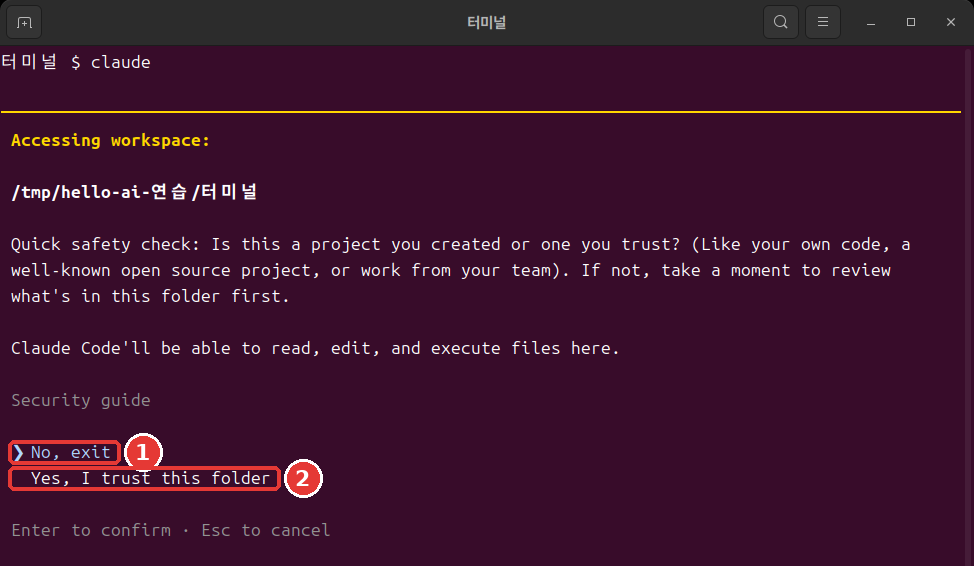
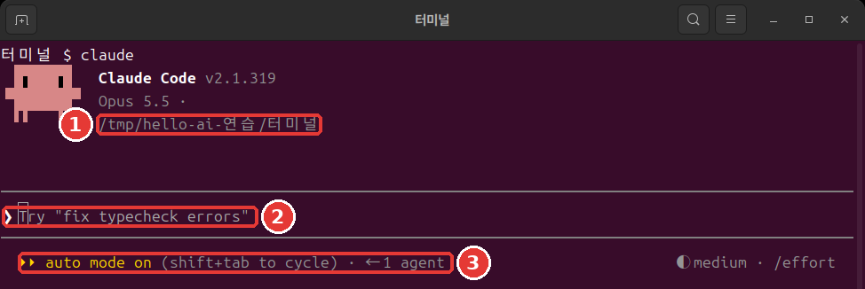
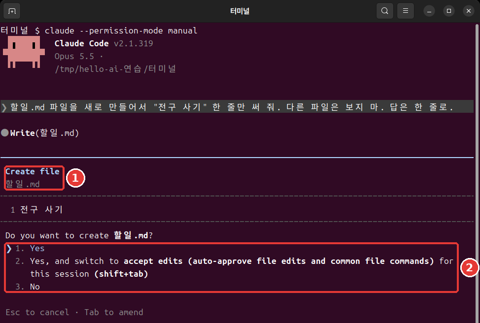

# 第4章 第一次會話

<Badge type="tip" text="必讀" /> 想跟著這個階段學下去，一定要讀這一章。

> **一句話總結**：進入要工作的資料夾，輸入 `claude`。在信任確認視窗裡選 `Yes`，然後用說話的方式交代任務。要停下按 `Esc`，要結束輸入 `/exit`。

**會話**（Session）是從開啟 Claude Code 到結束為止的一整段對話。我們在第2章建好的資料夾裡，開啟第一次會話。

## 從資料夾開始

先移動到要工作的資料夾。然後輸入 `claude`。[^start]

Mac·Linux 這樣輸入。

```bash
cd ~/hello-ai-practice/terminal
claude
```

Windows PowerShell 這樣輸入。

```powershell
cd $HOME\hello-ai-practice\terminal
claude
```

**順序很重要。** `claude` 會把當前所在的資料夾當作工作資料夾來啟動。啟動介面上也會顯示這個資料夾。[^header] 如果在和工作無關的資料夾裡開啟，它就會對著那個資料夾裡的檔案幹活。

- **不太好的例子**：一開啟終端就輸入 `claude`。
- **更好的例子**：用 `cd` 進入資料夾，用 `pwd` 確認後，再輸入 `claude`。

<Quiz id="ch804-start" />

## 信任確認視窗

在第一次開啟的資料夾裡，會先彈出這樣一個視窗。



這是實際終端視窗的截圖。顏色和字型取決於你的終端設定。下面的文字框是把同一個介面用文字寫出來的。[^screens]

```text
 Accessing workspace:

 ~/hello-ai-practice/terminal

 Quick safety check: Is this a project you created or one you trust? (Like your own code, a
 well-known open source project, or work from your team). If not, take a moment to review what's in
 this folder first.

 Claude Code'll be able to read, edit, and execute files here.

 Security guide

 ❯ No, exit
   Yes, I trust this folder

 Enter to confirm · Esc to cancel
```

意思是這樣的。"這是你自己建立的、或者你信任的資料夾嗎？如果不是，請先看看裡面有什麼。Claude Code 可以讀取、修改和執行這裡的檔案。"

**如果在這裡直接按 Enter，程式就會退出。** 因為 `❯` 標記停在 `No, exit` 上。按一次向下方向鍵，移到 `Yes, I trust this folder`，再按 Enter。在終端裡不能點選單來選擇。[^arrows]

這個資料夾是你剛剛自己建的，可以信任。如果是從別人那裡拿到的資料夾，請先看看裡面的內容。

<Quiz id="ch804-trust" />

## 看懂啟動介面

選了 `Yes` 之後，會出現這樣的介面。



```text
 ▐▛███▛█   Claude Code v2.1.318
▝▜██████▀  Opus 5.5 · Claude 方案名稱
 ▝▝   ▝▝   ~/hello-ai-practice/terminal

▎ Auto mode is now Claude Code's default permission mode.
▎ Auto mode lets Claude handle permission prompts automatically. Claude checks each tool call for
▎ risky actions and prompt injection before executing, runs the ones it assesses as lower-risk, and
▎ blocks the rest.
▎ https://code.claude.com/docs/en/permission-modes

────────────────────────────────────────────────────────────
❯ Try "create a util logging.py that..."
────────────────────────────────────────────────────────────
  ⏵⏵ auto mode on (shift+tab to cycle)                ◐ medium · /effort
```

從上往下讀一讀。

- **最上面三行**：版本、當前模型、工作資料夾。[^header] 一定要看看資料夾是不是你以為的那個。
- **Auto mode 說明**：第一次執行時會看到的英文通知。現在不讀直接跳過也可以。重要的內容下面馬上用中文講。
- **`❯` 那一行**：輸入框。以 `Try` 開頭的文字是示例。你一輸入自己的文字，它就會消失。
- **最下面一行**：左邊是當前的**許可權模式**。許可權模式是 Claude 不用問你就可以做的事情的範圍。[^mode] 右邊的 `medium` 在第13章講。

終端裡的 `claude` 以**自動模式**（auto）啟動。另有一個 AI 會提前檢查它的行動，攔下看起來危險的操作。不過，自動模式只是減少許可視窗，並不保證安全。[^auto]

一開始，最好親眼看著 Claude 要做什麼。按一次 `Shift + Tab`，切換到手動模式。[^shift-tab] 最下面一行會變成這樣。

```text
  ⏸ manual mode on · ? for shortcuts                  ◐ medium · /effort
```

手動模式下，在修改檔案或執行命令之前，大多會先問你。[^manual] 模式在第7章詳細講。

::: details 詳細說明（點選展開）
- 不能使用自動模式的會話，會以手動模式啟動。[^auto] 當前是什麼模式，請以最下面一行為準。
- 也可以一開始就用 `claude --permission-mode manual` 啟動。[^manual]
:::

<Quiz id="ch804-screen" />

## 第一個請求——做會議記錄

現在讓它幹活。像跟同事說話一樣寫就行。[^colleague] 把這句話輸入到輸入框裡，按 Enter。

```text
讀一下 inbox 裡的會議筆記，儲存成 minutes.md。回答只要一行。
```

`.md` 是 Markdown 檔案。是用記事本也能開啟的文字檔案。

請求越具體越好。

- **不太好的例子**：`幫我做會議記錄`——讀什麼、放在哪裡，都得讓 Claude 去猜。
- **更好的例子**：上面那句話——要讀的東西、儲存的位置、回答的長度都有了。

如果是手動模式，Claude 會讀取筆記，顯示檔案內容，然後這樣問你。



```text
 Do you want to create minutes.md?
 ❯ 1. Yes
   2. Yes, and switch to accept edits (auto-approve file edits and common file commands) for this
      session (shift+tab)
   3. No

 Esc to cancel · Tab to amend
```

瀏覽一下內容，在 `1. Yes` 上按 Enter。[^yes] 2 號是讓這次會話裡修改檔案不再詢問的選項，3 號是拒絕。如果保持自動模式，可能不會出現這個視窗就直接儲存了。本指南的介面記錄是手動模式下的。

完成後，它會這樣回答。

```text
● 已整理成 minutes.md。筆記裡的 10/27（週一）和 11/3（週一）在 2026 年的日曆上是星期二，所以在檔案裡標註了
  需要確認。
```

就算它提到星期幾的事，也不要驚訝。練習筆記裡的星期是編出來的，和日曆對不上。Claude 發現了這一點。回答的句子每次執行都可能不同。輸入框裡也可能淺淺地顯示出下一個請求的建議。不用也沒關係。

用同一份筆記做出的成果物在 [ch4-minutes.txt](/practice/zh-hant/cli/results/ch4-minutes.txt) 裡。可以和你自己的結果比一比。不需要一模一樣。

<Quiz id="ch804-first" />

## 交代任務與停下

會話就是對話。可以接著前面的事繼續交代。這次來修改檔案。

```text
在 minutes.md 的最上面一行加上"草稿"這一行。回答只要一行。
```

這次它會顯示要改動的行，然後問你。帶 `+` 的行是要新加入的行。

```text
 1 +草稿
 2  # 街角咖啡館 每週例會 會議記錄
 3
 4  - **日期時間：** 10/27（週一）
```

在它下面會問 `Do you want to make this edit to minutes.md?`。要改動的行的樣子，取決於你的會議記錄。

許可視窗要讀完再選。這是你能核對它做的是不是你交代的事的時刻。

如果 Claude 跑偏了，就按 **`Esc`**。正在執行的操作會被取消，Claude 會等你的下一個指示。你隨時可以插話，改變方向。[^esc]

有一點要記住。即使停下了，**到目前為止做過的事還在。**[^esc-keep] 已經儲存的檔案不會自動恢復原樣。怎麼撤銷，在第7章學。

<Quiz id="ch804-stop" />

## 結束

在輸入框裡這樣輸入，按 Enter。[^exit]

```text
/exit
```

會回到終端的提示符。現在你已經在 Claude Code 外面了。確認一下檔案有沒有生成。

```bash
ls
cat minutes.md
```

如果在 PowerShell 裡文字顯示成亂碼，就用 `Get-Content -Encoding UTF8 minutes.md` 來看。

在空的輸入框裡按兩次 `Ctrl + D` 也能結束。[^ctrl-d] 一開始，用文字輸入的 `/exit` 最不容易搞混。怎麼繼續已經結束的對話，在第6章講。

現在來區分兩個地方。以後命令該輸入到哪裡，就靠這個來判斷。

- **終端**：游標前面的符號是 `%`、`$`、`>`。`cd`、`ls`、`claude` 輸入在這裡。
- **Claude 輸入框**：最前面是 `❯`，上下各有一條線。用說話方式提的請求和以 `/` 開頭的命令輸入在這裡。

把 `/exit` 輸入到終端裡會出錯。反過來，把 `ls` 或 `cd` 這樣的終端命令輸入到輸入框裡，它不會作為命令執行，而是變成發給 Claude 的話。後面章節裡說要"在終端裡"輸入的命令，如果你看到的是輸入框，就先用 `/exit` 出來再輸入。

<Quiz id="ch804-exit" />

## 動手試試

1. 用 `cd` 進入練習資料夾，用 `pwd` 確認。
2. 開啟 `claude`，在信任確認視窗裡選 `Yes, I trust this folder`。
3. 在啟動介面上看資料夾和許可權模式。用 `Shift + Tab` 切換到手動模式。
4. 傳送做會議記錄的請求，讀完許可視窗後選 `1. Yes`。
5. 讓它加上"草稿"那一行。
6. 用 `/exit` 出來，用 `cat` 檢視檔案。

問問自己。檔案生成了嗎？筆記裡的決定和待辦事項都一個不落地寫進去了嗎？有沒有混進筆記裡沒有的內容？把 AI 的結果和筆記對照的習慣，就從這裡開始。

## 小結

- 用 `cd` 進入資料夾後再開啟 `claude`。
- 信任確認視窗的預設選項是 `No, exit`。用向下方向鍵選 `Yes`。
- 在啟動介面上看資料夾和許可權模式。終端以自動模式啟動，用 `Shift + Tab` 切換。
- 請求裡要寫明讀什麼、存在哪裡。許可視窗讀完再選。
- `Esc` 是停下。到目前為止做過的事會留下。
- 用 `/exit` 結束，把結果和筆記對照。
- 符號是 `%`、`$`、`>` 就是終端，是 `❯` 就是 Claude 輸入框。

## 術語整理

| 術語 | 中文名稱 | 一句話解釋 |
|---|---|---|
| Session | 會話 | 從開啟 Claude Code 到結束為止的一整段對話 |
| Permission mode | 許可權模式 | 不用詢問就可以做的事情的範圍 |
| Auto mode | 自動模式 | 另有一個 AI 提前檢查、減少許可視窗的模式 |
| Manual mode | 手動模式 | 大多會先詢問的模式 |
| Markdown | Markdown | 用符號寫標題和列表的文字檔案格式 |

<ChapterDone :chapter="804" />

下一章：[第5章 輸入技巧與命令](05-input-commands.md)

[^screens]: 本章和後面的圖，是在 Linux 終端裡用 Claude Code 2.1.319 截的。資料夾路徑是練習用的臨時資料夾，所以和你的介面不同；方案名稱已經遮住。介面上的資料夾路徑和方案名稱，按本課程改寫過。文字框是為了方便複製另外謄寫的。有些地方是從別的執行裡搬過來的，所以路徑或檔名可能和圖不一樣。
[^start]: Claude Code 官方文件，「Quickstart」. "Open your terminal in any project directory and start Claude Code:" https://code.claude.com/docs/en/quickstart （確認日期 2026-11-06）
[^header]: Claude Code 官方文件，「Quickstart」. "The Claude Code prompt appears with the version, current model, and working directory shown above it." https://code.claude.com/docs/en/quickstart （確認日期 2026-11-06）
[^arrows]: Claude Code 官方文件，「Terminal guide for new users」. "You can't click on things in the terminal. Use the arrow keys to move around." https://code.claude.com/docs/en/terminal-guide （確認日期 2026-11-06）
[^mode]: Claude Code 官方文件，「Choose a permission mode」. "A permission mode sets which actions Claude can take in a session without asking you first." https://code.claude.com/docs/en/permission-modes （確認日期 2026-11-06）
[^auto]: Claude Code 官方文件，「Choose a permission mode」. "With Claude Code v2.1.283 or later, auto mode is the built-in starting permission mode for interactive terminal and VS Code sessions." / "A separate classifier model reviews actions before they run, blocking anything that escalates beyond your request, targets unrecognized infrastructure, or appears driven by hostile content Claude read." / "Auto mode reduces permission prompts but does not guarantee safety." / "When the flag, a settings file, or the built-in default selects `auto` but auto mode isn't available to the session, Claude Code starts the session in Manual instead." https://code.claude.com/docs/en/permission-modes （確認日期 2026-11-06）
[^shift-tab]: Claude Code 官方文件，「Choose a permission mode」. "From `auto`, the first press switches to `default`, and the cycle then runs `default` → `acceptEdits` → `plan`." https://code.claude.com/docs/en/permission-modes （確認日期 2026-11-06）
[^manual]: Claude Code 官方文件，「Choose a permission mode」. "In Manual mode, Claude Code stops and asks you before most actions that edit files, run shell commands, or reach the network." https://code.claude.com/docs/en/permission-modes · 「Best practices for Claude Code」. "`Shift+Tab` in the session cycles through the permission modes, Manual included, or start with `claude --permission-mode manual` from your shell." https://code.claude.com/docs/en/best-practices （確認日期 2026-11-06）
[^colleague]: Claude Code 官方文件，「Quickstart」. "Talk to Claude like you would a helpful colleague." https://code.claude.com/docs/en/quickstart （確認日期 2026-11-06）
[^yes]: Claude Code 官方文件，「Quickstart」. "If it asks before making the change, select Yes to approve." https://code.claude.com/docs/en/quickstart （確認日期 2026-11-06）
[^esc]: Claude Code 官方文件，「How Claude Code works」. "The running tool call is canceled and Claude waits for your next instruction." / "You can interrupt at any point to steer Claude in a different direction, provide additional context, or ask it to try a different approach." https://code.claude.com/docs/en/how-claude-code-works （確認日期 2026-11-06）
[^esc-keep]: Claude Code 官方文件，「Interactive mode」. "Stop the current response or tool call mid-turn so you can redirect. Claude keeps the work done so far." https://code.claude.com/docs/en/interactive-mode （確認日期 2026-11-06）
[^exit]: Claude Code 官方文件，「Commands」. "Exit the CLI." https://code.claude.com/docs/en/commands （確認日期 2026-11-06）
[^ctrl-d]: Claude Code 官方文件，「Terminal guide for new users」. "Type `exit` or press `Ctrl + D` twice on an empty prompt to leave Claude Code." https://code.claude.com/docs/en/terminal-guide （確認日期 2026-11-06）
