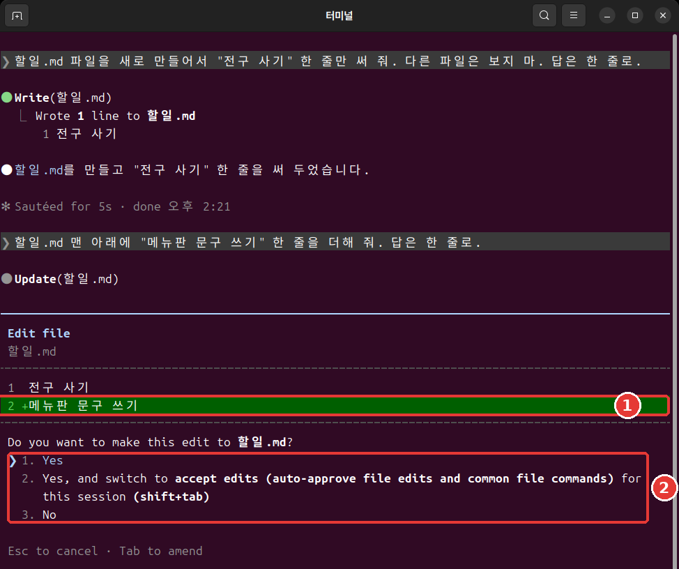
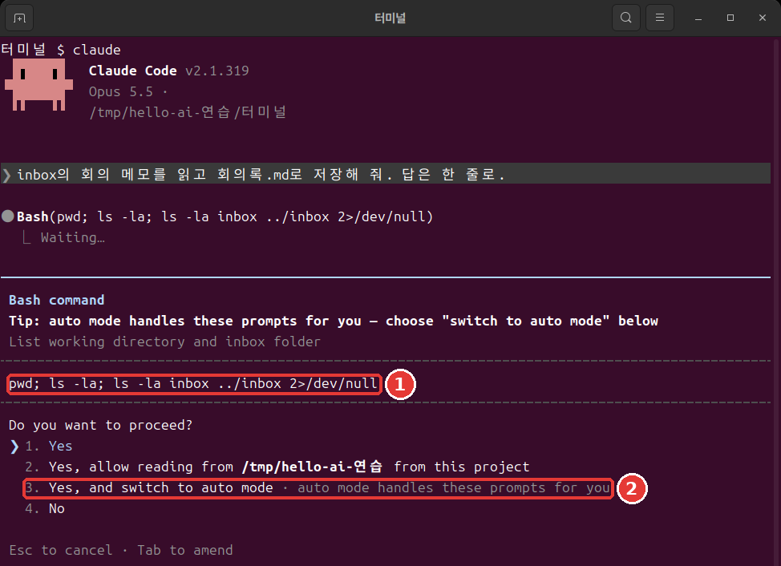
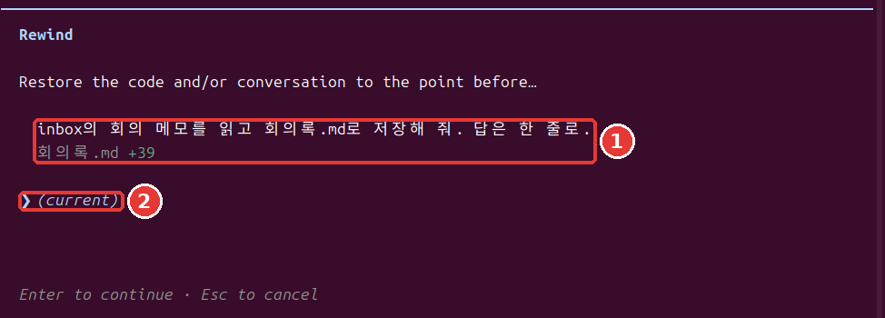
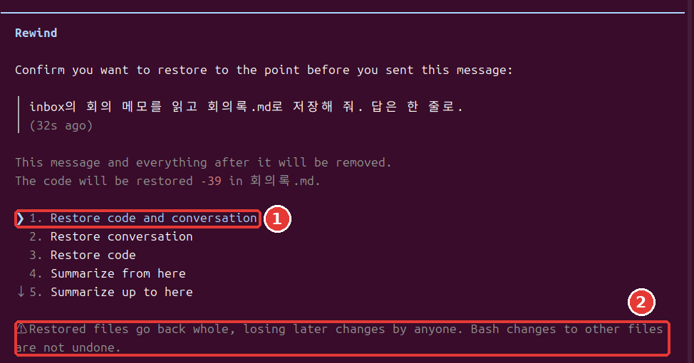

# 第7章 許可與撤回

<Badge type="tip" text="必讀" /> 想跟著這個階段學下去，一定要讀這一章。

> **一句話總結**：Claude 不問你就能做哪些事，由許可權模式和規則決定。出了錯可以按兩次 Esc 回退，但也有回不來的事。

不用全部記住。[^run] 先學會怎麼讀許可視窗就行。

## 四種許可權模式

**許可權模式**（Permission mode）是 Claude 不問你也可以做的事情的範圍。[^modes] 當前模式顯示在畫面最下面一行。每按一次 Shift+Tab，就按表格的順序切換，最下面一個之後會回到最上面。

| 簡單的名字 | 最下面一行的文字 | 作用 |
|---|---|---|
| 自動 | `⏵⏵ auto mode on` | 由另一個 AI 檢查後進行 |
| 手動 | `⏸ manual mode on` | 大多數事先問你 |
| 允許編輯 | `⏵⏵ accept edits on` | 檔案操作不問你 |
| 計劃 | `⏸ plan mode on` | 只調查和提建議 |

- **自動（auto）**：在終端裡開啟 `claude`，就從這個模式開始。一個事先檢查行動的另一個 AI，會攔下看起來危險的操作。[^auto] 這不是有人替你把關。自動模式只是減少許可視窗，並不保證安全。[^auto]
- **手動（manual）**：修改檔案、執行 Shell 命令、訪問網路，大多都會先問你。[^modes] 很安全，但大約十次之後，就容易不看內容直接批准。[^practice]
- **允許編輯（accept edits）**：在工作資料夾裡新建和修改檔案，都不會問你。[^modes] 常見的檔案命令也會不問就批准。
- **計劃（plan）**：只調查並提出建議，不做修改。[^modes] 交給它大任務之前，想先看看它打算怎麼做時很好用。

::: details 詳細說明（點選展開）
在自動模式下連續被攔下三次，它就會停下來，重新來問你。[^practice]
:::

剛開始練習時，試試從手動模式開始。你會慢慢看熟 Claude 在做什麼。在終端裡這樣輸入。[^practice]

```bash
claude --permission-mode manual
```

<Quiz id="ch807-modes" />

## 讀懂許可視窗

在手動模式下，如果你請它"讀一下 inbox 裡的會議記錄，儲存成 minutes2.md。回答只用一行。"，就會彈出這樣的視窗。許可視窗會先展示 Claude 打算做的事，再給你選項。[^prompt]

```text
 Do you want to create minutes2.md?
 ❯ 1. Yes
   2. Yes, and switch to accept edits (auto-approve file edits and common file commands) for this
      session (shift+tab)
   3. No

 Esc to cancel · Tab to amend
```

用上下方向鍵選擇，然後按 Enter。選 1 只允許這一次。選 2 會把這個會話切換成允許編輯模式。選 3 就是不做。Esc 是取消。

修改已有檔案時，它會問 `Do you want to make this edit to minutes2.md?`，並顯示要改的行。前面帶 `+` 的行是新加進去的行。



執行 Shell 命令時，會彈出樣子稍有不同的視窗。它會原樣顯示要執行的命令，所以先讀一讀。如果可以用自動模式，還會附上切換到自動模式的選項。[^switch-auto]



以 `Yes, allow reading from` 開頭的選項，是在問能不能讀某個資料夾。看清是哪個資料夾的名字再選。[^symbols]

視窗彈出時，這樣問問自己。

- 是我說的那個檔案嗎？
- 要改的內容是我請它做的嗎？
- 有沒有夾雜我沒請它做的事？

欠佳的習慣是視窗一彈出就按 Enter。更好的習慣是看清檔名和要改的行再選。這幾秒鐘能提前抓住錯誤的修改。

Shell 命令的許可視窗裡可能會出現 `Yes, and don't ask again`。選它的話，規則會儲存到設定檔案裡，下一個會話也繼續有效。[^local-file] 檔案修改的批准只持續到會話結束。[^prompt] 會被儲存的那種會留很久，所以只在明白意思時再選。

<Quiz id="ch807-prompt" />

## 不要用跳過檢查的選項

你可能會在網上的文章裡看到 `--dangerously-skip-permissions`。這是跳過許可權檢查的選項。[^skip] 不要用它。

這個選項既擋不住失誤，也擋不住提示詞注入（第5章看過的、用藏在文字裡的指令操控 AI 的攻擊）。[^bypass] 所以它只用在和你的電腦隔開的練習環境裡。官方文件舉的例子是斷網的容器或虛擬機器（在你電腦裡另外建的一臺隔離的電腦）。[^bypass]

如果嫌許可視窗麻煩，還有別的辦法。只把常做的事用下一節的允許規則放開就行。

<Quiz id="ch807-skip" />

## 許可規則 allow·ask·deny

如果說模式是大框架，規則就是細項。規則按**工具**來定。工具是 Claude 使用的功能。比如 `Read` 是讀檔案，`Bash` 是 Shell 命令。

規則有三種。[^rules]

- **allow**：不問就允許。
- **ask**：每次使用都確認。
- **deny**：禁止使用。

規則寫在設定檔案裡。下一節會親手做一條。

規則按 deny、ask、allow 的順序判斷，先匹配上的那條勝出。所以不能用 allow 在大範圍的 deny 上開個口子。[^rules] 拒絕規則在任何模式下都會攔住。[^bypass]

樣子是這樣的：在工具名後面的括號裡寫上對象。`Bash(ls *)` 只匹配 `ls` 命令。寫成 `Bash(*)` 就匹配所有 Shell 命令。[^rules] 星號匹配的範圍很廣，只在需要的範圍內使用。

在會話裡輸入 `/permissions`，就能檢視和管理規則。[^rules] 用左右方向鍵在上方的標籤之間移動。

```text
  Permissions  Recently blocked   Allow   Ask   Deny   Auto mode   Workspace
```

<Quiz id="ch807-rules" />

## 試用拒絕規則

我們來試試不讓 Claude 讀秘密檔案。含有密碼、認證金鑰這類登入資訊的檔案，最好用許可權規則擋住。[^creds] **不要用真正的密碼**，用假檔案來練習。

要做三件事：建立一個假的秘密檔案，建立一個擋住它的設定檔案，然後請 Claude 讀一下試試。

用 `/exit` 退出，在終端裡進入練習資料夾。Mac 和 Linux 把下面的內容整段貼上進去。Windows PowerShell 請按照緊接著下面的「如果是 Windows PowerShell」的方法來做。

```bash
mkdir secret
echo '假密碼: cafe-1234' > secret/password.txt
mkdir -p .claude
cat > .claude/settings.json <<'EOF'
{
  "permissions": {
    "deny": ["Read(./secret/**)"]
  }
}
EOF
```

我們一行一行讀一下這個框。

- `mkdir secret`：建立 `secret`（秘密）資料夾。
- `echo '…' > secret/password.txt`：把引號裡的文字儲存到檔案裡。`>` 是把輸出儲存到檔案的符號。
- `mkdir -p .claude`：建立 `.claude` 資料夾。就算已經存在也不會報錯。
- `cat > .claude/settings.json <<'EOF'`：把從下一行開始到 `EOF` 為止的內容儲存到這個檔案裡。後面的章節建立檔案時也會用這種寫法。
- 從 `{` 到 `}`：要放進設定檔案的內容。在 `"deny"` 一欄寫上了要擋住的對象。

貼上後如果還沒執行，就再按一次 Enter。什麼都沒顯示就是成功了。用 `ls` 看看 `secret` 資料夾有沒有建好。

**如果是 Windows PowerShell**：用 `mkdir secret`、`mkdir .claude` 建立資料夾。用 `notepad secret\password.txt` 開啟記事本，填入 `假密碼: cafe-1234`。在 `notepad .claude\settings.json` 裡，去掉上面框中以 `cat` 開頭的那一行和 `EOF` 那一行，只填入兩者之間的內容。問你是否新建檔案時點「是（예）」，用 `Ctrl + S` 儲存後關閉。這個方法我們沒有實際執行過。

`Read(./secret/**)` 的意思是不要讀秘密資料夾裡的任何東西。在終端裡開啟 `claude`，請它"讀一下 secret/password.txt 檔案，告訴我內容。"試試。

我們把同樣的請求用一次就結束的方式（在[第10章](10-headless-automation.md)裡學的方式）發出去，Claude 回答說讀不了這個檔案，也沒有顯示內容。每次執行的措辭可能不一樣。要確認的只有一件事：回答裡出現 `cafe-1234` 了嗎？

這個練習說明的只有一件事：Claude 的讀取請求被擋住了。不要把它擴大理解成用任何方法都絕對讀不到。不指明檔名就讀取檔案的命令，這條規則管不到。[^deny-limit] 最安全的做法是，真正的密碼不要放在工作資料夾裡。

<Quiz id="ch807-deny" />

## 回退

Claude 修改的檔案會被自動追蹤。每發一次請求，就多一個可以回去的點。[^checkpoint] 這個點叫作**檢查點**（Checkpoint）。

在輸入框為空時按兩次 Esc，就會開啟 `Rewind` 選單。輸入 `/rewind` 也可以。**輸入框必須是空的。** 如果有文字，就不會開啟選單，而是把文字清掉。[^checkpoint] 被清掉的文字可以用上方向鍵找回來。[^esc-up]

選單裡會顯示你發過的訊息和改過的檔案。用上方向鍵選一條訊息，按 Enter，就會出現選項。[^checkpoint]





| 選項 | 意思 |
|---|---|
| Restore code and conversation | 檔案和對話都回退 |
| Restore conversation | 只回退對話 |
| Restore code | 只回退檔案 |
| Summarize from here | 把從這裡開始的對話做成摘要 |
| Summarize up to here | 把這裡之前的對話做成摘要 |

第一次的話，選最上面那個。想放棄就按 Esc。選單下方會出現這樣的警告。

```text
  ⚠ Restored files go back whole, losing later changes by anyone. Bash changes to other files are
  not undone.
```

意思是檔案會整個回退，所以之後不管是誰做的修改，也都會消失。

練習時，我們讓它在檔案裡多加一行，然後用最上面的選項回退了。檔案回到了之前的內容，我發過的那條訊息又回到了輸入框裡。改一改再發，或者刪掉就行。

想讓 Claude 停下手頭的事時，只按**一次** Esc。到那時為止做的事會保留下來。[^practice]

<Quiz id="ch807-rewind" />

## 撤回不了的事

如果以為"按兩次 Esc 就全都能回去"，那就麻煩了。回退只處理**被 Claude 的編輯工具修改過的檔案**。下面這些回不來。[^limits]

- 只被 Shell 命令改過的檔案
- 子代理（Claude 把一部分工作分出去交給的輔助幫手，[第9章](09-skills-extensions.md)）改過的其他檔案
- 你自己改過的檔案，或其他會話的編輯（大多數情況下）
- 發郵件、修改外部資料庫這類在電腦外面做的事[^remote]

要撤回這些修改，就要用 **Git** 這類版本管理工具。[^limits] Git 是把檔案狀態記錄下來的工具。和遊戲的存檔檔案差不多。在[第12章](12-parallel-remote.md)裡會第一次留下記錄。回退是方便的安全網，但不要把它當成唯一的安全網。

<Quiz id="ch807-limits" />

## 動手試試

1. 在練習資料夾裡用 `claude --permission-mode manual` 開始，按四次 Shift+Tab，看模式轉一圈。
2. 請它建立 minutes2.md。接著說："在 minutes2.md 的第一行加一行"草稿"。回答只用一行。"讀一讀許可視窗，選 1。
3. 在輸入框為空時按兩次 Esc。選最後一條請求，再選 `Restore code and conversation`。"草稿"那一行消失了嗎？
4. 用兩次 Esc 清掉回到輸入框裡的文字，再用 `/exit` 退出。在終端裡建立拒絕規則，開啟 `claude`，請它讀一下 `secret/password.txt` 試試。

問問自己：我能說出我的 Claude 不經許可能做哪些事嗎？我能舉出三件用回退回不來的事嗎？

## 小結

- 許可權模式有四種，用 Shift+Tab 切換。對話模式從自動開始，自動並不保證安全。
- 許可視窗要看清檔名和要改的行再選。不用 `--dangerously-skip-permissions`。
- 規則按 deny、ask、allow 的順序判斷。拒絕規則在所有模式下都會攔住。
- 在輸入框為空時按兩次 Esc，就會打開回退選單。
- 回退只能撤回被 Claude 的編輯工具改過的檔案。其餘的需要 Git。

## 術語整理

| 術語 | 中文名稱 | 一句話解釋 |
|---|---|---|
| Permission mode | 許可權模式 | 不問也可以做的事情的範圍 |
| allow / ask / deny | 允許 / 詢問 / 拒絕 | 允許 / 確認 / 拒絕規則 |
| Checkpoint | 檢查點 | 可以回去的點 |
| Git | Git | 把檔案狀態記錄下來的工具 |

<ChapterDone :chapter="807" />

下一章：[第8章 專案記憶與設定](08-memory-settings.md)

[^run]: 本章的畫面是 2026 年 11 月 6 日在 Linux 上用 Claude Code 2.1.318 執行的結果。
[^symbols]: 圖中命令裡的 `;` 和 `2>/dev/null` 是什麼意思，可以在[命令詞典](command-reference.md)裡查到。
[^local-file]: 儲存到的檔案是 `.claude/settings.local.json`。設定檔案在[第8章](08-memory-settings.md)裡講。
[^modes]: Claude Code 官方文件，「Choose a permission mode」。"A permission mode sets which actions Claude can take in a session without asking you first." / "In Manual mode, Claude Code stops and asks you before most actions that edit files, run shell commands, or reach the network." / "lets Claude create and edit files in your working directory without prompting" / "Plan mode tells Claude to research and propose changes without making them." https://code.claude.com/docs/en/permission-modes （確認日期 2026-11-06）
[^auto]: Claude Code 官方文件，「Choose a permission mode」。"With Claude Code v2.1.283 or later, auto mode is the built-in starting permission mode for interactive terminal and VS Code sessions." / "A separate classifier model reviews actions before they run, blocking anything that escalates beyond your request, targets unrecognized infrastructure, or appears driven by hostile content Claude read." / "Auto mode reduces permission prompts but does not guarantee safety." https://code.claude.com/docs/en/permission-modes （確認日期 2026-11-06）
[^practice]: Claude Code 官方文件，「Best practices for Claude Code」。"After three blocks in a row (or twenty in total), auto mode pauses and goes back to asking you." / "Safe, but after the tenth prompt you start approving without reading, and nothing moves while you're away from the keyboard." / "`Shift+Tab` in the session cycles through the permission modes, Manual included, or start with `claude --permission-mode manual` from your shell." / "`Esc` stops Claude mid-action and keeps everything up to that point, so you can redirect without losing work." https://code.claude.com/docs/en/best-practices （確認日期 2026-11-06）
[^prompt]: Claude Code 官方文件，「Configure permissions」。"A permission prompt shows what Claude is about to do, followed by your options." / "Claude Code saves the rule to `.claude/settings.local.json` at the root of the git repository" / "A file-modification approval isn't saved to the file: as the table shows, it lasts until the session ends." https://code.claude.com/docs/en/permissions （確認日期 2026-11-06）
[^skip]: Claude Code 官方文件，「CLI reference」。"Skip permission prompts." https://code.claude.com/docs/en/cli-reference （確認日期 2026-11-06）
[^bypass]: Claude Code 官方文件，「Choose a permission mode」。"Only use this mode in isolated environments like containers, VMs, or dev containers without internet access, where Claude Code cannot damage your host system." / "`bypassPermissions` offers no protection against prompt injection or unintended actions." / "Deny rules block in every mode, including `bypassPermissions`." https://code.claude.com/docs/en/permission-modes （確認日期 2026-11-06）
[^rules]: Claude Code 官方文件，「Configure permissions」。"Allow rules let Claude Code use the specified tool without manual approval." / "Ask rules prompt for confirmation whenever Claude Code tries to use the specified tool." / "Deny rules prevent Claude Code from using the specified tool." / "Rules are evaluated in order: deny, then ask, then allow." / "An allow rule can't carve an exception out of a deny rule." / "`Bash(ls *)` matches `ls`" / "`Bash(*)` is equivalent to `Bash` and matches all Bash commands." / "You can view and manage Claude Code's tool permissions with `/permissions`." https://code.claude.com/docs/en/permissions （確認日期 2026-11-06）
[^creds]: Claude Code 官方文件，「Explore the .claude directory」。"Use permission rules to deny reads of credential files" https://code.claude.com/docs/en/claude-directory （確認日期 2026-11-06）
[^checkpoint]: Claude Code 官方文件，「Checkpointing」。"Claude Code automatically tracks Claude's file edits as you work, allowing you to quickly undo changes and rewind to previous states if anything gets off track." / "Every prompt you send that starts a turn creates a new checkpoint" / "Run `/rewind`, or press `Esc` twice when the prompt input is empty, to open the rewind menu." / "If the prompt input contains text, double `Esc` clears it instead of opening the menu." / "Restore code and conversation: revert both code and conversation to that point" / "Restore conversation: rewind to that message while keeping current code" / "Restore code: revert file changes while keeping the conversation" / "Summarize from here: compress the conversation from this point forward into a summary, freeing context window space" / "Summarize up to here: compress the conversation before this point into a summary, keeping later messages intact" https://code.claude.com/docs/en/checkpointing （確認日期 2026-11-06）
[^esc-up]: Claude Code 官方文件，「Interactive mode」。"When the prompt input contains text, double `Esc` clears it and saves the draft to history so `Up` recalls it." https://code.claude.com/docs/en/interactive-mode （確認日期 2026-11-06）
[^limits]: Claude Code 官方文件，「Checkpointing」。"A file that only Bash commands changed isn't tracked and stays as it is." / "To revert it, use version control, such as Git." / "The subagent's edits to other files stay, so use version control, such as Git, to revert them." / "Manual changes you make to files outside of Claude Code and edits from other concurrent sessions are normally not captured, unless they happen to modify the same files as the current session." https://code.claude.com/docs/en/checkpointing （確認日期 2026-11-06）
[^remote]: Claude Code 官方文件，「How Claude Code works」。"Actions that affect remote systems (databases, APIs, deployments) can't be checkpointed." https://code.claude.com/docs/en/how-claude-code-works （確認日期 2026-11-06）
[^deny-limit]: Claude Code 官方文件，「Configure permissions」。"They don't apply to a command that reads files without naming them" https://code.claude.com/docs/en/permissions （確認日期 2026-11-06）
[^switch-auto]: Claude Code 官方文件，「Choose a permission mode」。"Claude Code adds **Yes, and switch to auto mode** to a Bash command's permission prompt." https://code.claude.com/docs/en/permission-modes （確認日期 2026-11-06）
