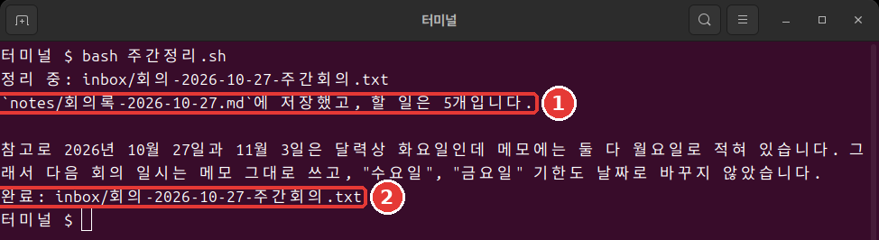

# 第10章 一行執行與自動化

<Badge type="tip" text="必讀" /> 要跟上這個階段，請一定讀完。

> **一句話總結**：`claude -p` 回答一次就結束。寫入要事先許可，成功與否看退出碼。把這三樣組合起來，就成了一行命令就能執行的每週整理。

本章的輸出是 2026年11月6日在 Linux 上用 Claude Code 2.1.318 執行的結果。覺得難也沒關係。一塊一塊地看，其實就是把前面幾章做好的東西接起來。

## claude -p 與對話式的區別

加上 `-p`（或 `--print`），就不進入對話，回答一次就結束。[^headless] 用 `/exit` 退出，在終端裡進入練習資料夾後輸入。

```bash
claude -p "inbox 資料夾裡有幾個檔案？只用一行回答。"
```

它回答了 `inbox 資料夾裡有 1 個檔案。`，然後馬上回到了 Shell。

對話式的 `claude` 會一直持續到你退出，並以自動（auto）模式啟動。`claude -p` 給出回答就結束，並以手動（Manual）模式啟動。[^headless] 只有在沒人值守、要運行同樣的工作時才需要 `-p`。其餘情況用對話式就夠了。

<Quiz id="ch810-print" />

## 為什麼寫入會被擋住

這次請它建立一個檔案。為了不覆蓋第4章的檔案，把檔名定為 `회의록-한줄.md`（會議記錄-一行）。

```bash
claude -p "讀取 inbox 裡的會議筆記，整理成 회의록-한줄.md 檔案並儲存。"
```

檔案沒有生成。回答裡告訴你 `檔案寫入許可權沒有被批准`。這不是故障。`-p` 以手動模式啟動，卻沒有可以詢問的人。所以需要批准的呼叫會被拒絕。[^headless] 只要事先許可需要的工具就行。[^headless]

```bash
claude -p "讀取 inbox 裡的會議筆記，整理成 회의록-한줄.md 檔案並儲存。回答只用一行。" --allowedTools "Read,Write"
```

`--allowedTools` 是事先指定哪些工具不用詢問就能使用的選項。`Read` 是讀取檔案，`Write` 是寫入檔案。用逗號連起來，再用引號括住。

這次檔案生成了。如果 `ls` 裡沒有，也看看 `ls notes`。因為第8章的規則，它可能被儲存到了那裡。

與其因為不知道需要什麼而給得很寬，不如只給這項工作需要的 `Read,Write`。許可給得窄，就算 Claude 判斷錯了，它能做的事也相應更少。

<Quiz id="ch810-allow" />

## 用管道傳遞內容

**管道**（Pipe，`|`）是把前一條命令的輸出交給後一條命令作為輸入的符號。想象水順著管子流過去就行。`claude -p` 也能透過管道接收內容。[^headless]

```bash
cat inbox/회의-2026-10-27-주간회의.txt | claude -p "從這份筆記裡只挑出待辦事項，寫成三行。"
```

```text
- 瑞妍：今天（10/27）買衛生間燈泡
- 瑞妍：週三前寫好套餐選單文案初稿
- 俊浩：週五前查好熱紅酒成本
```

**在 Windows 上**，透過管道傳過去的韓文可能會變成亂碼。如果回答不對勁，就不用管道，改成在檔名前加 `@` 傳過去。把 `檔名` 換成實際的筆記檔名。這條命令我們在 Linux 上執行確認過，在 Windows 上沒有試過。

```bash
claude -p "從 @inbox/檔名 裡只挑出待辦事項，寫成三行。"
```

**不能信任的內容，不要直接用管道傳過去。**[^security] 比如從網上下載的文字，或者陌生人發來的郵件。文字裡可能藏著[第7章](07-permissions-undo.md)裡看到的提示詞注入。[^security] 提示詞注入是在文字裡偷偷混入給 AI 的指示，讓它去做奇怪事情的手法。

練習筆記 [회의-2026-10-29-임시회의.txt](/practice/notes/inbox/회의-2026-10-29-임시회의.txt)（會議-2026-10-29-臨時會議）裡就有這種句子的例子。現在只點開連結，在瀏覽器裡讀一讀。先不要放進 `inbox` 資料夾。因為後面要做的指令碼會處理 `inbox` 裡的所有筆記。這份筆記要等到[第13章](13-cost-safety-trouble.md)學習如何安全處理時再放進去。

<Quiz id="ch810-pipe" />

## 儲存輸出、改變格式

想把回答存成檔案，就在最後加上 `> 할일.txt`（待辦.txt）。[^headless] 回答不會顯示在螢幕上，而是寫進檔案。如果已經有同名檔案，會被覆蓋，要小心。

本章的練習不需要下面的 JSON 輸出。知道有這麼個東西就行。

如果需要別的程式來讀取回答，就用[第8章](08-memory-settings.md)裡看到的 JSON 格式接收。[^headless] 寫法是 `claude -p "1+1等於幾？只要數字。" --output-format json`。會輸出很長的一行。回答在 `result` 這一項裡。

`total_cost_usd` 這一項裡是美元金額。不用吃驚。這是程式算出的估算值，可能和實際賬單不同。[^headless] 對訂閱使用者來說，會話費用的數字在計費上沒有意義。[^costs]

<Quiz id="ch810-output" />

## 次數限制與退出碼

沒人看著的時候，Claude 執行太久就麻煩了。用 `--max-turns` 給輪次（Claude 接著做一次工作的單位）的次數設上限。預設沒有限制。[^max-turns] 我們故意把它降到 1 試試。

```bash
claude -p "讀取 inbox 資料夾裡的所有筆記，總結成三行。" --allowedTools "Read" --max-turns 1
echo $?
```

```text
Error: Reached max turns (1)
1
```

最下面的 `1` 就是**退出碼**（Exit code）。成功是 0，失敗是不為 0 的值。[^headless] 人讀文字，指令碼讀這個數字。`echo $?` 顯示剛剛那條命令的退出碼。在 PowerShell 裡輸入 `$LASTEXITCODE`。

<Quiz id="ch810-exit" />

## 製作 주간정리.sh

現在把這些零件拼起來。**指令碼**（Script）就是把命令寫進檔案，一次性執行。需要有[第8章](08-memory-settings.md)的 `CLAUDE.md` 和 `notes` 資料夾，以及[第9章](09-skills-extensions.md)的技能。用 `/exit` 退出，在終端裡進入練習資料夾。Mac 和 Linux 把下面整段貼上進去（以檔案檢視：[10장-주간정리.sh.txt](/practice/cli/results/10장-주간정리.sh.txt)）。

```bash
cat > 주간정리.sh <<'EOF'
#!/bin/bash
# 把 inbox 裡的會議筆記逐個整理成會議記錄。
for memo in inbox/회의-*.txt; do
  echo "正在整理：$memo"
  if claude -p "/meeting-notes $memo" --allowedTools "Read,Write" --max-turns 10; then
    echo "完成：$memo"
  else
    echo "失敗：$memo"
  fi
done
EOF
```

粘貼後如果還沒執行，就再按一次 Enter。什麼都沒顯示就是成功了。用 `ls` 看看 `주간정리.sh`（每週整理.sh）有沒有生成。

第一行 `#!/bin/bash` 表示用 bash（Shell 的一種）來讀這個檔案。下一行以 `#` 開頭，是給人看的說明。`for` 那一行把名字以 `회의-` 開頭的筆記逐個放進 `memo`。這裡的 `memo` 是**變數**（Variable）。可以看成暫時存放值的名牌。在名字前面加 `$`，寫成 `$memo`，就能取出裡面的值來用。第一輪時，`$memo` 會變成 `inbox/회의-2026-10-27-주간회의.txt`。

`if` 那一行呼叫第9章的技能，退出碼是 0 就列印 `完成`，否則列印 `失敗`。

變數名要像 `memo` 這樣用英文寫。bash 不接受韓文變數名。檔名用韓文也沒關係。

執行只要一行。

```bash
bash 주간정리.sh
```



```text
正在整理：inbox/회의-2026-10-27-주간회의.txt
已儲存到 `notes/회의록-2026-10-27.md`，待辦事項有 5 個。

順便說一下，筆記裡把 10/27 和 11/3 寫成了星期一，但按 2026 年的日曆兩天都是星期二，所以星期和日期保持了筆記原樣。
完成：inbox/회의-2026-10-27-주간회의.txt
```

沒人按任何鍵，會議記錄就生成了（[檢視結果](/practice/cli/results/10장-회의록-스크립트로.txt)）。你的結果措辭不同也沒關係，只要有三個部分和表格就行。

**在 Windows 上**，這個指令碼不能在 PowerShell 裡直接執行。因為它是給 bash 用的。請用下面的 PowerShell 版。Mac 和 Linux 跳過這部分就行。

同樣的工作用 PowerShell 寫是下面這樣。每次執行時，把這個框裡的內容貼上到視窗裡。這是沒有實際執行過的示例。如果你用 WSL，就在 WSL 終端裡執行上面的指令碼。[^wsl]

```powershell
foreach ($file in Get-ChildItem inbox/회의-*.txt) {
  $memo = "inbox/$($file.Name)"
  Write-Output "正在整理：$memo"
  claude -p "/meeting-notes $memo" --allowedTools "Read,Write" --max-turns 10
  if ($LASTEXITCODE -eq 0) { Write-Output "完成：$memo" } else { Write-Output "失敗：$memo" }
}
```

<Quiz id="ch810-script" />

## 訂閱帳號要知道的事

如果是訂閱帳號，只要記住兩點。

- 執行指令碼前後各看一次用量。在會話裡輸入 `/usage`，會顯示用量條。[^costs]
- 就算別的文章推薦 `--bare` 這個選項，也不要加。

`-p` 執行會怎樣從訂閱限額裡扣除，本指南確認過的官方文件裡沒有寫。所以不要猜，用 `/usage` 親眼看最可靠。

不能加 `--bare` 的原因是這樣的。官方文件推薦在腳本里用 `--bare`，但 `--bare` 不會讀取訂閱登入資訊。`CLAUDE.md` 和技能也不會載入。[^bare] 我們的指令碼這三樣都需要。

反過來，不加 `--bare` 使用 `-p`，就會載入那個資料夾的設定。連從沒信任過的資料夾裡的鉤子和 MCP 伺服器也一樣。[^bare] 所以只在你清楚內容的自己的資料夾裡執行。

<Quiz id="ch810-subscription" />

## 離開座位前的檢查

交給它執行、自己離開座位之前，確認三件事。[^unattended] 對照我們的指令碼是這樣的。

- 結束時是什麼樣子？每份筆記在 `notes` 裡生成一個會議記錄檔案，就算結束。
- 它能檢查自己的工作嗎？用退出碼區分 `完成` 和 `失敗`。
- 它只碰該碰的東西嗎？只許可了 `Read,Write`，但並沒有限制資料夾。所以只在練習資料夾裡執行。次數用 `--max-turns 10` 限住了。

指令碼會處理 `inbox` 裡的全部會議筆記。所以放進新筆記再執行。沒讀過的筆記不要放進去。另外，退出碼 0 只表示正常結束了。並不表示會議記錄的內容也是對的。頭幾週請親自讀一讀結果。

<Quiz id="ch810-unattended" />

## 動手試一試

1. 在終端裡用 `claude -p` 發一個讀取類的問題，再不加許可發一個寫入請求。用 `ls` 確認檔案沒有生成。
2. 加上 `--allowedTools "Read,Write"` 再發一次。
3. 用管道挑出待辦事項並儲存。在 Windows 上如果回答不對勁，就用前面的 `@` 方法。

   ```bash
   cat inbox/회의-2026-10-27-주간회의.txt | claude -p "從這份筆記裡只挑出待辦事項，寫成三行。" > 할일.txt
   ```

4. 用 `--max-turns 1` 讓它失敗，看看退出碼。
5. 做好 `주간정리.sh`，用 `bash 주간정리.sh` 執行。Windows 貼上上面的 PowerShell 程式碼框。

問問自己：沒人值守也跑完了嗎？結果和筆記一致嗎？下週筆記多了，用同一條命令也行嗎？

## 小結

- `claude -p` 以手動模式啟動，沒有可以詢問的人。寫入要用 `--allowedTools` 事先許可。
- 不能信任的內容不要用管道傳過去。JSON 裡的費用是估算值。
- 用 `--max-turns` 限制次數，用退出碼判斷是否成功。
- bash 變數名用英文寫。bash 指令碼不能在 PowerShell 裡直接執行。
- 訂閱帳號不要用 `--bare`，用量用 `/usage` 親自檢視。

## 術語整理

| 術語 | 中文名稱 | 一句話解釋 |
|---|---|---|
| Pipe | 管道 | 把前一條命令的輸出交給後面的符號 |
| Exit code | 退出碼 | 結束時留下的數字（0 表示成功） |
| Script | 指令碼 | 寫好命令、一次性執行的檔案 |

<ChapterDone :chapter="810" />

下一章：[第11章 鉤子與介面定製](11-hooks-statusline.md)

[^headless]: Claude Code 官方文件，「Run Claude Code programmatically」。"Add the `-p` (or `--print`) flag to any `claude` command to run it non-interactively." / "With Claude Code v2.1.302 or later, `claude -p` runs start in Manual mode when nothing sets a permission mode." / "In a Manual mode `claude -p` run, a call that needs approval is denied unless something approves it" / "Use `--allowedTools` to let Claude use certain tools without prompting." / "Non-interactive mode reads stdin, so you can pipe data in and redirect the response out like any other command-line tool." / "`json`: structured JSON with result, session ID, and metadata" / "Both figures are client-side estimates and can differ from your actual bill." / "Claude Code exits with code 0 on success and a non-zero code when the run fails, so your scripts can branch on the exit status." https://code.claude.com/docs/en/headless (確認日期 2026-11-06)
[^security]: Claude Code 官方文件，「Security」。"Avoid piping untrusted content directly to Claude" / "Prompt injection is a technique where an attacker attempts to override or manipulate an AI assistant's instructions by inserting malicious text." https://code.claude.com/docs/en/security (確認日期 2026-11-06)
[^costs]: Claude Code 官方文件，「Manage costs effectively」。"Claude Pro, Max, and Ultra subscribers have usage included in their subscription, so the session cost figure isn't relevant for billing purposes." / "Subscribers see plan usage bars, activity stats, and a usage breakdown on the same screen." https://code.claude.com/docs/en/costs (確認日期 2026-11-06)
[^max-turns]: Claude Code 官方文件，「CLI reference」。"Limit the number of agentic turns (print mode only). No limit by default." https://code.claude.com/docs/en/cli-reference (確認日期 2026-11-06)
[^wsl]: Claude Code 官方文件，「Advanced setup」。"You install and launch `claude` inside the WSL terminal, not from PowerShell or CMD." https://code.claude.com/docs/en/setup (確認日期 2026-11-06)
[^bare]: Claude Code 官方文件，「Run Claude Code programmatically」。"`--bare` is the recommended mode for scripted and SDK calls, and will become the default for `-p` in a future release." / "In bare mode, Claude Code never reads OAuth credentials or the system keychain." / "Add `--bare` to reduce startup time by skipping auto-discovery of hooks, skills, custom commands, subagents, installed plugins, MCP servers, auto memory, and CLAUDE.md." / "Without `--bare`, a `-p` session runs the hooks in a project's `.claude/settings.json` and connects the servers in its `.mcp.json`, even in a folder you've never trusted." https://code.claude.com/docs/en/headless (確認日期 2026-11-06)
[^unattended]: Claude Code 官方文件，「Best practices for Claude Code」。"Before a run goes unattended, make sure it knows what done looks like, can check its own work, and can only touch what it should." https://code.claude.com/docs/en/best-practices (確認日期 2026-11-06)
